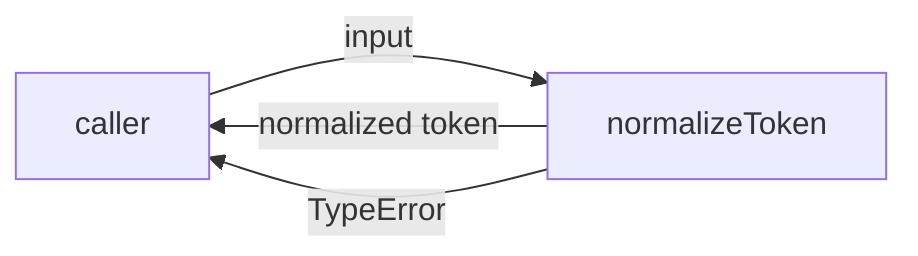
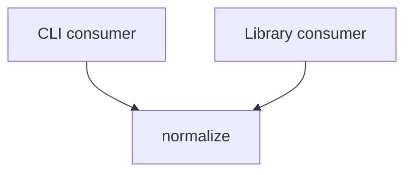

# Module: normalize

<!--SECTION:SPEC_ID-->
TOKEN-NORMALIZE
<!--/SECTION:SPEC_ID-->

<!--SECTION:MODULE_VISION-->
## Module Vision
This module owns the single deterministic token transformation of the `token` scope: `normalizeToken` trims leading and trailing ASCII spaces, lowercases ASCII letters, and collapses runs of ASCII spaces, underscores, and hyphens into one hyphen. The parent scope is [token](../token.spec.md); the scope has no sibling modules and this module has no child modules. The module owns no I/O, persistence, configuration, or external integration.
<!--/SECTION:MODULE_VISION-->

<!--SECTION:OVERVIEW-->
## Overview

_Главный путь нормализации одного токена — NOR-REQ-1, NOR-REQ-2._
<!--/SECTION:OVERVIEW-->

<!--SECTION:MODULE_USAGE_EXAMPLE-->
## Module Usage Example
```ts
import { normalizeToken } from "./normalize.js";

const token = normalizeToken("  Foo__BAR  ");
console.log(token);

try {
  normalizeToken("");
} catch (error) {
  if (!(error instanceof TypeError)) throw error;
  console.error("invalid token");
}
```
<!--/SECTION:MODULE_USAGE_EXAMPLE-->

<!--SECTION:MODULE_REQUIREMENTS-->
## Requirements
### NOR-REQ-1 [должен]
**Когда** на вход передана ASCII-строка, содержащая хотя бы один символ, отличный от пробела, underscore и hyphen, **нормализатор должен** обрезать крайние пробелы, привести ASCII-буквы к нижнему регистру и свернуть каждую серию пробелов, underscore и hyphen в один hyphen.

> Реализует TOK-REQ-1 в границах модуля normalize: один детерминированный токен нужен локальным CLI и библиотечным потребителям.

### NOR-REQ-2 [должен · нештатная]
**Если** входная строка пустая, состоит только из разделителей или содержит не-ASCII символ, **то нормализатор должен** выбросить TypeError без ввода-вывода.

> Реализует TOK-REQ-2: ошибочный вход нельзя маскировать пустым или частично нормализованным токеном.

| Input | Outcome |
|---|---|
| `"  Foo__BAR  "` | `"foo-bar"` |
| `""` | `TypeError` |
<!--/SECTION:MODULE_REQUIREMENTS-->

<!--SECTION:INTER_MODULE_DEPENDENCIES-->
## Inter-Module Dependencies
- **Depends on:** No modules.
- **Scope Reference (cross-scope):** None.
- **Provides to:** No sibling modules; the public function serves external CLI and library consumers.


_Внешние потребители вызывают normalize; рёбер между модулями нет._
<!--/SECTION:INTER_MODULE_DEPENDENCIES-->

<!--SECTION:ENTITY_INVENTORY-->
## Entity Inventory
_Это полный список сущностей модуля. Любое введение сущности execution-агентом помимо этого списка считается drift'ом и требует обновления spec._

| Name | Type | Purpose |
|------|------|---------|
| `normalizeToken` | Service | Чистая детерминированная нормализация входного токена |

Ошибки: throw TypeError → `normalizeToken`

Одна сущность, поэтому ER-скетч не рисуется: связей между сущностями нет.
<!--/SECTION:ENTITY_INVENTORY-->

<!--SECTION:ENTITY_SURFACES-->
## Entity Surfaces
The module exposes one service surface: the pure `normalizeToken` function.

<details>
<summary>Полные поверхности сущностей</summary>

### `normalizeToken`
- **Type:** Service
- **Purpose:** Преобразует одну ASCII-строку в нормализованный токен или отклоняет недопустимый вход.
- **Public Properties:** N/A
- **Public Operations:** Normalize one input string; trims outer ASCII spaces, lowercases ASCII letters, and collapses separator runs; throws TypeError for invalid input.
- **Lifecycle:** Created and owned by the caller for one call; no persistent state; terminates when the normalized string is returned or TypeError is thrown.
- **Events Emitted:** N/A
- **Errors & Degradation:** `TypeError` via throw, owned by `normalizeToken` and surfaced by the calling CLI or library consumer; no logging, fallback, or I/O.
- **Consumers:**
  - Internal: none — the module has no internal callers.
  - External: local CLI and library consumers.
- **Usage Waiver (external: CLI and library consumers):** Public module surface whose callers live outside this module.

</details>
<!--/SECTION:ENTITY_SURFACES-->

<!--SECTION:MODULE_CONTRACTS-->
## Module Contracts
No Ports or Adapters exist; one pure Service contract carries the normalization behavior.

Граф не рисуется: в модуле нет Port/Adapter, только Service `normalizeToken`.

Call Chain не рисуется: в инвентаре одна абстракция — `normalizeToken`.

<details>
<summary>Контракты DbC</summary>

### Services

#### Service: `normalizeToken`
- **Purpose:** Преобразует один входной токен и отклоняет недопустимый вход без побочных эффектов.
- **Consumers:** external: local CLI and library consumers
- **Runtime Backing:** `not-implemented`
- **Verification Levels:** `contract`, `unit`
- **Deferred Runtime Scope:** Всё объявленное поведение ожидает будущей реализации; этот артефакт не заявляет runtime.

**Contract (DbC)** — one block per operation:
- `normalizeToken`:
  - Pre: `input` is a string whose characters are all ASCII and which contains at least one character other than a space, underscore, or hyphen.
  - Post: Returns the input with leading and trailing ASCII spaces removed, ASCII letters lowercased, and every maximal run of ASCII spaces, underscores, or hyphens replaced by one hyphen.
  - On pre-violation: Throws TypeError before any I/O and returns no token.

**Invariants:** The operation is pure: it performs no I/O, mutates no external state, and equal inputs always produce equal outputs or the same TypeError outcome.

</details>
<!--/SECTION:MODULE_CONTRACTS-->

<!--SECTION:PUBLIC_OPTIONS-->
## Public Options & Policies
None: `normalizeToken` exposes no flags, options, policies, or configuration.

<details>
<summary>Опции и политики</summary>

No publicly observable options exist in v1. Unicode handling and configurable separators are out of scope, not deferred options.

</details>
<!--/SECTION:PUBLIC_OPTIONS-->

<!--SECTION:FILE_STRUCTURE-->
## File Structure
```
normalize/
├── normalize.ts
└── normalize.test.ts
```

**File Mapping:**
- `normalize/normalize.ts`: implementation of `normalizeToken`
- `normalize/normalize.test.ts`: unit tests for normalization and rejection behavior
<!--/SECTION:FILE_STRUCTURE-->

<!--SECTION:RESEARCH-->
## Research
No research documents were used for this bounded deterministic draft.
<!--/SECTION:RESEARCH-->

<!--SECTION:MODULE_DECISION_LOG-->
## Module Decision Log
One decision is recorded: the module uses a single pure function without a Port/Adapter layer.

<details>
<summary>Полные записи Decision Log</summary>

NOR-DL-1 2026-10-24 — no Port or Adapter layer for the pure normalizeToken function; где: specs/token/normalize/normalize.spec.md#module-contracts (почему: single deterministic transformation has no confirmed variability or test seam) [verdict: pending-operator].

</details>
<!--/SECTION:MODULE_DECISION_LOG-->

<!--SECTION:HANDOFF-->
## Handoff to Tasks
- **Implementation files to be created:** `normalize/normalize.ts`
- **Test files to be created:** `normalize/normalize.test.ts`
- **Stack dependencies:**
  - Language: `typescript` (resolves to `ai/directives/coding/typescript-rules.xml`)
  - Test framework: `node-test` (resolves to `ai/directives/testing/node-test.xml`)
- **Module Rules Additions:** None.
- **Open risks & validation needs:** No implementation exists, so runtime behavior is unverified until a future task; operator approval of this boundary is still pending.
- **Approval status:** pending-operator — no tickets created and no execution claimed.
<!--/SECTION:HANDOFF-->

<!--SECTION:IMPLEMENTATION_INSIGHTS-->
## Implementation Insights
Not applicable: no implementation exists yet, so there are no post-implementation learnings to record.
<!--/SECTION:IMPLEMENTATION_INSIGHTS-->
