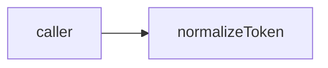

# token: library specification

<!--SECTION:SPEC_ID-->
TOKEN
<!--/SECTION:SPEC_ID-->

<!--SECTION:SCOPE_TYPE-->
## scope-type
library
<!--/SECTION:SCOPE_TYPE-->

<!--SECTION:VISION-->
## Vision & Primary Goal
A deterministic token normalizer for local CLI and library consumers; no network or persistence.
<!--/SECTION:VISION-->

<!--SECTION:OVERVIEW-->
## Overview

_Нормализация токена без состояния._
<!--/SECTION:OVERVIEW-->

<!--SECTION:GOLDEN_DX-->
## Target Experience
normalizeToken("  Foo__BAR  ") returns "foo-bar". Empty input throws TypeError. No setup or network.
<!--/SECTION:GOLDEN_DX-->

<!--SECTION:SCOPE_DEPENDENCIES-->
## Scope Dependencies
- **Depends on:** infra-base
- **Provides to:** CLI consumers.
[Authoring infrastructure](../infra-base/infra-base.spec.md)
<!--/SECTION:SCOPE_DEPENDENCIES-->

<!--SECTION:REQUIREMENTS_AND_CONSTRAINTS-->
## Requirements & Constraints
### TOK-REQ-1 [должен]
**Когда** передана ASCII-строка, которая содержит хотя бы один символ, отличный от пробела, underscore и hyphen, **нормализатор должен** обрезать крайние пробелы, привести буквы к lower-case и свернуть пробелы, underscore и hyphen в один hyphen.
> Один детерминированный формат токена нужен CLI и библиотечным потребителям.

### TOK-REQ-2 [должен · нештатная]
**Если** строка пустая, состоит из разделителей или содержит не-ASCII символы, **то нормализатор должен** выбросить TypeError без ввода-вывода.
> Ошибку входа нельзя маскировать пустым корректным токеном.

| Input | Outcome |
|---|---|
| `"  Foo__BAR  "` | `"foo-bar"` |
| `""` | `TypeError` |

### Out-of-Scope
- Unicode transliteration, network and persistent configuration.

### Runtime & Deferred Scope
Not implemented; no runtime claim.

### Rules
No additional activated rule set.
<!--/SECTION:REQUIREMENTS_AND_CONSTRAINTS-->

<!--SECTION:DATA_FLOW-->
## Data Flow

_Нормализация токена без состояния._
<!--/SECTION:DATA_FLOW-->

<!--SECTION:PUBLIC_API_SURFACE-->
## Public API Surface
`normalizeToken(input: string): string` throws TypeError for invalid input. No other exports.
<!--/SECTION:PUBLIC_API_SURFACE-->

<!--SECTION:ARCHITECTURE-->
## Architecture
One pure normalizeToken function. A stateful service was rejected because the transformation needs no state.

_Нормализация токена без состояния._
<!--/SECTION:ARCHITECTURE-->

<!--SECTION:MODULE_MAP-->
## Module Map
### Modules
- [normalize](normalize/normalize.spec.md) — token normalization.

### Inter-Module Dependency Map
No sibling dependencies.
<!--/SECTION:MODULE_MAP-->

<!--SECTION:RESEARCH-->
## Research
No research documents for this bounded deterministic draft.
<!--/SECTION:RESEARCH-->

<!--SECTION:DECISION_LOG-->
## Decision Log
TOK-DL-1 — keep authoring pending; no operator approval exists.

Boundary
Pure local operation; no implementation or approval claimed.

<!--/SECTION:DECISION_LOG-->

<!--SECTION:BOOTSTRAP_REQUIREMENTS-->
## Prerequisites
No external bootstrap required.

Bootstrap audit

The authoring fixture has no executable product code, package setup or external service prerequisite.

<!--/SECTION:BOOTSTRAP_REQUIREMENTS-->

<!--SECTION:HANDOFF-->
## Handoff to Modules
- **Status:** pending-operator
- **Operator decision:** pending
No tickets created or execution approved by this draft.
<!--/SECTION:HANDOFF-->
