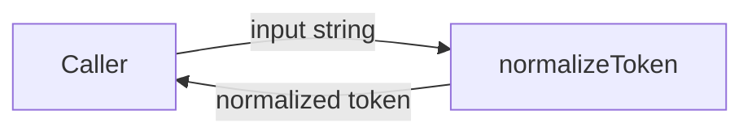
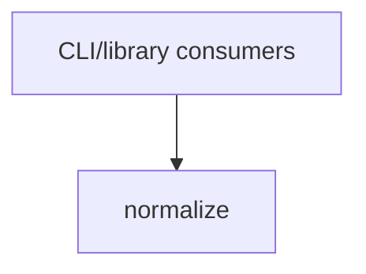

# Module: Normalize

<!--SECTION:SPEC_ID-->
TOKEN-NORMALIZE
<!--/SECTION:SPEC_ID-->

<!--SECTION:MODULE_VISION-->
## Module Vision
Owns deterministic normalization of one token: trim leading and trailing ASCII spaces, lowercase ASCII letters, and collapse runs of spaces, underscores and hyphens into a single hyphen, while rejecting empty, separator-only and non-ASCII input. Implements the `normalize` module of the [token scope](../token.spec.md). The scope has no sibling modules and this module has no child modules; it stays intentionally flat.
<!--/SECTION:MODULE_VISION-->

<!--SECTION:OVERVIEW-->
## Overview


_Главный путь нормализации токена — NOR-REQ-1._

<!--/SECTION:OVERVIEW-->

<!--SECTION:MODULE_USAGE_EXAMPLE-->
## Module Usage Example
```ts
import { normalizeToken } from "./normalize.js";

const token = normalizeToken("  Foo__BAR  ");
console.log(token); // "foo-bar"

try {
  normalizeToken("");
} catch (error) {
  // error is a TypeError; no I/O was attempted
  console.error("invalid token");
}
```
<!--/SECTION:MODULE_USAGE_EXAMPLE-->

<!--SECTION:MODULE_REQUIREMENTS-->
## Requirements
### NOR-REQ-1 [должен]
**Когда** передана непустая ASCII-строка, в которой после удаления крайних ASCII-пробелов остаётся хотя бы один символ, отличный от пробела, underscore и hyphen, **нормализатор должен** обрезать крайние ASCII-пробелы, привести ASCII-буквы к нижнему регистру и свернуть каждую последовательность пробелов, underscore и hyphen в один hyphen.

> Уточняет TOK-REQ-1: один детерминированный формат токена нужен локальным CLI и библиотечным потребителям без сети и состояния.

### NOR-REQ-2 [должен · нештатная]
**Если** входная строка пуста, состоит только из пробелов, underscore и hyphen или содержит хотя бы один не-ASCII символ, **то нормализатор должен** выбросить TypeError без любого ввода-вывода.

> Уточняет TOK-REQ-2: ошибку входа нельзя маскировать пустым или искажённым токеном.

| Input | Outcome |
|---|---|
| `"  Foo__BAR  "` | `"foo-bar"` |
| `""` | `TypeError` |
<!--/SECTION:MODULE_REQUIREMENTS-->

<!--SECTION:INTER_MODULE_DEPENDENCIES-->
## Inter-Module Dependencies
- **Depends on:** None.
- **Scope Reference (cross-scope):** None — the module uses only built-in language facilities and the token scope's public contract.
- **Provides to:** None within this scope; external CLI and library consumers use `normalizeToken` through the [token scope](../token.spec.md).


_Внешние потребители вызывают `normalizeToken` через публичный API скоупа token._
<!--/SECTION:INTER_MODULE_DEPENDENCIES-->

<!--SECTION:ENTITY_INVENTORY-->
## Entity Inventory
_Это полный список сущностей модуля. Любое введение сущности execution-агентом помимо этого списка считается drift'ом и требует обновления spec._

| Name | Type | Purpose |
|------|------|---------|
| `normalizeToken` | Function | Trim ASCII spaces, lowercase ASCII letters, collapse separator runs into one hyphen |

Ошибки: throw `TypeError` → `normalizeToken`

ER-набросок не рисуется: в инвентаре одна сущность, связывать её не с чем.
<!--/SECTION:ENTITY_INVENTORY-->

<!--SECTION:ENTITY_SURFACES-->
## Entity Surfaces
All observable behavior lives on the single pure function `normalizeToken`; full surface detail is folded below.

<details>
<summary>Полные поверхности сущностей</summary>

### `normalizeToken`
- **Type:** Function
- **Purpose:** Normalize one token deterministically with no external state or I/O.
- **Public Properties:** N/A
- **Public Operations:**
  - normalize a token: trim leading/trailing ASCII spaces, lowercase ASCII letters, collapse separator runs into one hyphen
- **Lifecycle:** Created per call; stateless; terminates when it returns the normalized token or throws.
- **Events Emitted:** N/A
- **Errors & Degradation:** `TypeError` thrown directly for empty, separator-only or non-ASCII input; no I/O is attempted and no other error mechanism is used.
- **Consumers:**
  - Internal: none — this is the module's only entity.
  - External: CLI and library consumers through the token scope public API.
- **Usage Waiver (external: CLI/library consumers via the token scope):** public entry point of this module; the implementation is not yet built.

</details>
<!--/SECTION:ENTITY_SURFACES-->

<!--SECTION:MODULE_CONTRACTS-->
## Module Contracts
The module defines one Service-style pure function, `normalizeToken`; it owns its behavior directly and has no Ports or Adapters.

Граф не рисуется: в модуле нет Port/Adapter, только Function `normalizeToken`.

Цепочка вызовов не рисуется: в инвентаре одна абстракция, порог ≥2 не пройден.

<details>
<summary>Контракты DbC</summary>

### Services

#### Service: `normalizeToken`
- **Purpose:** Normalize one token deterministically with no external state or I/O.
- **Consumers:** CLI and library consumers through the token scope public API.
- **Runtime Backing:** `not-implemented`
- **Verification Levels:** `contract`, `unit`
- **Deferred Runtime Scope:** The whole function is unimplemented; no runtime behavior is claimed.

**Contract (DbC)** — one block per operation:
- `normalizeToken`:
  - Pre: the input is a string; after trimming leading and trailing ASCII spaces it contains at least one character that is not a space, underscore or hyphen; every remaining character is ASCII.
  - Post: returns the token with leading and trailing ASCII spaces removed, ASCII letters lowercased, and every maximal run of spaces, underscores and hyphens replaced by one `-`; the result is deterministic and no I/O occurs.
  - On pre-violation: throws `TypeError` with no I/O when the input is empty, separator-only or contains a non-ASCII character.

**Invariants:** the function is pure and deterministic — the same input always yields the same token or the same `TypeError`, and it never performs I/O or mutates shared state.

</details>
<!--/SECTION:MODULE_CONTRACTS-->

<!--SECTION:PUBLIC_OPTIONS-->
## Public Options & Policies
No public flags, options or policies are configurable; the module exposes only `normalizeToken(input)`, whose behavior is fixed by NOR-REQ-1 and NOR-REQ-2.
<!--/SECTION:PUBLIC_OPTIONS-->

<!--SECTION:FILE_STRUCTURE-->
## File Structure
```
src/token/normalize/
└── normalize.ts
```

**File Mapping:**
- `src/token/normalize/normalize.ts`: exports `normalizeToken` and implements NOR-REQ-1 and NOR-REQ-2.
<!--/SECTION:FILE_STRUCTURE-->

<!--SECTION:RESEARCH-->
## Research
No research documents apply: the behavior is fully fixed by the bounded deterministic contract in the scope draft and `docs/token-contract.md`.
<!--/SECTION:RESEARCH-->

<!--SECTION:MODULE_DECISION_LOG-->
## Module Decision Log
One decision is recorded: the module uses a single pure Function with no Port or Adapter layer; the full entry is folded below.

<details>
<summary>Полные записи Decision Log</summary>

NOR-DL-1 2026-10-24 — single pure Function `normalizeToken` with no Port or Adapter (почему: stateless transform, no confirmed variability or test seam; отвергнуто: Port/Adapter layer — adds no seam for a pure function; риск: future variability would require a contract change).

</details>
<!--/SECTION:MODULE_DECISION_LOG-->

<!--SECTION:HANDOFF-->
## Handoff to Tasks
- **Implementation files to be created:** `src/token/normalize/normalize.ts`
- **Test files to be created:** `test/token/normalize/normalize.test.ts`
- **Stack dependencies:**
  - Language: `typescript` (resolves to `ai/directives/coding/typescript-rules.xml`)
  - Test framework: `node-test` (resolves to `ai/directives/testing/node-test.xml`)
- **Module Rules Additions:** None; no module-specific rules on top of the scope-wide baseline.

- **Open risks & validation needs:** No implementation is requested or present, so behavior is specified but not executed. The planned tests must cover the happy path, empty input, separator-only input and non-ASCII input without I/O. Operator approval remains pending; no ticket or execution is claimed.
<!--/SECTION:HANDOFF-->

<!--SECTION:IMPLEMENTATION_INSIGHTS-->
## Implementation Insights
Not applicable: no implementation has been performed, so there are no post-implementation learnings to record.
<!--/SECTION:IMPLEMENTATION_INSIGHTS-->
