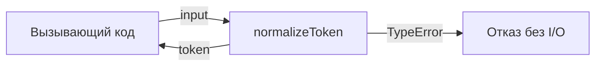
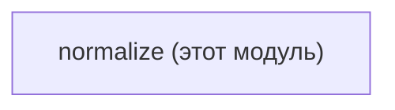

# Module: normalize

<!--SECTION:SPEC_ID-->
TOKEN-NORMALIZE
<!--/SECTION:SPEC_ID-->

<!--SECTION:MODULE_VISION-->
## Module Vision
Модуль владеет единственной операцией `normalizeToken`: детерминированной нормализацией ASCII-токена без состояния, сети и ввода-вывода. Он реализует поведение скоупа [token](../token.spec.md); родительская иерархия — скоуп `token`, дочерних модулей нет.
<!--/SECTION:MODULE_VISION-->

<!--SECTION:OVERVIEW-->
## Overview

_Нормализация токена и отказ на некорректном вводе — NOR-REQ-1, NOR-REQ-2._
<!--/SECTION:OVERVIEW-->

<!--SECTION:MODULE_USAGE_EXAMPLE-->
## Module Usage Example
```ts
import { normalizeToken } from './normalize.ts';

const token = normalizeToken('  Foo__BAR  ');
// token === 'foo-bar'

try {
  normalizeToken('');
} catch (error) {
  // error instanceof TypeError
}
```
<!--/SECTION:MODULE_USAGE_EXAMPLE-->

<!--SECTION:MODULE_REQUIREMENTS-->
## Requirements
### NOR-REQ-1 [должен]
**Когда** передана ASCII-строка, содержащая хотя бы один символ, отличный от пробела, underscore и hyphen, **нормализатор должен** обрезать крайние ASCII-пробелы, привести ASCII-буквы к lower-case и свернуть последовательности пробелов, underscore и hyphen в один hyphen.

> Уточняет TOK-REQ-1: один детерминированный формат токена нужен CLI и библиотечным потребителям.

### NOR-REQ-2 [должен · нештатная]
**Если** строка пустая, состоит только из разделителей или содержит не-ASCII символы, **то нормализатор должен** выбросить TypeError без ввода-вывода.

> Уточняет TOK-REQ-2: ошибочный вход нельзя маскировать пустым корректным токеном.

| Input | Outcome |
|---|---|
| `"  Foo__BAR  "` | `"foo-bar"` |
| `""` | `TypeError` |
<!--/SECTION:MODULE_REQUIREMENTS-->

<!--SECTION:INTER_MODULE_DEPENDENCIES-->
## Inter-Module Dependencies
- **Depends on:** No sibling modules.
- **Scope Reference (cross-scope):** No runtime scope dependency; [infra-base](../../infra-base/infra-base.spec.md) is referenced by the parent scope only as authoring infrastructure.
- **Provides to:** Local CLI and library consumers of the `token` scope.


_Модуль не зависит от других модулей скоупа._
<!--/SECTION:INTER_MODULE_DEPENDENCIES-->

<!--SECTION:ENTITY_INVENTORY-->
## Entity Inventory

_Это полный список сущностей модуля. Любое введение сущности execution-агентом помимо этого списка считается drift'ом и требует обновления spec._

| Name | Type | Purpose |
|------|------|---------|
| `normalizeToken` | Function | Детерминированно нормализует ASCII-токен и отвергает некорректный вход |

Ошибки: throw `TypeError` → `normalizeToken`

ER-набросок не нужен: в инвентаре одна сущность, связывать нечего.
<!--/SECTION:ENTITY_INVENTORY-->

<!--SECTION:ENTITY_SURFACES-->
## Entity Surfaces
Модуль предоставляет одну функцию `normalizeToken` с публичной операцией нормализации и явным отказом через `TypeError`.

<details>
<summary>Полные поверхности сущностей</summary>

### `normalizeToken`
- **Type:** Function
- **Purpose:** Детерминированно нормализует ASCII-токен и отвергает некорректный вход.
- **Public Properties:** N/A
- **Public Operations:** `normalizeToken`
- **Lifecycle:** Чистая функция без состояния: доступна после импорта модуля, отдельного создания или завершения нет.
- **Events Emitted:** N/A
- **Errors & Degradation:** `TypeError` через throw; владелец — `normalizeToken`, обработка остаётся вызывающему коду.
- **Consumers:**
  - Internal: `src/token/normalize/normalize.ts`
  - External: local CLI and library consumers

</details>
<!--/SECTION:ENTITY_SURFACES-->

<!--SECTION:MODULE_CONTRACTS-->
## Module Contracts
Модуль определяет один Service `normalizeToken`; Ports и Adapters отсутствуют, потому что вариативность реализации не подтверждена.

Граф не рисуется: в модуле нет Port/Adapter, только Service `normalizeToken`.

Call Chain не рисуется: в модуле одна абстракция `normalizeToken`, порог ≥2 не достигнут.

<details>
<summary>Контракты DbC</summary>

### Services

#### Service: `normalizeToken`
- **Purpose:** Детерминированно нормализует ASCII-токен и отвергает некорректный вход.
- **Consumers:** local CLI and library consumers
- **Runtime Backing:** `not-implemented`
- **Verification Levels:** `contract`, `unit`
- **Deferred Runtime Scope:** None

**Contract (DbC)** — one block per operation:
- `normalizeToken`:
  - Pre: input is a string whose characters are ASCII.
  - Post: returns the input with leading and trailing ASCII spaces removed, ASCII letters lowercased, and runs of spaces, underscores, and hyphens collapsed into one hyphen.
  - On pre-violation: throws TypeError before any I/O when the input is empty, separator-only, or contains a non-ASCII character.

</details>
<!--/SECTION:MODULE_CONTRACTS-->

<!--SECTION:PUBLIC_OPTIONS-->
## Public Options & Policies
Публичных опций нет: поведение `normalizeToken` фиксировано в v1 и не настраивается.
<!--/SECTION:PUBLIC_OPTIONS-->

<!--SECTION:FILE_STRUCTURE-->
## File Structure
```
src/token/normalize/
├── normalize.ts
└── normalize.test.ts
```

**File Mapping:**
- `src/token/normalize/normalize.ts`: реализация `normalizeToken`
- `src/token/normalize/normalize.test.ts`: тесты нормализации и отказа через `TypeError`
<!--/SECTION:FILE_STRUCTURE-->

<!--SECTION:RESEARCH-->
## Research
Not applicable: модуль не опирается на research-документы; его поведение полностью задано TOK-REQ-1 и TOK-REQ-2.
<!--/SECTION:RESEARCH-->

<!--SECTION:MODULE_DECISION_LOG-->
## Module Decision Log
Записей нет: модуль не принимает спорных автономных решений, а операторское согласование остаётся незавершённым.

<details>
<summary>Полные записи Decision Log</summary>

No module-level decisions recorded.

</details>
<!--/SECTION:MODULE_DECISION_LOG-->

<!--SECTION:HANDOFF-->
## Handoff to Tasks
- **Status:** pending-operator
- **Implementation files to be created:** `src/token/normalize/normalize.ts`
- **Test files to be created:** `src/token/normalize/normalize.test.ts`
- **Stack dependencies:**
  - Language: `typescript` (resolves to `ai/directives/coding/typescript-rules.xml`)
  - Test framework: `node-test` (resolves to `ai/directives/testing/node-test.xml`)
- **Module Rules Additions:** None
- **Open risks & validation needs:** Approval #1 и операторский handoff остаются pending; реализация, тикеты и execution не созданы. Отказ для separator-only и не-ASCII входа нужно проверить тестами при scaffold.
<!--/SECTION:HANDOFF-->

<!--SECTION:IMPLEMENTATION_INSIGHTS-->
## Implementation Insights
Not applicable: реализации ещё нет, поэтому post-implementation learnings отсутствуют.
<!--/SECTION:IMPLEMENTATION_INSIGHTS-->
