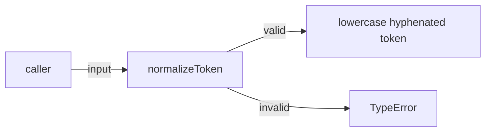
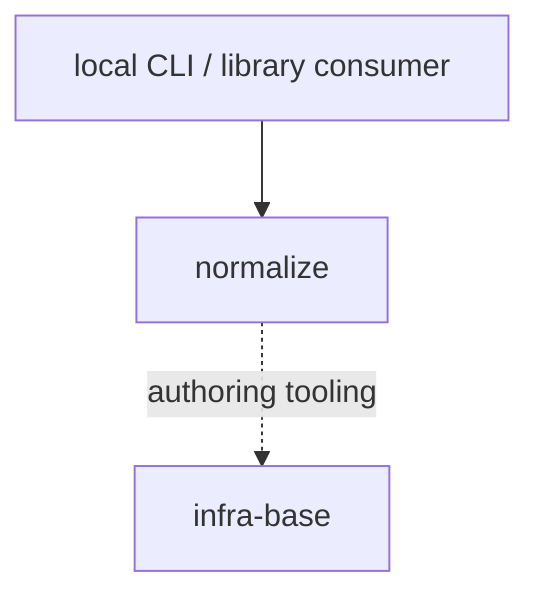

# Module: normalize

<!--SECTION:SPEC_ID-->
TOKEN-NORMALIZE
<!--/SECTION:SPEC_ID-->

<!--SECTION:MODULE_VISION-->
## Module Vision
Owns deterministic ASCII token normalization for the [token](../token.spec.md) library scope: one pure function turns valid input into a lowercase hyphen-separated token and rejects invalid input with TypeError. The module has no sibling, parent or child modules inside `token`; it exposes no state, network behavior or persistence.
<!--/SECTION:MODULE_VISION-->

<!--SECTION:OVERVIEW-->
## Overview

_Главный поток normalizeToken: валидный ввод становится токеном, невалидный — TypeError — NOR-REQ-1, NOR-REQ-2._
<!--/SECTION:OVERVIEW-->

<!--SECTION:MODULE_USAGE_EXAMPLE-->
## Module Usage Example
```ts
import { normalizeToken } from './normalize-token.ts';

const token = normalizeToken('  Foo__BAR  ');
console.log(token);

try {
  normalizeToken('');
} catch (error) {
  console.error(error instanceof TypeError ? 'invalid token' : error);
}
```
<!--/SECTION:MODULE_USAGE_EXAMPLE-->

<!--SECTION:MODULE_REQUIREMENTS-->
## Requirements
### NOR-REQ-1 [должен]
**Когда** передана строка, содержащая хотя бы один ASCII-символ, отличный от пробела, underscore и hyphen, и не содержащая не-ASCII символов, **нормализатор должен** обрезать ведущие и хвостовые ASCII-пробелы, привести ASCII-буквы к нижнему регистру и свернуть каждую последовательность ASCII-пробелов, underscore и hyphen в один hyphen.

> Уточняет TOK-REQ-1: модуль фиксирует точную форму одного токена и не выполняет транслитерацию.

### NOR-REQ-2 [должен · нештатная]
**Если** входная строка пустая, состоит только из разделителей (ASCII-пробелов, underscore и hyphen) или содержит хотя бы один не-ASCII символ, **то нормализатор должен** выбросить TypeError без ввода-вывода.

> Уточняет TOK-REQ-2: невалидный вход нельзя маскировать пустым или частично нормализованным токеном.

| Input | Outcome |
|---|---|
| `"  Foo__BAR  "` | `"foo-bar"` |
| `""` | `TypeError` |
<!--/SECTION:MODULE_REQUIREMENTS-->

<!--SECTION:INTER_MODULE_DEPENDENCIES-->
## Inter-Module Dependencies
- **Depends on:** None — `token` has no sibling modules in this draft.
- **Scope Reference (cross-scope):** [infra-base](../../infra-base/infra-base.spec.md) — local authoring tooling only; no runtime edge.
- **Provides to:** Local CLI and library consumers (outside this scope); no sibling modules.


_Границы normalize: внешние потребители вызывают функцию, зависимостей от соседних модулей нет._
<!--/SECTION:INTER_MODULE_DEPENDENCIES-->

<!--SECTION:ENTITY_INVENTORY-->
## Entity Inventory
_Это полный список сущностей модуля. Любое введение сущности execution-агентом помимо этого списка считается drift'ом и требует обновления spec._

| Name | Type | Purpose |
|------|------|---------|
| `normalizeToken` | Function | Pure ASCII token normalization and invalid-input rejection |

Ошибки: throw TypeError → `normalizeToken`.

ER-эскиз не рисуется: в инвентаре одна сущность, связывать её не с чем.
<!--/SECTION:ENTITY_INVENTORY-->

<!--SECTION:ENTITY_SURFACES-->
## Entity Surfaces
One public Function, `normalizeToken`; it has no state, emitted events or configurable surface.

<details>
<summary>Полные поверхности сущностей</summary>

### `normalizeToken`
- **Type:** Function
- **Purpose:** Convert one valid ASCII token into a lowercase hyphen-separated token or reject invalid input.
- **Public Properties:** N/A
- **Public Operations:** Normalize one token; reject empty, separator-only and non-ASCII input.
- **Lifecycle:** Imported by a consumer; stateless and terminated with the caller's process.
- **Events Emitted:** N/A
- **Errors & Degradation:** `TypeError` thrown by `normalizeToken` for empty, separator-only or non-ASCII input; the caller owns handling; no I/O occurs.
- **Consumers:**
  - Internal: none — the function is the module root.
  - External: local CLI and library consumers.
- **Usage Waiver (external: local CLI and library consumers):** The function is the module's sole public contract; its call sites live outside this module tree.

</details>
<!--/SECTION:ENTITY_SURFACES-->

<!--SECTION:MODULE_CONTRACTS-->
## Module Contracts
Defines one pure Service, `normalizeToken`; no Ports or Adapters because there is no confirmed variability, I/O or test seam.

Граф не рисуется: в модуле нет Port/Adapter, только Service `normalizeToken`.

Call Chain не рисуется: в модуле одна абстракция (Service `normalizeToken`), последовательность вызовов между абстракциями отсутствует.

<details>
<summary>Контракты DbC</summary>

### Services

#### Service: `normalizeToken`
- **Purpose:** Convert one valid ASCII token into a lowercase hyphen-separated token or reject invalid input.
- **Consumers:** External: local CLI and library consumers; Internal: none.
- **Runtime Backing:** `not-implemented`
- **Verification Levels:** `contract` | `unit`
- **Deferred Runtime Scope:** All behavior — no implementation is requested by this draft.
- **Usage Waiver (external: local CLI and library consumers):** The function is the module's sole public contract; its call sites live outside this module tree.

**Contract (DbC)**
- `normalizeToken`:
  - Pre: `input` is a string containing at least one ASCII character that is not a space, underscore or hyphen, and contains no non-ASCII characters.
  - Post: Returns the input with leading and trailing ASCII spaces removed, ASCII letters lowercased, and every run of ASCII spaces, underscores and hyphens replaced by one hyphen; performs no I/O.
  - On pre-violation: Throws `TypeError` without I/O.

**Invariants:** The function is pure and stateless: identical input yields the same result or the same TypeError, and no external state is read or written.

</details>
<!--/SECTION:MODULE_CONTRACTS-->

<!--SECTION:PUBLIC_OPTIONS-->
## Public Options & Policies
None — `normalizeToken` exposes no flags, options or policies in v1.

<details>
<summary>Опции и политики</summary>

No configurable behavior exists. The function accepts only the input string; any future option is deferred and not consumed in v1.

</details>
<!--/SECTION:PUBLIC_OPTIONS-->

<!--SECTION:FILE_STRUCTURE-->
## File Structure
```
src/token/normalize/
├── normalize-token.ts
└── normalize-token.test.ts
```

**File Mapping:**
- `src/token/normalize/normalize-token.ts`: `normalizeToken` implementation.
- `src/token/normalize/normalize-token.test.ts`: unit tests for valid normalization and TypeError rejection.
<!--/SECTION:FILE_STRUCTURE-->

<!--SECTION:RESEARCH-->
## Research
Not applicable — no research documents feed this bounded deterministic module.
<!--/SECTION:RESEARCH-->

<!--SECTION:MODULE_DECISION_LOG-->
## Module Decision Log
One decision recorded: no Port/Adapter layer for the pure function. Full entry folds below.

<details>
<summary>Полные записи Decision Log</summary>

NOR-DL-1 2026-10-24 — `normalizeToken` остаётся чистым Function/Service без Port, Adapter и состояния (почему: одна реализация, нет I/O, вариативности или подтверждённого тестового шва; отвергнуто: Port+Adapter ради тестового шва — преждевременная абстракция; риск: будущая замена алгоритма потребует прямой правки функции).

</details>
<!--/SECTION:MODULE_DECISION_LOG-->

<!--SECTION:HANDOFF-->
## Handoff to Tasks
- **Status:** pending-operator — no implementation, ticket creation, execution or operator approval is claimed.
- **Implementation files to be created:** `src/token/normalize/normalize-token.ts`
- **Test files to be created:** `src/token/normalize/normalize-token.test.ts`
- **Stack dependencies:**
  - Language: `typescript` (resolves to `ai/directives/coding/typescript-rules.xml`)
  - Test framework: `node-test` (resolves to `ai/directives/testing/node-test.xml`)
- **Module Rules Additions:** None — the TypeScript and node-test baselines cover this module.

- **Open risks & validation needs:** Implementation and test execution remain unstarted; behavior must be validated by the future task, including separator-only and non-ASCII rejection.
<!--/SECTION:HANDOFF-->

<!--SECTION:IMPLEMENTATION_INSIGHTS-->
## Implementation Insights
Not applicable — no implementation has occurred, so no post-implementation learnings exist.

<details>
<summary>Заметки по реализации</summary>

No implementation insights are available for this authoring-only draft.

</details>
<!--/SECTION:IMPLEMENTATION_INSIGHTS-->
