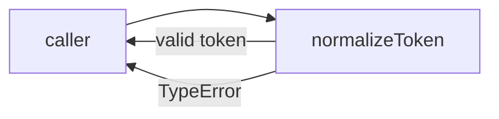
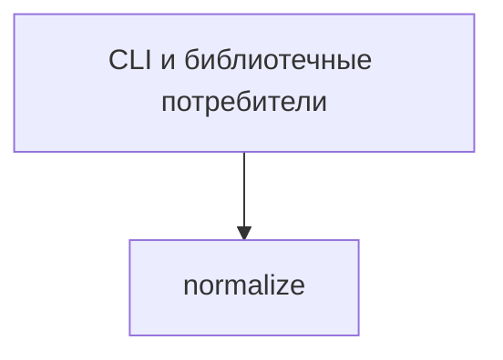

# Module: normalize

<!--SECTION:SPEC_ID-->
TOKEN-NORMALIZE
<!--/SECTION:SPEC_ID-->

<!--SECTION:MODULE_VISION-->
## Module Vision
Модуль `normalize` владеет детерминированной нормализацией ASCII-токена внутри скоупа [token](../token.spec.md). Родительских, дочерних и соседних модулей нет: это плоский модуль с одной публичной функцией.
<!--/SECTION:MODULE_VISION-->

<!--SECTION:OVERVIEW-->
## Overview

_Главный путь модуля: вход нормализуется либо отклоняется — NOR-REQ-1, NOR-REQ-2._
<!--/SECTION:OVERVIEW-->

<!--SECTION:MODULE_USAGE_EXAMPLE-->
## Module Usage Example
```ts
import { normalizeToken } from "./normalize.js";

const token = normalizeToken("  Foo__BAR  ");
console.log(token);

try {
  normalizeToken("");
} catch (error) {
  if (!(error instanceof TypeError)) throw error;
  console.error("invalid token input");
}
```
<!--/SECTION:MODULE_USAGE_EXAMPLE-->

<!--SECTION:MODULE_REQUIREMENTS-->
## Requirements
### NOR-REQ-1 [должен]
**Когда** передана непустая ASCII-строка, которая содержит хотя бы один символ, отличный от ASCII-пробела, underscore и hyphen, **нормализатор должен** обрезать ведущие и хвостовые ASCII-пробелы, привести ASCII-буквы к нижнему регистру и свернуть серии ASCII-пробелов, underscore и hyphen в один hyphen.

> Уточняет TOK-REQ-1: модуль владеет единственным детерминированным преобразованием токена; без него потребители получают разные написания одного токена.

### NOR-REQ-2 [должен · нештатная]
**Если** строка пустая, состоит только из ASCII-пробелов, underscore и hyphen или содержит не-ASCII символ, **то нормализатор должен** выбросить `TypeError` без ввода-вывода.

> Уточняет TOK-REQ-2: ошибку входа нельзя маскировать пустым или искажённым токеном.

Проверочные примеры:

| Input | Outcome |
|---|---|
| `"  Foo__BAR  "` | `"foo-bar"` |
| `""` | `TypeError` |
<!--/SECTION:MODULE_REQUIREMENTS-->

<!--SECTION:INTER_MODULE_DEPENDENCIES-->
## Inter-Module Dependencies
- **Depends on:** нет модулей-соседей внутри скоупа `token`.
- **Scope Reference (cross-scope):** нет runtime-зависимости; авторская зависимость скоупа от [infra-base](../../infra-base/infra-base.spec.md) в этот модуль не входит.
- **Provides to:** внешние CLI и библиотечные потребители; модулей-соседей внутри скоупа нет.


_Внешние потребители вызывают normalize; зависимостей от соседних модулей нет._
<!--/SECTION:INTER_MODULE_DEPENDENCIES-->

<!--SECTION:ENTITY_INVENTORY-->
## Entity Inventory

_Это полный список сущностей модуля. Любое введение сущности execution-агентом помимо этого списка считается drift'ом и требует обновления spec._

| Name | Type | Purpose |
|------|------|---------|
| `normalizeToken` | Function | Чистая нормализация ASCII-токена и отклонение недопустимого входа |

Ошибки: throw `TypeError` → `normalizeToken`

ER-скетч не рисуется: в инвентаре одна сущность без связей.
<!--/SECTION:ENTITY_INVENTORY-->

<!--SECTION:ENTITY_SURFACES-->
## Entity Surfaces
Одна публичная функция `normalizeToken`; полная поверхность раскрыта ниже.

<details>
<summary>Полные поверхности сущностей</summary>

### `normalizeToken`
- **Type:** Function
- **Purpose:** Детерминированно нормализовать ASCII-токен и отклонять недопустимый вход.
- **Public Properties:** N/A
- **Public Operations:**
  - нормализовать ASCII-токен;
  - отклонить пустой, separator-only или не-ASCII вход.
- **Lifecycle:** Создаётся при импорте модуля; состояния нет; завершается после возврата строки или `TypeError`.
- **Events Emitted:** N/A
- **Errors & Degradation:** `TypeError` через throw; владелец — `normalizeToken`.
- **Consumers:**
  - Internal: `src/token/normalize/normalize.ts`
  - External: CLI и библиотечные потребители
- **Usage Waiver (external: CLI и библиотечные потребители):** единственная публичная точка входа модуля, весь его контракт выражается этой функцией.

</details>
<!--/SECTION:ENTITY_SURFACES-->

<!--SECTION:MODULE_CONTRACTS-->
## Module Contracts
Один Service `normalizeToken` без Port/Adapter: чистое детерминированное преобразование без подтверждённой вариативности.

Граф не рисуется: в модуле нет Port/Adapter, только Service `normalizeToken`.

Call Chain не рисуется: в модуле одна абстракция (Service `normalizeToken`), порог ≥2 не достигнут.

<details>
<summary>Контракты DbC</summary>

### Services

#### Service: `normalizeToken`
- **Purpose:** Нормализовать ASCII-токен по фиксированным правилам и отклонять недопустимый вход.
- **Consumers:** `src/token/normalize/normalize.ts` · внешние CLI и библиотечные потребители
- **Runtime Backing:** `not-implemented`
- **Verification Levels:** `contract`, `unit`
- **Deferred Runtime Scope:** None

**Contract (DbC)** — one block per operation:
- `normalizeToken`:
  - Pre: вход — непустая ASCII-строка, содержащая хотя бы один символ, отличный от ASCII-пробела, underscore и hyphen.
  - Post: возвращает строку без ведущих и хвостовых ASCII-пробелов, с ASCII-буквами в нижнем регистре и с сериями ASCII-пробелов, underscore и hyphen, сведёнными к одному hyphen.
  - On pre-violation: выбрасывает `TypeError` без ввода-вывода.

**Invariants** (omit when none): функция не хранит состояние и не выполняет ввод-вывод.

</details>
<!--/SECTION:MODULE_CONTRACTS-->

<!--SECTION:PUBLIC_OPTIONS-->
## Public Options & Policies
Публичных опций в v1 нет: поведение фиксировано требованиями.

<details>
<summary>Опции и политики</summary>

Не применимо: модуль не предоставляет флагов, опций или настраиваемых политик.

</details>
<!--/SECTION:PUBLIC_OPTIONS-->

<!--SECTION:FILE_STRUCTURE-->
## File Structure
```
normalize/
└── normalize.ts
```

**File Mapping:**
- `src/token/normalize/normalize.ts`: чистая функция `normalizeToken`
<!--/SECTION:FILE_STRUCTURE-->

<!--SECTION:RESEARCH-->
## Research
Не применимо: ресёрч-документы этот модуль не питают; его контракт зафиксирован в [docs/token-contract.md](../../../docs/token-contract.md).
<!--/SECTION:RESEARCH-->

<!--SECTION:MODULE_DECISION_LOG-->
## Module Decision Log
Записано одно решение: чистая функция без Port/Adapter.

<details>
<summary>Полные записи Decision Log</summary>

NOR-DL-1 2026-10-24 — `normalizeToken` реализуется одной чистой функцией без Port/Adapter (почему: преобразование без состояния, вариативности и внешних зависимостей; отвергнуто: отдельный Port ради тестового шва — шва не требуется)

</details>
<!--/SECTION:MODULE_DECISION_LOG-->

<!--SECTION:HANDOFF-->
## Handoff to Tasks
- **Implementation files to be created:** `src/token/normalize/normalize.ts`
- **Test files to be created:** `test/token/normalize.test.ts`
- **Stack dependencies:**
  - Language: `typescript` (resolves to `ai/directives/coding/typescript-rules.xml`)
  - Test framework: `node-test` (resolves to `ai/directives/testing/node-test.xml`)
- **Module Rules Additions:** None

- **Open risks & validation needs:** Вход не-строкового типа не задан контрактом и требует уточнения перед реализацией. Операторское одобрение #1 не получено: спецификация остаётся pending-operator; тикеты не создавались, исполнение не начиналось.
<!--/SECTION:HANDOFF-->

<!--SECTION:IMPLEMENTATION_INSIGHTS-->
## Implementation Insights
Не применимо: реализация не начиналась, appendix заполняется только после audit-cycle compaction.

<details>
<summary>Заметки по реализации</summary>

Не применимо: post-implementation знаний пока нет.

</details>
<!--/SECTION:IMPLEMENTATION_INSIGHTS-->
