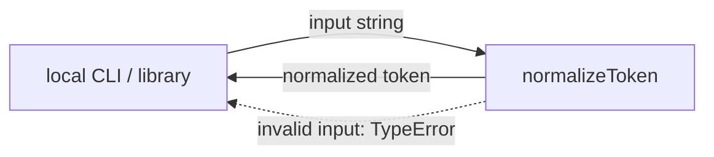
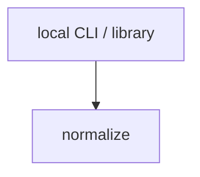

# Module: normalize

<!--SECTION:SPEC_ID-->
TOKEN-NORMALIZE
<!--/SECTION:SPEC_ID-->

<!--SECTION:MODULE_VISION-->
## Module Vision
Модуль `normalize` владеет единственной чистой операцией `normalizeToken`: локальная детерминированная нормализация ASCII-токена для CLI и библиотечных потребителей. Родительская спека — [token](../../token.spec.md); собственных parent/child-модулей нет, потому что модуль плоский и реализует одно неделимое преобразование.
<!--/SECTION:MODULE_VISION-->

<!--SECTION:OVERVIEW-->
## Overview


_Путь нормализации токена и отклонения недопустимого входа — NOR-REQ-1, NOR-REQ-2._
<!--/SECTION:OVERVIEW-->

<!--SECTION:MODULE_USAGE_EXAMPLE-->
## Module Usage Example
```ts
import { normalizeToken } from "./normalize";

const token = normalizeToken("  Foo__BAR  ");
console.log(token);

try {
  normalizeToken("");
} catch (error) {
  if (!(error instanceof TypeError)) throw error;
  console.error("invalid token");
}
```
<!--/SECTION:MODULE_USAGE_EXAMPLE-->

<!--SECTION:MODULE_REQUIREMENTS-->
## Requirements
### NOR-REQ-1 [должен]
**Когда** передана ASCII-строка, содержащая хотя бы один символ, отличный от пробела, underscore и hyphen, **нормализатор должен** обрезать ведущие и замыкающие ASCII-пробелы, привести ASCII-буквы к нижнему регистру и свернуть каждую серию пробелов, underscore и hyphen в один hyphen.
> Уточняет TOK-REQ-1: модуль фиксирует точную форму токена, которую CLI и библиотечные потребители получают без дополнительной обработки.

### NOR-REQ-2 [должен · нештатная]
**Если** входная строка пустая, состоит только из разделителей (пробел, underscore, hyphen) или содержит хотя бы один не-ASCII символ, **то нормализатор должен** выбросить TypeError без ввода-вывода.
> Уточняет TOK-REQ-2: недопустимый вход нельзя маскировать пустым или частично нормализованным токеном.

| Input | Outcome |
|---|---|
| `"  Foo__BAR  "` | `"foo-bar"` |
| `""` | `TypeError` |
<!--/SECTION:MODULE_REQUIREMENTS-->

<!--SECTION:INTER_MODULE_DEPENDENCIES-->
## Inter-Module Dependencies
- **Depends on:** none — внутри scope `token` других модулей нет.
- **Scope Reference (cross-scope):** none.
- **Provides to:** local CLI and library consumers.


_Модуль normalize не имеет внутренних зависимостей; внешние потребители вызывают его напрямую._
<!--/SECTION:INTER_MODULE_DEPENDENCIES-->

<!--SECTION:ENTITY_INVENTORY-->
## Entity Inventory
_Это полный список сущностей модуля. Любое введение сущности execution-агентом помимо этого списка считается drift'ом и требует обновления spec._

| Name | Type | Purpose |
|------|------|---------|
| `normalizeToken` | Function | Чистая нормализация ASCII-токена |

Ошибки: throw TypeError → `normalizeToken`

ER sketch не рисуется: в инвентаре одна сущность, связей нет.
<!--/SECTION:ENTITY_INVENTORY-->

<!--SECTION:ENTITY_SURFACES-->
## Entity Surfaces
Одна публичная функция `normalizeToken`; ниже — её полная поверхность.

<details>
<summary>Полные поверхности сущностей</summary>

### `normalizeToken`
- **Type:** Function
- **Purpose:** Нормализует ASCII-токен и отклоняет недопустимый вход без ввода-вывода.
- **Public Properties:** N/A
- **Public Operations:** normalizeToken(input: string): string
- **Lifecycle:** Загружается вместе с модулем, не хранит состояние и не имеет завершения.
- **Events Emitted:** N/A
- **Errors & Degradation:** TypeError через throw; вызывающий код обрабатывает ошибку, запасного ввода-вывода нет.
- **Consumers:**
  - External: local CLI and library consumers
- **Usage Waiver (external: local CLI and library consumers):** единственный публичный API модуля; нормализация — вся его ответственность.

</details>
<!--/SECTION:ENTITY_SURFACES-->

<!--SECTION:MODULE_CONTRACTS-->
## Module Contracts
Модуль определяет один Service `normalizeToken`; Port и Adapter отсутствуют.

Граф не рисуется: в модуле нет Port/Adapter, только Service `normalizeToken`.

Call Chain не рисуется: в инвентаре одна абстракция — Service `normalizeToken`.

<details>
<summary>Контракты DbC</summary>

### Services

#### Service: `normalizeToken`
- **Purpose:** Детерминированно приводит допустимый ASCII-токен к канонической форме.
- **Consumers:** local CLI and library consumers
- **Runtime Backing:** `not-implemented`
- **Verification Levels:** `contract`, `unit`
- **Deferred Runtime Scope:** всё поведение `normalizeToken`; реализации и тикетов пока нет.

**Contract (DbC)**
- `normalizeToken`:
  - Pre: вход — строка, содержащая только ASCII-символы и хотя бы один символ, отличный от пробела, underscore и hyphen.
  - Post: возвращена строка без ведущих и замыкающих ASCII-пробелов, с ASCII-буквами в нижнем регистре и каждой серией пробелов, underscore и hyphen, заменённой одним hyphen.
  - On pre-violation: выброшен TypeError без ввода-вывода.

**Invariants:** функция чистая: не выполняет ввода-вывода, не хранит состояние и при одинаковом входе возвращает одинаковый результат.

</details>
<!--/SECTION:MODULE_CONTRACTS-->

<!--SECTION:PUBLIC_OPTIONS-->
## Public Options & Policies
Не применимо: у `normalizeToken` нет публичных флагов, опций или политик.

<details>
<summary>Опции и политики</summary>

Публичных опций нет; поведение полностью фиксировано NOR-REQ-1 и NOR-REQ-2.

</details>
<!--/SECTION:PUBLIC_OPTIONS-->

<!--SECTION:FILE_STRUCTURE-->
## File Structure
```
src/token/normalize/
├── normalize.ts
└── normalize.test.ts
```

**File Mapping:**
- `src/token/normalize/normalize.ts`: чистая функция `normalizeToken`
- `src/token/normalize/normalize.test.ts`: unit-тесты нормализации и TypeError
<!--/SECTION:FILE_STRUCTURE-->

<!--SECTION:RESEARCH-->
## Research
Не применимо: ресёрч-документов для этого ограниченного детерминированного модуля нет.
<!--/SECTION:RESEARCH-->

<!--SECTION:MODULE_DECISION_LOG-->
## Module Decision Log
Модульных решений не записано: границы модуля следуют из scope `token` и брифа.

<details>
<summary>Полные записи Decision Log</summary>

Записей уровня модуля нет.

</details>
<!--/SECTION:MODULE_DECISION_LOG-->

<!--SECTION:HANDOFF-->
## Handoff to Tasks
- **Implementation files to be created:** `src/token/normalize/normalize.ts`
- **Test files to be created:** `src/token/normalize/normalize.test.ts`
- **Stack dependencies:**
  - Language: `typescript` (resolves to `ai/directives/coding/typescript-rules.xml`)
  - Test framework: `node-test` (resolves to `ai/directives/testing/node-test.xml`)
- **Module Rules Additions:** None.

- **Open risks & validation needs:** операторское одобрение не получено; язык и тест-фреймворк не объявлены в seed-файлах и приняты как TypeScript + node:test; реализация, тикеты и исполнение не созданы.
<!--/SECTION:HANDOFF-->

<!--SECTION:IMPLEMENTATION_INSIGHTS-->
## Implementation Insights
Не применимо: реализации ещё не было, извлекать уроки не из чего.

<details>
<summary>Заметки по реализации</summary>

Заметок нет.

</details>
<!--/SECTION:IMPLEMENTATION_INSIGHTS-->
