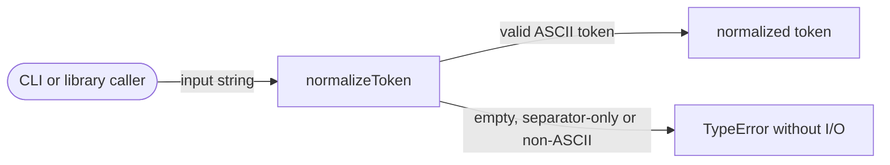
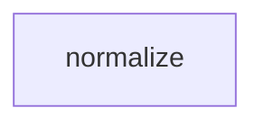

# Module: normalize

<!--SECTION:SPEC_ID-->
TOKEN-NORMALIZE
<!--/SECTION:SPEC_ID-->

<!--SECTION:MODULE_VISION-->
## Module Vision
Модуль `normalize` владеет единственной публичной операцией `normalizeToken(input: string): string` — детерминированной нормализацией ASCII-токена без состояния, сети и ввода-вывода. Родительский скоуп: [token](../token.spec.md); обязательства уточняют [REQUIREMENTS_AND_CONSTRAINTS](../token.spec.md#REQUIREMENTS_AND_CONSTRAINTS), публичная поверхность зафиксирована в [PUBLIC_API_SURFACE](../token.spec.md#PUBLIC_API_SURFACE), место в скоупе — в [MODULE_MAP](../token.spec.md#MODULE_MAP). Parent/child модулей нет: `normalize` — плоский модуль скоупа.
<!--/SECTION:MODULE_VISION-->

<!--SECTION:OVERVIEW-->
## Overview


_Один вызов возвращает нормализованный токен или завершается TypeError без I/O — NOR-REQ-1, NOR-REQ-2._
<!--/SECTION:OVERVIEW-->

<!--SECTION:MODULE_USAGE_EXAMPLE-->
## Module Usage Example
```ts
import { normalizeToken } from "./src/index.js";

const token = normalizeToken("  Foo__BAR  ");
console.log(token);

try {
  normalizeToken("");
} catch (error) {
  if (error instanceof TypeError) {
    console.error(error.message);
  }
}
```
<!--/SECTION:MODULE_USAGE_EXAMPLE-->

<!--SECTION:MODULE_REQUIREMENTS-->
## Requirements
### NOR-REQ-1 [должен]
**Когда** передана ASCII-строка, содержащая хотя бы один символ, отличный от ASCII-пробела, underscore и hyphen, **normalizeToken должен** обрезать ведущие и замыкающие ASCII-пробелы, привести ASCII-буквы к lower-case и свернуть каждый непрерывный набор ASCII-пробелов, underscore и hyphen в один hyphen.

> Уточняет TOK-REQ-1; сценарий `normalize-example`. Без единого детерминированного формата CLI и библиотечные потребители получают разные написания одного токена.

### NOR-REQ-2 [должен · нештатная]
**Если** входная строка пустая, состоит только из ASCII-пробелов, underscore и hyphen или содержит хотя бы один не-ASCII символ, **то normalizeToken должен** выбросить TypeError без ввода-вывода и без возврата токена.

> Уточняет TOK-REQ-2; сценарий `empty-input-rejection`. Ошибку входа нельзя маскировать пустым или искажённым токеном.

Строки покрывают сценарии `normalize-example` и `empty-input-rejection`.

| Input | Outcome |
|---|---|
| `"  Foo__BAR  "` | `"foo-bar"` |
| `""` | `TypeError` |
<!--/SECTION:MODULE_REQUIREMENTS-->

<!--SECTION:INTER_MODULE_DEPENDENCIES-->
## Inter-Module Dependencies
- **Depends on:** нет; sibling-модулей в скоупе `token` нет.
- **Scope Reference (cross-scope):** нет.
- **Provides to:** нет; публичная операция потребляется напрямую CLI и библиотечными потребителями скоупа.


_Модуль `normalize` не имеет sibling-зависимостей и не предоставляет интерфейс другим модулям._
<!--/SECTION:INTER_MODULE_DEPENDENCIES-->

<!--SECTION:ENTITY_INVENTORY-->
## Entity Inventory

_Это полный список сущностей модуля. Любое введение сущности execution-агентом помимо этого списка считается drift'ом и требует обновления spec._

| Name | Type | Purpose |
|------|------|---------|
| `normalizeToken` | Function | Чистая нормализация одного ASCII-токена |

Ошибки: throw → normalizeToken.

Одна сущность — связей для ER-скетча нет.
<!--/SECTION:ENTITY_INVENTORY-->

<!--SECTION:ENTITY_SURFACES-->
## Entity Surfaces

Одна сущность: чистая функция `normalizeToken` с одной публичной операцией.

<details>
<summary>Полные поверхности сущностей</summary>

### `normalizeToken`
- **Type:** Function
- **Purpose:** Детерминированно нормализовать один валидный ASCII-токен.
- **Public Properties:** N/A
- **Public Operations:** нормализация строки в токен
- **Lifecycle:** создаётся при импорте модуля; состояние не хранит; завершается после каждого вызова.
- **Events Emitted:** N/A
- **Errors & Degradation:** `TypeError` через throw для пустого, separator-only или не-ASCII входа; обработку и отображение ошибки владеет вызывающий потребитель, модуль I/O не выполняет.
- **Consumers:**
  - Internal: `src/index.ts`
  - External: CLI и библиотечные потребители
- **Usage Waiver (external: CLI and library consumers):** единственная публичная операция модуля; без неё у модуля нет поверхности.

</details>
<!--/SECTION:ENTITY_SURFACES-->

<!--SECTION:MODULE_CONTRACTS-->
## Module Contracts

Модуль определяет один чистый Service `normalizeToken`; Ports и Adapters отсутствуют.

Граф не рисуется: в модуле нет Port/Adapter, только Service `normalizeToken`.

Call Chain не рисуется: в модуле одна абстракция — Service `normalizeToken`; единственный сценарий — прямой вызов функции.

<details>
<summary>Контракты DbC</summary>

### Services

#### Service: `normalizeToken`
- **Purpose:** Детерминированно нормализовать один валидный ASCII-токен.
- **Consumers:** `src/index.ts`; CLI и библиотечные потребители.
- **Runtime Backing:** `not-implemented`
- **Verification Levels:** `contract`, `unit`
- **Deferred Runtime Scope:** Вся реализация и исполняемая проверка отложены; спецификация не содержит кода.

**Contract (DbC)** — одна операция:
- `normalizeToken(input)`:
  - Pre: `input` — ASCII-строка, содержащая хотя бы один символ, отличный от ASCII-пробела, underscore и hyphen.
  - Post: ведущие и замыкающие ASCII-пробелы удалены, ASCII-буквы приведены к lower-case, каждый непрерывный набор ASCII-пробелов, underscore и hyphen заменён одним hyphen; остальные ASCII-символы сохранены без изменений.
  - On pre-violation: выброшен `TypeError` без ввода-вывода и без возврата токена.

**Invariants:** функция чистая и детерминированная; не читает и не пишет внешнее состояние, файлы или сеть.

</details>
<!--/SECTION:MODULE_CONTRACTS-->

<!--SECTION:PUBLIC_OPTIONS-->
## Public Options & Policies
Модуль не имеет настраиваемых опций или политик; поведение фиксировано контрактом `normalizeToken`.

<details>
<summary>Опции и политики</summary>

Публичных флагов и конфигурации нет; поведение полностью задано `NOR-REQ-1` и `NOR-REQ-2`. Опции не отложены и не планируются в этой спеке.
</details>
<!--/SECTION:PUBLIC_OPTIONS-->

<!--SECTION:FILE_STRUCTURE-->
## File Structure
```
normalize/
├── src/
│   ├── index.ts
│   └── normalize.ts
└── test/
    └── normalize.test.ts
```

**File Mapping:**
- `src/normalize.ts`: реализация `normalizeToken`
- `src/index.ts`: публичный реэкспорт `normalizeToken`
- `test/normalize.test.ts`: unit-тесты контракта и границ входа
<!--/SECTION:FILE_STRUCTURE-->

<!--SECTION:RESEARCH-->
## Research
Исследовательских документов нет: поведение ограничено детерминированным контрактом из брифа и родительского скоупа `token`.
<!--/SECTION:RESEARCH-->

<!--SECTION:MODULE_DECISION_LOG-->
## Module Decision Log
Одна запись: чистая функция без Port/Adapter.

<details>
<summary>Полные записи Decision Log</summary>

NOR-DL-1 2026-10-24 — Чистая функция `normalizeToken` без Port/Adapter и состояния (почему: одна детерминированная трансформация не имеет подтверждённой вариативности или тестового шва; отвергнуто: Port + Adapter — лишний слой без второй реализации; риск: нет для локального контракта без I/O)
</details>
<!--/SECTION:MODULE_DECISION_LOG-->

<!--SECTION:HANDOFF-->
## Handoff to Tasks
- **Status:** pending-operator — operator approval not given.
- **Operator decision:** pending.
- **Implementation files to be created:** `src/normalize.ts`, `src/index.ts`.
- **Test files to be created:** `test/normalize.test.ts`.
- **Stack dependencies:**
  - Language: `typescript` (resolves to `ai/directives/coding/typescript-rules.xml`)
  - Test framework: `node-test` (resolves to `ai/directives/testing/node-test.xml`)
- **Module Rules Additions:** None; scope-wide baseline applies.
- **Open risks & validation needs:** No implementation or runtime verification exists; the TypeError boundary for empty, separator-only and non-ASCII input must be covered by unit tests before implementation is claimed.
No tickets created and no execution approved by this draft.
<!--/SECTION:HANDOFF-->

<!--SECTION:IMPLEMENTATION_INSIGHTS-->
## Implementation Insights
Не применимо: реализации ещё нет, поэтому постимплементационных наблюдений нет.

<details>
<summary>Заметки по реализации</summary>

Не применимо: раздел заполняется после реализации и аудит-цикла; эта спека authored без кода.
</details>
<!--/SECTION:IMPLEMENTATION_INSIGHTS-->
