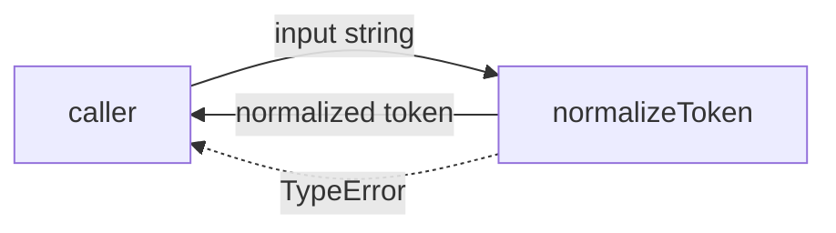
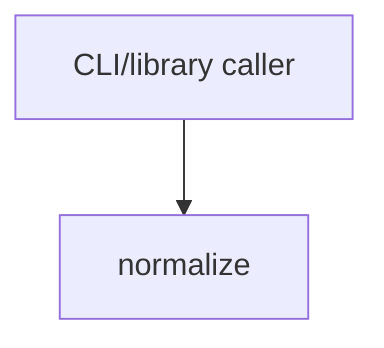

# Module: normalize

<!--SECTION:SPEC_ID-->
TOKEN-NORMALIZE
<!--/SECTION:SPEC_ID-->

<!--SECTION:MODULE_VISION-->
## Module Vision
`normalize` owns one deterministic transformation: turning a valid ASCII input string into a single
lowercase hyphen-separated token, and rejecting invalid input with `TypeError`. It is the only module
in [Scope](../token.spec.md) and has no sibling, parent or child modules; the scope's
[MODULE_MAP](../token.spec.md#MODULE_MAP) and [PUBLIC_API_SURFACE](../token.spec.md#PUBLIC_API_SURFACE)
remain its only routing points. It refines
[REQUIREMENTS_AND_CONSTRAINTS](../token.spec.md#REQUIREMENTS_AND_CONSTRAINTS).
<!--/SECTION:MODULE_VISION-->

<!--SECTION:OVERVIEW-->
## Overview


_Путь нормализации и отказа — NOR-REQ-1, NOR-REQ-2._
<!--/SECTION:OVERVIEW-->

<!--SECTION:MODULE_USAGE_EXAMPLE-->
## Module Usage Example
```ts
import { normalizeToken } from "./normalize.js";

const token = normalizeToken("  Foo__BAR  ");
console.log(token);

try {
  normalizeToken("");
} catch (error) {
  if (error instanceof TypeError) {
    console.error("invalid token input");
  }
}
```
<!--/SECTION:MODULE_USAGE_EXAMPLE-->

<!--SECTION:MODULE_REQUIREMENTS-->
## Requirements
### NOR-REQ-1 [должен]
**When** `normalizeToken` receives a string composed only of ASCII characters and containing at
least one character other than a space, underscore or hyphen, **the normalizer must** trim leading
and trailing ASCII spaces, lowercase ASCII letters, collapse every run of spaces, underscores and
hyphens into one hyphen, and preserve all other characters in order.
> Refines TOK-REQ-1: one deterministic token format for CLI and library consumers.

### NOR-REQ-2 [должен · нештатная]
**If** the input is empty, consists only of spaces, underscores or hyphens, or contains any
non-ASCII character, **then the normalizer must** throw `TypeError` without performing I/O or
returning a token.
> Refines TOK-REQ-2: invalid input must not be masked by an empty valid token.

| Input | Outcome |
|---|---|
| `"  Foo__BAR  "` | `"foo-bar"` |
| `""` | `TypeError` |
<!--/SECTION:MODULE_REQUIREMENTS-->

<!--SECTION:INTER_MODULE_DEPENDENCIES-->
## Inter-Module Dependencies
- **Depends on:** None — `token` has no sibling modules.
- **Scope Reference (cross-scope):** None — this module consumes no interface from another scope.
- **Provides to:** No sibling module; the exported function is consumed by CLI and library callers.


_Нормализатор вызывается потребителем и не имеет рёбер к соседним модулям._
<!--/SECTION:INTER_MODULE_DEPENDENCIES-->

<!--SECTION:ENTITY_INVENTORY-->
## Entity Inventory
_Это полный список сущностей модуля. Любое введение сущности execution-агентом помимо этого списка считается drift'ом и требует обновления spec._

| Name | Type | Purpose |
|------|------|---------|
| `normalizeToken` | Service | Pure normalization of one token; owns TypeError for invalid input. |

Ошибки: throw (TypeError) → normalizeToken
Single-entity inventory: no entity relations exist, so no ER sketch applies.
<!--/SECTION:ENTITY_INVENTORY-->

<!--SECTION:ENTITY_SURFACES-->
## Entity Surfaces
One public function covers the whole module surface; there are no other entities.

<details>
<summary>Полные поверхности сущностей</summary>

### `normalizeToken`
- **Type:** Service
- **Purpose:** Convert one valid ASCII input string into a lowercase hyphen-separated token.
- **Public Properties:** N/A
- **Public Operations:** Normalize one token from a string input.
- **Lifecycle:** Stateless pure call; created by import and terminated when the call returns or throws.
- **Events Emitted:** N/A
- **Errors & Degradation:** `TypeError` via throw for empty, separator-only or non-ASCII input; owned by `normalizeToken` and surfaced directly to the caller.
- **Consumers:**
  - Internal: none — this is the module's sole public export
  - External: CLI and library consumers
- **Usage Waiver (external: CLI and library consumers):** The module intentionally exposes exactly one public function; its external use is the module's contract.

</details>
<!--/SECTION:ENTITY_SURFACES-->

<!--SECTION:MODULE_CONTRACTS-->
## Module Contracts
One pure Service, `normalizeToken`; no Ports or Adapters define variability.

Граф зависимостей не рисуется: в модуле нет Port/Adapter, только Service `normalizeToken`.
Call Chain не применим: одна абстракция (Service `normalizeToken`), порог ≥2 не достигнут.

<details>
<summary>Контракты DbC</summary>

### Services

#### Service: `normalizeToken`
- **Purpose:** Deterministically normalize one ASCII token.
- **Consumers:** CLI and library callers.
- **Runtime Backing:** `not-implemented`
- **Verification Levels:** `contract`, `unit`
- **Deferred Runtime Scope:** None.

**Contract (DbC)** — one operation:
- `normalizeToken(input)`:
  - Pre: `input` is a string composed only of ASCII characters, and at least one character is neither a space, an underscore nor a hyphen.
  - Post: leading and trailing ASCII spaces are removed; ASCII letters are lowercase; every run of spaces, underscores and hyphens is replaced by one hyphen; all other characters keep their order; the result has no leading or trailing space and no repeated hyphen introduced by the collapse.
  - On pre-violation: throw `TypeError` with no I/O and no returned token, including empty, separator-only and non-ASCII input.

**Invariants:** The operation is pure and deterministic: equal input returns an equal output or the same `TypeError` class, with no I/O, no mutation of external state and no dependence on ambient configuration.

</details>
<!--/SECTION:MODULE_CONTRACTS-->

<!--SECTION:PUBLIC_OPTIONS-->
## Public Options & Policies
None — this module exposes no configurable flags, options or policies.

<details>
<summary>Опции и политики</summary>

No public options exist in v1; nothing is deferred because no option surface is planned.
</details>
<!--/SECTION:PUBLIC_OPTIONS-->

<!--SECTION:FILE_STRUCTURE-->
## File Structure
```text
src/token/normalize/
├── normalize.ts
└── normalize.test.ts
```

**File Mapping:**
- `src/token/normalize/normalize.ts`: pure `normalizeToken` implementation.
- `src/token/normalize/normalize.test.ts`: unit tests for successful normalization and TypeError paths.
<!--/SECTION:FILE_STRUCTURE-->

<!--SECTION:RESEARCH-->
## Research
Not applicable: this bounded deterministic draft has no research document, so no research row is needed.
<!--/SECTION:RESEARCH-->

<!--SECTION:MODULE_DECISION_LOG-->
## Module Decision Log
One recorded architecture choice: a single pure Service with no Port or Adapter.

<details>
<summary>Полные записи Decision Log</summary>

NOR-DL-1 2026-10-24 — implement `normalizeToken` as one pure Service without a Port or Adapter (почему: no confirmed variability or test seam justifies an abstraction; отвергнуто: Port with adapter; риск: a second normalization policy would require a later refactor).

</details>
<!--/SECTION:MODULE_DECISION_LOG-->

<!--SECTION:HANDOFF-->
## Handoff to Tasks
- **Implementation files to be created:** `src/token/normalize/normalize.ts`
- **Test files to be created:** `src/token/normalize/normalize.test.ts`
- **Stack dependencies:**
  - Language: `TypeScript` (resolves to `ai/directives/coding/typescript-rules.xml`)
  - Test framework: `node:test` (resolves to `ai/directives/testing/node-test.xml`)
- **Module Rules Additions:** None — the scope-wide baseline applies unchanged.

- **Open risks & validation needs:**
  - No implementation or execution was performed; the contract remains unverified.
  - The current `package.json` declares no TypeScript compiler or test script; scaffolding must add the toolchain before tests can run.
  - The scope defines only `string` input; behavior for non-string runtime values is outside this module's contract.

**Authoring/handoff status:** pending-operator — no approval or execution claim is made.
<!--/SECTION:HANDOFF-->

<!--SECTION:IMPLEMENTATION_INSIGHTS-->
## Implementation Insights
Not applicable: no implementation has been performed, so no post-implementation learnings exist.
<!--/SECTION:IMPLEMENTATION_INSIGHTS-->
