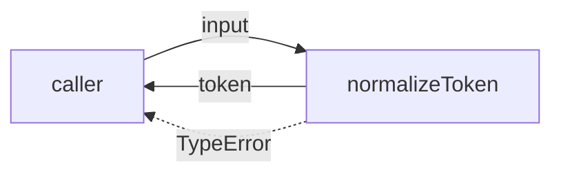
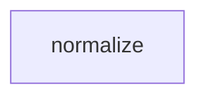

# Module: normalize

<!--SECTION:SPEC_ID-->
TOKEN-NORMALIZE
<!--/SECTION:SPEC_ID-->

<!--SECTION:MODULE_VISION-->
## Module Vision

Owns the single pure token-normalization function of the [token scope](../token.spec.md). `normalizeToken` is the module's whole public surface: it turns one valid ASCII token into the canonical lower-case hyphen-separated form and rejects invalid input without side effects. No other module, Port, Adapter or stateful service belongs here.

Parent scope: [Scope](../token.spec.md) · [REQUIREMENTS_AND_CONSTRAINTS](../token.spec.md#REQUIREMENTS_AND_CONSTRAINTS) · [PUBLIC_API_SURFACE](../token.spec.md#PUBLIC_API_SURFACE) · [MODULE_MAP](../token.spec.md#MODULE_MAP). No parent, sibling or child modules exist inside this scope.
<!--/SECTION:MODULE_VISION-->

<!--SECTION:OVERVIEW-->
## Overview


_Нормализация токена и отклонение недопустимого входа — NOR-REQ-1, NOR-REQ-2._
<!--/SECTION:OVERVIEW-->

<!--SECTION:MODULE_USAGE_EXAMPLE-->
## Module Usage Example

```ts
import { normalizeToken } from "./normalize";

const token = normalizeToken("  Foo__BAR  ");
console.log(token); // "foo-bar"

try {
  normalizeToken("");
} catch (error) {
  console.error(error instanceof TypeError ? "invalid token input" : error);
}
```
<!--/SECTION:MODULE_USAGE_EXAMPLE-->

<!--SECTION:MODULE_REQUIREMENTS-->
## Requirements

### NOR-REQ-1 [должен]
**Когда** передана непустая ASCII-строка, содержащая хотя бы один символ, отличный от ASCII-пробела, underscore и hyphen, **нормализатор должен** обрезать крайние ASCII-пробелы, привести ASCII-буквы к lower-case и свернуть каждую серию ASCII-пробелов, underscore и hyphen в один hyphen. Уточняет [TOK-REQ-1](../token.spec.md#REQUIREMENTS_AND_CONSTRAINTS).
> Один детерминированный формат токена нужен CLI и библиотечным потребителям.

### NOR-REQ-2 [должен · нештатная]
**Если** вход пустой, состоит только из ASCII-пробелов, underscore и hyphen или содержит не-ASCII символ, **то нормализатор должен** выбросить TypeError синхронно, без ввода-вывода и без частичного результата. Уточняет [TOK-REQ-2](../token.spec.md#REQUIREMENTS_AND_CONSTRAINTS).
> Ошибку входа нельзя маскировать пустым корректным токеном.

**Input / Outcome**

| Input | Outcome |
|---|---|
| `"  Foo__BAR  "` | `"foo-bar"` |
| `""` | `TypeError` |
<!--/SECTION:MODULE_REQUIREMENTS-->

<!--SECTION:INTER_MODULE_DEPENDENCIES-->
## Inter-Module Dependencies

- **Depends on:** None — no sibling modules exist in scope `token`.
- **Scope Reference (cross-scope):** None — [infra-base](../../infra-base/infra-base.spec.md) is authoring infrastructure, not a runtime interface dependency.
- **Provides to:** No sibling modules; `normalizeToken` is consumed directly by local CLI and library callers.


_Изолированный модуль: рёбер зависимости к другим модулям нет._
<!--/SECTION:INTER_MODULE_DEPENDENCIES-->

<!--SECTION:ENTITY_INVENTORY-->
## Entity Inventory

_Это полный список сущностей модуля. Любое введение сущности execution-агентом помимо этого списка считается drift'ом и требует обновления spec._

| Name | Type | Purpose |
|------|------|---------|
| `normalizeToken` | Function | Нормализует один ASCII-токен в lower-case форму с hyphen-разделителями |

Ошибки: throw (`TypeError`) → `normalizeToken` (передаёт вызывающему коду).

ER sketch not applicable: the inventory contains one entity, so there is no relation between entities to draw.
<!--/SECTION:ENTITY_INVENTORY-->

<!--SECTION:ENTITY_SURFACES-->
## Entity Surfaces

The module exposes one stateless Function; its full surface is folded below.

<details>
<summary>Полные поверхности сущностей</summary>

### `normalizeToken`
- **Type:** Function
- **Purpose:** Normalizes one valid ASCII token into a lower-case hyphen-separated form.
- **Public Properties:** N/A
- **Public Operations:** Normalize a token (trim, lower-case, collapse separators); reject invalid input with `TypeError`.
- **Lifecycle:** Stateless; the caller invokes it per input and it retains no state between calls.
- **Events Emitted:** N/A
- **Errors & Degradation:** `TypeError` thrown synchronously for empty, separator-only or non-ASCII input; the caller owns handling.
- **Consumers:**
  - Internal: N/A
  - External: local CLI and library callers
- **Usage Waiver (external: local CLI and library consumers):** Sole public entry point of this module; no internal call sites exist by design.

</details>
<!--/SECTION:ENTITY_SURFACES-->

<!--SECTION:MODULE_CONTRACTS-->
## Module Contracts

No Ports or Adapters: one pure Function `normalizeToken` owns the behavior directly.

Граф не рисуется: в модуле нет Port/Adapter, только Function `normalizeToken`.

Call Chain не рисуется: единственная абстракция — `normalizeToken`, порог в две абстракции не достигнут.

<details>
<summary>Контракты DbC</summary>

#### Service: `normalizeToken`
- **Purpose:** Transform one valid ASCII token into its canonical lower-case hyphen-separated form.
- **Consumers:** local CLI and library callers
- **Runtime Backing:** `not-implemented`
- **Verification Levels:** `contract`, `unit`
- **Deferred Runtime Scope:** All declared behavior — implementation is not requested in this authoring draft.

**Contract (DbC)**
- `normalizeToken`:
  - Pre: `input` is a string that contains at least one character other than an ASCII space, underscore or hyphen, and contains no non-ASCII character.
  - Post: returns a string with leading and trailing ASCII spaces removed, ASCII letters lower-cased, and every maximal run of ASCII spaces, underscores and hyphens replaced by one hyphen.
  - On pre-violation: throws `TypeError` synchronously, with no I/O and no partial result.

**Invariants:** Deterministic and pure: no I/O, network, persistence or retained state; equal valid input always yields an equal token.
</details>
<!--/SECTION:MODULE_CONTRACTS-->

<!--SECTION:PUBLIC_OPTIONS-->
## Public Options & Policies

None — `normalizeToken` exposes no configurable flags, options or policies.

<details>
<summary>Опции и политики</summary>

Not applicable: the module surface is one fixed function, and no option or policy is deferred.
</details>
<!--/SECTION:PUBLIC_OPTIONS-->

<!--SECTION:FILE_STRUCTURE-->
## File Structure
```
normalize/
├── normalize.ts
└── normalize.test.ts
```

**File Mapping:**
- `normalize/normalize.ts`: pure `normalizeToken` function and its TypeError validation
- `normalize/normalize.test.ts`: contract tests for the normalization and rejection paths
<!--/SECTION:FILE_STRUCTURE-->

<!--SECTION:RESEARCH-->
## Research

Not applicable: no research documents feed this bounded deterministic module.
<!--/SECTION:RESEARCH-->

<!--SECTION:MODULE_DECISION_LOG-->
## Module Decision Log

One decision recorded: the module uses a single pure Function instead of a Port/Adapter layer.

<details>
<summary>Полные записи Decision Log</summary>

NOR-DL-1 2026-10-24 — один чистый Function `normalizeToken` без Port/Adapter (почему: преобразование детерминированное, без состояния и внешней вариативности; отвергнуто: Port+Adapter — лишняя абстракция без второй реализации или тестового шва; риск: будущая смена стратегии нормализации потребует рефакторинга).

</details>
<!--/SECTION:MODULE_DECISION_LOG-->

<!--SECTION:HANDOFF-->
## Handoff to Tasks

- **Status:** pending-operator — authoring only; no operator approval given and no tickets created.
- **Implementation files to be created:** `normalize/normalize.ts`
- **Test files to be created:** `normalize/normalize.test.ts`
- **Stack dependencies:**
  - Language: `typescript` (resolves to `ai/directives/coding/typescript-rules.xml`)
  - Test framework: Not selected — no test framework is installed or chosen in this authoring-only draft.
- **Module Rules Additions:** None — no module-specific rules beyond the scope-wide baseline.
- **Open risks & validation needs:** No implementation or tests exist in this draft; non-ASCII rejection, empty-input rejection and separator-only rejection still need validation in a future test round. No runtime claim, operator approval or execution is made here.
<!--/SECTION:HANDOFF-->

<!--SECTION:IMPLEMENTATION_INSIGHTS-->
## Implementation Insights

Not applicable: no implementation has occurred, and this appendix is populated only after audit-cycle compaction.

<details>
<summary>Заметки по реализации</summary>

Not applicable — there are no post-implementation learnings yet.
</details>
<!--/SECTION:IMPLEMENTATION_INSIGHTS-->
