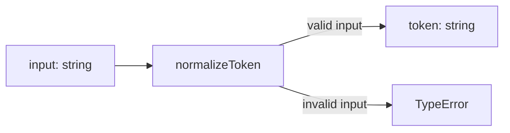
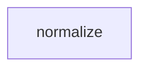

# Module: normalize

<!--SECTION:SPEC_ID-->
TOKEN-NORMALIZE
<!--/SECTION:SPEC_ID-->

<!--SECTION:MODULE_VISION-->
## Module Vision

Модуль владеет детерминированной нормализацией одного токена: обрезкой крайних ASCII-пробелов, приведением ASCII-букв к lower-case и свёрткой серий пробелов, underscore и hyphen в один hyphen. Модуль не выполняет ввод-вывод и не хранит состояние.

Родительский скоуп: [Scope](../token.spec.md). Родительские требования: [REQUIREMENTS_AND_CONSTRAINTS](../token.spec.md#REQUIREMENTS_AND_CONSTRAINTS). Публичная поверхность скоупа: [PUBLIC_API_SURFACE](../token.spec.md#PUBLIC_API_SURFACE). Место модуля в скоупе: [MODULE_MAP](../token.spec.md#MODULE_MAP).

Модуль плоский: родительских модулей внутри скоупа нет, дочерних модулей нет, соседних модулей с зависимостями нет.
<!--/SECTION:MODULE_VISION-->

<!--SECTION:OVERVIEW-->
## Overview


_Путь одного токена: валидный вход даёт нормализованную строку, невалидный — TypeError — NOR-REQ-1, NOR-REQ-2._
<!--/SECTION:OVERVIEW-->

<!--SECTION:MODULE_USAGE_EXAMPLE-->
## Module Usage Example

```ts
import { normalizeToken } from "./normalize.ts";

const token = normalizeToken("  Foo__BAR  ");
// token === "foo-bar"

try {
  normalizeToken("");
} catch (error) {
  // error instanceof TypeError
}
```
<!--/SECTION:MODULE_USAGE_EXAMPLE-->

<!--SECTION:MODULE_REQUIREMENTS-->
## Requirements

### NOR-REQ-1 [должен]
**Сценарий:** `normalize-example`.

**Когда** передана ASCII-строка, содержащая хотя бы один символ, отличный от пробела, underscore и hyphen, **нормализатор должен** обрезать ведущие и хвостовые ASCII-пробелы, привести ASCII-буквы к lower-case и свернуть серии пробелов, underscore и hyphen в один hyphen. Уточняет TOK-REQ-1.

### NOR-REQ-2 [должен · нештатная]
**Сценарий:** `empty-input-rejection`.

**Если** вход пустой, состоит только из разделителей (пробелов, underscore, hyphen) или содержит не-ASCII символы, **то нормализатор должен** выбросить TypeError без ввода-вывода. Уточняет TOK-REQ-2.

| Input | Outcome |
|---|---|
| `"  Foo__BAR  "` | `"foo-bar"` |
| `""` | `TypeError` |
<!--/SECTION:MODULE_REQUIREMENTS-->

<!--SECTION:INTER_MODULE_DEPENDENCIES-->
## Inter-Module Dependencies

- **Depends on:** ничего — у модуля нет зависимостей от соседних модулей внутри скоупа.
- **Scope Reference (cross-scope):** нет — модуль использует только требования скоупа [token](../token.spec.md).
- **Provides to:** ничего — модуль не предоставляет интерфейс соседним модулям.


_Плоский модуль без зависимостей от соседей._
<!--/SECTION:INTER_MODULE_DEPENDENCIES-->

<!--SECTION:ENTITY_INVENTORY-->
## Entity Inventory

_Это полный список сущностей модуля. Любое введение сущности execution-агентом помимо этого списка считается drift'ом и требует обновления spec._

| Name | Type | Purpose |
|------|------|---------|
| `normalizeToken` | Function | Нормализует один токен и отклоняет невалидный вход |

Ошибки: throw → `normalizeToken`.

ER-набросок не рисуется: в инвентаре одна сущность, связывать нечего.
<!--/SECTION:ENTITY_INVENTORY-->

<!--SECTION:ENTITY_SURFACES-->
## Entity Surfaces

Одна сущность: `normalizeToken` — чистая функция с публичной операцией нормализации и выбросом TypeError на невалидном входе.

<details>
<summary>Полные поверхности сущностей</summary>

### `normalizeToken`
- **Type:** Function
- **Purpose:** Детерминированно преобразует один токен в канонический lower-case hyphen-формат.
- **Public Properties:** N/A
- **Public Operations:** нормализовать входную строку; отклонить невалидный вход TypeError.
- **Lifecycle:** вызывается потребителем по требованию; состояние не создаётся и не завершается.
- **Events Emitted:** N/A
- **Errors & Degradation:** `TypeError` через throw, владелец — `normalizeToken`; вызывающий потребитель обрабатывает ошибку.
- **Consumers:**
  - Internal: `src/token/normalize/normalize.ts`
  - External: CLI и библиотечные потребители скоупа token

</details>
<!--/SECTION:ENTITY_SURFACES-->

<!--SECTION:MODULE_CONTRACTS-->
## Module Contracts

Модуль определяет один Service-подобный чистый Function `normalizeToken`; Ports и Adapters не определены.

Граф не рисуется: в модуле нет Port/Adapter, только Service `normalizeToken`.

Call Chain не рисуется: в инвентаре одна абстракция (`normalizeToken`), последовательности между абстракциями нет.

<details>
<summary>Контракты DbC</summary>

#### Service: `normalizeToken`
- **Purpose:** Преобразует валидный строковый токен в канонический формат и отклоняет невалидный вход.
- **Consumers:** `src/token/normalize/normalize.ts`; CLI и библиотечные потребители скоупа token.
- **Runtime Backing:** `not-implemented`
- **Verification Levels:** `contract`, `unit`
- **Deferred Runtime Scope:** Всё поведение модуля объявлено, но реализации и runtime пока нет.

**Contract (DbC)** — one block per operation:
- `normalizeToken`:
  - Pre: вход — ASCII-строка, содержащая хотя бы один символ, отличный от пробела, underscore и hyphen.
  - Post: ведущие и хвостовые ASCII-пробелы обрезаны; ASCII-буквы приведены к lower-case; серии пробелов, underscore и hyphen свёрнуты в один hyphen; ввод-вывод не выполняется.
  - On pre-violation: выбрасывается `TypeError` без ввода-вывода.

**Invariants:** функция детерминирована и не сохраняет состояние между вызовами — одинаковый валидный вход всегда даёт одинаковый результат.

</details>
<!--/SECTION:MODULE_CONTRACTS-->

<!--SECTION:PUBLIC_OPTIONS-->
## Public Options & Policies

Публичных опций и политик нет: `normalizeToken` не принимает флагов, настроек или переопределяемых правил.

<details>
<summary>Опции и политики</summary>

Не применимо: контракт модуля состоит из одной функции с фиксированным поведением; опции не объявлены и не отложены.

</details>
<!--/SECTION:PUBLIC_OPTIONS-->

<!--SECTION:FILE_STRUCTURE-->
## File Structure

```
src/token/normalize/
├── normalize.ts
└── normalize.test.ts
```

**File Mapping:**
- `src/token/normalize/normalize.ts`: реализация функции `normalizeToken`
- `src/token/normalize/normalize.test.ts`: тесты валидной нормализации и отклонения невалидного входа
<!--/SECTION:FILE_STRUCTURE-->

<!--SECTION:RESEARCH-->
## Research

Ресёрч не применим: для этого модуля нет research-документов; поведение выведено из требований родительского скоупа TOK-REQ-1 и TOK-REQ-2, поэтому реестр пуст.
<!--/SECTION:RESEARCH-->

<!--SECTION:MODULE_DECISION_LOG-->
## Module Decision Log

Записано одно решение: модуль остаётся одной чистой функцией без Port/Adapter.

<details>
<summary>Полные записи Decision Log</summary>

NOR-DL-1 2026-10-24 — `normalizeToken` остаётся одной чистой функцией без Port и Adapter (почему: детерминированное преобразование без состояния, внешнего ввода-вывода и подтверждённой вариативности; отвергнуто: Port с отдельным Adapter-слоем; риск: будущая альтернативная политика нормализации потребует нового контракта).

</details>
<!--/SECTION:MODULE_DECISION_LOG-->

<!--SECTION:HANDOFF-->
## Handoff to Tasks

- **Implementation files to be created:** `src/token/normalize/normalize.ts`
- **Test files to be created:** `src/token/normalize/normalize.test.ts`
- **Stack dependencies:**
  - Language: `typescript` (resolves to `ai/directives/coding/typescript-rules.xml`)
  - Test framework: `node-test` (resolves to `ai/directives/testing/node-test.xml`)
- **Module Rules Additions:** (additions on top of scope-wide baseline; `None` if no module-specific rules)

  | Rule | Category | Source |
  |------|----------|--------|
  | None | — | — |

- **Open risks & validation needs:** Реализация и runtime не создавались. Поведение для строк, которые начинаются или заканчиваются разделителем, но не состоят только из разделителей, в брифе не уточнено и требует подтверждения при реализации. Operator approval отсутствует; handoff остаётся pending.
<!--/SECTION:HANDOFF-->

<!--SECTION:IMPLEMENTATION_INSIGHTS-->
## Implementation Insights

Не применимо: реализации ещё нет, поэтому post-implementation наблюдений не существует; appendix заполняется только после audit-cycle compaction.

<details>
<summary>Заметки по реализации</summary>

Не применимо на этапе authoring: ни одной реализации или audit-cycle ещё не было.

</details>
<!--/SECTION:IMPLEMENTATION_INSIGHTS-->
