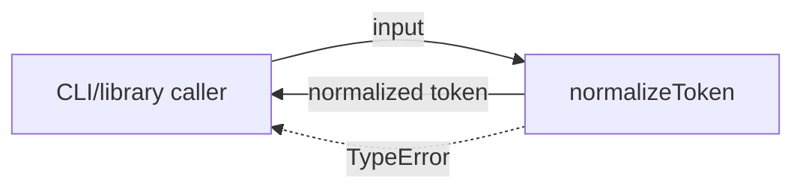
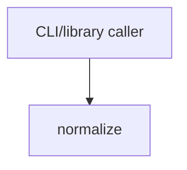

# Module: normalize

<!--SECTION:SPEC_ID-->
TOKEN-NORMALIZE
<!--/SECTION:SPEC_ID-->

<!--SECTION:MODULE_VISION-->
## Module Vision
Модуль `normalize` владеет единственной ответственностью scope [token](../token.spec.md): детерминированной нормализацией ASCII-токена без состояния и ввода-вывода. Он реализует [REQUIREMENTS_AND_CONSTRAINTS](../token.spec.md#REQUIREMENTS_AND_CONSTRAINTS) scope token и публикует единственную операцию `normalizeToken(input: string): string`. Других модулей, parent/child modules или sibling modules в этом scope нет; публичная поверхность описана в [PUBLIC_API_SURFACE](../token.spec.md#PUBLIC_API_SURFACE).
<!--/SECTION:MODULE_VISION-->

<!--SECTION:OVERVIEW-->
## Overview


_Путь нормализации токена и отказ на недопустимом входе — NOR-REQ-1, NOR-REQ-2._
<!--/SECTION:OVERVIEW-->

<!--SECTION:MODULE_USAGE_EXAMPLE-->
## Module Usage Example
Намеченное использование; реализации в этом проходе нет.

```ts
import { normalizeToken } from "./normalize.js";

const token = normalizeToken("  Foo__BAR  ");
console.log(token); // "foo-bar"

try {
  normalizeToken("");
} catch (error) {
  console.error(error instanceof TypeError); // true
}
```
<!--/SECTION:MODULE_USAGE_EXAMPLE-->

<!--SECTION:MODULE_REQUIREMENTS-->
## Requirements
### NOR-REQ-1 [должен]
**Когда** передана ASCII-строка, которая содержит хотя бы один символ, отличный от пробела, underscore и hyphen, **нормализатор должен** обрезать ведущие и замыкающие ASCII-пробелы, привести ASCII-буквы к lower-case и свернуть каждую серию пробелов, underscore и hyphen в один hyphen.

> Уточняет TOK-REQ-1 для модуля normalize: единственный успешный результат — нормализованный токен.

### NOR-REQ-2 [должен · нештатная]
**Если** вход пустой, состоит только из разделителей или содержит не-ASCII символы, **то нормализатор должен** выбросить TypeError без ввода-вывода.

> Уточняет TOK-REQ-2: ошибка входа не маскируется пустым корректным токеном.

| Input | Outcome |
|---|---|
| `"  Foo__BAR  "` | `"foo-bar"` |
| `""` | `TypeError` |
<!--/SECTION:MODULE_REQUIREMENTS-->

<!--SECTION:INTER_MODULE_DEPENDENCIES-->
## Inter-Module Dependencies
- **Depends on:** нет sibling modules в scope token.
- **Scope Reference (cross-scope):** нет; модуль локальный и чистый, cross-scope интерфейс не требуется.
- **Provides to:** внешних CLI и библиотечных потребителей scope token; sibling modules отсутствуют.


_Единственный модуль scope token и его внешний потребитель._
<!--/SECTION:INTER_MODULE_DEPENDENCIES-->

<!--SECTION:ENTITY_INVENTORY-->
## Entity Inventory
_Это полный список сущностей модуля. Любое введение сущности execution-агентом помимо этого списка считается drift'ом и требует обновления spec._

| Name | Type | Purpose |
|------|------|---------|
| `normalizeToken` | Service | Чистая нормализация ASCII-токена и отказ TypeError на недопустимом входе |

Ошибки: throw → `normalizeToken`

Единственная сущность inventory; ER-скетч не требуется, потому что связывать нечего.
<!--/SECTION:ENTITY_INVENTORY-->

<!--SECTION:ENTITY_SURFACES-->
## Entity Surfaces
Одна публичная сущность `normalizeToken`: чистая операция без состояния.

<details>
<summary>Полные поверхности сущностей</summary>

### `normalizeToken`
- **Type:** Service
- **Purpose:** Нормализует ASCII-токен и явно отвергает недопустимый вход.
- **Public Properties:** N/A
- **Public Operations:** `normalizeToken(input: string): string` — вернуть нормализованный токен или выбросить TypeError.
- **Lifecycle:** Состояния нет; сущность создаётся вызовом потребителя и завершается возвратом либо throw.
- **Events Emitted:** N/A
- **Errors & Degradation:** `TypeError` через throw; владелец — `normalizeToken`; ввод-вывод не выполняется.
- **Consumers:**
  - Internal: `src/token/normalize/normalize.ts` (запланирован; не реализован)
  - External: локальные CLI и библиотечные потребители
- **Usage Waiver (external: local CLI and library consumers):** единственная публичная операция модуля и его контракт.

</details>
<!--/SECTION:ENTITY_SURFACES-->

<!--SECTION:MODULE_CONTRACTS-->
## Module Contracts
Модуль определяет только Service `normalizeToken`; Ports и Adapters отсутствуют.

Граф не рисуется: в модуле нет Port/Adapter, только Service `normalizeToken`.

Цепочка вызовов не рисуется: единственная абстракция — Service `normalizeToken`, последовательных участников нет.

<details>
<summary>Контракты DbC</summary>

### Services

#### Service: `normalizeToken`
- **Purpose:** Детерминированно нормализовать ASCII-токен и отвергать недопустимый вход.
- **Consumers:** локальные CLI и библиотечные потребители.
- **Runtime Backing:** `not-implemented`
- **Verification Levels:** `contract`, `unit`
- **Deferred Runtime Scope:** Всё исполнение отложено; реализация в этом проходе не запрошена.

**Contract (DbC)**
- `normalizeToken`:
  - Pre: вход — строка из ASCII-символов, содержащая хотя бы один символ, отличный от пробела, underscore и hyphen.
  - Post: возвращена та же строка без ведущих и замыкающих ASCII-пробелов, с ASCII-буквами в lower-case и каждой серией пробелов, underscore и hyphen, заменённой одним hyphen.
  - On pre-violation: выброшен `TypeError`; ввод-вывод и частичный результат отсутствуют.

**Invariants:** операция чистая, детерминированная и не использует разделяемое состояние или ввод-вывод.

</details>
<!--/SECTION:MODULE_CONTRACTS-->

<!--SECTION:PUBLIC_OPTIONS-->
## Public Options & Policies
Публично настраиваемых опций и политик нет; поведение фиксировано TOK-REQ-1 и TOK-REQ-2.

<details>
<summary>Опции и политики</summary>

Не применимо: модуль не принимает флагов, режимов или конфигурации; единственный вход — `input`.

</details>
<!--/SECTION:PUBLIC_OPTIONS-->

<!--SECTION:FILE_STRUCTURE-->
## File Structure
```
src/token/normalize/
├── normalize.ts
└── normalize.test.ts
```

**File Mapping:**
- `src/token/normalize/normalize.ts`: реализация `normalizeToken` и проверки недопустимого входа.
- `src/token/normalize/normalize.test.ts`: contract/unit-тесты для NOR-REQ-1 и NOR-REQ-2.
<!--/SECTION:FILE_STRUCTURE-->

<!--SECTION:RESEARCH-->
## Research
Not applicable: для этого ограниченного детерминированного модуля нет research-документов и зарегистрированных источников.
<!--/SECTION:RESEARCH-->

<!--SECTION:MODULE_DECISION_LOG-->
## Module Decision Log
Module-level решения не записаны: границу чистого модуля уже фиксирует scope token.

<details>
<summary>Полные записи Decision Log</summary>

Записей `NOR-DL-*` нет. Handoff остаётся `pending-operator`; операторского решения или принятого риска нет.

</details>
<!--/SECTION:MODULE_DECISION_LOG-->

<!--SECTION:HANDOFF-->
## Handoff to Tasks
- **Implementation files to be created:** `src/token/normalize/normalize.ts`
- **Test files to be created:** `src/token/normalize/normalize.test.ts`
- **Stack dependencies:**
  - Language: `typescript` (resolves to `ai/directives/coding/typescript-rules.xml`)
  - Test framework: `node-test` (resolves to `ai/directives/testing/node-test.xml`)
- **Module Rules Additions:** None.

- **Open risks & validation needs:** Реализации нет; runtime-поведение не проверено. Запланированные пути `src/token/normalize/` и стек TypeScript/node-test — авторское допущение, ожидающее подтверждения оператора. Handoff — `pending-operator`; тикеты не созданы.
<!--/SECTION:HANDOFF-->

<!--SECTION:IMPLEMENTATION_INSIGHTS-->
## Implementation Insights
Not applicable: реализации ещё нет, post-implementation знаний не накоплено.

<details>
<summary>Заметки по реализации</summary>

Секция остаётся пустой по существу до появления реализации; заполнять её сейчас означало бы выдумать опыт, которого нет.

</details>
<!--/SECTION:IMPLEMENTATION_INSIGHTS-->
