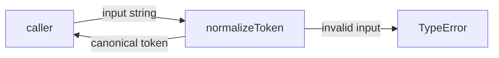
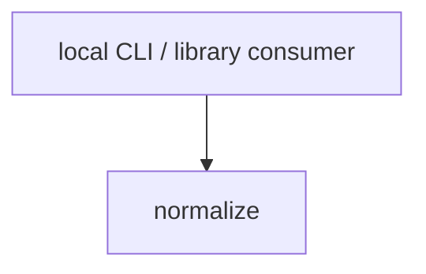

# Module: normalize

<!--SECTION:SPEC_ID-->
TOKEN-NORMALIZE
<!--/SECTION:SPEC_ID-->

<!--SECTION:MODULE_VISION-->
## Module Vision
`normalize` owns the deterministic ASCII token transformation for the [token](../token.spec.md) library scope: one public function turns a valid input string into its canonical token and rejects invalid input with `TypeError`. It owns no persistence, network access, logging, CLI wiring, or consumer composition. This is the only module listed in the parent [MODULE_MAP](../token.spec.md#MODULE_MAP); no sibling or child modules exist at this stage.
<!--/SECTION:MODULE_VISION-->

<!--SECTION:OVERVIEW-->
## Overview

_Нормализация одного токена без состояния — NOR-REQ-1, NOR-REQ-2._
<!--/SECTION:OVERVIEW-->

<!--SECTION:MODULE_USAGE_EXAMPLE-->
## Module Usage Example
```ts
import { normalizeToken } from "./normalize.ts";

const token = normalizeToken("  Foo__BAR  ");
if (token !== "foo-bar") throw new Error("unexpected normalization");

try {
  normalizeToken("");
} catch (error) {
  if (!(error instanceof TypeError)) throw error;
}
```

No initialization or cross-module setup is required; the function is called directly for the happy path and invalid input takes the visible error path.
<!--/SECTION:MODULE_USAGE_EXAMPLE-->

<!--SECTION:MODULE_REQUIREMENTS-->
## Requirements
### NOR-REQ-1 [должен]
**Когда** передана ASCII-строка, содержащая хотя бы один символ, отличный от ASCII-пробела, underscore и hyphen, **нормализатор должен** обрезать ведущие и замыкающие ASCII-пробелы, привести ASCII-буквы к нижнему регистру и свернуть каждый непрерывный набор ASCII-пробелов, underscore и hyphen в один hyphen.
> Уточняет TOK-REQ-1; отдельная публичная функция даёт локальным CLI и библиотечным потребителям один воспроизводимый формат токена.

### NOR-REQ-2 [должен · нештатная]
**Если** строка пустая, состоит только из ASCII-пробелов, underscore или hyphen либо содержит не-ASCII символ, **то нормализатор должен** выбросить `TypeError` до любого ввода-вывода.
> Уточняет TOK-REQ-2; ошибка входа не маскируется пустым корректным токеном.

| Input | Outcome |
|---|---|
| `"  Foo__BAR  "` | `"foo-bar"` |
| `""` | `TypeError` |
<!--/SECTION:MODULE_REQUIREMENTS-->

<!--SECTION:INTER_MODULE_DEPENDENCIES-->
## Inter-Module Dependencies
- **Depends on:** None. The module has no sibling-module edges.
- **Scope Reference (cross-scope):** None at runtime. The parent scope's [infra-base](../../infra-base/infra-base.spec.md) dependency supplies local authoring tooling only; `normalizeToken` does not call it.
- **Provides to:** None. Local CLI and library consumers use the function through the [token](../token.spec.md) scope public surface; no sibling module consumes it.


_Потребитель вызывает `normalize`; рёбер к соседним модулям нет._
<!--/SECTION:INTER_MODULE_DEPENDENCIES-->

<!--SECTION:ENTITY_INVENTORY-->
## Entity Inventory
_Это полный список сущностей модуля. Любое введение сущности execution-агентом помимо этого списка считается drift'ом и требует обновления spec._

| Name | Type | Purpose |
|------|------|---------|
| `normalizeToken` | Function | Нормализует ASCII-токен и отклоняет недопустимый вход через TypeError |

Ошибки: throw `TypeError` → `normalizeToken`

ER-эскиз не рисуется: в инвентаре одна сущность, связывать нечего.
<!--/SECTION:ENTITY_INVENTORY-->

<!--SECTION:ENTITY_SURFACES-->
## Entity Surfaces
`normalizeToken` — единственная публичная функция модуля; полная поверхность приведена ниже.

<details>
<summary>Полные поверхности сущностей</summary>

### `normalizeToken`
- **Type:** Function
- **Purpose:** Преобразует допустимую ASCII-строку в канонический токен и отклоняет недопустимый вход.
- **Public Properties:** N/A
- **Public Operations:** Normalize one token string into canonical lowercase form.
- **Lifecycle:** Created by module import; stateless, with no termination step.
- **Events Emitted:** N/A
- **Errors & Degradation:** `TypeError` via throw for empty, separator-only, or non-ASCII input; owned by `normalizeToken` and surfaced directly to the caller.
- **Consumers:**
  - Internal: `src/token/normalize/normalize.ts` (module implementation)
  - External: local CLI and library consumers
- **Usage Waiver (external: local CLI and library consumers):** the function is the named public contract of the scope, and every token consumer is expected to call it directly.

</details>
<!--/SECTION:ENTITY_SURFACES-->

<!--SECTION:MODULE_CONTRACTS-->
## Module Contracts
`normalizeToken` is the module's only Service; no Port or Adapter is defined because the scope exposes one pure function with no confirmed variability.

Граф не рисуется: в модуле нет Port/Adapter, только Service `normalizeToken`.

Call chain не рисуется: в модуле одна абстракция (`normalizeToken`), последовательных участников нет.

<details>
<summary>Контракты DbC</summary>

### Services
#### Service: `normalizeToken`
- **Purpose:** Преобразует допустимую ASCII-строку в канонический токен и отклоняет недопустимый вход.
- **Consumers:** internal `src/token/normalize/normalize.ts` · external local CLI and library consumers
- **Runtime Backing:** `not-implemented`
- **Verification Levels:** `contract`, `unit`
- **Deferred Runtime Scope:** All declared behavior; no implementation exists in this artifact.

**Contract (DbC)**
- `normalizeToken`:
  - Pre: `input` is a string in the valid domain — it contains at least one character other than ASCII space (U+0020), underscore, or hyphen, and every character is ASCII.
  - Post: returns the input with leading and trailing ASCII spaces removed, ASCII letters lowercased, and each contiguous run of ASCII spaces, underscores, and hyphens replaced by one hyphen.
  - On pre-violation: throws `TypeError` without I/O.

**Invariants:** The operation is pure; equal inputs produce equal outputs, and no network, filesystem, console, or mutable shared state is touched.

</details>
<!--/SECTION:MODULE_CONTRACTS-->

<!--SECTION:PUBLIC_OPTIONS-->
## Public Options & Policies
No public options: the behavior is fixed and not configurable.
<details>
<summary>Опции и политики</summary>

The module exposes no flags, environment variables, or policy hooks. Configuration is deferred / not consumed in v1; no activation ticket exists.
</details>
<!--/SECTION:PUBLIC_OPTIONS-->

<!--SECTION:FILE_STRUCTURE-->
## File Structure
```
src/token/normalize/
└── normalize.ts
```

**File Mapping:**
- `src/token/normalize/normalize.ts`: exports `normalizeToken` and owns input validation plus canonicalization.
<!--/SECTION:FILE_STRUCTURE-->

<!--SECTION:RESEARCH-->
## Research
No research documents. This bounded module is derived from the brief and the [token scope](../token.spec.md); no research registry entry exists for it.
<!--/SECTION:RESEARCH-->

<!--SECTION:MODULE_DECISION_LOG-->
## Module Decision Log
One architecture decision is recorded: the contract lives on the pure Service because no Port/Adapter variability is confirmed.
<details>
<summary>Полные записи Decision Log</summary>

NOR-DL-1 2026-10-24 — контракт размещён на чистой функции без Port/Adapter (почему: одна реализация и нет подтверждённой вариативности; отвергнуто: Port с единственным Adapter; риск: при появлении второй реализации потребуется выделить Port, поведение и публичная сигнатура не меняются).
</details>
<!--/SECTION:MODULE_DECISION_LOG-->

<!--SECTION:HANDOFF-->
## Handoff to Tasks
- **Implementation files to be created:** `src/token/normalize/normalize.ts`
- **Test files to be created:** `test/token/normalize/normalize.test.ts`
- **Stack dependencies:**
  - Language: `TypeScript` (resolves to `ai/directives/coding/typescript-rules.xml`)
  - Test framework: `node:test` (resolves to `ai/directives/testing/node-test.xml`)
- **Module Rules Additions:** None.
- **Open risks & validation needs:** Implementation and runtime verification are not performed by this artifact; operator approval remains pending.
- **Status:** pending-operator
- **Operator decision:** pending

No tickets created or execution approved by this draft.
<!--/SECTION:HANDOFF-->

<!--SECTION:IMPLEMENTATION_INSIGHTS-->
## Implementation Insights
Not applicable: no implementation exists yet, so there are no post-implementation learnings to preserve.
<!--/SECTION:IMPLEMENTATION_INSIGHTS-->
