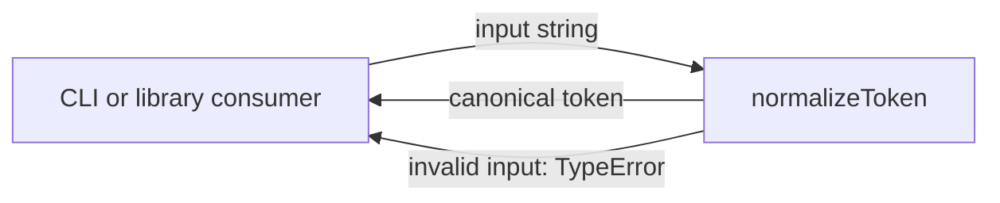
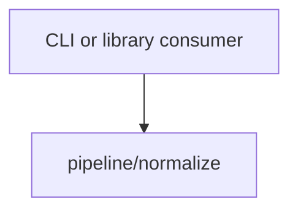

# Module: normalize

<!--SECTION:SPEC_ID-->
TOKEN-PIPELINE-NORMALIZE
<!--/SECTION:SPEC_ID-->

<!--SECTION:MODULE_VISION-->
## Module Vision
`pipeline/normalize` owns the single deterministic transformation that turns one raw ASCII token into its canonical form and rejects invalid input. It belongs to the `token` library scope ([`token` scope specification](../../token.spec.md)); the module has no child modules and no sibling modules in the current module map.
<!--/SECTION:MODULE_VISION-->

<!--SECTION:OVERVIEW-->
## Overview

_Нормализация токена и явный отказ на недопустимом вводе — NOR-REQ-1, NOR-REQ-2._
<!--/SECTION:OVERVIEW-->

<!--SECTION:MODULE_USAGE_EXAMPLE-->
## Module Usage Example
```ts
import { normalizeToken } from "./normalize.js";

const happyToken = normalizeToken("  Foo__BAR  ");
console.log(happyToken);

try {
  normalizeToken("");
} catch (error) {
  if (error instanceof TypeError) {
    console.error("invalid token input");
  }
}
```
<!--/SECTION:MODULE_USAGE_EXAMPLE-->

<!--SECTION:MODULE_REQUIREMENTS-->
## Requirements
### NOR-REQ-1 [должен]
**Когда** передана ASCII-строка, содержащая хотя бы один символ, отличный от пробела, underscore и hyphen, **нормализатор должен** обрезать ведущие и замыкающие ASCII-пробелы, привести ASCII-буквы к нижнему регистру и заменить каждую серию пробелов, underscore и hyphen одним hyphen.

> Сценарий `normalize-example` уточняет TOK-REQ-1: без единого детерминированного формата CLI и библиотечные потребители получают разные написания одного токена.

### NOR-REQ-2 [должен · нештатная]
**Если** входная строка пустая, состоит только из разделителей (ASCII-пробелов, underscore и hyphen) или содержит не-ASCII символы, **то нормализатор должен** выбросить TypeError без чтения или записи.

> Сценарий `empty-input-rejection` уточняет TOK-REQ-2: молчаливый пустой токен скрыл бы ошибку входа и выдал бы недопустимое значение за корректный результат.

| Input | Outcome |
|---|---|
| `"  Foo__BAR  "` | `"foo-bar"` |
| `""` | `TypeError` |
<!--/SECTION:MODULE_REQUIREMENTS-->

<!--SECTION:INTER_MODULE_DEPENDENCIES-->
## Inter-Module Dependencies
- **Depends on:** None — no sibling module in `token` is consumed.
- **Scope Reference (cross-scope):** None — the module does not consume an interface-type scope; `infra-base` supports authoring only.
- **Provides to:** None within this scope; external CLI and library consumers import the module's public function.


_Единственная зависимость модуля — внешний потребитель, вызывающий `normalizeToken`._
<!--/SECTION:INTER_MODULE_DEPENDENCIES-->

<!--SECTION:ENTITY_INVENTORY-->
## Entity Inventory

_Это полный список сущностей модуля. Любое введение сущности execution-агентом помимо этого списка считается drift'ом и требует обновления spec._

| Name | Type | Purpose |
|------|------|---------|
| `normalizeToken` | Function | Детерминированная нормализация ASCII-токена и отказ на недопустимом вводе |

Ошибки: throw `TypeError` → `normalizeToken`.

ER sketch: not drawn — the inventory contains one entity with no relational connections.
<!--/SECTION:ENTITY_INVENTORY-->

<!--SECTION:ENTITY_SURFACES-->
## Entity Surfaces
Одна публичная сущность `normalizeToken` с единственной операцией нормализации и отказом через `TypeError`.

<details>
<summary>Полные поверхности сущностей</summary>

### `normalizeToken`
- **Type:** Function
- **Purpose:** Преобразует одну ASCII-строку в канонический токен или отклоняет недопустимый ввод.
- **Public Properties:** N/A
- **Public Operations:** нормализовать переданную строку в канонический токен
- **Lifecycle:** Создаётся как функция без состояния при загрузке модуля; владелец — модуль `pipeline/normalize`; завершение не предусмотрено.
- **Events Emitted:** N/A
- **Errors & Degradation:** `TypeError` через throw; владелец `normalizeToken`; I/O не выполняется.
- **Consumers:**
  - Internal: `src/token/pipeline/normalize/normalize.ts`
  - External: CLI and library consumers
- **Usage Waiver (external: CLI and library consumers):** Публичная точка входа модуля составляет его единственную ответственность.

</details>
<!--/SECTION:ENTITY_SURFACES-->

<!--SECTION:MODULE_CONTRACTS-->
## Module Contracts
Модуль предоставляет один контракт — чистую функцию `normalizeToken`; Port и Adapter не вводятся.

Граф зависимостей не рисуется: в модуле нет Port/Adapter, только Service `normalizeToken`.

Call Chain не рисуется: в модуле одна абстракция, последовательность вызовов между абстракциями отсутствует.

<details>
<summary>Контракты DbC</summary>

### Service: `normalizeToken`
- **Purpose:** Детерминированно нормализовать ASCII-токен и отклонить недопустимый ввод.
- **Consumers:** `src/token/pipeline/normalize/normalize.ts`; CLI and library consumers.
- **Runtime Backing:** `not-implemented`
- **Verification Levels:** `contract`, `unit`
- **Deferred Runtime Scope:** Всё объявленное поведение `normalizeToken` — реализация не запрошена, runtime не заявлен.

**Contract (DbC)**
- `normalizeToken`:
  - Pre: Вход — строка, содержащая хотя бы один ASCII-символ, отличный от пробела, underscore и hyphen, и не содержащая не-ASCII символов.
  - Post: Ведущие и замыкающие ASCII-пробелы удалены, ASCII-буквы приведены к нижнему регистру, каждая серия пробелов, underscore и hyphen заменена одним hyphen.
  - On pre-violation: Выбрасывается `TypeError` без чтения или записи I/O.

</details>
<!--/SECTION:MODULE_CONTRACTS-->

<!--SECTION:PUBLIC_OPTIONS-->
## Public Options & Policies
Публичных опций и политик нет: единственный вход — аргумент `input`.

<details>
<summary>Опции и политики</summary>

Флаги, режимы и настраиваемые политики отсутствуют. `normalizeToken` не принимает опций помимо аргумента `input`.

</details>
<!--/SECTION:PUBLIC_OPTIONS-->

<!--SECTION:FILE_STRUCTURE-->
## File Structure
```
src/token/pipeline/normalize/
├── normalize.ts
└── normalize.test.ts
```

**File Mapping:**
- `src/token/pipeline/normalize/normalize.ts`: публичная функция `normalizeToken`
- `src/token/pipeline/normalize/normalize.test.ts`: unit-тесты контракта и негативных сценариев
<!--/SECTION:FILE_STRUCTURE-->

<!--SECTION:RESEARCH-->
## Research
No research documents; this bounded deterministic module needs no external research.
<!--/SECTION:RESEARCH-->

<!--SECTION:MODULE_DECISION_LOG-->
## Module Decision Log
Одна запись: модуль реализуется как чистая функция без Port/Adapter.

<details>
<summary>Полные записи Decision Log</summary>

NOR-DL-1 2026-10-24 — модуль реализуется как чистая функция без Port/Adapter; где: specs/token/pipeline/normalize/normalize.spec.md#module-contracts (почему: нет подтверждённой вариативности или тестового шва, трансформация не требует состояния) [verdict: pending-operator]

</details>
<!--/SECTION:MODULE_DECISION_LOG-->

<!--SECTION:HANDOFF-->
## Handoff to Tasks
- **Implementation files to be created:** `src/token/pipeline/normalize/normalize.ts`
- **Test files to be created:** `src/token/pipeline/normalize/normalize.test.ts`
- **Stack dependencies:**
  - Language: `typescript` (resolves to `ai/directives/coding/typescript-rules.xml`)
  - Test framework: `vitest` (resolves to `ai/directives/testing/vitest-rules.xml`)
- **Module Rules Additions:** None.
- **Open risks & validation needs:** Реализация не запрошена; поведение `TypeError` для пустого, separator-only и не-ASCII ввода должно быть подтверждено тестами. Operator approval pending.
- **Status:** pending-operator
<!--/SECTION:HANDOFF-->

<!--SECTION:IMPLEMENTATION_INSIGHTS-->
## Implementation Insights
Not applicable: no implementation exists yet; post-implementation insights are authored after audit-cycle compaction.

<details>
<summary>Заметки по реализации</summary>

Нет заметок: модуль ещё не реализован.

</details>
<!--/SECTION:IMPLEMENTATION_INSIGHTS-->
