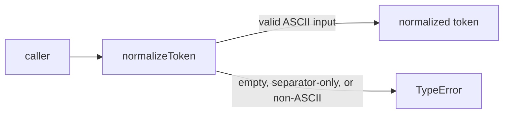
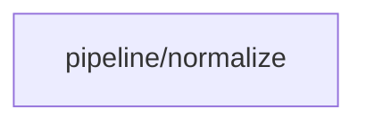

# Module: Token Normalization

<!--SECTION:SPEC_ID-->
TOKEN-PIPELINE-NORMALIZE
<!--/SECTION:SPEC_ID-->

<!--SECTION:MODULE_VISION-->
## Module Vision
Модуль владеет единственной чистой операцией нормализации ASCII-токена в скоупе [`token`](../../token.spec.md). Соседних, родительских или дочерних модулей у него нет: `pipeline/normalize` — единственный модуль, объявленный картой скоупа.
<!--/SECTION:MODULE_VISION-->

<!--SECTION:OVERVIEW-->
## Overview


_Путь одного вызова normalizeToken — NOR-REQ-1, NOR-REQ-2._
<!--/SECTION:OVERVIEW-->

<!--SECTION:MODULE_USAGE_EXAMPLE-->
## Module Usage Example
```ts
import { normalizeToken } from "./normalize.js";

const token = normalizeToken("  Foo__BAR  ");
if (token !== "foo-bar") {
  throw new Error("unexpected normalization result");
}

try {
  normalizeToken("");
  throw new Error("invalid input was accepted");
} catch (error) {
  if (!(error instanceof TypeError)) {
    throw error;
  }
}
```
<!--/SECTION:MODULE_USAGE_EXAMPLE-->

<!--SECTION:MODULE_REQUIREMENTS-->
## Requirements
### NOR-REQ-1 [должен]
**Когда** `normalizeToken` получает строку, содержащую хотя бы один ASCII-символ, отличный от пробела, underscore и hyphen, **то функция должна** обрезать крайние ASCII-пробелы, привести ASCII-буквы к lower-case и свернуть каждый прогон пробелов, underscore и hyphen в один hyphen.

> Уточняет родительское требование TOK-REQ-1: один детерминированный формат токена нужен CLI и библиотечным потребителям без настройки и состояния.

### NOR-REQ-2 [должен · нештатная]
**Если** входная строка пустая, состоит только из разделителей или содержит не-ASCII символ, **то `normalizeToken` должен** выбросить `TypeError` без ввода-вывода.

> Уточняет родительское требование TOK-REQ-2: ошибку входа нельзя маскировать пустым или искажённым корректным токеном.

| Input | Outcome |
|---|---|
| `"  Foo__BAR  "` | `"foo-bar"` |
| `""` | `TypeError` |
<!--/SECTION:MODULE_REQUIREMENTS-->

<!--SECTION:INTER_MODULE_DEPENDENCIES-->
## Inter-Module Dependencies
- **Depends on:** None — в скоупе `token` нет соседних модулей.
- **Scope Reference (cross-scope):** None — модуль не использует межскоупный интерфейс.
- **Provides to:** None — потребители находятся вне модульной карты скоупа: локальный CLI и библиотечный код.


_Модуль не имеет зависимостей от соседних модулей._
<!--/SECTION:INTER_MODULE_DEPENDENCIES-->

<!--SECTION:ENTITY_INVENTORY-->
## Entity Inventory

_Это полный список сущностей модуля. Любое введение сущности execution-агентом помимо этого списка считается drift'ом и требует обновления spec._

| Name | Type | Purpose |
|------|------|---------|
| `normalizeToken` | Function | Чистая нормализация ASCII-токена или выброс TypeError для недопустимого входа |

Ошибки: throw (`TypeError`) → `normalizeToken`

ER-набросок не рисуется: в инвентаре одна сущность, связывать нечего.
<!--/SECTION:ENTITY_INVENTORY-->

<!--SECTION:ENTITY_SURFACES-->
## Entity Surfaces
Одна публичная функция `normalizeToken`; полная поверхность раскрыта ниже.

<details>
<summary>Полные поверхности сущностей</summary>

### `normalizeToken`
- **Type:** Function
- **Purpose:** Преобразует допустимую ASCII-строку в нормализованный токен либо отклоняет недопустимый вход.
- **Public Properties:** N/A
- **Public Operations:** Нормализовать переданную строку в детерминированный токен.
- **Lifecycle:** Не хранит состояние; существует в пределах одного вызова и завершается при возврате или выбросе ошибки.
- **Events Emitted:** N/A
- **Errors & Degradation:** `TypeError` выбрасывается синхронно при пустом, разделительном или не-ASCII входе; обработка и отображение остаются у вызывающего кода.
- **Consumers:**
  - Internal: `src/token/pipeline/normalize/normalize.ts`
  - External: локальный CLI и библиотечные потребители
- **Usage Waiver (external: локальный CLI и библиотечные потребители):** Публичная точка входа модуля, реализующая TOK-REQ-1 и TOK-REQ-2; без неё модуль не предоставляет наблюдаемого поведения.

</details>
<!--/SECTION:ENTITY_SURFACES-->

<!--SECTION:MODULE_CONTRACTS-->
## Module Contracts
Модуль определяет один чистый Service `normalizeToken`; Port и Adapter не вводятся, потому что подтверждённой вариативности или test seam нет.

Граф не рисуется: в модуле нет Port/Adapter, только Service normalizeToken.

Call Chain не рисуется: в модуле одна абстракция — Service normalizeToken.

<details>
<summary>Контракты DbC</summary>

### Services

#### Service: `normalizeToken`
- **Purpose:** Нормализовать допустимый ASCII-токен и явно отклонять недопустимый вход.
- **Consumers:** `src/token/pipeline/normalize/normalize.ts`; локальный CLI и библиотечные потребители.
- **Runtime Backing:** `not-implemented`
- **Verification Levels:** `contract`, `unit`
- **Deferred Runtime Scope:** Всё объявленное поведение: реализация не запрошена и принадлежит будущим задачам.

**Contract (DbC)** — одна операция:
- `normalizeToken`:
  - Pre: Вход — строка, содержащая хотя бы один ASCII-символ, отличный от пробела, underscore и hyphen, и не содержащая не-ASCII символов.
  - Post: Возвращённая строка не имеет крайних ASCII-пробелов, содержит только lower-case ASCII-буквы и одиночные hyphen между фрагментами.
  - On pre-violation: Выбрасывается `TypeError` без файлового, сетевого или иного ввода-вывода.

**Invariants:** Операция чистая и детерминированная: одинаковый вход даёт одинаковый результат или одинаковый `TypeError`, без наблюдаемых побочных эффектов.

</details>
<!--/SECTION:MODULE_CONTRACTS-->

<!--SECTION:PUBLIC_OPTIONS-->
## Public Options & Policies
Публичных опций и политик нет: `normalizeToken` не принимает конфигурацию и всегда следует фиксированным правилам нормализации.

<details>
<summary>Опции и политики</summary>

Нет публично наблюдаемых флагов, опций или политик. Все правила закреплены контрактом `normalizeToken`; отложенных опций версии также нет.

</details>
<!--/SECTION:PUBLIC_OPTIONS-->

<!--SECTION:FILE_STRUCTURE-->
## File Structure
```
src/token/pipeline/normalize/
└── normalize.ts
```

**File Mapping:**
- `src/token/pipeline/normalize/normalize.ts`: чистая функция `normalizeToken` — единственный компонент модуля.
<!--/SECTION:FILE_STRUCTURE-->

<!--SECTION:RESEARCH-->
## Research
Not applicable: для этого ограниченного детерминированного модуля нет research-документов, на которые он опирается.
<!--/SECTION:RESEARCH-->

<!--SECTION:MODULE_DECISION_LOG-->
## Module Decision Log
Записан один выбор состава модуля: чистая функция без Port/Adapter.

<details>
<summary>Полные записи Decision Log</summary>

NOR-DL-1 2026-10-24 — не вводить Port/Adapter для одной чистой функции (почему: подтверждённой вариативности и test seam нет, родительский скоуп уже выбрал одну функцию; отвергнуто: Port ради одной реализации; риск: будущая замена реализации потребует изменить контракт модуля).

</details>
<!--/SECTION:MODULE_DECISION_LOG-->

<!--SECTION:HANDOFF-->
## Handoff to Tasks
- **Implementation files to be created:** `src/token/pipeline/normalize/normalize.ts`
- **Test files to be created:** `test/token/pipeline/normalize/normalize.test.ts`
- **Stack dependencies:**
  - Language: `typescript` (resolves to `ai/directives/coding/typescript-rules.xml`)
  - Test framework: `node-test` (resolves to `ai/directives/testing/node-test.xml`)
- **Module Rules Additions:** None; the scope-wide baseline applies without module-specific additions.
- **Open risks & validation needs:** Поведение не проверено исполнением: реализации и тестов ещё нет. Нужны проверки NOR-REQ-1 и NOR-REQ-2 после создания файлов.
- **Operator approval:** pending-operator — согласование модуля не получено; задачи не созданы и исполнение не разрешено.
<!--/SECTION:HANDOFF-->

<!--SECTION:IMPLEMENTATION_INSIGHTS-->
## Implementation Insights
Not applicable: реализации ещё не было, поэтому пост-имплементационных наблюдений нет.
<!--/SECTION:IMPLEMENTATION_INSIGHTS-->
