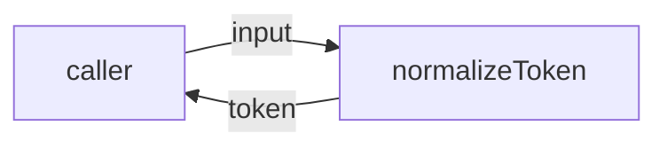
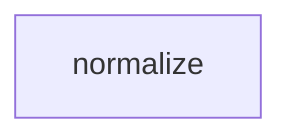

# Module: Normalize

<!--SECTION:SPEC_ID-->
TOKEN-PIPELINE-NORMALIZE
<!--/SECTION:SPEC_ID-->

<!--SECTION:MODULE_VISION-->
## Module Vision

Модуль владеет единственной ответственностью: детерминированной нормализацией входной строки в токен средствами чистой локальной функции. Сеть, файловый ввод-вывод, конфигурация и состояние отсутствуют.

Родительский скоуп: [token](../../token.spec.md). Parent/child modules отсутствуют: модуль плоский внутри `pipeline/normalize`.
<!--/SECTION:MODULE_VISION-->

<!--SECTION:OVERVIEW-->
## Overview


_Главный поток: вход нормализуется в строку или отклоняется TypeError — NOR-REQ-1, NOR-REQ-2._
<!--/SECTION:OVERVIEW-->

<!--SECTION:MODULE_USAGE_EXAMPLE-->
## Module Usage Example

```ts
import { normalizeToken } from "./normalize.js";

const token = normalizeToken("  Foo__BAR  ");
console.log(token);

try {
  normalizeToken("");
} catch (error) {
  if (error instanceof TypeError) {
    console.error(error.message);
  }
}
```
<!--/SECTION:MODULE_USAGE_EXAMPLE-->

<!--SECTION:MODULE_REQUIREMENTS-->
## Requirements

### NOR-REQ-1 [должен]
**Когда** передана непустая ASCII-строка, содержащая хотя бы один символ, отличный от пробела, underscore и hyphen, **нормализатор должен** обрезать крайние ASCII-пробелы, привести ASCII-буквы к lower-case и свернуть любые серии пробелов, underscore и hyphen в один hyphen. Уточняет TOK-REQ-1.
> Один детерминированный формат токена нужен CLI и библиотечным потребителям.

### NOR-REQ-2 [должен · нештатная]
**Если** строка пустая, состоит только из пробелов, underscore и hyphen или содержит не-ASCII символ, **то нормализатор должен** выбросить TypeError, не выполняя ввода-вывода. Уточняет TOK-REQ-2.
> Ошибку входа нельзя маскировать пустым корректным токеном.

| Input | Outcome |
|---|---|
| `"  Foo__BAR  "` | `"foo-bar"` |
| `""` | `TypeError` |
<!--/SECTION:MODULE_REQUIREMENTS-->

<!--SECTION:INTER_MODULE_DEPENDENCIES-->
## Inter-Module Dependencies

- **Depends on:** нет соседних модулей внутри скоупа `token`.
- **Scope Reference (cross-scope):** нет; модуль использует только собственный контракт.
- **Provides to:** нет; публичная поверхность предназначена внешним CLI/библиотечным потребителям скоупа.


_Соседних модулей нет: normalize изолирован._
<!--/SECTION:INTER_MODULE_DEPENDENCIES-->

<!--SECTION:ENTITY_INVENTORY-->
## Entity Inventory

_Это полный список сущностей модуля. Любое введение сущности execution-агентом помимо этого списка считается drift'ом и требует обновления spec._

| Name | Type | Purpose |
|------|------|---------|
| `normalizeToken` | Function | Детерминированная нормализация строки в токен |

Ошибки: throw → `normalizeToken`

ER-эскиз не рисуется: инвентарь состоит из одной сущности, связывать нечего.
<!--/SECTION:ENTITY_INVENTORY-->

<!--SECTION:ENTITY_SURFACES-->
## Entity Surfaces

Поверхность одна: публичная функция `normalizeToken` с детерминированным результатом или `TypeError`.

<details>
<summary>Полные поверхности сущностей</summary>

### `normalizeToken`
- **Type:** Function
- **Purpose:** Преобразует допустимую ASCII-строку в нормализованный токен.
- **Public Properties:** N/A
- **Public Operations:** нормализовать входную строку в токен
- **Lifecycle:** Вызывается потребителем; завершается возвратом строки либо исключением `TypeError`.
- **Events Emitted:** N/A
- **Errors & Degradation:** `TypeError` через throw; владелец — `normalizeToken`; сообщение различает пустой/разделительный вход и не-ASCII вход.
- **Consumers:**
  - Internal: `src/token/pipeline/normalize/normalize.test.ts`
  - External: token CLI/library consumers
- **Usage Waiver (external: token CLI/library consumers):** Единственная публичная операция модуля; отдельный Port не окупается.

</details>
<!--/SECTION:ENTITY_SURFACES-->

<!--SECTION:MODULE_CONTRACTS-->
## Module Contracts

Модуль определяет один Service `normalizeToken`; Port и Adapter отсутствуют, потому что нет подтверждённой вариативности или тестового шва.

Граф не рисуется: в модуле нет Port/Adapter, только Service `normalizeToken`.

Call Chain не рисуется: в инвентаре одна абстракция (`normalizeToken`), отдельной последовательности вызовов нет.

<details>
<summary>Контракты DbC</summary>

### Services

#### Service: `normalizeToken`
- **Purpose:** Детерминированно нормализовать допустимую ASCII-строку в токен.
- **Consumers:** `src/token/pipeline/normalize/normalize.test.ts`; token CLI/library consumers
- **Runtime Backing:** `not-implemented`
- **Verification Levels:** `contract`, `unit`
- **Deferred Runtime Scope:** Реализация не запрошена; поведение объявлено, но не исполняется.

**Contract (DbC)**
- `normalizeToken`:
  - Pre: Вход — строка, содержащая хотя бы один ASCII-символ, отличный от пробела, underscore и hyphen; все символы строки ASCII.
  - Post: Возвращает строку без крайних ASCII-пробелов, с ASCII-буквами в lower-case и любой серией пробелов, underscore и hyphen, заменённой одним hyphen.
  - On pre-violation: Выбрасывает `TypeError` без ввода-вывода.

**Invariants:** Функция чистая и детерминированная: один и тот же вход даёт один и тот же результат; состояние, сеть и файловый ввод-вывод не используются.

</details>
<!--/SECTION:MODULE_CONTRACTS-->

<!--SECTION:PUBLIC_OPTIONS-->
## Public Options & Policies

Не применимо: у модуля нет публичных флагов, опций или политик.

<details>
<summary>Опции и политики</summary>

Публичная поверхность ограничена `normalizeToken(input: string): string`; настройка не предусмотрена.
</details>
<!--/SECTION:PUBLIC_OPTIONS-->

<!--SECTION:FILE_STRUCTURE-->
## File Structure

```
src/token/pipeline/normalize/
├── normalize.ts
└── normalize.test.ts
```

**File Mapping:**
- `src/token/pipeline/normalize/normalize.ts`: реализация `normalizeToken`
- `src/token/pipeline/normalize/normalize.test.ts`: unit-тесты нормализации и отказа
<!--/SECTION:FILE_STRUCTURE-->

<!--SECTION:RESEARCH-->
## Research

Не применимо: для этого ограниченного детерминированного модуля research-документов нет.
<!--/SECTION:RESEARCH-->

<!--SECTION:MODULE_DECISION_LOG-->
## Module Decision Log

Зафиксировано одно решение: прямая функция без Port/Adapter.

<details>
<summary>Полные записи Decision Log</summary>

NOR-DL-1 2026-10-24 — нормализация реализуется одной чистой функцией normalizeToken без Port/Adapter; где: specs/token/pipeline/normalize/normalize.spec.md#module-contracts (почему: одна реализация, нет подтверждённой вариативности или тестового шва) [verdict: pending-operator].

</details>
<!--/SECTION:MODULE_DECISION_LOG-->

<!--SECTION:HANDOFF-->
## Handoff to Tasks

- **Implementation files to be created:** `src/token/pipeline/normalize/normalize.ts`
- **Test files to be created:** `src/token/pipeline/normalize/normalize.test.ts`
- **Stack dependencies:**
  - Language: `TypeScript` (resolves to `ai/directives/coding/typescript-rules.xml`)
  - Test framework: `node:test` (resolves to `ai/directives/testing/node-test.xml`)
- **Module Rules Additions:** None

- **Open risks & validation needs:** Границы ASCII и классификация не-ASCII входа должны быть подтверждены тестами; реализации ещё нет.
- **Approval:** pending-operator — оператор не одобрял модуль; тикеты и исполнение не созданы.
<!--/SECTION:HANDOFF-->

<!--SECTION:IMPLEMENTATION_INSIGHTS-->
## Implementation Insights

Не применимо: реализации ещё нет, post-implementation наблюдений не существует.

<details>
<summary>Заметки по реализации</summary>

Раздел не применим на этапе authoring: сохранять нечего до появления кода и его аудита.
</details>
<!--/SECTION:IMPLEMENTATION_INSIGHTS-->
