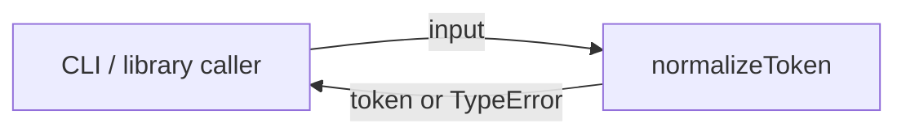
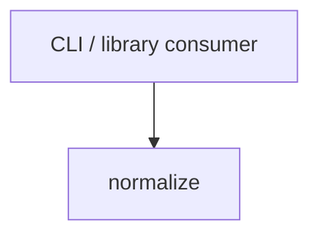

# Module: normalize

<!--SECTION:SPEC_ID-->
TOKEN-PIPELINE-NORMALIZE
<!--/SECTION:SPEC_ID-->

<!--SECTION:MODULE_VISION-->
## Module Vision
Модуль `pipeline/normalize` владеет единственной обязанностью — детерминированной нормализацией входного токена без сети, диска и состояния. Родительская спека: [token](../../token.spec.md). Родительских, дочерних и соседних модулей в скоупе нет.
<!--/SECTION:MODULE_VISION-->

<!--SECTION:OVERVIEW-->
## Overview

_Нормализация токена без состояния._
<!--/SECTION:OVERVIEW-->

<!--SECTION:MODULE_USAGE_EXAMPLE-->
## Module Usage Example
```ts
import { normalizeToken } from "./normalize.ts";

const token = normalizeToken("  Foo__BAR  ");
// token === "foo-bar"

try {
  normalizeToken("");
} catch (error) {
  // error instanceof TypeError
}
```
<!--/SECTION:MODULE_USAGE_EXAMPLE-->

<!--SECTION:MODULE_REQUIREMENTS-->
## Requirements
### NOR-REQ-1 [должен]
**Когда** передана ASCII-строка, содержащая хотя бы один символ, отличный от пробела, underscore и hyphen, **нормализатор должен** обрезать крайние ASCII-пробелы, привести ASCII-буквы к нижнему регистру и свернуть серии пробелов, underscore и hyphen в один hyphen.

> Уточняет TOK-REQ-1: модуль фиксирует наблюдаемый результат нормализации для локальных CLI- и библиотечных потребителей.

### NOR-REQ-2 [должен · нештатная]
**Если** входная строка пустая, состоит только из разделителей или содержит не-ASCII символ, **то нормализатор должен** выбросить TypeError без операций ввода-вывода.

> Уточняет TOK-REQ-2: ошибку входа нельзя маскировать пустым или искажённым корректным токеном.

Проверочные примеры:

| Input | Outcome |
|---|---|
| `"  Foo__BAR  "` | `"foo-bar"` |
| `""` | `TypeError` |
<!--/SECTION:MODULE_REQUIREMENTS-->

<!--SECTION:INTER_MODULE_DEPENDENCIES-->
## Inter-Module Dependencies
- **Depends on:** нет модулей внутри скоупа `token`.
- **Scope Reference (cross-scope):** [infra-base](../../../infra-base/infra-base.spec.md) — только инфраструктура авторства, без runtime-зависимости.
- **Provides to:** внешние CLI- и библиотечные потребители; соседних модулей в скоупе нет.


_Внешние потребители вызывают normalize; соседних модулей нет._
<!--/SECTION:INTER_MODULE_DEPENDENCIES-->

<!--SECTION:ENTITY_INVENTORY-->
## Entity Inventory

_Это полный список сущностей модуля. Любое введение сущности execution-агентом помимо этого списка считается drift'ом и требует обновления spec._

| Name | Type | Purpose |
|------|------|---------|
| `normalizeToken` | Function | Чистая детерминированная нормализация входного токена |

Ошибки: throw (TypeError) → `normalizeToken`

ER-скетч не рисуется: в инвентаре одна сущность, связывать нечего.
<!--/SECTION:ENTITY_INVENTORY-->

<!--SECTION:ENTITY_SURFACES-->
## Entity Surfaces
Единственная поверхность — публичная функция `normalizeToken` с входом-строкой, строковым результатом и `TypeError` на недопустимом входе.

<details>
<summary>Полные поверхности сущностей</summary>

### `normalizeToken`
- **Type:** Function
- **Purpose:** Детерминированно нормализовать входной токен.
- **Public Properties:** N/A
- **Public Operations:** `normalizeToken(input)` — вернуть нормализованный токен.
- **Lifecycle:** Создаётся при импорте модуля, вызывается потребителем, состояние не хранит и не завершается.
- **Events Emitted:** N/A
- **Errors & Degradation:** `TypeError` через throw; выбрасывает `normalizeToken`, без ввода-вывода; обработка остаётся за потребителем.
- **Consumers:**
  - Internal: `normalize/normalize.ts`
  - External: CLI / library consumer
- **Usage Waiver (external: CLI / library token consumers):** Публичная точка входа модуля; иного потребителя в v1 нет.

</details>
<!--/SECTION:ENTITY_SURFACES-->

<!--SECTION:MODULE_CONTRACTS-->
## Module Contracts
Ports и Adapters отсутствуют; единственный контракт — чистая функция `normalizeToken`.

Граф не рисуется: в модуле нет Port/Adapter, только Service `normalizeToken`.

Call Chain не рисуется: в модуле одна абстракция, `normalizeToken`.

<details>
<summary>Контракты DbC</summary>

### Services

#### Service: `normalizeToken`
- **Purpose:** Детерминированно нормализовать входной токен.
- **Consumers:** internal `normalize/normalize.ts`; external CLI / library consumer
- **Runtime Backing:** `not-implemented`
- **Verification Levels:** `contract`, `unit`
- **Deferred Runtime Scope:** None

**Contract (DbC)** — one block per operation:
- `normalizeToken`:
  - Pre: Вход — строка, содержащая хотя бы один символ, отличный от ASCII-пробела, underscore и hyphen; все символы ASCII.
  - Post: Возвращённый токен не имеет крайних ASCII-пробелов, все ASCII-буквы в нижнем регистре, серии пробелов, underscore и hyphen свёрнуты в один hyphen.
  - On pre-violation: Выбрасывается `TypeError`; никаких операций ввода-вывода и побочных эффектов.

**Invariants:** Функция чистая, детерминированная и не хранит состояние между вызовами.

</details>
<!--/SECTION:MODULE_CONTRACTS-->

<!--SECTION:PUBLIC_OPTIONS-->
## Public Options & Policies
Нет публичных опций: `normalizeToken` — фиксированная чистая трансформация без флагов и политик.

<details>
<summary>Опции и политики</summary>

Not applicable: в v1 не объявлено ни одной наблюдаемой опции, флага или политики; отложенных опций также нет.

</details>
<!--/SECTION:PUBLIC_OPTIONS-->

<!--SECTION:FILE_STRUCTURE-->
## File Structure
```
normalize/
├── normalize.ts
└── normalize.test.ts
```

**File Mapping:**
- `normalize/normalize.ts`: чистая функция `normalizeToken`
- `normalize/normalize.test.ts`: unit-тесты нормализации и `TypeError`
<!--/SECTION:FILE_STRUCTURE-->

<!--SECTION:RESEARCH-->
## Research
Not applicable: для этого ограниченного детерминированного модуля research-документы не создавались и не регистрировались.
<!--/SECTION:RESEARCH-->

<!--SECTION:MODULE_DECISION_LOG-->
## Module Decision Log
Записано одно решение: модуль остаётся чистой функцией без Port/Adapter.

<details>
<summary>Полные записи Decision Log</summary>

NOR-DL-1 2026-10-24 — Port/Adapter не вводятся, `normalizeToken` остаётся чистой функцией (почему: одна детерминированная трансформация без подтверждённой вариативности или test seam; отвергнуто: Port ради единственной реализации).

</details>
<!--/SECTION:MODULE_DECISION_LOG-->

<!--SECTION:HANDOFF-->
## Handoff to Tasks
- **Implementation files to be created:** `normalize/normalize.ts`
- **Test files to be created:** `normalize/normalize.test.ts`
- **Stack dependencies:**
  - Language: `typescript` (resolves to `ai/directives/coding/typescript-rules.xml`)
  - Test framework: `node-test` (resolves to `ai/directives/testing/node-test.xml`)
- **Module Rules Additions:** None

  | Rule | Category | Source |
  |------|----------|--------|
  | None | — | — |

- **Open risks & validation needs:** Операторского одобрения нет; handoff остаётся `pending-operator`. Реализация, тесты и тикеты этой задачей не создаются.
<!--/SECTION:HANDOFF-->

<!--SECTION:IMPLEMENTATION_INSIGHTS-->
## Implementation Insights
Not applicable: реализации ещё нет, post-implementation заметок нет.

<details>
<summary>Заметки по реализации</summary>

Not applicable: в этой ограниченной authoring-задаче код не создавался.
</details>
<!--/SECTION:IMPLEMENTATION_INSIGHTS-->
