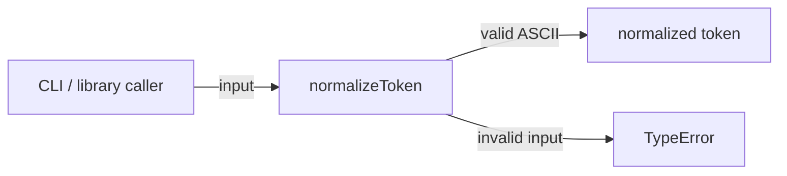
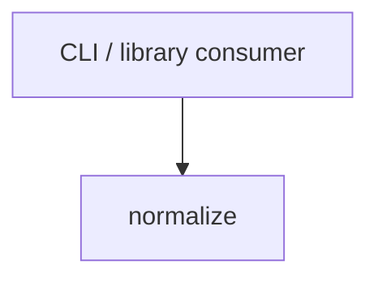

# Module: normalize

<!--SECTION:SPEC_ID-->
TOKEN-PIPELINE-NORMALIZE
<!--/SECTION:SPEC_ID-->

<!--SECTION:MODULE_VISION-->
## Module Vision

Owns the deterministic, side-effect-free token normalization of scope [token](../../token.spec.md): the
`normalizeToken` function and its validation boundary. The module has no parent module and no child
modules; its only sibling is absent because the scope Module Map currently lists this module alone.
All behavior remains an authored draft with no implementation claim.

<!--/SECTION:MODULE_VISION-->

<!--SECTION:OVERVIEW-->
## Overview


_Нормализация токена с единственной ошибкой входа — NOR-REQ-1, NOR-REQ-2._

<!--/SECTION:OVERVIEW-->

<!--SECTION:MODULE_USAGE_EXAMPLE-->
## Module Usage Example

```ts
import { normalizeToken } from "./normalize";

const token = normalizeToken("  Foo__BAR  ");
console.log(token);

try {
  normalizeToken("");
} catch (error) {
  if (error instanceof TypeError) {
    console.error("invalid token input");
  }
}
```

The snippet is self-sufficient: it imports only this module, exercises the happy path and the
minimal error path, and assumes no other module.

<!--/SECTION:MODULE_USAGE_EXAMPLE-->

<!--SECTION:MODULE_REQUIREMENTS-->
## Requirements

### NOR-REQ-1 [должен]
**Когда** передана ASCII-строка, содержащая хотя бы один символ, отличный от пробела, underscore и hyphen, **нормализатор должен** обрезать крайние ASCII-пробелы, привести ASCII-буквы к lower-case и свернуть каждый ряд пробелов, underscore и hyphen в один hyphen.

> Уточняет TOK-REQ-1 границами модуля: без единого детерминированного формата CLI и библиотечные потребители получат разные токены для одного и того же входа.

### NOR-REQ-2 [должен · нештатная]
**Если** входная строка пустая, состоит только из пробелов, underscore и hyphen или содержит не-ASCII символ, **то нормализатор должен** выбросить TypeError без ввода-вывода.

> Уточняет TOK-REQ-2: ошибку входа нельзя маскировать пустым или частично нормализованным токеном, а модуль не должен обращаться к диску, сети или внешнему процессу.

| Input | Outcome |
|---|---|
| `"  Foo__BAR  "` | `"foo-bar"` |
| `""` | `TypeError` |

<!--/SECTION:MODULE_REQUIREMENTS-->

<!--SECTION:INTER_MODULE_DEPENDENCIES-->
## Inter-Module Dependencies

- **Depends on:** None. No sibling module inside scope `token` is declared.
- **Scope Reference (cross-scope):** None. The module consumes no cross-scope interface.
- **Provides to:** Local CLI and library consumers outside this scope.


_Потребитель вызывает normalize напрямую; sibling-зависимостей нет._

<!--/SECTION:INTER_MODULE_DEPENDENCIES-->

<!--SECTION:ENTITY_INVENTORY-->
## Entity Inventory

_Это полный список сущностей модуля. Любое введение сущности execution-агентом помимо этого списка считается drift'ом и требует обновления spec._

| Name | Type | Purpose |
|------|------|---------|
| `normalizeToken` | Function | Детерминированно нормализует ASCII-токен и отклоняет некорректный вход |

Ошибки: throw TypeError → `normalizeToken`

ER-эскиз не нужен: в инвентаре одна сущность, связей между сущностями нет.

<!--/SECTION:ENTITY_INVENTORY-->

<!--SECTION:ENTITY_SURFACES-->
## Entity Surfaces

Модуль предоставляет одну публичную функцию без состояния; её поверхность описана ниже.

<details>
<summary>Полные поверхности сущностей</summary>

### `normalizeToken`
- **Type:** Function
- **Purpose:** Convert one ASCII token into a lower-case hyphenated form and reject invalid input.
- **Public Properties:** N/A
- **Public Operations:** normalizeToken — normalize one ASCII string input
- **Lifecycle:** Stateless; the function is created with the module and is invoked per call, with no lifecycle transitions or termination.
- **Events Emitted:** N/A
- **Errors & Degradation:** `TypeError` via throw for empty, separator-only or non-ASCII input; owned by `normalizeToken`; no I/O and no fallback value.
- **Consumers:**
  - Internal: `src/token/pipeline/normalize/normalize.ts`
  - External: local CLI and library consumers
- **Usage Waiver (external: local CLI and library consumers):** The function is the module's public entry point for external consumers.

</details>

<!--/SECTION:ENTITY_SURFACES-->

<!--SECTION:MODULE_CONTRACTS-->
## Module Contracts

Модуль определяет один чистый Service `normalizeToken`; Port и Adapter отсутствуют.

Граф не рисуется: в модуле нет Port/Adapter, только Service normalizeToken.

Call Chain не рисуется: в модуле одна абстракция normalizeToken, последовательности между абстракциями нет.

<details>
<summary>Контракты DbC</summary>

### Services

#### Service: `normalizeToken`
- **Purpose:** Normalize one ASCII token or reject invalid input without side effects.
- **Consumers:** `src/token/pipeline/normalize/normalize.ts`; local CLI and library consumers.
- **Runtime Backing:** `not-implemented`
- **Verification Levels:** contract, unit
- **Deferred Runtime Scope:** All behavior is declared only; no implementation is requested in this authoring change.

**Contract (DbC)**
- `normalizeToken`:
  - Pre: The input is a string that is non-empty, contains at least one character other than ASCII space, underscore and hyphen, and contains only ASCII characters.
  - Post: Returns the input with leading and trailing ASCII spaces removed, ASCII letters lowercased, and every maximal run of ASCII spaces, underscores and hyphens replaced by one hyphen.
  - On pre-violation: Throws TypeError and performs no I/O.

**Invariants:** A successful result contains no ASCII uppercase letters, no underscore, no ASCII space and no consecutive hyphens; a failed call produces no I/O and no partial token.

</details>

<!--/SECTION:MODULE_CONTRACTS-->

<!--SECTION:PUBLIC_OPTIONS-->
## Public Options & Policies

Публичных опций нет: поведение `normalizeToken` фиксировано.

<details>
<summary>Опции и политики</summary>

No flags, options or policies are exposed. All behavior is bound to the `normalizeToken` contract
above; nothing is deferred to a later activation.

</details>

<!--/SECTION:PUBLIC_OPTIONS-->

<!--SECTION:FILE_STRUCTURE-->
## File Structure

```
normalize/
├── normalize.ts
└── normalize.test.ts
```

**File Mapping:**
- `src/token/pipeline/normalize/normalize.ts`: `normalizeToken` implementation
- `src/token/pipeline/normalize/normalize.test.ts`: unit tests for the normalizer contract

<!--/SECTION:FILE_STRUCTURE-->

<!--SECTION:RESEARCH-->
## Research

No research documents support this bounded deterministic draft.

<!--/SECTION:RESEARCH-->

<!--SECTION:MODULE_DECISION_LOG-->
## Module Decision Log

Одна запись: `normalizeToken` остаётся чистым Service без Port и Adapter; вердикт ожидает оператора.

<details>
<summary>Полные записи Decision Log</summary>

NOR-DL-1 2026-10-24 — normalizeToken остаётся чистым Service без Port и Adapter; где: specs/token/pipeline/normalize/normalize.spec.md#module-contracts (почему: нет подтверждённой вариативности или test seam; отвергнуто: Port+Adapter — лишний слой без альтернативной реализации; риск: будущая вариативность потребует ввести Port) [verdict: pending-operator]

</details>

<!--/SECTION:MODULE_DECISION_LOG-->

<!--SECTION:HANDOFF-->
## Handoff to Tasks

- **Implementation files to be created:** `src/token/pipeline/normalize/normalize.ts`
- **Test files to be created:** `src/token/pipeline/normalize/normalize.test.ts`
- **Stack dependencies:**
  - Language: `TypeScript` (resolves to `ai/directives/coding/typescript-rules.xml`)
  - Test framework: `node:test` (resolves to `ai/directives/testing/node-test.xml`)
- **Module Rules Additions:** None.

- **Open risks & validation needs:** No implementation or runtime validation exists. The exact
  non-ASCII character set used for rejection, and the final test framework choice, still need
  operator confirmation before scaffold.

<!--/SECTION:HANDOFF-->

<!--SECTION:IMPLEMENTATION_INSIGHTS-->
## Implementation Insights

Not applicable: no implementation exists yet, so no post-implementation learnings are recorded.

<details>
<summary>Заметки по реализации</summary>

None. This appendix stays empty until an audit-cycle compaction produces non-trivial learnings.

</details>

<!--/SECTION:IMPLEMENTATION_INSIGHTS-->
