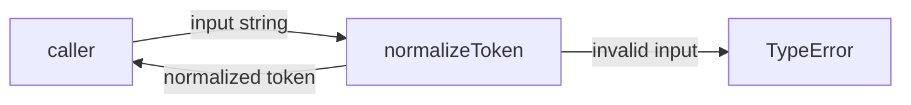
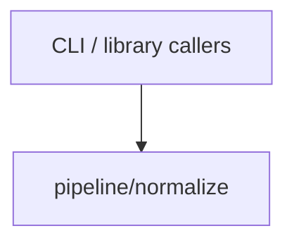

# Module: pipeline/normalize

<!--SECTION:SPEC_ID-->
TOKEN-PIPELINE-NORMALIZE
<!--/SECTION:SPEC_ID-->

<!--SECTION:MODULE_VISION-->
## Module Vision
Owns the deterministic normalization of one ASCII token inside the token scope. The module implements the behavior declared by the [token scope](../../token.spec.md); it has no sibling, parent, or child modules in this fixture.
<!--/SECTION:MODULE_VISION-->

<!--SECTION:OVERVIEW-->
## Overview


_Путь одного токена от входа до результата или TypeError — NOR-REQ-1, NOR-REQ-2._
<!--/SECTION:OVERVIEW-->

<!--SECTION:MODULE_USAGE_EXAMPLE-->
## Module Usage Example
```ts
import { normalizeToken } from "./pipeline/normalize/normalize.js";

const token = normalizeToken("  Foo__BAR  ");
console.log(token);

try {
  normalizeToken("");
} catch (error) {
  if (error instanceof TypeError) {
    console.error("invalid token");
  }
}
```
<!--/SECTION:MODULE_USAGE_EXAMPLE-->

<!--SECTION:MODULE_REQUIREMENTS-->
## Requirements
### NOR-REQ-1 [должен]
**Когда** normalizeToken получает `"  Foo__BAR  "`, **нормализатор должен** вернуть `"foo-bar"`.

> Уточняет TOK-REQ-1 на границе модуля: фиксирует канонический пример наблюдаемого результата.

### NOR-REQ-2 [должен · нештатная]
**Если** normalizeToken получает пустую строку, строку только из пробелов, underscore и hyphen или строку с не-ASCII символом, **то нормализатор должен** выбросить TypeError без ввода-вывода.

> Уточняет TOK-REQ-2: некорректный вход нельзя маскировать пустым корректным токеном.

| Input | Outcome |
|---|---|
| `"  Foo__BAR  "` | `"foo-bar"` |
| `""` | `TypeError` |
<!--/SECTION:MODULE_REQUIREMENTS-->

<!--SECTION:INTER_MODULE_DEPENDENCIES-->
## Inter-Module Dependencies
- **Depends on:** None; this module has no sibling modules.
- **Scope Reference (cross-scope):** None; the token scope's dependency on infra-base is authoring tooling, not a runtime interface.
- **Provides to:** No modules within this scope; the public function serves local CLI and library callers.


_Модуль не имеет внутренних рёбер и вызывается только внешними потребителями._
<!--/SECTION:INTER_MODULE_DEPENDENCIES-->

<!--SECTION:ENTITY_INVENTORY-->
## Entity Inventory
_Это полный список сущностей модуля. Любое введение сущности execution-агентом помимо этого списка считается drift'ом и требует обновления spec._

| Name | Type | Purpose |
|------|------|---------|
| `normalizeToken` | Function | Нормализует входную ASCII-строку в канонический токен |

Ошибки: throw (TypeError) → `normalizeToken`

ER-набросок не рисуется: в инвентаре одна сущность, связывать нечего.
<!--/SECTION:ENTITY_INVENTORY-->

<!--SECTION:ENTITY_SURFACES-->
## Entity Surfaces
Одна публичная функция `normalizeToken`; её полная поверхность раскрыта ниже.

<details>
<summary>Полные поверхности сущностей</summary>

### `normalizeToken`
- **Type:** Function
- **Purpose:** Преобразует входную ASCII-строку в канонический токен или отвергает некорректный вход.
- **Public Properties:** N/A
- **Public Operations:** `normalizeToken` — принимает строку и возвращает нормализованный токен.
- **Lifecycle:** Создаётся вызывающей стороной при импорте; не хранит состояние; завершается вместе с вызовом.
- **Events Emitted:** N/A
- **Errors & Degradation:** `TypeError` через throw для пустого, separator-only и не-ASCII входа; владелец — `normalizeToken`, ошибка возвращается вызывающей стороне.
- **Consumers:**
  - Internal: `pipeline/normalize/normalize.ts`
  - External: local CLI and library callers
- **Usage Waiver (external: local CLI and library callers):** This function is the module's sole public API; both consumers use it directly.

</details>
<!--/SECTION:ENTITY_SURFACES-->

<!--SECTION:MODULE_CONTRACTS-->
## Module Contracts
Одна чистая Service-операция `normalizeToken`; Port и Adapter отсутствуют.

Граф не рисуется: в модуле нет Port/Adapter, только Service `normalizeToken`.
Call Chain не рисуется: в инвентаре одна абстракция.

<details>
<summary>Контракты DbC</summary>

### Services
#### Service: `normalizeToken`
- **Purpose:** Детерминированно нормализует ASCII-токен и явно отвергает некорректный вход.
- **Consumers:** local CLI and library callers; implementation path `pipeline/normalize/normalize.ts`
- **Runtime Backing:** `not-implemented`
- **Verification Levels:** `contract`, `unit`
- **Deferred Runtime Scope:** Всё поведение объявлено только спецификацией; реализации в этом черновике нет.

**Contract (DbC)**
- `normalizeToken`:
  - Pre: вход — строка, которая после удаления краевых ASCII-пробелов содержит хотя бы один символ, отличный от пробела, underscore и hyphen, и состоит только из ASCII-символов.
  - Post: краевые ASCII-пробелы удалены, ASCII-буквы приведены к нижнему регистру, серии пробелов, underscore и hyphen свёрнуты в один hyphen; результат возвращён.
  - On pre-violation: выброшен `TypeError` без ввода-вывода.

</details>
<!--/SECTION:MODULE_CONTRACTS-->

<!--SECTION:PUBLIC_OPTIONS-->
## Public Options & Policies
Опций и политик нет: публичная поверхность ограничена сигнатурой `normalizeToken`.

<details>
<summary>Опции и политики</summary>

None. Публичных флагов, опций и настраиваемых политик в модуле нет.

</details>
<!--/SECTION:PUBLIC_OPTIONS-->

<!--SECTION:FILE_STRUCTURE-->
## File Structure
```
pipeline/normalize/
└── normalize.ts
```

**File Mapping:**
- `pipeline/normalize/normalize.ts`: реализация `normalizeToken`
<!--/SECTION:FILE_STRUCTURE-->

<!--SECTION:RESEARCH-->
## Research
Not applicable: для этого ограниченного детерминированного модуля нет research-документов.
<!--/SECTION:RESEARCH-->

<!--SECTION:MODULE_DECISION_LOG-->
## Module Decision Log
Записано одно решение: чистая Service-функция без Port/Adapter.

<details>
<summary>Полные записи Decision Log</summary>

NOR-DL-1 2026-10-24 — реализовать `normalizeToken` как чистую Service-функцию без Port/Adapter (почему: одна реализация и нет подтверждённой вариативности или test seam; отвергнуто: Port/Adapter-слой — избыточен для одной детерминированной функции).

</details>
<!--/SECTION:MODULE_DECISION_LOG-->

<!--SECTION:HANDOFF-->
## Handoff to Tasks
- **Implementation files to be created:** `pipeline/normalize/normalize.ts`
- **Test files to be created:** `pipeline/normalize/normalize.test.ts`
- **Stack dependencies:**
  - Language: `typescript` (resolves to `ai/directives/coding/typescript-rules.xml`)
  - Test framework: `node-test` (resolves to `ai/directives/testing/node-test.xml`)
- **Module Rules Additions:** None.

- **Open risks & validation needs:** Реализация не запрошена и не существует; TypeScript-инструментарий и test runner не предоставлены этим fixture; требуется независимая проверка и решение оператора.
- **Owner handoff:** pending-operator — операторское одобрение не дано, тикеты не созданы.
<!--/SECTION:HANDOFF-->

<!--SECTION:IMPLEMENTATION_INSIGHTS-->
## Implementation Insights
Not applicable: реализации ещё не было, поэтому post-implementation learnings отсутствуют.

<details>
<summary>Заметки по реализации</summary>

No post-implementation learnings exist for this draft.

</details>
<!--/SECTION:IMPLEMENTATION_INSIGHTS-->
