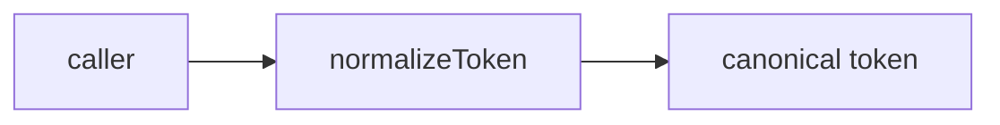
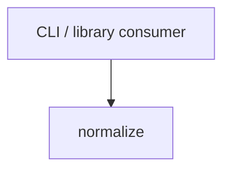

# Module: normalize

<!--SECTION:SPEC_ID-->
TOKEN-PIPELINE-NORMALIZE
<!--/SECTION:SPEC_ID-->

<!--SECTION:MODULE_VISION-->
## Module Vision
Own the single deterministic token-normalization operation for the `token` scope: one pure function that turns a non-empty ASCII string into a canonical lower-case token and rejects every other input. This is a child of [Scope](../../token.spec.md), listed in the scope [MODULE_MAP](../../token.spec.md#MODULE_MAP); it has no sibling or child modules, and its only public export is the surface summarized by the scope [PUBLIC_API_SURFACE](../../token.spec.md#PUBLIC_API_SURFACE).
<!--/SECTION:MODULE_VISION-->

<!--SECTION:OVERVIEW-->
## Overview

_Один вход проходит через нормализатор к каноническому токену — NOR-REQ-1._
<!--/SECTION:OVERVIEW-->

<!--SECTION:MODULE_USAGE_EXAMPLE-->
## Module Usage Example
```ts
import { normalizeToken } from "./normalize.js";

const token = normalizeToken("  Foo__BAR  ");
console.log(token);

try {
  normalizeToken("");
} catch (error) {
  if (!(error instanceof TypeError)) throw error;
  console.log(error.message);
}
```
<!--/SECTION:MODULE_USAGE_EXAMPLE-->

<!--SECTION:MODULE_REQUIREMENTS-->
## Requirements
### NOR-REQ-1 [должен]
**Когда** передана непустая ASCII-строка, которая содержит хотя бы один символ, отличный от пробела, underscore и hyphen, **нормализатор должен** обрезать крайние ASCII-пробелы, привести ASCII-буквы к нижнему регистру и свернуть каждый прогон пробелов, underscore и hyphen в один hyphen.

> Уточняет TOK-REQ-1: фиксирует точный локальный результат и перечень разделителей, чтобы CLI и библиотечные потребители получали один и тот же токен.

### NOR-REQ-2 [должен · нештатная]
**Если** входная строка пустая, состоит только из разделителей или содержит не-ASCII символы, **то нормализатор должен** выбросить TypeError без ввода-вывода.

> Уточняет TOK-REQ-2: запрещает маскировать некорректный вход пустым или частично преобразованным токеном.

| Input | Outcome |
|---|---|
| `"  Foo__BAR  "` | `"foo-bar"` |
| `""` | `TypeError` |
<!--/SECTION:MODULE_REQUIREMENTS-->

<!--SECTION:INTER_MODULE_DEPENDENCIES-->
## Inter-Module Dependencies
- **Depends on:** None
- **Scope Reference (cross-scope):** None; the parent [Scope](../../token.spec.md) owns the library boundary.
- **Provides to:** External CLI and library consumers only; no sibling module consumes this module.


_Внешний потребитель вызывает normalize; рёбер между модулями скоупа нет._
<!--/SECTION:INTER_MODULE_DEPENDENCIES-->

<!--SECTION:ENTITY_INVENTORY-->
## Entity Inventory
_Это полный список сущностей модуля. Любое введение сущности execution-агентом помимо этого списка считается drift'ом и требует обновления spec._

| Name | Type | Purpose |
|------|------|---------|
| `normalizeToken` | Function | Чистая нормализация одной ASCII-строки в канонический токен |

Ошибки: throw → `normalizeToken`

ER-эскиз не нужен: инвентарь содержит одну сущность.
<!--/SECTION:ENTITY_INVENTORY-->

<!--SECTION:ENTITY_SURFACES-->
## Entity Surfaces
Одна публичная функция с единственной операцией и явным путём ошибки.

<details>
<summary>Полные поверхности сущностей</summary>

### `normalizeToken`
- **Type:** Function
- **Purpose:** Детерминированно превращает допустимую ASCII-строку в канонический токен.
- **Public Properties:** N/A
- **Public Operations:** нормализовать переданную строку и вернуть результат; на некорректном входе выбросить TypeError.
- **Lifecycle:** Вызывается на каждый вход, не хранит состояние и завершается вместе с вызовом.
- **Events Emitted:** N/A
- **Errors & Degradation:** `TypeError` через throw для пустой строки, строки только из разделителей или строки с не-ASCII символами; владелец обработки — `normalizeToken`.
- **Consumers:**
  - Internal: `src/token/pipeline/normalize/normalize.ts`
  - External: CLI и библиотечные потребители
- **Usage Waiver (external: CLI and library consumers):** Единственный публичный экспорт модуля; ценность определяется внешним потреблением, а не числом внутренних вызовов.

</details>
<!--/SECTION:ENTITY_SURFACES-->

<!--SECTION:MODULE_CONTRACTS-->
## Module Contracts
Модуль определяет один Service `normalizeToken`; Port и Adapter отсутствуют, потому что операция чистая и не имеет подтверждённой вариативности.

Граф зависимостей не рисуется: в модуле нет Port/Adapter, только Service `normalizeToken`.

Call Chain не рисуется: одна абстракция (`normalizeToken`), порог ≥2 не достигнут.

<details>
<summary>Контракты DbC</summary>

### Services

#### Service: `normalizeToken`
- **Purpose:** Детерминированно нормализовать допустимую ASCII-строку в канонический токен.
- **Consumers:** CLI и библиотечные потребители; внутренний файл `src/token/pipeline/normalize/normalize.ts`.
- **Runtime Backing:** `not-implemented`
- **Verification Levels:** `contract`, `unit`
- **Deferred Runtime Scope:** Всё объявленное поведение остаётся без реального runtime до создания реализации.

**Contract (DbC)**
- `normalizeToken`:
  - Pre: вход — строка, содержащая хотя бы один ASCII-символ, отличный от пробела, underscore и hyphen.
  - Post: возвращает строку без крайних ASCII-пробелов, с ASCII-буквами в нижнем регистре и с каждым прогоном пробелов, underscore и hyphen, заменённым одним hyphen.
  - On pre-violation: выбрасывает TypeError до любого ввода-вывода, если строка пустая, состоит только из разделителей или содержит не-ASCII символы.

**Invariants:** Функция чистая и детерминированная: одинаковый вход даёт одинаковый выход, сетевого или дискового ввода-вывода нет.

</details>
<!--/SECTION:MODULE_CONTRACTS-->

<!--SECTION:PUBLIC_OPTIONS-->
## Public Options & Policies
Нет публичных опций: единственная операция принимает только входную строку.

<details>
<summary>Опции и политики</summary>

Флаги, режимы и политики в v1 не предусмотрены; поведение полностью задано NOR-REQ-1 и NOR-REQ-2.

</details>
<!--/SECTION:PUBLIC_OPTIONS-->

<!--SECTION:FILE_STRUCTURE-->
## File Structure
```
src/token/pipeline/normalize/
├── index.ts
├── normalize.ts
└── normalize.test.ts
```

**File Mapping:**
- `src/token/pipeline/normalize/normalize.ts`: чистая реализация `normalizeToken`
- `src/token/pipeline/normalize/index.ts`: публичный re-export
- `src/token/pipeline/normalize/normalize.test.ts`: unit-тесты контракта
<!--/SECTION:FILE_STRUCTURE-->

<!--SECTION:RESEARCH-->
## Research
Нет research-документов: границы модуля полностью заданы родительским скоупом и brief.
<!--/SECTION:RESEARCH-->

<!--SECTION:MODULE_DECISION_LOG-->
## Module Decision Log
Зафиксировано одно архитектурное решение: чистая функция без Port/Adapter.

<details>
<summary>Полные записи Decision Log</summary>

NOR-DL-1 2026-10-24 — нормализатор реализуется одной чистой функцией без Port/Adapter (почему: одна детерминированная операция без подтверждённой вариативности или test seam; отвергнуто: Port с единственным Adapter — лишний слой без альтернативной реализации; риск: будущая замена алгоритма потребует введения Port).

</details>
<!--/SECTION:MODULE_DECISION_LOG-->

<!--SECTION:HANDOFF-->
## Handoff to Tasks
- **Implementation files to be created:** `src/token/pipeline/normalize/normalize.ts`, `src/token/pipeline/normalize/index.ts`
- **Test files to be created:** `src/token/pipeline/normalize/normalize.test.ts`
- **Stack dependencies:**
  - Language: `typescript` (resolves to `ai/directives/coding/typescript-rules.xml`)
  - Test framework: `node-test` (resolves to `ai/directives/testing/node-test.xml`)
- **Module Rules Additions:** None

  | Rule | Category | Source |
  |------|----------|--------|
  | None | — | — |

- **Open risks & validation needs:** Операторское одобрение не получено, реализация не начата. Точная граница «не-ASCII» требует проверки по кодовым точкам выше U+007F при написании тестов.
<!--/SECTION:HANDOFF-->

<!--SECTION:IMPLEMENTATION_INSIGHTS-->
## Implementation Insights
Пост-имплементационных наблюдений нет: реализация ещё не создана.

<details>
<summary>Заметки по реализации</summary>

Раздел заполняется после появления реального кода и audit-cycle; сейчас он намеренно пуст по существу.

</details>
<!--/SECTION:IMPLEMENTATION_INSIGHTS-->
