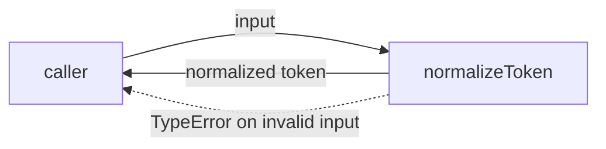
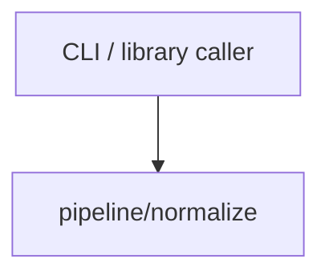

# Module: normalize

<!--SECTION:SPEC_ID-->
TOKEN-PIPELINE-NORMALIZE
<!--/SECTION:SPEC_ID-->

<!--SECTION:MODULE_VISION-->
## Module Vision
`normalize` owns the deterministic ASCII token transformation exposed as `normalizeToken` in the
`token` scope at `pipeline/normalize`. Parent scope: [token](../../token.spec.md). Parent
requirements refined here: [TOK-REQ-1 and TOK-REQ-2](../../token.spec.md#REQUIREMENTS_AND_CONSTRAINTS).
The current [MODULE_MAP](../../token.spec.md#MODULE_MAP) declares no parent, sibling or child
modules for this module.
<!--/SECTION:MODULE_VISION-->

<!--SECTION:OVERVIEW-->
## Overview

_Нормализация ASCII-токена или отказ TypeError на недопустимом входе — NOR-REQ-1, NOR-REQ-2._
<!--/SECTION:OVERVIEW-->

<!--SECTION:MODULE_USAGE_EXAMPLE-->
## Module Usage Example
```ts
import { normalizeToken } from "./normalize.js";

const token = normalizeToken("  Foo__BAR  ");
console.log(token);

try {
  normalizeToken("");
} catch (error) {
  if (error instanceof TypeError) {
    console.error(error.message);
  }
}
```
No initialization, configuration or I/O is needed; the import path is the planned implementation
module described in File Structure.
<!--/SECTION:MODULE_USAGE_EXAMPLE-->

<!--SECTION:MODULE_REQUIREMENTS-->
## Requirements
### NOR-REQ-1 [должен]
**Когда** передана непустая ASCII-строка, содержащая хотя бы один символ, отличный от пробела,
underscore и hyphen, **нормализатор должен** обрезать крайние ASCII-пробелы, привести ASCII-буквы
к нижнему регистру и свернуть каждый непрерывный ряд пробелов, underscore и hyphen в один hyphen.

> Уточняет TOK-REQ-1: фиксирует один детерминированный формат токена для CLI и библиотечных
> потребителей и не оставляет выбора разделителя или регистра.

### NOR-REQ-2 [должен · нештатная]
**Если** строка пустая, состоит только из разделителей (пробел, underscore, hyphen) или содержит
не-ASCII символ, **то нормализатор должен** выбросить `TypeError` без ввода-вывода.

> Уточняет TOK-REQ-2: ошибочный вход нельзя маскировать пустым или частично нормализованным
> корректным токеном.

| Input | Outcome |
|---|---|
| `"  Foo__BAR  "` | `"foo-bar"` |
| `""` | `TypeError` |
<!--/SECTION:MODULE_REQUIREMENTS-->

<!--SECTION:INTER_MODULE_DEPENDENCIES-->
## Inter-Module Dependencies
- **Depends on:** None — the scope [MODULE_MAP](../../token.spec.md#MODULE_MAP) declares no sibling module.
- **Scope Reference (cross-scope):** None — the `infra-base` entry in [Scope Dependencies](../../token.spec.md#SCOPE_DEPENDENCIES) is authoring infrastructure, not a runtime contract.
- **Provides to:** External CLI and library callers through the scope [PUBLIC_API_SURFACE](../../token.spec.md#PUBLIC_API_SURFACE); no sibling module consumes it.


_Внешние потребители вызывают normalize; рёбер к другим модулям скоупа нет._
<!--/SECTION:INTER_MODULE_DEPENDENCIES-->

<!--SECTION:ENTITY_INVENTORY-->
## Entity Inventory
_Это полный список сущностей модуля. Любое введение сущности execution-агентом помимо этого списка считается drift'ом и требует обновления spec._

| Name | Type | Purpose |
|------|------|---------|
| `normalizeToken` | Function | Детерминированно нормализует ASCII-токен и отвергает недопустимый вход |

Ошибки: throw `TypeError` → `normalizeToken`.

ER-эскиз не рисуется: inventory содержит одну сущность, связывать нечего.
<!--/SECTION:ENTITY_INVENTORY-->

<!--SECTION:ENTITY_SURFACES-->
## Entity Surfaces
One public function: `normalizeToken` transforms a valid ASCII token and rejects invalid input.

<details>
<summary>Полные поверхности сущностей</summary>

### `normalizeToken`
- **Type:** Function
- **Purpose:** Детерминированно нормализует ASCII-токен и отвергает недопустимый вход.
- **Public Properties:** N/A
- **Public Operations:** Normalize one ASCII token; reject invalid input with `TypeError`.
- **Lifecycle:** Stateless; available with the module and terminating with the process, with no instance state.
- **Events Emitted:** N/A
- **Errors & Degradation:** Synchronous `TypeError` for empty, separator-only or non-ASCII input; the external caller owns handling.
- **Consumers:**
  - Internal: `pipeline/normalize` module entry point
  - External: local CLI and library callers
- **Usage Waiver (external: local CLI and library callers):** The function is the module's single public entry point.

</details>
<!--/SECTION:ENTITY_SURFACES-->

<!--SECTION:MODULE_CONTRACTS-->
## Module Contracts
No Ports or Adapters are defined; one pure Function, `normalizeToken`, carries the whole public contract.

Граф не рисуется: в модуле нет Port/Adapter, только Function `normalizeToken`.
Call chain не рисуется: в модуле одна абстракция, последовательности между сущностями нет.

<details>
<summary>Контракты DbC</summary>

### Services

#### Service: `normalizeToken`
- **Purpose:** Детерминированно нормализует ASCII-токен и отвергает недопустимый вход.
- **Consumers:** local CLI and library callers through the scope public API
- **Runtime Backing:** `not-implemented`
- **Verification Levels:** `contract`, `unit`
- **Deferred Runtime Scope:** All declared behavior — no implementation was requested in this authoring task.

**Contract (DbC)**
- `normalizeToken(input: string): string`:
  - Pre: `input` is a string, is not empty, contains at least one character other than an ASCII space, underscore or hyphen, and contains no non-ASCII character.
  - Post: Returns a string with leading and trailing ASCII spaces removed, ASCII letters lowercased, and every maximal run of ASCII space, underscore or hyphen replaced by one hyphen; performs no I/O and mutates no state.
  - On pre-violation: Throws `TypeError` synchronously without performing I/O.

**Invariants:** Each call is pure: identical input yields identical output, and no I/O or retained state is observable.

</details>
<!--/SECTION:MODULE_CONTRACTS-->

<!--SECTION:PUBLIC_OPTIONS-->
## Public Options & Policies
None: the module exposes no flags, options or policies.
<!--/SECTION:PUBLIC_OPTIONS-->

<!--SECTION:FILE_STRUCTURE-->
## File Structure
```
normalize/
├── normalize.ts
└── normalize.test.ts
```

**File Mapping:**
- `normalize.ts`: planned implementation of `normalizeToken` (not created by this authoring task)
- `normalize.test.ts`: planned unit tests for NOR-REQ-1 and NOR-REQ-2
<!--/SECTION:FILE_STRUCTURE-->

<!--SECTION:RESEARCH-->
## Research
No research documents: this bounded deterministic draft does not depend on external research.
<!--/SECTION:RESEARCH-->

<!--SECTION:MODULE_DECISION_LOG-->
## Module Decision Log
One decision: the normalizer is a single pure function without a Port or Adapter.

<details>
<summary>Полные записи Decision Log</summary>

NOR-DL-1 2026-10-24 — нормализатор реализуется одной чистой функцией `normalizeToken` без Port и Adapter (почему: преобразование не имеет состояния и подтверждённой вариативности; отвергнуто: Port с единственным Adapter; риск: отдельного тестового seam через Port нет, поведение проверяется напрямую).

</details>
<!--/SECTION:MODULE_DECISION_LOG-->

<!--SECTION:HANDOFF-->
## Handoff to Tasks
- **Approval #1:** pending-operator — no operator approval has been given.
- **Implementation files to be created:** `specs/token/pipeline/normalize/normalize.ts`
- **Test files to be created:** `specs/token/pipeline/normalize/normalize.test.ts`
- **Stack dependencies:**
  - Language: `typescript` (resolves to `ai/directives/coding/typescript-rules.xml`)
  - Test framework: `node-test` (resolves to `ai/directives/testing/node-test.xml`)
- **Module Rules Additions:** None

  | Rule | Category | Source |
  |------|----------|--------|
  | None | — | — |

- **Open risks & validation needs:** operator approval is pending; no implementation exists; the brief does not mention digits or other ASCII punctuation, so their preservation must be validated before implementation; non-ASCII rejection and separator-only boundaries need explicit tests.
<!--/SECTION:HANDOFF-->

<!--SECTION:IMPLEMENTATION_INSIGHTS-->
## Implementation Insights
Not applicable: no implementation has been performed, so there are no post-implementation learnings to record.
<!--/SECTION:IMPLEMENTATION_INSIGHTS-->
