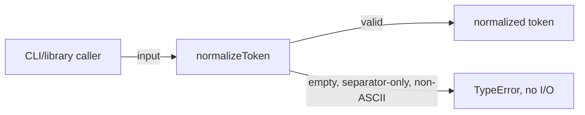
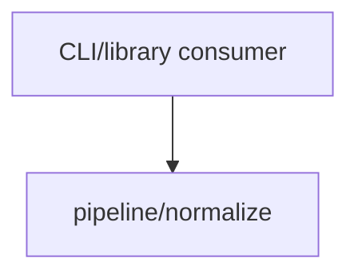

# Module: Token Normalizer

<!--SECTION:SPEC_ID-->
TOKEN-PIPELINE-NORMALIZE
<!--/SECTION:SPEC_ID-->

<!--SECTION:MODULE_VISION-->
## Module Vision
Модуль `pipeline/normalize` владеет единственной публичной операцией `normalizeToken`: детерминированной нормализацией ASCII-токена для локальных CLI- и библиотечных потребителей. Реализация и выполнение в этот артефакт не входят.

Родительский скоуп: [token](../../token.spec.md); его карта модулей: [MODULE_MAP](../../token.spec.md#MODULE_MAP). Родительских и дочерних модулей нет; других модулей в скоупе `token` нет.
<!--/SECTION:MODULE_VISION-->

<!--SECTION:OVERVIEW-->
## Overview


_Один детерминированный проход: нормализованный токен или TypeError — NOR-REQ-1, NOR-REQ-2._
<!--/SECTION:OVERVIEW-->

<!--SECTION:MODULE_USAGE_EXAMPLE-->
## Module Usage Example

```ts
import { normalizeToken } from "./normalize.js";

const token = normalizeToken("  Foo__BAR  ");
// token === "foo-bar"

try {
  normalizeToken("");
} catch (error) {
  if (!(error instanceof TypeError)) throw error;
  // invalid input is rejected; no I/O was performed
}
```
<!--/SECTION:MODULE_USAGE_EXAMPLE-->

<!--SECTION:MODULE_REQUIREMENTS-->
## Requirements
### NOR-REQ-1 [должен]
**Когда** передана ASCII-строка, содержащая хотя бы один символ, отличный от ASCII-пробела, underscore и hyphen, **normalizeToken должен** удалить ведущие и завершающие ASCII-пробелы, привести ASCII-буквы к нижнему регистру и свернуть каждую серию ASCII-пробелов, underscore и hyphen в один hyphen.
> Уточняет TOK-REQ-1 для модуля `pipeline/normalize`.

### NOR-REQ-2 [должен · нештатная]
**Если** входная строка пустая, состоит только из разделителей (ASCII-пробел, underscore, hyphen) или содержит не-ASCII символы, **то normalizeToken должен** выбросить `TypeError` без ввода-вывода.
> Уточняет TOK-REQ-2; ошибочный вход не маскируется пустым корректным токеном.

| Input | Outcome |
|---|---|
| `"  Foo__BAR  "` | `"foo-bar"` |
| `""` | `TypeError` |
<!--/SECTION:MODULE_REQUIREMENTS-->

<!--SECTION:INTER_MODULE_DEPENDENCIES-->
## Inter-Module Dependencies
- **Depends on:** None; внутри скоупа `token` нет других модулей.
- **Scope Reference (cross-scope):** None; нормализация не пересекает границу скоупа.
- **Provides to:** None внутри скоупа; публичная операция предназначена внешним CLI- и библиотечным потребителям.


_Внешний потребитель вызывает модуль; внутренних рёбер зависимостей нет._
<!--/SECTION:INTER_MODULE_DEPENDENCIES-->

<!--SECTION:ENTITY_INVENTORY-->
## Entity Inventory
_Это полный список сущностей модуля. Любое введение сущности execution-агентом помимо этого списка считается drift'ом и требует обновления spec._

| Name | Type | Purpose |
|------|------|---------|
| `normalizeToken` | Function | Чистая нормализация ASCII-токена или TypeError |

Ошибки: throw → `normalizeToken`

ER-скетч не рисуется: в инвентаре одна сущность без связей.
<!--/SECTION:ENTITY_INVENTORY-->

<!--SECTION:ENTITY_SURFACES-->
## Entity Surfaces
Поверхность одна: чистая функция `normalizeToken` с единственной операцией и явным TypeError на недопустимом входе.

<details>
<summary>Полные поверхности сущностей</summary>

### `normalizeToken`
- **Type:** Function
- **Purpose:** Детерминированно нормализовать ASCII-токен или отклонить недопустимый вход.
- **Public Properties:** N/A
- **Public Operations:** `normalizeToken(input)` — вернуть нормализованный токен либо выбросить TypeError.
- **Lifecycle:** Stateless; создаётся на время вызова и завершается возвратом или исключением.
- **Events Emitted:** N/A
- **Errors & Degradation:** `TypeError` через throw; владелец — `normalizeToken`; ввод-вывод не выполняется.
- **Consumers:**
  - Internal: none (публичная точка входа модуля)
  - External: local CLI and library consumers
- **Usage Waiver (external: CLI/library consumers):** Единственная публичная операция, закреплённая поверхностью TOK-REQ-1 и TOK-REQ-2.

</details>
<!--/SECTION:ENTITY_SURFACES-->

<!--SECTION:MODULE_CONTRACTS-->
## Module Contracts
Модуль определяет одну чистую Function `normalizeToken`; Port и Adapter отсутствуют, поведение контрактируется прямо на функции.

Граф не рисуется: в модуле нет Port/Adapter, только Function `normalizeToken`.

Call Chain не рисуется: в инвентаре одна абстракция (`normalizeToken`), второго участника вызова нет.

<details>
<summary>Контракты DbC</summary>

### Services

#### Service: `normalizeToken`
- **Purpose:** Нормализовать ASCII-токен и явно отклонять недопустимый вход.
- **Consumers:** Внешние CLI- и библиотечные потребители через публичную точку входа модуля.
- **Runtime Backing:** `not-implemented`
- **Verification Levels:** `contract`, `unit`
- **Deferred Runtime Scope:** Всё объявленное поведение — реализация и исполнение отложены за пределы этого authoring-артефакта.

**Contract (DbC)**
- `normalizeToken`:
  - Pre: `input` — строка, непустая, содержит хотя бы один символ, отличный от ASCII-пробела, `_` и `-`, и не содержит не-ASCII символов.
  - Post: возвращена строка без ведущих и завершающих ASCII-пробелов, с ASCII-буквами в нижнем регистре и с каждой серией ASCII-пробелов, `_` и `-`, свёрнутой в один `-`.
  - On pre-violation: выброшен `TypeError` до любого ввода-вывода; пустой корректный токен не возвращается.

**Invariants:** Функция не выполняет ввода-вывода, не хранит состояние и детерминирована: одинаковый вход даёт одинаковый результат или одинаковый `TypeError`.

</details>
<!--/SECTION:MODULE_CONTRACTS-->

<!--SECTION:PUBLIC_OPTIONS-->
## Public Options & Policies
Публичных опций нет: набор разделителей и поведение ошибки фиксированы требованиями.

<details>
<summary>Опции и политики</summary>

None. Флаги, режимы и отложенные политики отсутствуют в v1; `NOR-REQ-1` и `NOR-REQ-2` задают всё наблюдаемое поведение.

</details>
<!--/SECTION:PUBLIC_OPTIONS-->

<!--SECTION:FILE_STRUCTURE-->
## File Structure
```text
pipeline/normalize/
├── normalize.ts
└── normalize.test.ts
```

**File Mapping:**
- `pipeline/normalize/normalize.ts`: реализация `normalizeToken`
- `pipeline/normalize/normalize.test.ts`: contract/unit-тесты для `NOR-REQ-1` и `NOR-REQ-2`
<!--/SECTION:FILE_STRUCTURE-->

<!--SECTION:RESEARCH-->
## Research
No research documents for this bounded deterministic draft.
<!--/SECTION:RESEARCH-->

<!--SECTION:MODULE_DECISION_LOG-->
## Module Decision Log
Одна запись: чистая функция без Port и Adapter; одобрение оператора не заявлено.

<details>
<summary>Полные записи Decision Log</summary>

NOR-DL-1 2026-10-24 — `normalizeToken` реализуется как чистая Function без Port и Adapter (почему: единственная реализация и отсутствие подтверждённой вариативности; отвергнуто: Port ради не нужного чистой функции тестового шва; риск: будущая замена алгоритма потребует прямого изменения функции).

</details>
<!--/SECTION:MODULE_DECISION_LOG-->

<!--SECTION:HANDOFF-->
## Handoff to Tasks
- **Implementation files to be created:** `pipeline/normalize/normalize.ts`
- **Test files to be created:** `pipeline/normalize/normalize.test.ts`
- **Stack dependencies:**
  - Language: `typescript` (resolves to `ai/directives/coding/typescript-rules.xml`)
  - Test framework: `node-test` (resolves to `ai/directives/testing/node-test.xml`)
- **Module Rules Additions:** None; применяется baseline скоупа.
- **Open risks & validation needs:** Реализация и исполнение тестов не выполнены; runtime-подтверждения нет. Граница модуля не одобрена оператором.
- **Approval status:** pending-operator — решение оператора не записано, тикеты не созданы.
<!--/SECTION:HANDOFF-->

<!--SECTION:IMPLEMENTATION_INSIGHTS-->
## Implementation Insights
Not applicable: реализации ещё нет, поэтому post-implementation наблюдений нет.

<details>
<summary>Заметки по реализации</summary>

No implementation or post-implementation learning exists in this authoring-only artifact.

</details>
<!--/SECTION:IMPLEMENTATION_INSIGHTS-->
