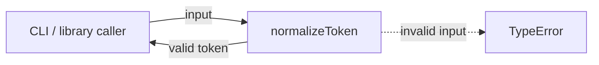
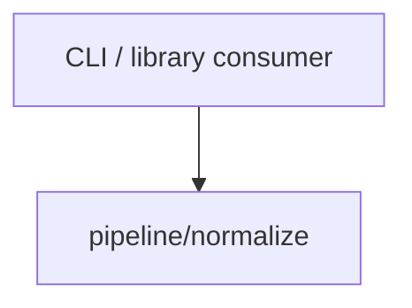

# Module: normalize

<!--SECTION:SPEC_ID-->
TOKEN-PIPELINE-NORMALIZE
<!--/SECTION:SPEC_ID-->

<!--SECTION:MODULE_VISION-->
## Module Vision

Own local, deterministic token normalization for the `token` scope: the pure `normalizeToken` function and its TypeError boundary. The module has no network, persistence or configuration responsibility.

- Parent scope: [Scope](../../token.spec.md)
- Scope map: [MODULE_MAP](../../token.spec.md#MODULE_MAP)
- Public contract: [PUBLIC_API_SURFACE](../../token.spec.md#PUBLIC_API_SURFACE)
- Sibling, parent and child modules: none in the current scope draft.
<!--/SECTION:MODULE_VISION-->

<!--SECTION:OVERVIEW-->
## Overview


_Главный путь нормализации токена и отказ на невалидном входе._
<!--/SECTION:OVERVIEW-->

<!--SECTION:MODULE_USAGE_EXAMPLE-->
## Module Usage Example

```ts
import { normalizeToken } from './normalize';

const token = normalizeToken('  Foo__BAR  ');
console.log(token);

try {
  normalizeToken('');
} catch (error) {
  if (error instanceof TypeError) {
    console.error('invalid token input');
  }
}
```
<!--/SECTION:MODULE_USAGE_EXAMPLE-->

<!--SECTION:MODULE_REQUIREMENTS-->
## Requirements

### NOR-REQ-1 [должен]
**Когда** передана ASCII-строка, которая содержит хотя бы один символ, отличный от пробела, underscore и hyphen, **нормализатор должен** обрезать крайние ASCII-пробелы, привести ASCII-буквы к нижнему регистру и свернуть серии пробелов, underscore и hyphen в один hyphen.

> Уточняет TOK-REQ-1 на границе модуля: фиксирует локальную функцию и её детерминированный результат.

### NOR-REQ-2 [должен · нештатная]
**Если** строка пустая, состоит из разделителей или содержит не-ASCII символы, **то нормализатор должен** выбросить TypeError без ввода-вывода.

> Уточняет TOK-REQ-2: невалидный вход не должен превращаться в пустой корректный токен.

| Input | Outcome |
|---|---|
| `"  Foo__BAR  "` | `"foo-bar"` |
| `""` | `TypeError` |
<!--/SECTION:MODULE_REQUIREMENTS-->

<!--SECTION:INTER_MODULE_DEPENDENCIES-->
## Inter-Module Dependencies

- **Depends on:** none.
- **Scope Reference (cross-scope):** none.
- **Provides to:** no sibling modules in this scope; external CLI and library consumers use the public function.


_Единственная внешняя граница модуля — вызов нормализатора._
<!--/SECTION:INTER_MODULE_DEPENDENCIES-->

<!--SECTION:ENTITY_INVENTORY-->
## Entity Inventory

_Это полный список сущностей модуля. Любое введение сущности execution-агентом помимо этого списка считается drift'ом и требует обновления spec._

| Name | Type | Purpose |
|------|------|---------|
| `normalizeToken` | Function | Pure token normalization and TypeError boundary |

Ошибки: throw TypeError → normalizeToken

ER sketch is not drawn: this is a single-entity inventory, so there is nothing to relate.
<!--/SECTION:ENTITY_INVENTORY-->

<!--SECTION:ENTITY_SURFACES-->
## Entity Surfaces

One public function surface; the per-entity detail is folded below.

<details>
<summary>Полные поверхности сущностей</summary>

### `normalizeToken`

- **Type:** Function
- **Purpose:** Normalize a valid ASCII token deterministically and reject invalid input.
- **Public Properties:** N/A
- **Public Operations:** Normalize a token string; throw TypeError for invalid input.
- **Lifecycle:** Created by module import as a stateless function; a caller invokes it and it terminates after returning a token or throwing.
- **Events Emitted:** N/A
- **Errors & Degradation:** `TypeError` via throw, owned by `normalizeToken`; no I/O and no fallback token.
- **Consumers:**
  - Internal: none; this is the public module boundary.
  - External: CLI and library consumers.
- **Usage Waiver (external: CLI and library consumers):** Exported public API expected to serve multiple callers.

</details>
<!--/SECTION:ENTITY_SURFACES-->

<!--SECTION:MODULE_CONTRACTS-->
## Module Contracts

One Function owns the behavior directly; no Port or Adapter is defined.

Граф не рисуется: в модуле нет Port/Adapter, только Function `normalizeToken`.

Цепочка вызовов не рисуется: в инвентаре одна абстракция — Function `normalizeToken`.

<details>
<summary>Контракты DbC</summary>

### Services

#### Service: `normalizeToken`

- **Purpose:** Normalize a valid ASCII token and reject invalid input.
- **Consumers:** External CLI and library consumers.
- **Runtime Backing:** `not-implemented`
- **Verification Levels:** `contract`, `unit`
- **Deferred Runtime Scope:** All behavior; implementation is not part of this authoring task.

**Contract (DbC)**

- `normalizeToken`:
  - Pre: input is a string, every character is ASCII, and at least one character is not an ASCII space, underscore or hyphen.
  - Post: returns a string with leading and trailing ASCII spaces removed, ASCII letters lowercased, and every run of ASCII space, underscore or hyphen replaced by one hyphen.
  - On pre-violation: throws `TypeError`; performs no I/O.

**Invariants:** The function is deterministic and stateless; it performs no I/O, network access or persistence.

</details>
<!--/SECTION:MODULE_CONTRACTS-->

<!--SECTION:PUBLIC_OPTIONS-->
## Public Options & Policies

No public options or policies: `normalizeToken` has one fixed contract.

<details>
<summary>Опции и политики</summary>

None. No flags, configuration values or selectable policies are part of this module.

</details>
<!--/SECTION:PUBLIC_OPTIONS-->

<!--SECTION:FILE_STRUCTURE-->
## File Structure

```
normalize/
├── normalize.ts
└── normalize.test.ts
```

**File Mapping:**
- `normalize/normalize.ts`: `normalizeToken` implementation, to be created by a future task.
- `normalize/normalize.test.ts`: contract tests for valid and invalid input, to be created by a future task.
<!--/SECTION:FILE_STRUCTURE-->

<!--SECTION:RESEARCH-->
## Research

No research documents support this bounded deterministic draft.
<!--/SECTION:RESEARCH-->

<!--SECTION:MODULE_DECISION_LOG-->
## Module Decision Log

`NOR-DL-1` records the pure-function boundary with no invented Port or Adapter; Approval #1 remains pending.

<details>
<summary>Полные записи Decision Log</summary>

`NOR-DL-1 2026-10-24 — keep normalizeToken as one pure function with no Port/Adapter (почему: no variability or test seam is confirmed; отвергнуто: Port/Adapter layer as unnecessary abstraction; риск: future substitution would require a module refinement).`

### Approval #1 — current specification set
- **Status:** pending
- **Reviewed set:** `specs/token/token.spec.md`, `specs/token/pipeline/normalize/normalize.spec.md`
- **Independent review:** pending
- **Operator decision:** pending
- **Recorded:** 2026-10-24

</details>
<!--/SECTION:MODULE_DECISION_LOG-->

<!--SECTION:HANDOFF-->
## Handoff to Tasks

- **Implementation files to be created:** `normalize/normalize.ts` (`normalizeToken`).
- **Test files to be created:** `normalize/normalize.test.ts`.
- **Stack dependencies:**
  - Language: `TypeScript` (resolves to `ai/directives/coding/typescript-rules.xml`)
  - Test framework: `node:test` (resolves to `ai/directives/testing/node-test.xml`)
- **Module Rules Additions:** None; no module-specific rules beyond the scope baseline.
- **Open risks & validation needs:** No implementation or tests exist; boundary witnesses for empty, separator-only and non-ASCII input remain future verification. Owner handoff is pending-operator; no independent review or operator approval is recorded.
<!--/SECTION:HANDOFF-->

<!--SECTION:IMPLEMENTATION_INSIGHTS-->
## Implementation Insights

Not applicable before implementation; there are no post-implementation learnings to record.

<details>
<summary>Заметки по реализации</summary>

Reserved for future audit-cycle compaction. This authoring-only draft has no runtime evidence.

</details>
<!--/SECTION:IMPLEMENTATION_INSIGHTS-->
