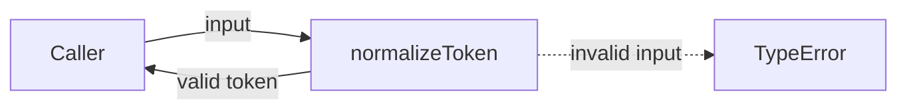
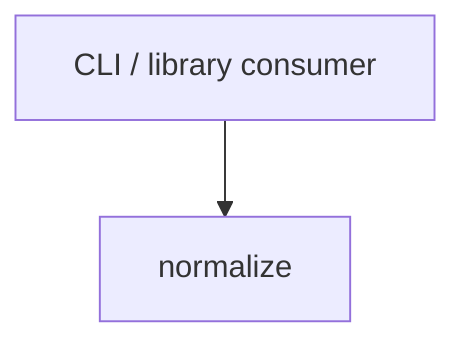

# Module: normalize

<!--SECTION:SPEC_ID-->
TOKEN-PIPELINE-NORMALIZE
<!--/SECTION:SPEC_ID-->

<!--SECTION:MODULE_VISION-->
## Module Vision
Модуль `normalize` владеет единственной чистой операцией `normalizeToken`: детерминированной нормализацией ASCII-токена без сетевого или дискового ввода-вывода. Родительский скоуп: [token](../../token.spec.md). Соседних, родительских и дочерних модулей нет — состав скоупа ограничен этим модулем.
<!--/SECTION:MODULE_VISION-->

<!--SECTION:OVERVIEW-->
## Overview


_Один вызов normalizeToken: валидный вход даёт токен, невалидный — TypeError — NOR-REQ-1, NOR-REQ-2._
<!--/SECTION:OVERVIEW-->

<!--SECTION:MODULE_USAGE_EXAMPLE-->
## Module Usage Example
```ts
import { normalizeToken } from "./normalize";

const token = normalizeToken("  Foo__BAR  ");
// token === "foo-bar"

try {
  normalizeToken("");
} catch (error) {
  if (error instanceof TypeError) {
    // Invalid input: empty, separator-only, or non-ASCII.
  }
}
```
<!--/SECTION:MODULE_USAGE_EXAMPLE-->

<!--SECTION:MODULE_REQUIREMENTS-->
## Requirements

### NOR-REQ-1 [должен]
**Когда** `normalizeToken` получает ASCII-строку, содержащую хотя бы один символ, отличный от ASCII-пробела, underscore и hyphen, **модуль должен** обрезать ведущие и замыкающие ASCII-пробелы, привести ASCII-буквы к нижнему регистру и свернуть серии пробелов, underscore и hyphen в один hyphen.
> Реализует родительское требование TOK-REQ-1.

### NOR-REQ-2 [должен · нештатная]
**Если** вход пустой, состоит только из разделителей или содержит не-ASCII символы, **модуль должен** выбросить `TypeError` без ввода-вывода.
> Реализует родительское требование TOK-REQ-2.

| Input | Outcome |
|---|---|
| `"  Foo__BAR  "` | `"foo-bar"` |
| `""` | `TypeError` |
<!--/SECTION:MODULE_REQUIREMENTS-->

<!--SECTION:INTER_MODULE_DEPENDENCIES-->
## Inter-Module Dependencies
- **Depends on:** None.
- **Scope Reference (cross-scope):** None.
- **Provides to:** None within `token`; external CLI and library consumers use `normalizeToken`.


_Модуль не зависит от соседей и отдаёт normalizeToken внешним потребителям._
<!--/SECTION:INTER_MODULE_DEPENDENCIES-->

<!--SECTION:ENTITY_INVENTORY-->
## Entity Inventory

_Это полный список сущностей модуля. Любое введение сущности execution-агентом помимо этого списка считается drift'ом и требует обновления spec._

| Name | Type | Purpose |
|------|------|---------|
| `normalizeToken` | Function | Чистая нормализация ASCII-токена: trim, lower-case и сворачивание разделителей |

Ошибки: throw `TypeError` → `normalizeToken`

ER-скетч не рисуется: инвентарь содержит одну сущность без связей.
<!--/SECTION:ENTITY_INVENTORY-->

<!--SECTION:ENTITY_SURFACES-->
## Entity Surfaces
Поверхность одна: публичная функция `normalizeToken`, возвращающая нормализованный токен или выбрасывающая `TypeError`.

<details>
<summary>Полные поверхности сущностей</summary>

### `normalizeToken`
- **Type:** Function
- **Purpose:** Детерминированно нормализует ASCII-токен без ввода-вывода.
- **Public Properties:** N/A
- **Public Operations:** `normalizeToken(input: string): string` — возвращает нормализованный токен либо выбрасывает `TypeError`.
- **Lifecycle:** Не имеет состояния; доступна сразу после загрузки модуля, завершение не требуется.
- **Events Emitted:** N/A
- **Errors & Degradation:** `TypeError` через throw для пустого входа, входа только из разделителей и не-ASCII входа; владелец — `normalizeToken`, обработка остаётся вызывающему коду.
- **Consumers:**
  - Internal: N/A — модуль состоит из одной сущности.
  - External: CLI and library consumers.
- **Usage Waiver (external: CLI and library consumers):** `normalizeToken` — единственная публичная операция, ради которой существует модуль, и её единственный контракт задан родительским `PUBLIC_API_SURFACE`.

</details>
<!--/SECTION:ENTITY_SURFACES-->

<!--SECTION:MODULE_CONTRACTS-->
## Module Contracts
Контракт один: чистая функция `normalizeToken`; Port и Adapter не вводятся, потому что подтверждённой вариативности или тестового шва нет.

Граф не рисуется: в модуле нет Port/Adapter, только Service `normalizeToken`.

Call Chain не рисуется: в инвентаре одна абстракция — `normalizeToken`.

<details>
<summary>Контракты DbC</summary>

### Services

#### Service: `normalizeToken`
- **Purpose:** Детерминированно нормализует ASCII-токен, отклоняя недопустимый вход.
- **Consumers:** CLI and library consumers.
- **Runtime Backing:** `not-implemented`
- **Verification Levels:** `contract`, `unit`
- **Deferred Runtime Scope:** Вся объявленная нормализация остаётся `not-implemented`; код не создавался.
- **Usage Waiver (external: CLI and library consumers):** Единственная публичная операция модуля, заданная родительским `PUBLIC_API_SURFACE`.

**Contract (DbC)** — one block per operation:
- `normalizeToken`:
  - Pre: вход — строка; она не пустая, состоит не только из ASCII-пробелов, underscore и hyphen и содержит только ASCII-символы.
  - Post: возвращённая строка не имеет ведущих и замыкающих ASCII-пробелов, ASCII-буквы приведены к нижнему регистру, а каждая серия ASCII-пробелов, underscore и hyphen заменена одним hyphen.
  - On pre-violation: выбрасывается `TypeError`; ввод-вывод не выполняется.

**Invariants:** Функция чистая, детерминированная и не хранит состояние между вызовами.
</details>
<!--/SECTION:MODULE_CONTRACTS-->

<!--SECTION:PUBLIC_OPTIONS-->
## Public Options & Policies
Публичных флагов и политик нет: поведение задаётся только входом `normalizeToken`.

<details>
<summary>Опции и политики</summary>

Не применимо: модуль не предоставляет флагов, настроек или публичных политик; все значения фиксированы контрактом `normalizeToken`.

</details>
<!--/SECTION:PUBLIC_OPTIONS-->

<!--SECTION:FILE_STRUCTURE-->
## File Structure
```
normalize/
├── normalize.ts
└── normalize.test.ts
```

**File Mapping:**
- `normalize/normalize.ts`: реализация `normalizeToken` и отклонение недопустимого входа через `TypeError`.
- `normalize/normalize.test.ts`: unit-тесты счастливого пути и отклонения пустого, separator-only и не-ASCII входа.
<!--/SECTION:FILE_STRUCTURE-->

<!--SECTION:RESEARCH-->
## Research
Не применимо: этот ограниченный модуль не опирается на research-документы, а реестр research родительского скоупа пуст.
<!--/SECTION:RESEARCH-->

<!--SECTION:MODULE_DECISION_LOG-->
## Module Decision Log
Одна запись: чистая функция без Port/Adapter.

<details>
<summary>Полные записи Decision Log</summary>

NOR-DL-1 2026-10-24 — не вводить Port/Adapter для единственной чистой функции (почему: подтверждённой вариативности или тестового шва нет; отвергнуто: Port ради одной реализации — лишняя абстракция; риск: смена контракта потребует нового решения)

</details>
<!--/SECTION:MODULE_DECISION_LOG-->

<!--SECTION:HANDOFF-->
## Handoff to Tasks
- **Implementation files to be created:** `normalize/normalize.ts`
- **Test files to be created:** `normalize/normalize.test.ts`
- **Stack dependencies:**
  - Language: `typescript` (resolves to `ai/directives/coding/typescript-rules.xml`)
  - Test framework: `node-test` (resolves to `ai/directives/testing/node-test.xml`)
- **Module Rules Additions:** None.

  | Rule | Category | Source |
  |------|----------|--------|
  | — | — | — |

- **Open risks & validation needs:** Authoring only: implementation and tests are not created, and operator approval remains pending. The fixture has no TypeScript test runner installed, so test execution is unverified.
<!--/SECTION:HANDOFF-->

<!--SECTION:IMPLEMENTATION_INSIGHTS-->
## Implementation Insights
Не применимо: реализации ещё не было.

<details>
<summary>Заметки по реализации</summary>

Пост-имплементационных наблюдений нет, потому что код не создавался.

</details>
<!--/SECTION:IMPLEMENTATION_INSIGHTS-->
