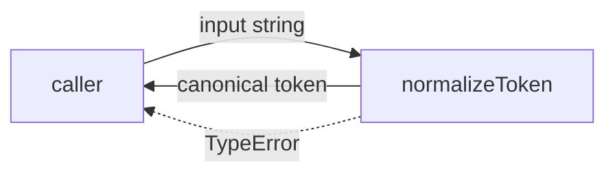
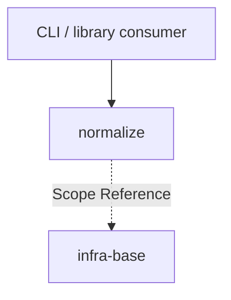

# Module: normalize

<!--SECTION:SPEC_ID-->
TOKEN-PIPELINE-NORMALIZE
<!--/SECTION:SPEC_ID-->

<!--SECTION:MODULE_VISION-->
## Module Vision

Owns the deterministic ASCII token normalization inside the `token` scope. This module turns one input string into one canonical token or rejects it with `TypeError`, with no network, persistence or shared state.

- **Parent scope:** [Scope](../../token.spec.md), [MODULE_MAP](../../token.spec.md#MODULE_MAP), [REQUIREMENTS_AND_CONSTRAINTS](../../token.spec.md#REQUIREMENTS_AND_CONSTRAINTS).
- **Child modules:** none — this is the only module in the `pipeline/normalize` responsibility.
- **Sibling modules:** none.
<!--/SECTION:MODULE_VISION-->

<!--SECTION:OVERVIEW-->
## Overview


_Один вход проходит нормализацию и возвращает токен либо TypeError — NOR-REQ-1, NOR-REQ-2._
<!--/SECTION:OVERVIEW-->

<!--SECTION:MODULE_USAGE_EXAMPLE-->
## Module Usage Example

```ts
import { normalizeToken } from "./normalize";

const token = normalizeToken("  Foo__BAR  ");
console.log(token);

try {
  normalizeToken("");
} catch (error) {
  if (error instanceof TypeError) {
    console.error("invalid token input");
  }
}
```
<!--/SECTION:MODULE_USAGE_EXAMPLE-->

<!--SECTION:MODULE_REQUIREMENTS-->
## Requirements

### NOR-REQ-1 [должен]
**Когда** передана ASCII-строка, содержащая хотя бы один символ, отличный от пробела, underscore и hyphen, **нормализатор должен** обрезать ведущие и хвостовые ASCII-пробелы, привести ASCII-буквы к нижнему регистру и свернуть любые серии пробелов, underscore и hyphen в один hyphen. Уточняет [TOK-REQ-1](../../token.spec.md#REQUIREMENTS_AND_CONSTRAINTS).
> Один и тот же вход всегда даёт один канонический токен.

### NOR-REQ-2 [должен · нештатная]
**Если** строка пустая, состоит только из разделителей (пробел, underscore, hyphen) или содержит не-ASCII символы, **то нормализатор должен** выбросить `TypeError` без выполнения ввода-вывода. Уточняет [TOK-REQ-2](../../token.spec.md#REQUIREMENTS_AND_CONSTRAINTS).
> Неверный вход нельзя маскировать пустым корректным токеном.

| Input | Outcome |
|---|---|
| `"  Foo__BAR  "` | `"foo-bar"` |
| `""` | `TypeError` |
<!--/SECTION:MODULE_REQUIREMENTS-->

<!--SECTION:INTER_MODULE_DEPENDENCIES-->
## Inter-Module Dependencies

- **Depends on:** none within this scope — `normalize` has no sibling modules.
- **Scope Reference (cross-scope):** [infra-base](../../../infra-base/infra-base.spec.md) (infrastructure authoring only).
- **Provides to:** CLI and library consumers through the parent [Scope](../../token.spec.md).


_Направление зависимостей: потребитель → normalize, без зависимостей от соседних модулей._
<!--/SECTION:INTER_MODULE_DEPENDENCIES-->

<!--SECTION:ENTITY_INVENTORY-->
## Entity Inventory

_Это полный список сущностей модуля. Любое введение сущности execution-агентом помимо этого списка считается drift'ом и требует обновления spec._

| Name | Type | Purpose |
|------|------|---------|
| `normalizeToken` | Function | Чистая нормализация ASCII-строки в канонический токен и владение ошибкой `TypeError`. |

Ошибки: `TypeError` (throw) → `normalizeToken`

Инвентарь из одной сущности: реляционный ER-скетч не применим, связывать нечего.
<!--/SECTION:ENTITY_INVENTORY-->

<!--SECTION:ENTITY_SURFACES-->
## Entity Surfaces

Одна публичная функция `normalizeToken`; ниже — её полная поверхность.

<details>
<summary>Полные поверхности сущностей</summary>

### `normalizeToken`
- **Type:** Function
- **Purpose:** Преобразует допустимую ASCII-строку в канонический токен или выбрасывает `TypeError`.
- **Public Properties:** N/A — функция без состояния.
- **Public Operations:** `normalizeToken` — нормализовать переданную строку.
- **Lifecycle:** Чистая функция; создаётся на время вызова, не владеет экземпляром и завершается при возврате значения или выбросе `TypeError`.
- **Events Emitted:** N/A
- **Errors & Degradation:** `TypeError` через `throw`, владелец — `normalizeToken`; обработка и отображение остаются за вызывающим потребителем, без ввода-вывода.
- **Consumers:**
  - Internal: `src/token/pipeline/normalize/normalize.ts`
  - External: CLI and library consumers
- **Usage Waiver (external: CLI and library consumers):** Единственная публичная точка входа модуля; альтернативной поверхности нет.

</details>
<!--/SECTION:ENTITY_SURFACES-->

<!--SECTION:MODULE_CONTRACTS-->
## Module Contracts

Модуль определяет одну чистую функцию `normalizeToken`; Ports и Adapters отсутствуют.

Граф не рисуется: в модуле нет Port/Adapter, только Service `normalizeToken`.

Call Chain не рисуется: в инвентаре одна абстракция (`normalizeToken`), порог ≥2 не достигнут.

<details>
<summary>Контракты DbC</summary>

### Services

#### Service: `normalizeToken`
- **Purpose:** Детерминированно нормализовать допустимую ASCII-строку в канонический токен.
- **Consumers:** `src/token/pipeline/normalize/normalize.ts`; внешние CLI и библиотечные потребители.
- **Runtime Backing:** `not-implemented`
- **Verification Levels:** `contract`, `unit`
- **Deferred Runtime Scope:** Вся объявленная реализация — вне текущей authoring-задачи; код не запрошен.

**Contract (DbC)** — one block per operation:
- `normalizeToken`:
  - Pre: Вход — ASCII-строка, содержащая хотя бы один символ, отличный от пробела, underscore и hyphen.
  - Post: Возвращается вход без ведущих и хвостовых ASCII-пробелов, с ASCII-буквами в нижнем регистре и с сериями пробелов, underscore и hyphen, свёрнутыми в один hyphen.
  - On pre-violation: Выбрасывается `TypeError`; ввод-вывод не выполняется.

**Invariants:** Результат детерминирован и не зависит от состояния; для одного и того же входа результат всегда одинаков, а ввод-вывод отсутствует.

</details>
<!--/SECTION:MODULE_CONTRACTS-->

<!--SECTION:PUBLIC_OPTIONS-->
## Public Options & Policies

Публичных опций и политик нет: поведение зафиксировано в NOR-REQ-1 и NOR-REQ-2.

<details>
<summary>Опции и политики</summary>

No configurable flags or policies are exposed. The input domain, separator set and `TypeError` behavior are fixed by NOR-REQ-1 and NOR-REQ-2; nothing is deferred to a future option.

</details>
<!--/SECTION:PUBLIC_OPTIONS-->

<!--SECTION:FILE_STRUCTURE-->
## File Structure

```
src/token/pipeline/normalize/
├── normalize.ts
└── normalize.test.ts
```

**File Mapping:**
- `src/token/pipeline/normalize/normalize.ts`: pure `normalizeToken` function and its `TypeError` rejection path.
- `src/token/pipeline/normalize/normalize.test.ts`: unit and contract tests for NOR-REQ-1 and NOR-REQ-2.
<!--/SECTION:FILE_STRUCTURE-->

<!--SECTION:RESEARCH-->
## Research

No research documents are registered for this module. The bounded deterministic normalization contract required no external research.
<!--/SECTION:RESEARCH-->

<!--SECTION:MODULE_DECISION_LOG-->
## Module Decision Log

Одна запись: чистая функция без Port/Adapter; полная запись ниже.

<details>
<summary>Полные записи Decision Log</summary>

NOR-DL-1 2026-10-24 — реализовать нормализацию одной чистой функцией `normalizeToken` без Port/Adapter; где: `specs/token/pipeline/normalize/normalize.spec.md#MODULE_CONTRACTS` (почему: нет подтверждённой вариативности или тестового шва, требующего абстракции; отвергнуто: Port с Adapter-обёрткой; риск: замена реализации потребует правки потребителей) [verdict: pending-operator]

</details>
<!--/SECTION:MODULE_DECISION_LOG-->

<!--SECTION:HANDOFF-->
## Handoff to Tasks

- **Implementation files to be created:** `src/token/pipeline/normalize/normalize.ts`
- **Test files to be created:** `src/token/pipeline/normalize/normalize.test.ts`
- **Stack dependencies:**
  - Language: `typescript` (resolves to `ai/directives/coding/typescript-rules.xml`)
  - Test framework: `node-test` (resolves to `ai/directives/testing/node-test.xml`)
- **Module Rules Additions:** None — no module-specific additions; the scope-wide baseline applies.

  | Rule | Category | Source |
  |------|----------|--------|
  | No module-specific additions | architecture | `ai/directives/coding/baseline-rules.xml` |

- **Open risks & validation needs:** No implementation exists, so runtime and test receipts remain pending; the artifact oracle and independent semantic review are not claimed here.
- **Owner handoff:** pending-operator — Approval #1 has not been given. No tickets, implementation or execution are approved by this draft.
<!--/SECTION:HANDOFF-->

<!--SECTION:IMPLEMENTATION_INSIGHTS-->
## Implementation Insights

Not applicable: this authoring task requests no implementation, so there are no post-implementation learnings to record.

<details>
<summary>Заметки по реализации</summary>

No implementation insights exist yet. This appendix stays empty until implementation and audit-cycle compaction produce non-trivial learnings.

</details>
<!--/SECTION:IMPLEMENTATION_INSIGHTS-->
