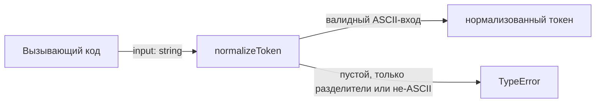
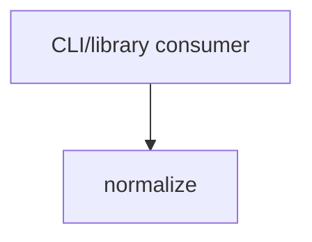

# Module: normalize

<!--SECTION:SPEC_ID-->
TOKEN-NORMALIZE
<!--/SECTION:SPEC_ID-->

<!--SECTION:MODULE_VISION-->
## Module Vision

Модуль владеет единственной детерминированной операцией нормализации ASCII-токена внутри скоупа
[`token`](../token.spec.md): обрезка крайних пробелов, приведение ASCII-букв к нижнему регистру и
сворачивание разделителей в один hyphen. Дочерних модулей нет; соседних модулей скоупа нет.

<!--/SECTION:MODULE_VISION-->

<!--SECTION:OVERVIEW-->
## Overview



_Главный путь нормализации и отклонение недопустимого входа — NOR-REQ-1, NOR-REQ-2._

<!--/SECTION:OVERVIEW-->

<!--SECTION:MODULE_USAGE_EXAMPLE-->
## Module Usage Example

Инициализация не нужна: модуль экспортирует одну чистую функцию.

```ts
import { normalizeToken } from './normalize.js';

const token = normalizeToken('  Foo__BAR  ');
console.log(token);

try {
  normalizeToken('');
} catch (error) {
  if (!(error instanceof TypeError)) {
    throw error;
  }
  console.error('invalid token');
}
```

<!--/SECTION:MODULE_USAGE_EXAMPLE-->

<!--SECTION:MODULE_REQUIREMENTS-->
## Requirements

### NOR-REQ-1 [должен]
**Когда** передана непустая ASCII-строка без не-ASCII символов, **normalizeToken должен** обрезать
крайние ASCII-пробелы, привести ASCII-буквы к нижнему регистру и свернуть последовательности
ASCII-пробелов, underscore и hyphen в один hyphen.

> Уточняет TOK-REQ-1: модуль фиксирует конкретный наблюдаемый формат токена. Пример
> `normalize-example` показывает ожидаемый результат на входе с несколькими разделителями.

### NOR-REQ-2 [должен · нештатная]
**Если** вход пуст, состоит только из разделителей или содержит не-ASCII символ, **то normalizeToken
должен** выбросить TypeError без ввода-вывода.

> Уточняет TOK-REQ-2: ошибку входа нельзя маскировать пустым корректным токеном. Пример
> `empty-input-rejection` фиксирует отказ на пустой строке.

Наблюдаемые примеры (`normalize-example`, `empty-input-rejection`):

| Input | Outcome |
|---|---|
| `"  Foo__BAR  "` | `"foo-bar"` |
| `""` | `TypeError` |

<!--/SECTION:MODULE_REQUIREMENTS-->

<!--SECTION:INTER_MODULE_DEPENDENCIES-->
## Inter-Module Dependencies

- **Depends on:** No sibling modules.
- **Scope Reference (cross-scope):** None.
- **Provides to:** No sibling modules; the public function serves CLI and library consumers outside the scope.



_Единственное отношение — внешний потребитель вызывает normalize; внутренних рёбер нет._

<!--/SECTION:INTER_MODULE_DEPENDENCIES-->

<!--SECTION:ENTITY_INVENTORY-->
## Entity Inventory

_Это полный список сущностей модуля. Любое введение сущности execution-агентом помимо этого списка считается drift'ом и требует обновления spec._

| Name | Type | Purpose |
|------|------|---------|
| `normalizeToken` | Function | Детерминированно нормализует ASCII-токен и отклоняет недопустимый вход |

Ошибки: throw (TypeError) → `normalizeToken`

ER-скетч не рисуется: в инвентаре одна сущность без связей.

<!--/SECTION:ENTITY_INVENTORY-->

<!--SECTION:ENTITY_SURFACES-->
## Entity Surfaces

Одна публичная функция `normalizeToken` с чистым контрактом и единственным видом ошибки.

<details>
<summary>Полные поверхности сущностей</summary>

### `normalizeToken`
- **Type:** Function
- **Purpose:** Преобразует ASCII-строку в нормализованный токен либо отклоняет недопустимый вход.
- **Public Properties:** N/A
- **Public Operations:** normalizeToken — нормализовать переданную строку.
- **Lifecycle:** Чистая функция без состояния; создаётся при импорте модуля, завершается после возврата значения или выброса TypeError.
- **Events Emitted:** N/A
- **Errors & Degradation:** `TypeError` через throw при пустом входе, входе только из разделителей или не-ASCII входе; владелец — `normalizeToken`, отображение ошибки остаётся за вызывающим кодом.
- **Consumers:**
  - Internal: `src/token/normalize/normalize.ts`
  - External: CLI and library consumers
- **Usage Waiver (external: CLI and library consumers):** Единственная публичная функция модуля; внутренних вызовов нет, потребители внешние.

</details>
<!--/SECTION:ENTITY_SURFACES-->

<!--SECTION:MODULE_CONTRACTS-->
## Module Contracts

Модуль определяет одну чистую функцию `normalizeToken`; Port/Adapter не вводятся.

Граф зависимостей не рисуется: в модуле нет Port/Adapter, только Service `normalizeToken`.

Call Chain не рисуется: в инвентаре одна абстракция — `normalizeToken`; цепочки между абстракциями нет.

<details>
<summary>Контракты DbC</summary>

### Services

#### Service: `normalizeToken`
- **Purpose:** Детерминированно нормализовать ASCII-токен и явно отклонить недопустимый вход.
- **Consumers:** `src/token/normalize/normalize.ts`; CLI and library consumers.
- **Runtime Backing:** `not-implemented`
- **Verification Levels:** `contract`, `unit`
- **Deferred Runtime Scope:** Реализация и тесты отсутствуют; контракт объявлен для будущего scaffold.

**Contract (DbC)**
- `normalizeToken`:
  - Pre: Вход — строка, содержащая хотя бы один не-разделитель ASCII и не содержащая не-ASCII символов.
  - Post: Крайние ASCII-пробелы удалены, ASCII-буквы приведены к нижнему регистру, последовательности ASCII-пробелов, underscore и hyphen свёрнуты в один hyphen; ввод-вывод не выполняется.
  - On pre-violation: Выбрасывается TypeError без ввода-вывода, если вход пуст, состоит только из разделителей или содержит не-ASCII символ.

**Invariants:** Функция чистая и детерминированная: один и тот же вход даёт один и тот же результат или TypeError, без состояния и ввода-вывода.

</details>
<!--/SECTION:MODULE_CONTRACTS-->

<!--SECTION:PUBLIC_OPTIONS-->
## Public Options & Policies

Публичных опций и политик нет: `normalizeToken` не принимает параметров конфигурации.

<details>
<summary>Опции и политики</summary>

Флаги, опции и политики отсутствуют; поведение полностью задано контрактом `normalizeToken`.

</details>
<!--/SECTION:PUBLIC_OPTIONS-->

<!--SECTION:FILE_STRUCTURE-->
## File Structure

```
src/token/normalize/
├── normalize.ts
└── normalize.test.ts
```

**File Mapping:**
- `src/token/normalize/normalize.ts`: чистая реализация `normalizeToken`
- `src/token/normalize/normalize.test.ts`: unit-тесты для нормализации и отклонения входа
<!--/SECTION:FILE_STRUCTURE-->

<!--SECTION:RESEARCH-->
## Research

Ресёрч не проводился: задача ограничена детерминированной локальной нормализацией без внешних
зависимостей и документов `research/`.

<!--/SECTION:RESEARCH-->

<!--SECTION:MODULE_DECISION_LOG-->
## Module Decision Log

Зафиксировано одно решение: чистая функция без Port/Adapter; вердикт `pending-operator`.

<details>
<summary>Полные записи Decision Log</summary>

NOR-DL-1 2026-10-24 — normalizeToken остаётся чистой функцией без Port/Adapter; где: specs/token/normalize/normalize.spec.md#module-contracts (почему: одна реализация и нет подтверждённой вариативности; отвергнуто: отдельный Port ради тестового шва; риск: будущая замена реализации потребует рефакторинга) [verdict: pending-operator]

</details>
<!--/SECTION:MODULE_DECISION_LOG-->

<!--SECTION:HANDOFF-->
## Handoff to Tasks

- **Implementation files to be created:** `src/token/normalize/normalize.ts`
- **Test files to be created:** `src/token/normalize/normalize.test.ts`
- **Stack dependencies:**
  - Language: `typescript` (resolves to `ai/directives/coding/typescript-rules.xml`)
  - Test framework: `node-test` (resolves to `ai/directives/testing/node-test.xml`)
- **Module Rules Additions:** None.
- **Open risks & validation needs:** TypeScript/Node test setup ещё не сконфигурирован в фикстуре; оба наблюдаемых примера должны быть проверены после scaffold.
- **Handoff status:** pending-operator — перечислены только ожидаемые артефакты; реализация, тикеты и исполнение не одобрены.

<!--/SECTION:HANDOFF-->

<!--SECTION:IMPLEMENTATION_INSIGHTS-->
## Implementation Insights

Неприменимо: реализация ещё не создана, post-implementation наблюдений нет.

<details>
<summary>Заметки по реализации</summary>

Раздел остаётся пустым до появления реализации и audit-cycle compaction.

</details>
<!--/SECTION:IMPLEMENTATION_INSIGHTS-->
