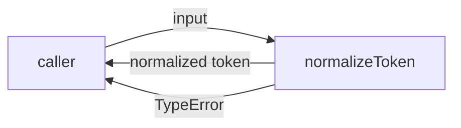
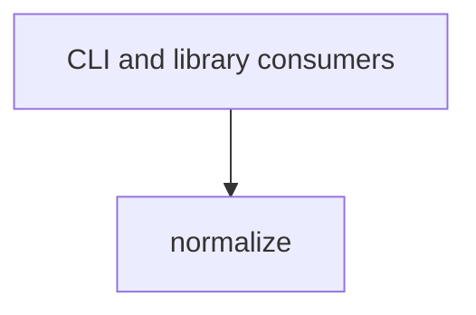

# Module: normalize

<!--SECTION:SPEC_ID-->
TOKEN-NORMALIZE
<!--/SECTION:SPEC_ID-->

<!--SECTION:MODULE_VISION-->
## Module Vision

`normalize` owns the single deterministic token-normalization operation inside the [`token` scope](../token.spec.md). It exposes `normalizeToken` to local CLI and library consumers and owns the rejection of invalid tokens. The module has no parent, child, or sibling modules; its responsibility is bounded by the token scope contract.

<!--/SECTION:MODULE_VISION-->

<!--SECTION:OVERVIEW-->
## Overview


_Путь вызова normalizeToken, включая отказ на недопустимом входе — NOR-REQ-1, NOR-REQ-2._

<!--/SECTION:OVERVIEW-->

<!--SECTION:MODULE_USAGE_EXAMPLE-->
## Module Usage Example

```ts
import { normalizeToken } from "./normalize.js";

const token = normalizeToken("  Foo__BAR  ");
console.log(token);

try {
  normalizeToken("");
} catch (error) {
  if (error instanceof TypeError) {
    console.error("invalid token input");
  }
}
```

<!--/SECTION:MODULE_USAGE_EXAMPLE-->

<!--SECTION:MODULE_REQUIREMENTS-->
## Requirements

### NOR-REQ-1 [должен]
**Когда** передана непустая ASCII-строка, содержащая хотя бы один символ, отличный от пробела, underscore и hyphen, **normalizeToken должен** обрезать крайние ASCII-пробелы, привести ASCII-буквы к нижнему регистру и свернуть каждый прогон пробелов, underscore и hyphen в один hyphen.

> Уточняет TOK-REQ-1 для модуля normalize: один детерминированный формат нужен CLI и библиотечным потребителям без дополнительной настройки.

### NOR-REQ-2 [должен · нештатная]
**Если** входная строка пуста, состоит только из ASCII-пробелов, underscore и hyphen или содержит хотя бы один не-ASCII символ, **то normalizeToken должен** выбросить TypeError без ввода-вывода.

> Уточняет TOK-REQ-2 для модуля normalize: недопустимый вход нельзя маскировать пустым или частично нормализованным токеном.

| Input | Outcome |
|---|---|
| `"  Foo__BAR  "` | `"foo-bar"` |
| `""` | `TypeError` |

<!--/SECTION:MODULE_REQUIREMENTS-->

<!--SECTION:INTER_MODULE_DEPENDENCIES-->
## Inter-Module Dependencies

- **Depends on:** none within this scope.
- **Scope Reference (cross-scope):** none at runtime; the [`token` scope](../token.spec.md) defines the contract.
- **Provides to:** local CLI and library consumers.


_Модуль normalize используется только внешними потребителями; внутренних зависимостей нет._

<!--/SECTION:INTER_MODULE_DEPENDENCIES-->

<!--SECTION:ENTITY_INVENTORY-->
## Entity Inventory

_Это полный список сущностей модуля. Любое введение сущности execution-агентом помимо этого списка считается drift'ом и требует обновления spec._

| Name | Type | Purpose |
|------|------|---------|
| `normalizeToken` | Function | Нормализует ASCII-токен и отклоняет недопустимый вход через TypeError. |

Ошибки: throw → `normalizeToken`

ER-набросок не рисуется: в инвентаре одна сущность, связывать нечего.

<!--/SECTION:ENTITY_INVENTORY-->

<!--SECTION:ENTITY_SURFACES-->
## Entity Surfaces

Одна публичная функция `normalizeToken` без состояния, событий и внутренних потребителей.

<details>
<summary>Полные поверхности сущностей</summary>

### `normalizeToken`
- **Type:** Function
- **Purpose:** Нормализует один ASCII-токен и отклоняет пустой, разделительный или не-ASCII вход.
- **Public Properties:** N/A
- **Public Operations:** `normalizeToken(input: string): string`
- **Lifecycle:** Stateless; caller invokes it per token, and the invocation ends on return or TypeError.
- **Events Emitted:** N/A
- **Errors & Degradation:** `TypeError` via throw for empty, separator-only, or non-ASCII input; owned by `normalizeToken`.
- **Consumers:**
  - Internal: none; this is the module's public surface.
  - External: local CLI and library consumers.

</details>

<!--/SECTION:ENTITY_SURFACES-->

<!--SECTION:MODULE_CONTRACTS-->
## Module Contracts

Модуль определяет одну чистую функцию `normalizeToken`; Port, Adapter и Service с состоянием не вводятся.

Граф не рисуется: в модуле нет Port/Adapter, только Function `normalizeToken`.

Call Chain не рисуется: в модуле одна абстракция — Function `normalizeToken`.

<details>
<summary>Контракты DbC</summary>

### Functions

#### Service: `normalizeToken`
- **Purpose:** Нормализует ASCII-токен по единому детерминированному правилу.
- **Consumers:** external: local CLI and library consumers; internal: none.
- **Runtime Backing:** `not-implemented`
- **Verification Levels:** `contract`, `unit`
- **Deferred Runtime Scope:** Всё поведение — реализация не создана в этой authoring-задаче.

**Contract (DbC)** — one block per operation:
- `normalizeToken`:
  - Pre: input is a non-empty ASCII string containing at least one character other than space, underscore and hyphen.
  - Post: returns the input with leading and trailing ASCII spaces trimmed, ASCII letters lowercased, and each run of spaces, underscores and hyphens replaced by one hyphen.
  - On pre-violation: throws `TypeError` without I/O for empty input, separator-only input, or any non-ASCII character.

**Invariants:** None — the function holds no state and performs no I/O.

</details>

<!--/SECTION:MODULE_CONTRACTS-->

<!--SECTION:PUBLIC_OPTIONS-->
## Public Options & Policies

Модуль не имеет публичных опций: контракт `normalizeToken` полностью фиксирован.

<details>
<summary>Опции и политики</summary>

Нет настраиваемых флагов, политик или порогов. Всё наблюдаемое поведение задано `NOR-REQ-1` и `NOR-REQ-2`.

</details>

<!--/SECTION:PUBLIC_OPTIONS-->

<!--SECTION:FILE_STRUCTURE-->
## File Structure

```
src/token/normalize/
├── normalize.ts
└── normalize.test.ts
```

**File Mapping:**
- `src/token/normalize/normalize.ts`: `normalizeToken` implementation and public export.
- `src/token/normalize/normalize.test.ts`: contract and unit tests for `normalizeToken`.

<!--/SECTION:FILE_STRUCTURE-->

<!--SECTION:RESEARCH-->
## Research

No research documents: this module is fully specified by the token scope contract and `docs/token-contract.md`, so no research registry entries exist.

<!--/SECTION:RESEARCH-->

<!--SECTION:MODULE_DECISION_LOG-->
## Module Decision Log

No module-level decisions are recorded; no unresolved boundary choice or deviation from the scope contract was introduced.

<details>
<summary>Полные записи Decision Log</summary>

Записей нет.

</details>

<!--/SECTION:MODULE_DECISION_LOG-->

<!--SECTION:HANDOFF-->
## Handoff to Tasks

- **Implementation files to be created:** `src/token/normalize/normalize.ts`
- **Test files to be created:** `src/token/normalize/normalize.test.ts`
- **Stack dependencies:**
  - Language: `typescript` (resolves to `ai/directives/coding/typescript-rules.xml`)
  - Test framework: `node-test` (resolves to `ai/directives/testing/node-test.xml`)
- **Module Rules Additions:** None.
- **Open risks & validation needs:** No implementation or test run exists; operator approval is pending, and runtime validation is deferred to a later execute phase.
- **Owner handoff status:** pending-operator.

<!--/SECTION:HANDOFF-->

<!--SECTION:IMPLEMENTATION_INSIGHTS-->
## Implementation Insights

Not applicable yet: no implementation exists, so no post-implementation learnings can be recorded.

<details>
<summary>Заметки по реализации</summary>

Нет заметок: модуль находится на стадии authoring, реализация не создавалась.

</details>

<!--/SECTION:IMPLEMENTATION_INSIGHTS-->
