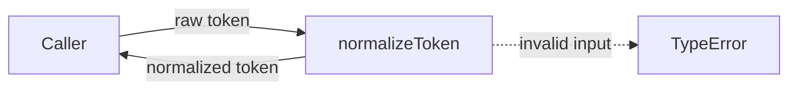
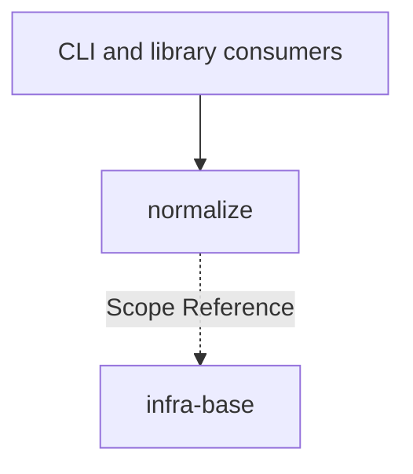

# Module: normalize

<!--SECTION:SPEC_ID-->
TOKEN-NORMALIZE
<!--/SECTION:SPEC_ID-->

<!--SECTION:MODULE_VISION-->
## Module Vision
Модуль владеет единственной операцией `normalizeToken` — локальной детерминированной нормализацией ASCII-токена для CLI и библиотечных потребителей. Он не выполняет транслитерацию, не обращается к сети, файлам или конфигурации и не является вторым владельцем поведения scope.

Родительский scope: [token](../token.spec.md). Соседних модулей в scope `token` нет; дочерних модулей у `normalize` нет.
<!--/SECTION:MODULE_VISION-->

<!--SECTION:OVERVIEW-->
## Overview

_Путь нормализации токена и отказ на недопустимом вводе — NOR-REQ-1, NOR-REQ-2._
<!--/SECTION:OVERVIEW-->

<!--SECTION:MODULE_USAGE_EXAMPLE-->
## Module Usage Example
```ts
import { normalizeToken } from "./normalize.js";

const token = normalizeToken("  Foo__BAR  ");
console.log(token);

try {
  normalizeToken("");
} catch (error) {
  if (!(error instanceof TypeError)) {
    throw error;
  }
  console.log("invalid token rejected");
}
```

Инициализация не требуется: функция вызывается напрямую и не хранит состояние.
<!--/SECTION:MODULE_USAGE_EXAMPLE-->

<!--SECTION:MODULE_REQUIREMENTS-->
## Requirements
### NOR-REQ-1 [должен]
**Когда** передана непустая ASCII-строка, содержащая хотя бы один символ, отличный от пробела, underscore и hyphen, **нормализатор должен** обрезать крайние ASCII-пробелы, привести ASCII-буквы к нижнему регистру и свернуть каждую серию пробелов, underscore и hyphen в один hyphen.
> Уточняет TOK-REQ-1: модуль фиксирует границу локальной детерминированной нормализации и не добавляет транслитерацию или ввод-вывод.

### NOR-REQ-2 [должен · нештатная]
**Если** строка пустая, состоит только из пробелов, underscore и hyphen или содержит не-ASCII символ, **то нормализатор должен** выбросить TypeError без ввода-вывода.
> Уточняет TOK-REQ-2: ошибочный вход нельзя маскировать пустым корректным токеном.

| Input | Outcome |
|---|---|
| `"  Foo__BAR  "` | `"foo-bar"` |
| `""` | `TypeError` |
<!--/SECTION:MODULE_REQUIREMENTS-->

<!--SECTION:INTER_MODULE_DEPENDENCIES-->
## Inter-Module Dependencies
- **Depends on:** None — в scope `token` нет других модулей.
- **Scope Reference (cross-scope):** [infra-base](../../infra-base/infra-base.spec.md) — только среда локального авторинга, без runtime-зависимости.
- **Provides to:** внешние CLI и библиотечные потребители; соседних модулей для предоставления нет.


_normalize не зависит от соседних модулей; infra-base связан только как среда авторинга._
<!--/SECTION:INTER_MODULE_DEPENDENCIES-->

<!--SECTION:ENTITY_INVENTORY-->
## Entity Inventory
_Это полный список сущностей модуля. Любое введение сущности execution-агентом помимо этого списка считается drift'ом и требует обновления spec._

| Name | Type | Purpose |
|------|------|---------|
| `normalizeToken` | Function | Чистая нормализация ASCII-токена и отказ с TypeError на недопустимом входе |

Ошибки: throw (TypeError) → `normalizeToken`.

ER-скетч не рисуется: в инвентаре одна сущность, связывать нечего.
<!--/SECTION:ENTITY_INVENTORY-->

<!--SECTION:ENTITY_SURFACES-->
## Entity Surfaces
Одна публичная функция `normalizeToken`: вход — строка, выход — нормализованный токен, ошибочный вход завершается TypeError.

<details>
<summary>Полные поверхности сущностей</summary>

### `normalizeToken`
- **Type:** Function
- **Purpose:** Детерминированно нормализовать ASCII-токен и явно отклонять недопустимый вход.
- **Public Properties:** N/A
- **Public Operations:** нормализовать строку; выбросить TypeError для пустой, separator-only или не-ASCII строки.
- **Lifecycle:** Вызывающий создаёт вызов функции; функция не имеет состояния и завершается после возврата значения или выброса ошибки.
- **Events Emitted:** N/A
- **Errors & Degradation:** `TypeError` через throw; владелец — `normalizeToken`; ошибка не перехватывается внутри модуля и передаётся вызывающему.
- **Consumers:**
  - Internal: `src/token/normalize/normalize.ts`
  - External: local CLI and library consumers
- **Usage Waiver (external: local CLI and library consumers):** Единственная публичная точка входа модуля; внутренних вызовов пока нет, потому что реализация и задачи не созданы.

</details>
<!--/SECTION:ENTITY_SURFACES-->

<!--SECTION:MODULE_CONTRACTS-->
## Module Contracts
Модуль определяет одну чистую функцию `normalizeToken`; Ports и Adapters не вводятся, потому что нет подтверждённой вариативности или тестового шва.

Граф зависимостей не рисуется: в модуле нет Port/Adapter, только функция `normalizeToken`.

Call Chain не рисуется: в модуле одна абстракция — `normalizeToken`.

<details>
<summary>Контракты DbC</summary>

### Services

#### Service: `normalizeToken`
- **Purpose:** Нормализовать ASCII-токен в один канонический вид и отклонять недопустимый вход.
- **Consumers:** `src/token/normalize/normalize.ts` (внутренняя точка экспорта); local CLI and library consumers (внешние).
- **Runtime Backing:** `not-implemented`
- **Verification Levels:** `contract`, `unit`
- **Deferred Runtime Scope:** Реализация и тесты отсутствуют; модуль описан как handoff-цель.

**Contract (DbC)**
- `normalizeToken`:
  - Pre: Вход — строка; строка непустая; строка содержит только ASCII-символы; строка содержит хотя бы один символ, отличный от пробела, underscore и hyphen.
  - Post: Возвращена строка без крайних ASCII-пробелов; ASCII-буквы приведены к нижнему регистру; каждая серия пробелов, underscore и hyphen заменена одним hyphen; ввод-вывод не выполнялся.
  - On pre-violation: Выброшен `TypeError`; ввод-вывод не выполнялся; частичный результат не возвращается.

**Invariants:** Функция чистая и детерминированная: одинаковый вход даёт одинаковый результат, глобальное состояние не изменяется, сеть, файловая система, часы и случайность не используются.
</details>
<!--/SECTION:MODULE_CONTRACTS-->

<!--SECTION:PUBLIC_OPTIONS-->
## Public Options & Policies
Публичных опций нет: поведение `normalizeToken` фиксировано, единственный вход — строка.

<details>
<summary>Опции и политики</summary>

- Флаги, режимы и политики конфигурации не предоставляются.
- Изменение набора разделителей или алфавита не входит в v1 и требует нового требования, а не скрытой опции.

</details>
<!--/SECTION:PUBLIC_OPTIONS-->

<!--SECTION:FILE_STRUCTURE-->
## File Structure
```
src/token/normalize/
├── normalize.ts
└── normalize.test.ts
```

**File Mapping:**
- `src/token/normalize/normalize.ts`: чистая реализация `normalizeToken`; handoff-цель, в этом артефакте не создаётся.
- `src/token/normalize/normalize.test.ts`: контрактные тесты NOR-REQ-1 и NOR-REQ-2; handoff-цель, в этом артефакте не создаётся.
<!--/SECTION:FILE_STRUCTURE-->

<!--SECTION:RESEARCH-->
## Research
Ресёрч не привлекался: поведение ограничено детерминированной локальной строковой операцией, зафиксированной в [token contract](../../../docs/token-contract.md) и родительском [TOK-REQ-1, TOK-REQ-2](../token.spec.md#requirements--constraints).
<!--/SECTION:RESEARCH-->

<!--SECTION:MODULE_DECISION_LOG-->
## Module Decision Log
Зафиксировано решение не вводить Port/Adapter для чистой функции.

<details>
<summary>Полные записи Decision Log</summary>

NOR-DL-1 2026-10-24 — оставить `normalizeToken` чистой функцией без Port и Adapter (почему: одна детерминированная реализация без подтверждённой вариативности; отвергнуто: Port/Adapter как лишний слой без второго кандидата реализации; риск: будущая вариативность потребует отдельного решения).

</details>
<!--/SECTION:MODULE_DECISION_LOG-->

<!--SECTION:HANDOFF-->
## Handoff to Tasks
- **Implementation files to be created:** `src/token/normalize/normalize.ts`
- **Test files to be created:** `src/token/normalize/normalize.test.ts`
- **Stack dependencies:**
  - Language: `typescript` (resolves to `ai/directives/coding/typescript-rules.xml`)
  - Test framework: `node-test` (resolves to `ai/directives/testing/node-test.xml`)
- **Module Rules Additions:** None — модуль не добавляет правил сверх scope-wide baseline.

- **Open risks & validation needs:** Реализация, тесты и задачи не созданы; поведение на не-ASCII входе проверяется только контрактным тестом после реализации. Статус: pending-operator; одобрение оператора отсутствует.
<!--/SECTION:HANDOFF-->

<!--SECTION:IMPLEMENTATION_INSIGHTS-->
## Implementation Insights
Не применимо: реализация ещё не выполнялась, поэтому post-implementation наблюдений нет.
<!--/SECTION:IMPLEMENTATION_INSIGHTS-->
