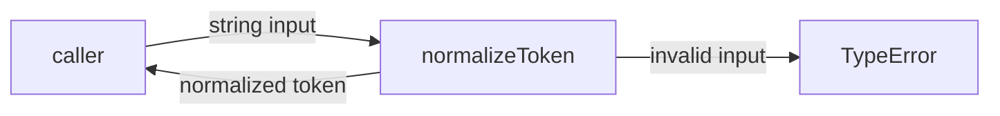
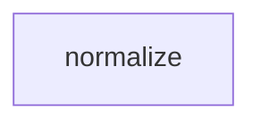

# Module: normalize

<!--SECTION:SPEC_ID-->
TOKEN-NORMALIZE
<!--/SECTION:SPEC_ID-->

<!--SECTION:MODULE_VISION-->
## Module Vision
Модуль `normalize` владеет единственной операцией нормализации строкового токена для локального CLI и библиотечных потребителей. Он принадлежит скоупу [token](../token.spec.md) и не имеет parent/child-модулей: вся ответственность сосредоточена в одной чистой функции `normalizeToken(input: string): string`.
<!--/SECTION:MODULE_VISION-->

<!--SECTION:OVERVIEW-->
## Overview


_Нормализация токена и отказ на недопустимом входе — NOR-REQ-1, NOR-REQ-2._
<!--/SECTION:OVERVIEW-->

<!--SECTION:MODULE_USAGE_EXAMPLE-->
## Module Usage Example
```ts
import { normalizeToken } from "./normalize.ts";

const token = normalizeToken("  Foo__BAR  ");
console.log(token);

try {
  normalizeToken("");
} catch (error) {
  console.error(error instanceof TypeError);
}
```
<!--/SECTION:MODULE_USAGE_EXAMPLE-->

<!--SECTION:MODULE_REQUIREMENTS-->
## Requirements
### NOR-REQ-1 [должен]
**Когда** передана непустая ASCII-строка, которая содержит хотя бы один символ, отличный от пробела, underscore и hyphen, **normalizeToken должен** обрезать крайние ASCII-пробелы, привести ASCII-буквы к нижнему регистру и свернуть серии пробелов, underscore и hyphen в один hyphen.

> Уточняет TOK-REQ-1: модуль фиксирует единственный детерминированный формат токена для CLI и библиотечных потребителей.

### NOR-REQ-2 [должен · нештатная]
**Если** строка пустая, состоит только из разделителей или содержит не-ASCII символ, **то normalizeToken должен** выбросить `TypeError` без ввода-вывода.

> Уточняет TOK-REQ-2: ошибочный вход нельзя маскировать пустым или частично нормализованным токеном.

| Input | Outcome |
|---|---|
| `"  Foo__BAR  "` | `"foo-bar"` |
| `""` | `TypeError` |
<!--/SECTION:MODULE_REQUIREMENTS-->

<!--SECTION:INTER_MODULE_DEPENDENCIES-->
## Inter-Module Dependencies
- **Depends on:** none.
- **Scope Reference (cross-scope):** none.
- **Provides to:** none.


_Модуль не имеет межмодульных зависимостей._
<!--/SECTION:INTER_MODULE_DEPENDENCIES-->

<!--SECTION:ENTITY_INVENTORY-->
## Entity Inventory

_Это полный список сущностей модуля. Любое введение сущности execution-агентом помимо этого списка считается drift'ом и требует обновления spec._

| Name | Type | Purpose |
|------|------|---------|
| `normalizeToken` | Function | Нормализует строковый токен; владеет TypeError на недопустимом входе. |

Ошибки: throw (`TypeError`) → `normalizeToken`

Одна сущность — ER sketch не нужен: связывать нечего.
<!--/SECTION:ENTITY_INVENTORY-->

<!--SECTION:ENTITY_SURFACES-->
## Entity Surfaces
Одна публичная функция `normalizeToken`; полная поверхность раскрыта ниже.

<details>
<summary>Полные поверхности сущностей</summary>

### `normalizeToken`
- **Type:** Function
- **Purpose:** Преобразует строку в детерминированный токен или выбрасывает TypeError на недопустимом входе.
- **Public Properties:** N/A
- **Public Operations:** normalizeToken — нормализация входной строки.
- **Lifecycle:** Stateless; создаётся импортом вызывающей стороны, завершение не требуется.
- **Events Emitted:** N/A
- **Errors & Degradation:** `TypeError` через throw; владелец и источник — `normalizeToken`; ввод-вывод не выполняется.
- **Consumers:**
  - Internal: none
  - External: local CLI and library consumers
- **Usage Waiver (external: local CLI and library consumers):** Единственная публичная точка входа модуля; потребитель находится вне модуля.

</details>
<!--/SECTION:ENTITY_SURFACES-->

<!--SECTION:MODULE_CONTRACTS-->
## Module Contracts
Модуль определяет один Service `normalizeToken`; Port/Adapter отсутствуют.

Граф зависимостей не рисуется: в модуле нет Port/Adapter, только Service `normalizeToken`.

Call Chain не рисуется: в модуле одна абстракция — Service `normalizeToken`.

<details>
<summary>Контракты DbC</summary>

### Services

#### Service: `normalizeToken`
- **Purpose:** Детерминированно нормализовать строковый токен без состояния и ввода-вывода.
- **Consumers:** local CLI and library consumers
- **Runtime Backing:** `not-implemented`
- **Verification Levels:** `contract`, `unit`
- **Deferred Runtime Scope:** Вся реализация отложена; исходный артефакт описывает только поведение.

**Contract (DbC)**
- `normalizeToken`:
  - Pre: вход — строка, каждый символ которой ASCII, и в ней есть хотя бы один символ, отличный от пробела, underscore и hyphen.
  - Post: возвращается строка без крайних ASCII-пробелов, с ASCII-буквами в нижнем регистре и каждой серией пробелов, underscore и hyphen, заменённой одним hyphen.
  - On pre-violation: выбрасывается `TypeError` без ввода-вывода.

**Invariants:** Функция stateless и не выполняет ввод-вывод.

</details>
<!--/SECTION:MODULE_CONTRACTS-->

<!--SECTION:PUBLIC_OPTIONS-->
## Public Options & Policies
Публичных опций в v1 нет: поведение полностью задано контрактом `normalizeToken`.

<details>
<summary>Опции и политики</summary>

Нет публично наблюдаемых флагов, опций или политик. Любое расширение потребует отдельного решения и ссылки на активирующий его тикет или версию.

</details>
<!--/SECTION:PUBLIC_OPTIONS-->

<!--SECTION:FILE_STRUCTURE-->
## File Structure
```
normalize/
├── normalize.ts
└── normalize.test.ts
```

**File Mapping:**
- `normalize/normalize.ts`: реализация `normalizeToken`.
- `normalize/normalize.test.ts`: проверки поведения для TOK-REQ-1 и TOK-REQ-2.
<!--/SECTION:FILE_STRUCTURE-->

<!--SECTION:RESEARCH-->
## Research
Ресёрч не проводился: задача ограничена детерминированной локальной трансформацией и не требует внешних источников.

| Документ | Что ресёрчили | Что дал для спеки |
|---|---|---|
| none | — | — |
<!--/SECTION:RESEARCH-->

<!--SECTION:MODULE_DECISION_LOG-->
## Module Decision Log
Записано одно решение об отсутствии Port/Adapter; полная запись раскрыта ниже.

<details>
<summary>Полные записи Decision Log</summary>

NOR-DL-1 2026-10-24 — `normalizeToken` реализуется как чистая функция без Port/Adapter (почему: нет подтверждённой вариативности и тестового шва; отвергнуто: Port + Adapter — лишний слой для одной stateless-трансформации; риск: реализация и рантайм отложены).

</details>
<!--/SECTION:MODULE_DECISION_LOG-->

<!--SECTION:HANDOFF-->
## Handoff to Tasks
- **Implementation files to be created:** `normalize/normalize.ts`
- **Test files to be created:** `normalize/normalize.test.ts`
- **Stack dependencies:**
  - Language: `typescript` (resolves to `ai/directives/coding/typescript-rules.xml`)
  - Test framework: `node-test` (resolves to `ai/directives/testing/node-test.xml`)
- **Module Rules Additions:** None.

- **Open risks & validation needs:**
  - Репозиторий не содержит TypeScript- или тестового тулинга; выбор стека — авторское допущение, требующее подтверждения при скаффолде.
  - Реализация и рантайм отложены; поведение подтверждено только спецификацией.
  - Статус: pending-operator; решение оператора не записано, тикеты не созданы.

<!--/SECTION:HANDOFF-->

<!--SECTION:IMPLEMENTATION_INSIGHTS-->
## Implementation Insights
Реализации пока нет, поэтому post-implementation знания отсутствуют.

<details>
<summary>Заметки по реализации</summary>

Нет заметок: appendix заполняется только после реализации и audit-cycle compaction.

</details>
<!--/SECTION:IMPLEMENTATION_INSIGHTS-->
