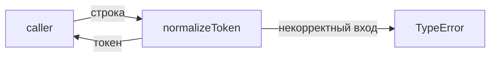
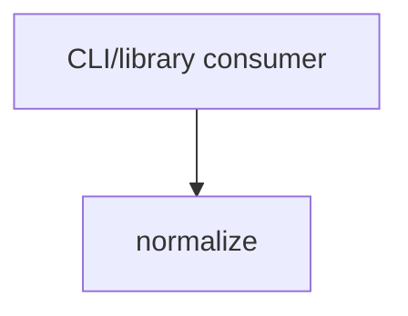

# Module: normalize

<!--SECTION:SPEC_ID-->
TOKEN-NORMALIZE
<!--/SECTION:SPEC_ID-->

<!--SECTION:MODULE_VISION-->
## Module Vision

Модуль владеет единственной операцией скоупа [token](../token.spec.md): детерминированным
преобразованием одной входной строки в нормализованный токен без сети, диска и состояния.
Других модулей в скоупе нет, поэтому parent/child modules отсутствуют.
<!--/SECTION:MODULE_VISION-->

<!--SECTION:OVERVIEW-->
## Overview


_Путь одного вызова normalizeToken — NOR-REQ-1, NOR-REQ-2._
<!--/SECTION:OVERVIEW-->

<!--SECTION:MODULE_USAGE_EXAMPLE-->
## Module Usage Example

```ts
import { normalizeToken } from "./normalize";

const slug = normalizeToken("  Foo__BAR  ");
console.log(slug);

try {
  normalizeToken("");
} catch (error) {
  if (error instanceof TypeError) {
    console.error("invalid token");
  }
}
```
<!--/SECTION:MODULE_USAGE_EXAMPLE-->

<!--SECTION:MODULE_REQUIREMENTS-->
## Requirements

### NOR-REQ-1 [должен]
**Когда** передана ASCII-строка, содержащая хотя бы один символ, отличный от пробела, underscore и hyphen, **нормализатор должен** обрезать крайние ASCII-пробелы, привести ASCII-буквы к нижнему регистру и свернуть серии пробелов, underscore и hyphen в один hyphen.

> Уточняет TOK-REQ-1: фиксирует точный набор разделителей и границу ASCII, чтобы CLI и библиотечные потребители получали один и тот же токен.

### NOR-REQ-2 [должен · нештатная]
**Если** строка пустая, состоит только из разделителей или содержит не-ASCII символ, **то нормализатор должен** выбросить TypeError, не выполняя ввода-вывода.

> Уточняет TOK-REQ-2: без явного TypeError некорректный вход превратился бы в пустой или искажённый токен.

| Input | Outcome |
|---|---|
| `"  Foo__BAR  "` | `"foo-bar"` |
| `""` | `TypeError` |
<!--/SECTION:MODULE_REQUIREMENTS-->

<!--SECTION:INTER_MODULE_DEPENDENCIES-->
## Inter-Module Dependencies

- **Depends on:** нет — в скоупе `token` других модулей нет.
- **Scope Reference (cross-scope):** нет — [token](../token.spec.md) является родительским скоупом, а не внешним интерфейсным скоупом.
- **Provides to:** CLI и библиотечные потребители скоупа.


_Модуль вызывается напрямую потребителем скоупа._
<!--/SECTION:INTER_MODULE_DEPENDENCIES-->

<!--SECTION:ENTITY_INVENTORY-->
## Entity Inventory

_Это полный список сущностей модуля. Любое введение сущности execution-агентом помимо этого списка считается drift'ом и требует обновления spec._

| Name | Type | Purpose |
|------|------|---------|
| `normalizeToken` | Function | Чистая нормализация одной строки в токен |

Ошибки: throw TypeError → `normalizeToken`

ER-скетч не рисуется: в инвентаре одна сущность, связывать нечего.
<!--/SECTION:ENTITY_INVENTORY-->

<!--SECTION:ENTITY_SURFACES-->
## Entity Surfaces

Одна поверхность: `normalizeToken` — единственная публичная операция модуля.

<details>
<summary>Полные поверхности сущностей</summary>

### `normalizeToken`
- **Type:** Function
- **Purpose:** Детерминированно преобразует одну строку в нормализованный токен.
- **Public Properties:** N/A
- **Public Operations:** нормализовать переданную строку и вернуть токен.
- **Lifecycle:** Вызывается потребителем; состояние между вызовами не хранит; завершается возвратом значения или TypeError.
- **Events Emitted:** N/A
- **Errors & Degradation:** `TypeError` через throw для пустой строки, строки только из разделителей и не-ASCII входа; обрабатывает вызывающий потребитель.
- **Consumers:**
  - Internal: нет — других модулей в скоупе нет.
  - External: CLI и библиотечные потребители скоупа `token`.

</details>
<!--/SECTION:ENTITY_SURFACES-->

<!--SECTION:MODULE_CONTRACTS-->
## Module Contracts

Модуль определяет одну чистую функцию `normalizeToken`; Port и Adapter не вводятся, потому что вариативности и внешних зависимостей нет.

Граф не рисуется: в модуле нет Port/Adapter, только Function `normalizeToken`.

Call Chain не рисуется: в модуле одна абстракция (`normalizeToken`), сценарий вызова тривиален.

<details>
<summary>Контракты DbC</summary>

### Services

#### Service: `normalizeToken`
- **Purpose:** Детерминированная нормализация одной строки в токен.
- **Consumers:** внешние CLI и библиотечные потребители скоупа `token`.
- **Runtime Backing:** `not-implemented`
- **Verification Levels:** `contract`, `unit`
- **Deferred Runtime Scope:** Вся нормализация и проверка входа — реализация не создаётся в этом раунде авторства.

**Contract (DbC)**
- `normalizeToken`:
  - Pre: на вход подана строка.
  - Post: возвращён токен с обрезанными крайними ASCII-пробелами, ASCII-буквами в нижнем регистре и сериями пробелов/underscore/hyphen, свёрнутыми в один hyphen; для `"  Foo__BAR  "` результат — `"foo-bar"`.
  - On pre-violation: пустая строка, строка только из разделителей или не-ASCII вход дают `TypeError` через throw, без ввода-вывода.

**Invariants:** Функция не выполняет ввода-вывода и не сохраняет состояние между вызовами.

</details>
<!--/SECTION:MODULE_CONTRACTS-->

<!--SECTION:PUBLIC_OPTIONS-->
## Public Options & Policies

Публичных опций нет; единственная политика — замена разделителей, зафиксированная в NOR-REQ-1.

<details>
<summary>Опции и политики</summary>

Не применимо: у модуля нет флагов, режимов или настраиваемых политик. Поведение полностью задано NOR-REQ-1 и NOR-REQ-2.

</details>
<!--/SECTION:PUBLIC_OPTIONS-->

<!--SECTION:FILE_STRUCTURE-->
## File Structure

```
src/token/normalize/
├── normalize.ts
└── normalize.test.ts
```

**File Mapping:**
- `src/token/normalize/normalize.ts`: функция `normalizeToken`
- `src/token/normalize/normalize.test.ts`: unit-тесты нормализации и отказов
<!--/SECTION:FILE_STRUCTURE-->

<!--SECTION:RESEARCH-->
## Research

No research documents for this bounded deterministic module.
<!--/SECTION:RESEARCH-->

<!--SECTION:MODULE_DECISION_LOG-->
## Module Decision Log

Записей нет: границы модуля следуют из TOK-REQ-1 и TOK-REQ-2.

<details>
<summary>Полные записи Decision Log</summary>

Модульных решений не зафиксировано; отказ от Port/Adapter объяснён в разделе Module Contracts и не требует отдельной записи.

</details>
<!--/SECTION:MODULE_DECISION_LOG-->

<!--SECTION:HANDOFF-->
## Handoff to Tasks

- **Implementation files to be created:** `src/token/normalize/normalize.ts`
- **Test files to be created:** `src/token/normalize/normalize.test.ts`
- **Stack dependencies:**
  - Language: `typescript` (resolves to `ai/directives/coding/typescript-rules.xml`)
  - Test framework: `vitest` (resolves to `ai/directives/testing/vitest-rules.xml`)
- **Module Rules Additions:** None — действует scope-wide baseline.
- **Open risks & validation needs:** реализация и тесты ещё не созданы; граница не-ASCII входа требует явной проверки кодовых точек; owner handoff остаётся `pending-operator`, одобрение не получено.
<!--/SECTION:HANDOFF-->

<!--SECTION:IMPLEMENTATION_INSIGHTS-->
## Implementation Insights

Не применимо: реализации ещё нет, постимплементационных наблюдений нет.

<details>
<summary>Заметки по реализации</summary>

Раздел остаётся пустым до появления реализации и аудита.

</details>
<!--/SECTION:IMPLEMENTATION_INSIGHTS-->
