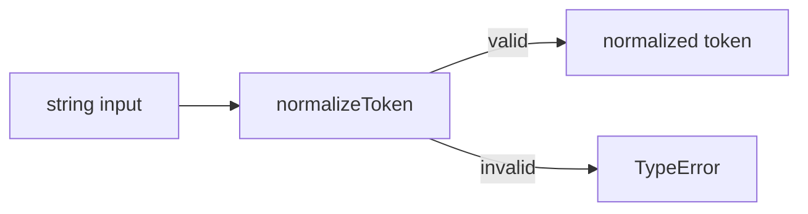
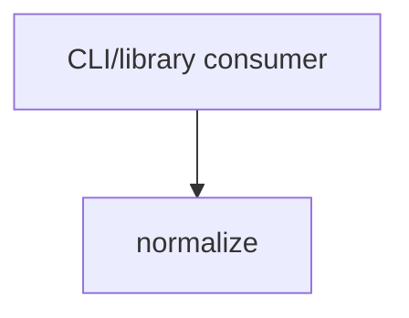

# Module: normalize

<!--SECTION:SPEC_ID-->
TOKEN-NORMALIZE
<!--/SECTION:SPEC_ID-->

<!--SECTION:MODULE_VISION-->
## Module Vision
Own the single pure transformation `normalizeToken(input: string): string`: trim leading and trailing ASCII spaces, lowercase ASCII letters, and collapse runs of spaces, underscores, and hyphens into one hyphen. The parent scope is [token](../token.spec.md). There are no parent or child modules; `normalize` is the only flat module in this scope, and it owns no persistence, network, or CLI wiring.
<!--/SECTION:MODULE_VISION-->

<!--SECTION:OVERVIEW-->
## Overview

_Основной путь нормализации токена и отказ для недопустимого входа — NOR-REQ-1, NOR-REQ-2._
<!--/SECTION:OVERVIEW-->

<!--SECTION:MODULE_USAGE_EXAMPLE-->
## Module Usage Example
```ts
import { normalizeToken } from "./normalize";

const token = normalizeToken("  Foo__BAR  ");
console.log(token); // "foo-bar"

try {
  normalizeToken("");
} catch (error) {
  if (error instanceof TypeError) {
    console.error("invalid token");
  }
}
```
<!--/SECTION:MODULE_USAGE_EXAMPLE-->

<!--SECTION:MODULE_REQUIREMENTS-->
## Requirements
### NOR-REQ-1 [должен]
**Когда** передана непустая ASCII-строка, содержащая хотя бы один символ, отличный от пробела, underscore и hyphen, **нормализатор должен** обрезать ведущие и хвостовые ASCII-пробелы, привести ASCII-буквы к нижнему регистру и свернуть любую серию пробелов, underscore и hyphen в один hyphen.

> Уточняет TOK-REQ-1: модуль владеет единственной детерминированной операцией нормализации, поэтому один и тот же вход всегда даёт один и тот же токен без обращения к внешнему состоянию.

### NOR-REQ-2 [должен · нештатная]
**Если** входная строка пустая, состоит только из разделителей (пробелов, underscore или hyphen) или содержит не-ASCII символы, **то нормализатор должен** выбросить TypeError без ввода-вывода.

> Уточняет TOK-REQ-2: ошибочный вход нельзя маскировать пустым или искажённым корректным токеном; явный TypeError отделяет отказ от успешной нормализации.

| Input | Outcome |
|---|---|
| `"  Foo__BAR  "` | `"foo-bar"` |
| `""` | `TypeError` |
<!--/SECTION:MODULE_REQUIREMENTS-->

<!--SECTION:INTER_MODULE_DEPENDENCIES-->
## Inter-Module Dependencies
- **Depends on:** None — no sibling modules exist in scope `token`.
- **Scope Reference (cross-scope):** None — the module is local and deterministic; no cross-scope interface is consumed.
- **Provides to:** CLI and library consumers outside the scope.


_Потребители модуля normalize; внутренних зависимостей нет._
<!--/SECTION:INTER_MODULE_DEPENDENCIES-->

<!--SECTION:ENTITY_INVENTORY-->
## Entity Inventory
_Это полный список сущностей модуля. Любое введение сущности execution-агентом помимо этого списка считается drift'ом и требует обновления spec._

| Name | Type | Purpose |
|------|------|---------|
| `normalizeToken` | Function | Приводит допустимый ASCII-токен к каноническому виду и отвергает недопустимый вход |

Ошибки: throw → `normalizeToken`

ER sketch not applicable: the inventory contains a single entity, so there is no relationship to draw.
<!--/SECTION:ENTITY_INVENTORY-->

<!--SECTION:ENTITY_SURFACES-->
## Entity Surfaces
One public function exposes the module's entire surface; invalid input is rejected with a thrown `TypeError`.

<details>
<summary>Полные поверхности сущностей</summary>

### `normalizeToken`
- **Type:** Function
- **Purpose:** Normalize an accepted ASCII token or reject invalid input.
- **Public Properties:** None — stateless function.
- **Public Operations:** normalize an input string to a lowercase, hyphen-collapsed token.
- **Lifecycle:** Created by import; owned by the consuming CLI or library; no per-call state and no termination step.
- **Events Emitted:** None.
- **Errors & Degradation:** `TypeError` thrown directly by `normalizeToken` when the input is empty, separator-only, or non-ASCII; no error is swallowed or returned as a value.
- **Consumers:**
  - Internal: `normalize/normalize.ts`
  - External: CLI and library consumers
- **Usage Waiver (external: CLI/library consumers):** the module's entire public surface is this one entry point.

</details>
<!--/SECTION:ENTITY_SURFACES-->

<!--SECTION:MODULE_CONTRACTS-->
## Module Contracts
One public Service, `normalizeToken`, owns the transformation; the module defines no Ports or Adapters because the behavior is pure and has no variability or test seam requiring an abstraction.

Граф не рисуется: в модуле нет Port/Adapter, только Service `normalizeToken`.

Call Chain не рисуется: в модуле одна абстракция — Service `normalizeToken`, вызываемый напрямую.

<details>
<summary>Контракты DbC</summary>

### Services

#### Service: `normalizeToken`
- **Purpose:** Convert an accepted ASCII input string into one canonical token.
- **Consumers:** internal `normalize/normalize.ts`; external CLI and library consumers.
- **Runtime Backing:** `not-implemented`
- **Verification Levels:** contract, unit
- **Deferred Runtime Scope:** all declared behavior lacks real runtime because this request authors the specification only.

**Contract (DbC)** — one block per operation:
- `normalizeToken`:
  - Pre: `input` is a string that is non-empty, contains only ASCII characters, and includes at least one character other than space, underscore, or hyphen.
  - Post: the returned string has no leading or trailing ASCII spaces, all ASCII letters are lowercase, and every run of spaces, underscores, and hyphens is replaced by one hyphen.
  - On pre-violation: throws `TypeError` without performing input/output.

**Invariants:** the function holds no state and performs no input/output across its entire lifetime.

</details>
<!--/SECTION:MODULE_CONTRACTS-->

<!--SECTION:PUBLIC_OPTIONS-->
## Public Options & Policies
No configurable options or policies; the transformation and rejection behavior are fixed.

<details>
<summary>Опции и политики</summary>

None. The module exposes no flags, options, or runtime policies in v1.

</details>
<!--/SECTION:PUBLIC_OPTIONS-->

<!--SECTION:FILE_STRUCTURE-->
## File Structure
```
src/token/normalize/
├── normalize.ts
└── normalize.test.ts
```

**File Mapping:**
- `src/token/normalize/normalize.ts`: pure `normalizeToken` implementation and `TypeError` rejection.
- `src/token/normalize/normalize.test.ts`: contract and unit tests for accepted and rejected inputs.
<!--/SECTION:FILE_STRUCTURE-->

<!--SECTION:RESEARCH-->
## Research
No research documents for this bounded deterministic module. The behavior is fully defined by the parent scope and the token contract.
<!--/SECTION:RESEARCH-->

<!--SECTION:MODULE_DECISION_LOG-->
## Module Decision Log
No module-level decisions recorded.

<details>
<summary>Полные записи Decision Log</summary>

No module-level decision entries. The pure-function form follows the Service contract without introducing a Port or Adapter.

</details>
<!--/SECTION:MODULE_DECISION_LOG-->

<!--SECTION:HANDOFF-->
## Handoff to Tasks
- **Implementation files to be created:** `src/token/normalize/normalize.ts`
- **Test files to be created:** `src/token/normalize/normalize.test.ts`
- **Stack dependencies:**
  - Language: `typescript` (resolves to `ai/directives/coding/typescript-rules.xml`)
  - Test framework: `node-test` (resolves to `ai/directives/testing/node-test.xml`)
- **Module Rules Additions:** None.

  | Rule | Category | Source |
  |------|----------|--------|
  | None | — | — |

- **Open risks & validation needs:** Implementation and tests are not created in this authoring request. Operator review and approval remain pending; no runtime behavior is claimed.
- **Status:** pending-operator — no operator approval has been given.
<!--/SECTION:HANDOFF-->

<!--SECTION:IMPLEMENTATION_INSIGHTS-->
## Implementation Insights
Not applicable: no implementation exists yet, so there are no post-implementation learnings to record.

<details>
<summary>Заметки по реализации</summary>

No implementation notes; this specification-only request defers them until an implementation cycle.
</details>
<!--/SECTION:IMPLEMENTATION_INSIGHTS-->
