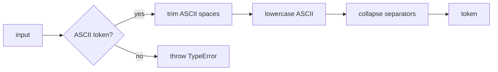
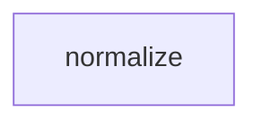

# Module: normalize

<!--SECTION:SPEC_ID-->
TOKEN-NORMALIZE
<!--/SECTION:SPEC_ID-->

<!--SECTION:MODULE_VISION-->
## Module Vision
Модуль `normalize` владеет единственной ответственностью внутри скоупа [token](../token.spec.md): детерминированным приведением входной строки к каноническому токену. Он не выполняет ввод-вывод, не хранит состояние и не предоставляет других экспортов, кроме `normalizeToken`.

Sibling-модулей и дочерних модулей у `normalize` нет; родительская граница задана спекой [token](../token.spec.md).
<!--/SECTION:MODULE_VISION-->

<!--SECTION:OVERVIEW-->
## Overview


_Путь нормализации входа и отказ на недопустимом входе — NOR-REQ-1, NOR-REQ-2._
<!--/SECTION:OVERVIEW-->

<!--SECTION:MODULE_USAGE_EXAMPLE-->
## Module Usage Example

```ts
import { normalizeToken } from "./normalize.js";

const token = normalizeToken("  Foo__BAR  ");
console.log(token);

try {
  normalizeToken("");
} catch (error) {
  if (!(error instanceof TypeError)) throw error;
}
```
<!--/SECTION:MODULE_USAGE_EXAMPLE-->

<!--SECTION:MODULE_REQUIREMENTS-->
## Requirements

### NOR-REQ-1 [должен]
**Когда** передана ASCII-строка, содержащая хотя бы один символ, отличный от ASCII-пробела, underscore и hyphen, **нормализатор должен** удалить ведущие и завершающие ASCII-пробелы, привести ASCII-буквы к нижнему регистру и свернуть каждую серию ASCII-пробелов, underscore и hyphen в один hyphen. Уточняет [TOK-REQ-1](../token.spec.md#REQUIREMENTS_AND_CONSTRAINTS).

### NOR-REQ-2 [должен · нештатная]
**Если** строка пустая, состоит только из разделителей (ASCII-пробел, underscore, hyphen) или содержит не-ASCII символ, **то нормализатор должен** синхронно выбросить `TypeError` без ввода-вывода и без побочных эффектов. Уточняет [TOK-REQ-2](../token.spec.md#REQUIREMENTS_AND_CONSTRAINTS).

| Scenario | Input | Outcome |
|---|---|---|
| `normalize-example` | `"  Foo__BAR  "` | `"foo-bar"` |
| `empty-input-rejection` | `""` | `TypeError` |
<!--/SECTION:MODULE_REQUIREMENTS-->

<!--SECTION:INTER_MODULE_DEPENDENCIES-->
## Inter-Module Dependencies
- **Depends on:** None — в скоупе `token` нет sibling-модулей.
- **Scope Reference (cross-scope):** None.
- **Provides to:** None.


_Модуль normalize не имеет sibling-зависимостей — граф из одной вершины._
<!--/SECTION:INTER_MODULE_DEPENDENCIES-->

<!--SECTION:ENTITY_INVENTORY-->
## Entity Inventory

_Это полный список сущностей модуля. Любое введение сущности execution-агентом помимо этого списка считается drift'ом и требует обновления spec._

| Name | Type | Purpose |
|------|------|---------|
| `normalizeToken` | Function | Чистая нормализация входного токена; владеет выбросом TypeError. |

Ошибки: throw → `normalizeToken`

ER-эскиз не рисуется: inventory состоит из одной сущности, связывать нечего.
<!--/SECTION:ENTITY_INVENTORY-->

<!--SECTION:ENTITY_SURFACES-->
## Entity Surfaces
Поверхность модуля — единственная публичная функция `normalizeToken` с одним успешным исходом и одним отказом.

<details>
<summary>Полные поверхности сущностей</summary>

### `normalizeToken`
- **Type:** Function
- **Purpose:** Детерминированно приводит допустимую ASCII-строку к каноническому токену.
- **Public Properties:** N/A
- **Public Operations:** нормализовать входную строку; выбросить `TypeError` на недопустимом входе.
- **Lifecycle:** Создаётся при импорте модуля; состояния не имеет; завершается после возврата значения или выброса ошибки.
- **Events Emitted:** N/A
- **Errors & Degradation:** `TypeError` через throw; владелец — `normalizeToken`; обработку и показ выбирает вызывающий код.
- **Consumers:**
  - Internal: `src/token/normalize/normalize.ts`
  - External: CLI и библиотечные потребители скоупа `token`
- **Usage Waiver (external: CLI и библиотечные потребители):** единственный публичный экспорт модуля, требуется TOK-REQ-1 и TOK-REQ-2.

</details>
<!--/SECTION:ENTITY_SURFACES-->

<!--SECTION:MODULE_CONTRACTS-->
## Module Contracts
Модуль определяет одну Service-функцию `normalizeToken`; Port/Adapter не вводятся.

Граф не рисуется: в модуле нет Port/Adapter, только Function `normalizeToken`.

Call Chain не рисуется: в модуле одна абстракция — Function `normalizeToken`.

<details>
<summary>Контракты DbC</summary>

### Services

#### Service: `normalizeToken`
- **Purpose:** Детерминированно нормализовать допустимый ASCII-токен без ввода-вывода.
- **Consumers:** CLI и библиотечные потребители скоупа `token`; внутренний файл `src/token/normalize/normalize.ts`.
- **Runtime Backing:** `not-implemented`
- **Verification Levels:** `contract`, `unit`
- **Deferred Runtime Scope:** Всё поведение отложено до реализации; runtime-claim отсутствует.

**Contract (DbC)**
- `normalizeToken`:
  - Pre: вход — строка, все символы которой ASCII и хотя бы один символ не является ASCII-пробелом, underscore или hyphen.
  - Post: возвращена строка без ведущих и завершающих ASCII-пробелов, с ASCII-буквами в нижнем регистре и каждой серией ASCII-пробелов/underscore/hyphen, заменённой одним hyphen; ввод-вывод не выполнялся.
  - On pre-violation: синхронно выброшен `TypeError`; ввод-вывод и побочные эффекты отсутствуют.

**Invariants** (omit when none): Функция не хранит состояние и не выполняет ввод-вывод; один и тот же вход всегда даёт один и тот же результат или один и тот же `TypeError`.

</details>
<!--/SECTION:MODULE_CONTRACTS-->

<!--SECTION:PUBLIC_OPTIONS-->
## Public Options & Policies
Нет публичных опций и политик в v1: единственный параметр — обязательный `input`, поведение фиксировано требованиями NOR-REQ-1 и NOR-REQ-2.
<!--/SECTION:PUBLIC_OPTIONS-->

<!--SECTION:FILE_STRUCTURE-->
## File Structure
```
normalize/
├── normalize.ts
└── normalize.test.ts
```

**File Mapping:**
- `normalize.ts`: публичная функция `normalizeToken` и её валидация входа.
- `normalize.test.ts`: unit-тесты успешного примера и отказов на недопустимом входе.
<!--/SECTION:FILE_STRUCTURE-->

<!--SECTION:RESEARCH-->
## Research
Ресёрч не применим: детерминированная нормализация не требует внешних документов или исследования рынка.
<!--/SECTION:RESEARCH-->

<!--SECTION:MODULE_DECISION_LOG-->
## Module Decision Log
Записано одно решение — об отсутствии Port/Adapter; оно ожидает вердикта оператора.

<details>
<summary>Полные записи Decision Log</summary>

NOR-DL-1 2026-10-24 — `normalizeToken` реализуется как чистая функция без Port/Adapter; где: specs/token/normalize/normalize.spec.md#MODULE_CONTRACTS (почему: единственная детерминированная реализация без подтверждённой вариативности или тестового шва) [verdict: pending-operator]

</details>
<!--/SECTION:MODULE_DECISION_LOG-->

<!--SECTION:HANDOFF-->
## Handoff to Tasks
- **Implementation files to be created:** `normalize.ts`
- **Test files to be created:** `normalize.test.ts`
- **Stack dependencies:**
  - Language: `TypeScript` (resolves to `ai/directives/coding/typescript-rules.xml`)
  - Test framework: `vitest` (resolves to `ai/directives/testing/vitest-rules.xml`)
- **Module Rules Additions:** None — module-specific rules are not introduced.

- **Open risks & validation needs:** Точная граница ASCII-разделителей (только пробел, underscore, hyphen) и не-ASCII входа требует подтверждения тестами при реализации; операторское одобрение отсутствует, handoff остаётся `pending-operator`.
<!--/SECTION:HANDOFF-->

<!--SECTION:IMPLEMENTATION_INSIGHTS-->
## Implementation Insights
Не применимо: реализация ещё не выполнялась, post-implementation наблюдений нет.
<!--/SECTION:IMPLEMENTATION_INSIGHTS-->
