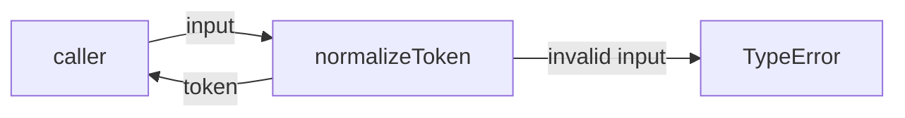
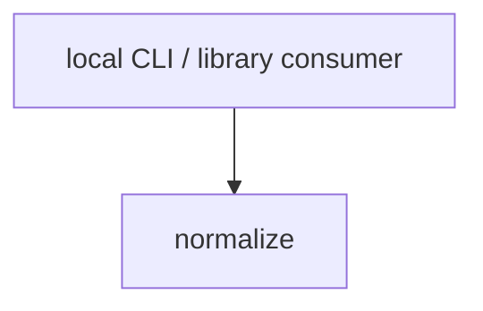

# Module: normalize

<!--SECTION:SPEC_ID-->
TOKEN-NORMALIZE
<!--/SECTION:SPEC_ID-->

<!--SECTION:MODULE_VISION-->
## Module Vision
Модуль `normalize` владеет единственной ответственностью скоупа `token`: детерминированным преобразованием ASCII-токена без состояния и без ввода-вывода. Родительский скоуп — [token](../token.spec.md). Соседних модулей, дочерних модулей и родительского модуля нет: `normalize` — плоский модуль скоупа.

Модуль публикует одну функцию, `normalizeToken`, и не владеет конфигурацией, хранением, сетевыми вызовами или CLI-разбором аргументов.
<!--/SECTION:MODULE_VISION-->

<!--SECTION:OVERVIEW-->
## Overview


_Нормализация допустимого токена и отказ с TypeError при недопустимом входе — NOR-REQ-1, NOR-REQ-2._
<!--/SECTION:OVERVIEW-->

<!--SECTION:MODULE_USAGE_EXAMPLE-->
## Module Usage Example
```ts
import { normalizeToken } from "./normalize";

const token = normalizeToken("  Foo__BAR  ");
if (token !== "foo-bar") {
  throw new Error("unexpected normalization result");
}

try {
  normalizeToken("");
} catch (error) {
  if (!(error instanceof TypeError)) {
    throw error;
  }
}
```
<!--/SECTION:MODULE_USAGE_EXAMPLE-->

<!--SECTION:MODULE_REQUIREMENTS-->
## Requirements
### NOR-REQ-1 [должен]
**Когда** входная строка содержит хотя бы один ASCII-символ, отличный от пробела, underscore и hyphen, **нормализатор должен** удалить ведущие и замыкающие ASCII-пробелы, привести ASCII-буквы к нижнему регистру и свернуть каждую серию пробелов, underscore и hyphen в один hyphen. Это уточнение родительского требования TOK-REQ-1 для поверхности модуля `normalize`.

### NOR-REQ-2 [должен · нештатная]
**Если** входная строка пустая, состоит только из разделителей (ASCII-пробелы, underscore, hyphen) или содержит хотя бы один не-ASCII символ, **то нормализатор должен** выбросить TypeError, не выполняя ввод-вывод и не возвращая токен. Это уточнение родительского требования TOK-REQ-2 для поверхности модуля `normalize`.

| Input | Outcome |
|---|---|
| `"  Foo__BAR  "` | `"foo-bar"` |
| `""` | `TypeError` |
<!--/SECTION:MODULE_REQUIREMENTS-->

<!--SECTION:INTER_MODULE_DEPENDENCIES-->
## Inter-Module Dependencies
- **Depends on:** нет зависимостей от модулей внутри скоупа `token`.
- **Scope Reference (cross-scope):** нет: модуль не использует интерфейсы других скоупов; родительский скоуп упоминает `infra-base` только как инфраструктуру авторинга.
- **Provides to:** нет других модулей внутри скоупа; публичная функция предназначена внешним локальным CLI- и библиотечным потребителям.


_Внешний потребитель вызывает normalize; рёбер между модулями скоупа нет._
<!--/SECTION:INTER_MODULE_DEPENDENCIES-->

<!--SECTION:ENTITY_INVENTORY-->
## Entity Inventory
_Это полный список сущностей модуля. Любое введение сущности execution-агентом помимо этого списка считается drift'ом и требует обновления spec._

| Name | Type | Purpose |
|------|------|---------|
| `normalizeToken` | Function | Детерминированная нормализация ASCII-токена и отказ с TypeError на недопустимом входе |

Ошибки: throw (`TypeError`) → владелец `normalizeToken`; функция выбрасывает ошибку и не выполняет ввод-вывод.

ER-скетч не рисуется: инвентарь содержит одну сущность, связывать нечего.
<!--/SECTION:ENTITY_INVENTORY-->

<!--SECTION:ENTITY_SURFACES-->
## Entity Surfaces
Одна публичная функция с чистым преобразованием и явным отказом на недопустимом входе; ниже — полная поверхность сущности.

<details>
<summary>Полные поверхности сущностей</summary>

### `normalizeToken`
- **Type:** Function
- **Purpose:** Детерминированно преобразует допустимый ASCII-токен к каноническому виду или отказывает с TypeError.
- **Public Properties:** N/A
- **Public Operations:** нормализовать входную строку в токен; отклонить пустой, состоящий только из разделителей или не-ASCII вход.
- **Lifecycle:** создаётся импортом модуля; не хранит состояние; завершается возвратом значения или выбросом TypeError.
- **Events Emitted:** N/A
- **Errors & Degradation:** `TypeError` через throw; владелец — `normalizeToken`; вызывающий потребитель решает, как показать ошибку. Ввод-вывод при ошибке не выполняется.
- **Consumers:**
  - Internal: N/A — других сущностей модуля нет.
  - External: local CLI and library consumers.
- **Usage Waiver (external: local CLI and library consumers):** публичная точка входа модуля; production-кода ещё нет, поэтому измеренное число использований отсутствует до реализации.

</details>
<!--/SECTION:ENTITY_SURFACES-->

<!--SECTION:MODULE_CONTRACTS-->
## Module Contracts
Модуль определяет одну Service-абстракцию `normalizeToken`; Port и Adapter не вводятся, потому что преобразование чистое и подтверждённой вариативности нет.

Граф не рисуется: в модуле нет Port/Adapter, только Service `normalizeToken`.

Call Chain не рисуется: в модуле одна абстракция — Service `normalizeToken`, порог ≥2 абстракций не достигнут.

<details>
<summary>Контракты DbC</summary>

### Services

#### Service: `normalizeToken`
- **Purpose:** Привести допустимый ASCII-токен к каноническому виду и явно отклонить недопустимый вход.
- **Consumers:** external local CLI and library consumers.
- **Runtime Backing:** `not-implemented`
- **Verification Levels:** `contract`, `unit`
- **Deferred Runtime Scope:** всё объявленное поведение не имеет реального runtime до реализации модуля.

**Contract (DbC)** — one block per operation:
- `normalizeToken`:
  - Pre: на вход передана строка; она непустая, не состоит только из ASCII-пробелов, underscore и hyphen и содержит только ASCII-символы.
  - Post: возвращается строка, в которой удалены ведущие и замыкающие ASCII-пробелы, ASCII-буквы приведены к нижнему регистру, а каждая серия ASCII-пробелов, underscore и hyphen заменена одним hyphen; ввод-вывод не выполняется.
  - On pre-violation: выбрасывается TypeError; значение не возвращается, ввод-вывод не выполняется.

**Invariants:** функция детерминирована, не хранит состояние между вызовами и не выполняет ввод-вывод ни на успешном, ни на ошибочном пути.

</details>
<!--/SECTION:MODULE_CONTRACTS-->

<!--SECTION:PUBLIC_OPTIONS-->
## Public Options & Policies
Публичных опций и политик нет: поведение полностью фиксировано NOR-REQ-1 и NOR-REQ-2.

<details>
<summary>Опции и политики</summary>

Публично наблюдаемых флагов, опций и политик нет. Конфигурация не предусмотрена и не отложена на будущую версию.

</details>
<!--/SECTION:PUBLIC_OPTIONS-->

<!--SECTION:FILE_STRUCTURE-->
## File Structure
```
normalize/
├── normalize.ts
└── normalize.test.ts
```

**File Mapping:**
- `normalize/normalize.ts`: реализация функции `normalizeToken`.
- `normalize/normalize.test.ts`: contract- и unit-проверки NOR-REQ-1 и NOR-REQ-2.
<!--/SECTION:FILE_STRUCTURE-->

<!--SECTION:RESEARCH-->
## Research
Ресёрч-документов нет: задача ограничена детерминированным ASCII-преобразованием, внешние исследования не привлекались.
<!--/SECTION:RESEARCH-->

<!--SECTION:MODULE_DECISION_LOG-->
## Module Decision Log
Записано одно решение: чистая функция без Port/Adapter.

<details>
<summary>Полные записи Decision Log</summary>

NOR-DL-1 2026-10-24 — нормализация реализуется одной чистой функцией `normalizeToken` без Port/Adapter (почему: преобразование не имеет состояния, побочных эффектов и подтверждённой вариативности).

</details>
<!--/SECTION:MODULE_DECISION_LOG-->

<!--SECTION:HANDOFF-->
## Handoff to Tasks
- **Implementation files to be created:** `normalize/normalize.ts`
- **Test files to be created:** `normalize/normalize.test.ts`
- **Stack dependencies:**
  - Language: `TypeScript` (resolves to `ai/directives/coding/typescript-rules.xml`)
  - Test framework: `node-test` (resolves to `ai/directives/testing/node-test.xml`)
- **Module Rules Additions:** None — scope-wide baseline only.
- **Open risks & validation needs:** реализация и тесты не созданы, поведение не подтверждено исполнением; независимый review не выполнялся; операторское approval отсутствует (Approval #1 pending).
<!--/SECTION:HANDOFF-->

<!--SECTION:IMPLEMENTATION_INSIGHTS-->
## Implementation Insights
Не применимо: реализация не выполнялась, post-implementation наблюдений нет.

<details>
<summary>Заметки по реализации</summary>

Не применимо: раздел предназначен для наблюдений после реализации, а этот документ описывает только авторинг спеки.

</details>
<!--/SECTION:IMPLEMENTATION_INSIGHTS-->
