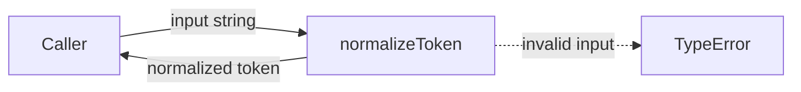
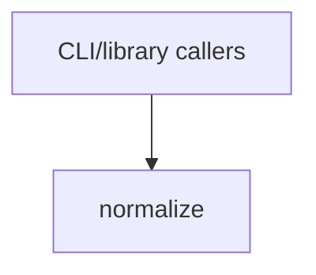

# Module: normalize

<!--SECTION:SPEC_ID-->
TOKEN-NORMALIZE
<!--/SECTION:SPEC_ID-->

<!--SECTION:MODULE_VISION-->
## Module Vision
Owns the single pure transformation inside the `token` scope: trimming leading and trailing ASCII spaces, lowercasing ASCII letters, collapsing runs of spaces, underscores and hyphens into one hyphen, and rejecting empty, separator-only and non-ASCII input. Parent scope: [token](../token.spec.md). There are no sibling modules in `token`, no parent module above this one and no child modules below it.
<!--/SECTION:MODULE_VISION-->

<!--SECTION:OVERVIEW-->
## Overview

_Преобразование входной строки в токен или TypeError — NOR-REQ-1, NOR-REQ-2._
<!--/SECTION:OVERVIEW-->

<!--SECTION:MODULE_USAGE_EXAMPLE-->
## Module Usage Example
```ts
import { normalizeToken } from "./normalize.js";

const token = normalizeToken("  Foo__BAR  ");
console.log(token);

try {
  normalizeToken("");
} catch (error) {
  if (error instanceof TypeError) {
    console.error(error.message);
  }
}
```
<!--/SECTION:MODULE_USAGE_EXAMPLE-->

<!--SECTION:MODULE_REQUIREMENTS-->
## Requirements
### NOR-REQ-1 [должен]
**Когда** `normalizeToken` получает ASCII-строку, содержащую хотя бы один символ, отличный от пробела, underscore и hyphen, **функция должна** обрезать крайние ASCII-пробелы, привести ASCII-буквы к нижнему регистру и свернуть каждую серию пробелов, underscore и hyphen в один hyphen.

> Уточняет TOK-REQ-1 для единственной функции модуля: границы преобразования и набор разделителей зафиксированы, поэтому результат не зависит от окружения.

### NOR-REQ-2 [должен · нештатная]
**Если** вход пустой, состоит только из разделителей или содержит хотя бы один не-ASCII символ, **то `normalizeToken` должен** выбросить TypeError до любого ввода-вывода.

> Уточняет TOK-REQ-2: отказ происходит на границе функции, поэтому вызывающая сторона получает явную ошибку вместо пустого или искажённого токена.

| Input | Outcome |
|---|---|
| `"  Foo__BAR  "` | `"foo-bar"` |
| `""` | `TypeError` |
<!--/SECTION:MODULE_REQUIREMENTS-->

<!--SECTION:INTER_MODULE_DEPENDENCIES-->
## Inter-Module Dependencies
- **Depends on:** None — `token` has no sibling modules.
- **Scope Reference (cross-scope):** None for runtime behavior; the local authoring environment is described by [infra-base](../../infra-base/infra-base.spec.md).
- **Provides to:** CLI and library callers of the `token` scope.


_Модуль не имеет sibling-зависимостей; вызывают его CLI и библиотечные потребители._
<!--/SECTION:INTER_MODULE_DEPENDENCIES-->

<!--SECTION:ENTITY_INVENTORY-->
## Entity Inventory

_Это полный список сущностей модуля. Любое введение сущности execution-агентом помимо этого списка считается drift'ом и требует обновления spec._

| Name | Type | Purpose |
|------|------|---------|
| `normalizeToken` | Function | Trims, lowercases and collapses separators for one ASCII token. |

Ошибки: throw → `normalizeToken`

ER-эскиз не рисуется: в инвентаре одна сущность, связывать нечего.
<!--/SECTION:ENTITY_INVENTORY-->

<!--SECTION:ENTITY_SURFACES-->
## Entity Surfaces
The surfaces cover the single public function: its inputs, stateless call lifecycle, throw-based rejection and CLI/library consumers.

<details>
<summary>Полные поверхности сущностей</summary>

### `normalizeToken`
- **Type:** Function
- **Purpose:** Convert one ASCII input string into a normalized lowercase token or reject invalid input.
- **Public Properties:** N/A
- **Public Operations:** `normalizeToken(input)` — validate and normalize one ASCII token.
- **Lifecycle:** Created per call by the caller; owns no state and terminates on return or throw.
- **Events Emitted:** N/A
- **Errors & Degradation:** `TypeError` via throw, owned by `normalizeToken` and surfaced directly to the caller; no fallback, retry or I/O.
- **Consumers:**
  - Internal: `normalize/normalize.ts`
  - External: CLI and library callers of the `token` scope
- **Usage Waiver (external: CLI and library callers):** public entry point of the scope's only exported function; low static usage count does not reflect its API role.

</details>
<!--/SECTION:ENTITY_SURFACES-->

<!--SECTION:MODULE_CONTRACTS-->
## Module Contracts
The module defines one pure Function, `normalizeToken`, and no Ports or Adapters; its DbC lives directly on the Service form below.

Граф не рисуется: в модуле нет Port/Adapter, только Function `normalizeToken`.

Call Chain не рисуется: в модуле одна абстракция (`normalizeToken`), а сценарий вызова — один прямой вызов.

<details>
<summary>Контракты DbC</summary>

#### Service: `normalizeToken`
- **Purpose:** Convert one ASCII input string into a normalized lowercase token or reject invalid input.
- **Consumers:** CLI and library callers of the `token` scope (`normalize/normalize.ts`).
- **Runtime Backing:** `not-implemented`
- **Verification Levels:** `contract`, `unit`
- **Deferred Runtime Scope:** All declared behavior — no implementation exists in this authoring pass.

**Contract (DbC)**
- `normalizeToken`:
  - Pre: `input` is a string containing at least one ASCII character that is not a space, underscore or hyphen.
  - Post: The result is lowercase ASCII with no leading or trailing hyphen; every run of spaces, underscores or hyphens becomes exactly one hyphen.
  - On pre-violation: Throws `TypeError` for an empty string, a separator-only string or any non-ASCII character, and performs no I/O.

**Invariants:** The function is pure and deterministic: it reads no external state, performs no I/O and returns the same result for the same input.

</details>
<!--/SECTION:MODULE_CONTRACTS-->

<!--SECTION:PUBLIC_OPTIONS-->
## Public Options & Policies
None — behavior is fixed; no public flags, options or policies are configurable in v1.

<details>
<summary>Опции и политики</summary>

No options in v1. The separator set (space, underscore, hyphen), locale-independent ASCII casing and the rejection policy are fixed by NOR-REQ-1 and NOR-REQ-2; any future option requires a new module contract.

</details>
<!--/SECTION:PUBLIC_OPTIONS-->

<!--SECTION:FILE_STRUCTURE-->
## File Structure
```
normalize/
├── normalize.ts
└── normalize.test.ts
```

**File Mapping:**
- `normalize/normalize.ts`: pure `normalizeToken` implementation
- `normalize/normalize.test.ts`: unit tests for `normalizeToken`
<!--/SECTION:FILE_STRUCTURE-->

<!--SECTION:RESEARCH-->
## Research
No research documents feed this module; its behavior is fully bounded by TOK-REQ-1 and TOK-REQ-2.
<!--/SECTION:RESEARCH-->

<!--SECTION:MODULE_DECISION_LOG-->
## Module Decision Log
One decision: the transformation is a pure Function without a Port or Adapter.

<details>
<summary>Полные записи Decision Log</summary>

NOR-DL-1 2026-10-24 — `normalizeToken` остаётся чистым Function без Port/Adapter; где: specs/token/normalize/normalize.spec.md#module-contracts (почему: детерминированное преобразование без состояния не имеет подтверждённой вариативности или тестового шва).

</details>
<!--/SECTION:MODULE_DECISION_LOG-->

<!--SECTION:HANDOFF-->
## Handoff to Tasks
- **Status:** pending-operator — no operator approval has been given for this module.
- **Implementation files to be created:** `normalize/normalize.ts`
- **Test files to be created:** `normalize/normalize.test.ts`
- **Stack dependencies:**
  - Language: `typescript` (resolves to `ai/directives/coding/typescript-rules.xml`)
  - Test framework: `node:test` (resolves to `ai/directives/testing/node-test.xml`)
- **Module Rules Additions:** None — no module-specific rules beyond the scope baseline.
- **Open risks & validation needs:** No implementation, execution claim or operator approval exists in this authoring pass; runtime behavior and tests remain unvalidated until a later task.
<!--/SECTION:HANDOFF-->

<!--SECTION:IMPLEMENTATION_INSIGHTS-->
## Implementation Insights
Not applicable — no implementation exists yet, so there are no post-implementation learnings to preserve.
<!--/SECTION:IMPLEMENTATION_INSIGHTS-->
