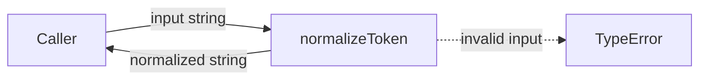
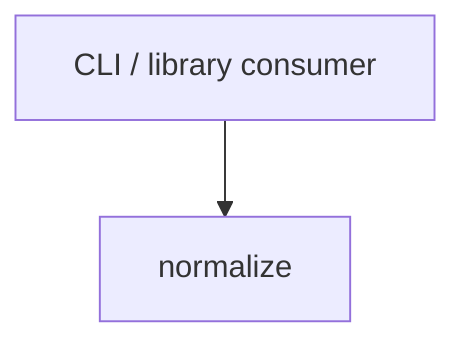

# Module: normalize

<!--SECTION:SPEC_ID-->
TOKEN-NORMALIZE
<!--/SECTION:SPEC_ID-->

<!--SECTION:MODULE_VISION-->
## Module Vision
`normalize` owns the single pure token-normalization operation of the `token` scope: it validates one input string and returns its canonical lowercase hyphenated form. Parent scope: [token specification](../token.spec.md). This is the only module in the scope Module Map; no sibling, parent, or child modules exist.
<!--/SECTION:MODULE_VISION-->

<!--SECTION:OVERVIEW-->
## Overview

_Путь одного токена от входа к канонической форме — NOR-REQ-1, NOR-REQ-2._
<!--/SECTION:OVERVIEW-->

<!--SECTION:MODULE_USAGE_EXAMPLE-->
## Module Usage Example
```ts
import { normalizeToken } from "./normalize.ts";

const token = normalizeToken("  Foo__BAR  ");
console.log(token);

try {
  normalizeToken("___");
} catch (error) {
  console.error(error instanceof TypeError);
}
```
<!--/SECTION:MODULE_USAGE_EXAMPLE-->

<!--SECTION:MODULE_REQUIREMENTS-->
## Requirements
### NOR-REQ-1 [должен]
**Когда** передана ASCII-строка, содержащая хотя бы один символ, отличный от ASCII-пробела, underscore и hyphen, **нормализатор должен** обрезать ведущие и замыкающие ASCII-пробелы, привести ASCII-буквы к нижнему регистру и свернуть каждую серию ASCII-пробелов, underscore и hyphen в один hyphen.
> Refines [TOK-REQ-1](../token.spec.md#REQUIREMENTS_AND_CONSTRAINTS): the scope fixes the token shape, this module owns the exact normalization operation.

### NOR-REQ-2 [должен · нештатная]
**Если** входная строка пустая, состоит только из ASCII-пробелов, underscore и hyphen или содержит хотя бы один не-ASCII символ, **то нормализатор должен** выбросить TypeError без ввода-вывода.
> Refines [TOK-REQ-2](../token.spec.md#REQUIREMENTS_AND_CONSTRAINTS): this module owns the invalid-input rejection boundary.

| Input | Outcome |
|---|---|
| `"  Foo__BAR  "` | `"foo-bar"` |
| `""` | `TypeError` |
<!--/SECTION:MODULE_REQUIREMENTS-->

<!--SECTION:INTER_MODULE_DEPENDENCIES-->
## Inter-Module Dependencies
- **Depends on:** None — `normalize` is the only module in the `token` scope.
- **Scope Reference (cross-scope):** None. The scope links `infra-base` only as authoring infrastructure, not as a runtime interface.
- **Provides to:** External CLI and library consumers of the `token` scope.


_Направление зависимости: внешний потребитель вызывает normalize._
<!--/SECTION:INTER_MODULE_DEPENDENCIES-->

<!--SECTION:ENTITY_INVENTORY-->
## Entity Inventory
_This is the complete entity list for the module. Any entity introduced by an execution agent outside this list is drift and requires a specification update._

| Name | Type | Purpose |
|------|------|---------|
| `normalizeToken` | Function | Validates one string and returns its canonical lowercase hyphenated token. |

Ошибки: throw `TypeError` → `normalizeToken`

Single-entity inventory: `normalizeToken` has no relational peers, so no ER sketch applies.
<!--/SECTION:ENTITY_INVENTORY-->

<!--SECTION:ENTITY_SURFACES-->
## Entity Surfaces
One public pure function; no state, emitted events, or owned collaborators.

<details>
<summary>Полные поверхности сущностей</summary>

### `normalizeToken`
- **Type:** Function
- **Purpose:** Converts one valid ASCII input string into a canonical lowercase hyphenated token.
- **Public Properties:** N/A
- **Public Operations:** `normalizeToken` — validate the input and return its normalized token.
- **Lifecycle:** Stateless; a caller invokes it and it returns or throws before the call ends.
- **Events Emitted:** N/A
- **Errors & Degradation:** `TypeError` via `throw`; owned by `normalizeToken` and propagated unchanged to the caller.
- **Consumers:**
  - Internal: none — no other module in the `token` scope.
  - External: CLI / library consumers.
- **Usage Waiver (external: CLI / library consumers):** The module exposes exactly one public operation; fewer than two internal call sites is the intended public surface, not dead code.

</details>
<!--/SECTION:ENTITY_SURFACES-->

<!--SECTION:MODULE_CONTRACTS-->
## Module Contracts
`normalize` exposes one pure Function, `normalizeToken`, with no Port or Adapter; its DbC contract covers valid normalization and pre-violation rejection.

Граф не рисуется: в модуле нет Port/Adapter, только Function `normalizeToken`.

Call chain не рисуется: инвентарь содержит одну абстракцию — Function `normalizeToken`; Port/Adapter отсутствуют.

<details>
<summary>Контракты DbC</summary>

### Services

#### Service: `normalizeToken`
- **Purpose:** Validates one input string and returns its canonical lowercase hyphenated token.
- **Consumers:** CLI / library consumers; no internal module consumer.
- **Runtime Backing:** `not-implemented`
- **Verification Levels:** `contract` | `unit`
- **Deferred Runtime Scope:** Entire declared `normalizeToken` behavior — this authoring round requests no implementation.

**Contract (DbC)**
- `normalizeToken`:
  - Pre: `input` is a string; every character is ASCII; at least one character is not an ASCII space, underscore, or hyphen.
  - Post: returns the input with leading and trailing ASCII spaces removed, ASCII letters lowercased, and every run of ASCII spaces, underscores, and hyphens replaced by one hyphen; no I/O occurs.
  - On pre-violation: throws `TypeError` without I/O.

**Invariants:** The operation is pure and deterministic; it reads no external state and performs no I/O on any path.

</details>
<!--/SECTION:MODULE_CONTRACTS-->

<!--SECTION:PUBLIC_OPTIONS-->
## Public Options & Policies
No public flags, options, or policies: `normalizeToken` has one fixed behavior.

<details>
<summary>Опции и политики</summary>

None. The module exposes no configurable flags, options, or policies.

</details>
<!--/SECTION:PUBLIC_OPTIONS-->

<!--SECTION:FILE_STRUCTURE-->
## File Structure
```
normalize/
├── normalize.ts
└── normalize.test.ts
```

**File Mapping:**
- `normalize.ts`: pure `normalizeToken` implementation.
- `normalize.test.ts`: unit tests for normalization and invalid-input rejection.
<!--/SECTION:FILE_STRUCTURE-->

<!--SECTION:RESEARCH-->
## Research
No research documents. The module is specified by the [token contract](../../../docs/token-contract.md) and the parent scope requirements; no `specs/token/research/` document exists.
<!--/SECTION:RESEARCH-->

<!--SECTION:MODULE_DECISION_LOG-->
## Module Decision Log
One pending architectural decision: one pure TypeScript function with no Port or Adapter.

<details>
<summary>Полные записи Decision Log</summary>

NOR-DL-1 2026-10-24 — single pure TypeScript function `normalizeToken` with no Port/Adapter; где: specs/token/normalize/normalize.spec.md#MODULE_CONTRACTS (почему: the transform has no confirmed variability, I/O, or test seam that would justify an abstraction) [verdict: pending-operator]

</details>
<!--/SECTION:MODULE_DECISION_LOG-->

<!--SECTION:HANDOFF-->
## Handoff to Tasks
- **Implementation files to be created:** `normalize/normalize.ts`
- **Test files to be created:** `normalize/normalize.test.ts`
- **Stack dependencies:**
  - Language: `TypeScript` (resolves to `ai/directives/coding/typescript-rules.xml`)
  - Test framework: `node:test` (resolves to `ai/directives/testing/node-test.xml`)
- **Module Rules Additions:** None
- **Open risks & validation needs:** Language and test framework are conservative defaults because the fixture declares no product stack; operator confirmation is pending. Implementation and runtime validation do not exist in this authoring round. Approval #1 remains pending; no tickets or execution are claimed.
<!--/SECTION:HANDOFF-->

<!--SECTION:IMPLEMENTATION_INSIGHTS-->
## Implementation Insights
Not applicable — this authoring round performs no implementation, so no post-implementation learnings exist.
<!--/SECTION:IMPLEMENTATION_INSIGHTS-->
