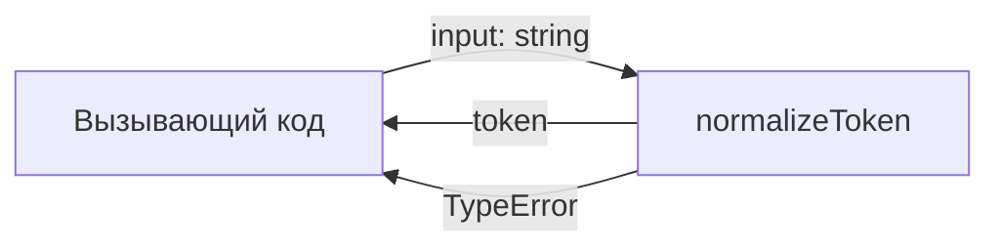
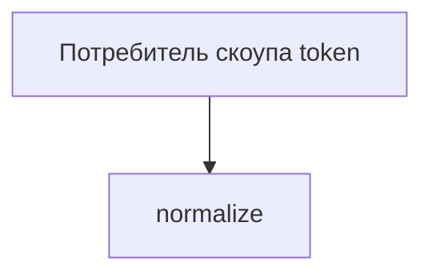

# Module: normalize

<!--SECTION:SPEC_ID-->
TOKEN-NORMALIZE
<!--/SECTION:SPEC_ID-->

<!--SECTION:MODULE_VISION-->
## Module Vision
Модуль `normalize` владеет единственной чистой операцией `normalizeToken(input: string): string`, которая приводит входную ASCII-строку к детерминированному токену. Модуль входит в скоуп [token](../token.spec.md); sibling-, parent- и child-модулей у него нет.
<!--/SECTION:MODULE_VISION-->

<!--SECTION:OVERVIEW-->
## Overview


_Преобразование входа в токен либо отказ через TypeError — NOR-REQ-1, NOR-REQ-2._
<!--/SECTION:OVERVIEW-->

<!--SECTION:MODULE_USAGE_EXAMPLE-->
## Module Usage Example
```ts
import { normalizeToken } from "./normalize";

const token = normalizeToken("  Foo__BAR  ");
console.log(token);

try {
  normalizeToken("");
} catch (error) {
  if (error instanceof TypeError) {
    console.error("invalid token input");
  }
}
```
Успешный путь возвращает `"foo-bar"`; недопустимый вход приводит к `TypeError` без ввода-вывода.
<!--/SECTION:MODULE_USAGE_EXAMPLE-->

<!--SECTION:MODULE_REQUIREMENTS-->
## Requirements
### NOR-REQ-1 [должен]
**Когда** передана ASCII-строка, содержащая хотя бы один символ, отличный от пробела, underscore и hyphen, **нормализатор должен** обрезать ведущие и замыкающие ASCII-пробелы, привести ASCII-буквы к lower-case и свернуть любые серии пробелов, underscore и hyphen в один hyphen.
> Уточняет TOK-REQ-1 для модуля `normalize`: CLI и библиотечные потребители получают единый детерминированный формат токена.

### NOR-REQ-2 [должен · нештатная]
**Если** вход пустой, состоит только из разделителей или содержит не-ASCII символы, **то нормализатор должен** выбросить `TypeError`, не выполняя ввода-вывода.
> Уточняет TOK-REQ-2: ошибка входа не маскируется пустым корректным токеном.

| Input | Outcome |
|---|---|
| `"  Foo__BAR  "` | `"foo-bar"` |
| `""` | `TypeError` |
<!--/SECTION:MODULE_REQUIREMENTS-->

<!--SECTION:INTER_MODULE_DEPENDENCIES-->
## Inter-Module Dependencies
- **Depends on:** нет — у `normalize` нет зависимостей от sibling-модулей.
- **Scope Reference (cross-scope):** нет.
- **Provides to:** нет — модуль доступен только через публичную поверхность скоупа `token`.


_Зависимости модуля normalize: внешних зависимостей нет._
<!--/SECTION:INTER_MODULE_DEPENDENCIES-->

<!--SECTION:ENTITY_INVENTORY-->
## Entity Inventory
_Это полный список сущностей модуля. Любое введение сущности execution-агентом помимо этого списка считается drift'ом и требует обновления spec._

| Name | Type | Purpose |
|------|------|---------|
| `normalizeToken` | Service | Чистая нормализация входной строки в токен |

Ошибки: throw → `normalizeToken`

ER-набросок не рисуется: в инвентаре одна сущность и нет связей между сущностями.
<!--/SECTION:ENTITY_INVENTORY-->

<!--SECTION:ENTITY_SURFACES-->
## Entity Surfaces
`normalizeToken` — единственная публичная поверхность модуля; ниже полные свойства.

<details>
<summary>Полные поверхности сущностей</summary>

### `normalizeToken`
- **Type:** Service
- **Purpose:** Приводит входную ASCII-строку к детерминированному формату токена.
- **Public Properties:** N/A
- **Public Operations:** нормализовать входную строку в токен
- **Lifecycle:** Не хранит состояние; вызывающий код вызывает операцию на каждый вход, экземпляр не создаётся.
- **Events Emitted:** N/A
- **Errors & Degradation:** `TypeError` через throw; ошибку поднимает и описывает `normalizeToken`, обрабатывает вызывающий код.
- **Consumers:**
  - Internal: нет потребителей внутри модуля.
  - External: CLI и библиотечные потребители скоупа `token`.
- **Usage Waiver (external: CLI и библиотечные потребители):** Единственная публичная точка входа модуля; низкое число внутренних вызовов ожидаемо для чистого API.

</details>
<!--/SECTION:ENTITY_SURFACES-->

<!--SECTION:MODULE_CONTRACTS-->
## Module Contracts
Модуль определяет один Service `normalizeToken`; Ports и Adapters отсутствуют.

Граф не рисуется: в модуле нет Port/Adapter, только Service `normalizeToken`.

Call Chain не рисуется: в инвентаре одна абстракция — `normalizeToken`.

<details>
<summary>Контракты DbC</summary>

#### Service: `normalizeToken`
- **Purpose:** Приводит входную ASCII-строку к детерминированному формату токена.
- **Consumers:** CLI и библиотечные потребители скоупа `token`.
- **Runtime Backing:** `not-implemented`
- **Verification Levels:** contract, unit
- **Deferred Runtime Scope:** Вся заявленная реализация отложена; код в этой задаче не создаётся.

**Contract (DbC)**
- `normalizeToken(input)`:
  - Pre: Вход — строка, содержащая не менее одного ASCII-символа, отличного от пробела, `_` и `-`, и не содержащая не-ASCII символов.
  - Post: Возвращается строка без ведущих и замыкающих ASCII-пробелов, с ASCII-буквами в lower-case и с одиночными hyphen вместо серий пробелов, `_` и `-`.
  - On pre-violation: Бросается `TypeError`; ввод-вывод не выполняется, побочных эффектов нет.

**Invariants:** Операция чистая: не читает и не изменяет внешнее состояние и не выполняет ввод-вывод.

</details>
<!--/SECTION:MODULE_CONTRACTS-->

<!--SECTION:PUBLIC_OPTIONS-->
## Public Options & Policies
Публичных опций и политик нет: поведение `normalizeToken` полностью фиксировано требованиями выше.
<!--/SECTION:PUBLIC_OPTIONS-->

<!--SECTION:FILE_STRUCTURE-->
## File Structure
```
normalize/
├── normalize.ts
└── normalize.test.ts
```

**File Mapping:**
- `normalize/normalize.ts`: реализация `normalizeToken`
- `normalize/normalize.test.ts`: unit-тесты для NOR-REQ-1 и NOR-REQ-2
<!--/SECTION:FILE_STRUCTURE-->

<!--SECTION:RESEARCH-->
## Research
Ресёрч-документов нет: задача ограничена детерминированной локальной нормализацией.
<!--/SECTION:RESEARCH-->

<!--SECTION:MODULE_DECISION_LOG-->
## Module Decision Log
Записано одно решение об отсутствии Port/Adapter; полная запись ниже.

<details>
<summary>Полные записи Decision Log</summary>

NOR-DL-1 2026-10-24 — отказаться от Port/Adapter и оставить один Service `normalizeToken` (почему: одна чистая реализация без подтверждённой вариативности и test seam; отвергнуто: Port ради симметрии — лишняя абстракция; риск: будущая замена реализации потребует рефакторинга) [verdict: pending-operator]

</details>
<!--/SECTION:MODULE_DECISION_LOG-->

<!--SECTION:HANDOFF-->
## Handoff to Tasks
- **Implementation files to be created:** `normalize/normalize.ts`
- **Test files to be created:** `normalize/normalize.test.ts`
- **Stack dependencies:**
  - Language: `TypeScript` (resolves to `ai/directives/coding/typescript-rules.xml`)
  - Test framework: `Vitest` (resolves to `ai/directives/testing/vitest-rules.xml`)
- **Module Rules Additions:** None

  | Rule | Category | Source |
  |------|----------|--------|
  | None | — | — |

- **Open risks & validation needs:** Реализация не запрашивалась, поэтому runtime-поведение не проверено. Operator approval: pending; тикеты не создавались.
<!--/SECTION:HANDOFF-->

<!--SECTION:IMPLEMENTATION_INSIGHTS-->
## Implementation Insights
**Не применимо:** реализация не запрашивалась, post-implementation learnings отсутствуют.
<!--/SECTION:IMPLEMENTATION_INSIGHTS-->
