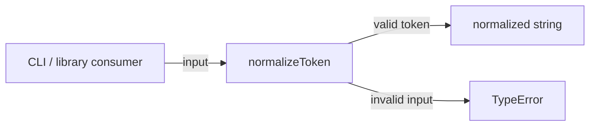
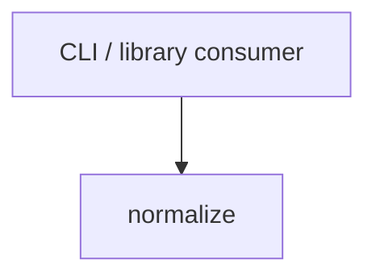

# Module: normalize

<!--SECTION:SPEC_ID-->
TOKEN-NORMALIZE
<!--/SECTION:SPEC_ID-->

<!--SECTION:MODULE_VISION-->
## Module Vision

Модуль `normalize` владеет единственной ответственностью внутри скоупа [`token`](../token.spec.md): детерминированно приводит ASCII-токен к каноническому виду и отвергает невалидный ввод. Соседних модулей в скоупе нет, дочерних модулей нет.
<!--/SECTION:MODULE_VISION-->

<!--SECTION:OVERVIEW-->
## Overview


_Нормализация валидного токена и отказ с TypeError на невалидном вводе — NOR-REQ-1, NOR-REQ-2._
<!--/SECTION:OVERVIEW-->

<!--SECTION:MODULE_USAGE_EXAMPLE-->
## Module Usage Example

```ts
import { normalizeToken } from "./normalize.js";

const token = normalizeToken("  Foo__BAR  ");
// token === "foo-bar"

try {
  normalizeToken("");
} catch (error) {
  if (error instanceof TypeError) {
    // invalid input is rejected without I/O
  }
}
```
<!--/SECTION:MODULE_USAGE_EXAMPLE-->

<!--SECTION:MODULE_REQUIREMENTS-->
## Requirements

### NOR-REQ-1 [должен]
**Когда** передана ASCII-строка, содержащая хотя бы один символ, отличный от пробела, underscore и hyphen, **нормализатор должен** обрезать ведущие и хвостовые ASCII-пробелы, привести ASCII-буквы к нижнему регистру и свернуть серии пробелов, underscore и hyphen в один hyphen.

> Уточняет TOK-REQ-1 для модуля: закрепляет каноническую форму локального токена без сети, состояния и файлового ввода-вывода.

### NOR-REQ-2 [должен · нештатная]
**Если** строка пустая, состоит только из разделителей или содержит не-ASCII символы, **то нормализатор должен** выбросить TypeError без ввода-вывода.

> Уточняет TOK-REQ-2 для модуля: невалидный вход нельзя маскировать пустым или частично нормализованным токеном.

| Input | Outcome |
|---|---|
| `"  Foo__BAR  "` | `"foo-bar"` |
| `""` | `TypeError` |
<!--/SECTION:MODULE_REQUIREMENTS-->

<!--SECTION:INTER_MODULE_DEPENDENCIES-->
## Inter-Module Dependencies

- **Depends on:** none — в скоупе `token` нет соседних модулей.
- **Scope Reference (cross-scope):** none — модуль использует только стандартную библиотеку целевого языка.
- **Provides to:** внешних потребителей скоупа через публичную функцию `normalizeToken`.


_Единственная зависимость модуля — внешний вызывающий, который получает нормализованный токен._
<!--/SECTION:INTER_MODULE_DEPENDENCIES-->

<!--SECTION:ENTITY_INVENTORY-->
## Entity Inventory

_Это полный список сущностей модуля. Любое введение сущности execution-агентом помимо этого списка считается drift'ом и требует обновления spec._

| Name | Type | Purpose |
|------|------|---------|
| `normalizeToken` | Function | Чистая нормализация ASCII-токена и выброс TypeError на невалидном входе. |

Ошибки: throw TypeError → `normalizeToken`

ER-набросок не рисуется: в inventory одна сущность, связывать нечего.
<!--/SECTION:ENTITY_INVENTORY-->

<!--SECTION:ENTITY_SURFACES-->
## Entity Surfaces

Одна публичная функция; её полная поверхность описана ниже.

<details>
<summary>Полные поверхности сущностей</summary>

### `normalizeToken`
- **Type:** Function
- **Purpose:** Детерминированно приводит валидный ASCII-токен к канонической форме и отвергает невалидный ввод.
- **Public Properties:** N/A
- **Public Operations:** принять строку, проверить допустимость входа, обрезать края, привести буквы к нижнему регистру, свернуть разделители в один hyphen.
- **Lifecycle:** создаётся при вызове, завершается возвратом строки или выбросом TypeError; собственного состояния нет.
- **Events Emitted:** N/A
- **Errors & Degradation:** `TypeError` через throw при пустом, разделительном или не-ASCII входе; обработка остаётся у вызывающего.
- **Consumers:**
  - Internal: `normalize/normalize.ts`
  - External: local CLI and library consumers
- **Usage Waiver (external: local CLI and library consumers):** публичная функция является единственной точкой входа модуля и существует именно для внешних потребителей.

</details>
<!--/SECTION:ENTITY_SURFACES-->

<!--SECTION:MODULE_CONTRACTS-->
## Module Contracts

Модуль определяет одну чистую функцию без Port/Adapter; контракт описан прямо на функции.

Граф не рисуется: в модуле нет Port/Adapter, только Function `normalizeToken`.

Call Chain не рисуется: в inventory одна абстракция, одной функции нечего вызывать по цепочке.

<details>
<summary>Контракты DbC</summary>

### Services

#### Service: `normalizeToken`
- **Purpose:** Выполняет нормализацию валидного ASCII-токена и отвергает невалидный ввод без побочных эффектов.
- **Consumers:** local CLI and library consumers
- **Runtime Backing:** `not-implemented`
- **Verification Levels:** `contract`, `unit`
- **Deferred Runtime Scope:** Вся реализация отложена; спецификация не содержит исполняемого кода.

**Contract (DbC)**
- `normalizeToken`:
  - Pre: `input` является строкой, содержит хотя бы один ASCII-символ, отличный от пробела, underscore и hyphen, и не содержит не-ASCII символов.
  - Post: возвращает строку без ведущих и хвостовых ASCII-пробелов, без ASCII-букв в верхнем регистре и без серий разделителей длиннее одного hyphen.
  - On pre-violation: выбрасывает `TypeError` без ввода-вывода.

**Invariants:** успешный вызов никогда не возвращает пустую строку, не содержит ASCII-букв в верхнем регистре и не содержит двух подряд идущих разделителей.

</details>
<!--/SECTION:MODULE_CONTRACTS-->

<!--SECTION:PUBLIC_OPTIONS-->
## Public Options & Policies

Публичных опций и политик нет: поведение `normalizeToken` фиксировано.

<details>
<summary>Опции и политики</summary>

No configurable flags, options or policies in v1. Any future option activates only through a separate approved change.
</details>
<!--/SECTION:PUBLIC_OPTIONS-->

<!--SECTION:FILE_STRUCTURE-->
## File Structure

```
normalize/
└── normalize.ts
```

**File Mapping:**
- `normalize/normalize.ts`: реализация `normalizeToken` — обрезка краёв, lower-case ASCII и свёртка разделителей; владелец TypeError.
<!--/SECTION:FILE_STRUCTURE-->

<!--SECTION:RESEARCH-->
## Research

No research documents back this bounded deterministic draft.
<!--/SECTION:RESEARCH-->

<!--SECTION:MODULE_DECISION_LOG-->
## Module Decision Log

Записано одно решение: модуль остаётся чистой функцией без Port/Adapter.

<details>
<summary>Полные записи Decision Log</summary>

NOR-DL-1 2026-10-24 — `normalizeToken` владеет поведением напрямую, без Port/Adapter (почему: одна детерминированная реализация без подтверждённой вариативности или test seam).

</details>
<!--/SECTION:MODULE_DECISION_LOG-->

<!--SECTION:HANDOFF-->
## Handoff to Tasks

- **Authoring status:** pending-operator — операторского approval нет.
- **Implementation files to be created:** `normalize/normalize.ts`
- **Test files to be created:** `normalize/normalize.test.ts`
- **Stack dependencies:**
  - Language: `typescript` (resolves to `ai/directives/coding/typescript-rules.xml`)
  - Test framework: `node-test` (resolves to `ai/directives/testing/node-test.xml`)
- **Module Rules Additions:** None
- **Open risks & validation needs:**
  - Проверить отдельными тестами пустой вход, вход только из разделителей и вход с не-ASCII символами.
  - Проверить, что операция не выполняет файлового или сетевого ввода-вывода.
  - Реализация, тикеты и независимый review не созданы; handoff остаётся pending-operator.
<!--/SECTION:HANDOFF-->

<!--SECTION:IMPLEMENTATION_INSIGHTS-->
## Implementation Insights

Not applicable: это authoring-only проход, post-implementation learnings ещё не существуют.

<details>
<summary>Заметки по реализации</summary>

No implementation has been performed, so there are no library wrap patterns, transaction subtleties or runtime pitfalls to record.
</details>
<!--/SECTION:IMPLEMENTATION_INSIGHTS-->
