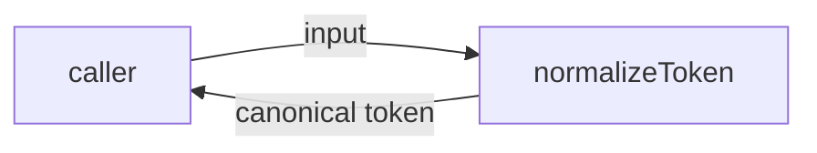
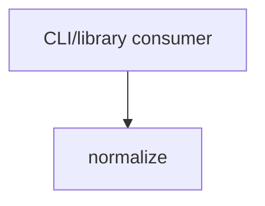

# Module: normalize

<!--SECTION:SPEC_ID-->
TOKEN-PIPELINE-NORMALIZE
<!--/SECTION:SPEC_ID-->

<!--SECTION:MODULE_VISION-->
## Module Vision

This module owns the local, deterministic normalization of one input token into a canonical ASCII token. Its public surface is one pure function, `normalizeToken`, with no state, network access, persistence, or runtime configuration. The parent scope is [token](../../token.spec.md); the scope owns the module boundary and this module owns the normalization behavior. The current scope has no sibling or child modules.
<!--/SECTION:MODULE_VISION-->

<!--SECTION:OVERVIEW-->
## Overview


_Прямой путь нормализации входа в канонический токен — NOR-REQ-1._
<!--/SECTION:OVERVIEW-->

<!--SECTION:MODULE_USAGE_EXAMPLE-->
## Module Usage Example

```ts
import { normalizeToken } from "./normalize";

const token = normalizeToken("  Foo__BAR  ");
console.log(token);

try {
  normalizeToken("");
} catch (error) {
  if (!(error instanceof TypeError)) throw error;
}
```
<!--/SECTION:MODULE_USAGE_EXAMPLE-->

<!--SECTION:MODULE_REQUIREMENTS-->
## Requirements

### NOR-REQ-1 [должен]

**Когда** `normalizeToken` получает непустую ASCII-строку, содержащую хотя бы один символ, отличный от ASCII-пробела, underscore и hyphen, **нормализатор должен** удалить ведущие и замыкающие ASCII-пробелы, привести ASCII-буквы к нижнему регистру и свернуть каждый непрерывный прогон ASCII-пробелов, underscore и hyphen в один hyphen.

> Уточняет TOK-REQ-1: результат всегда является одним каноническим токеном без внешних эффектов.

### NOR-REQ-2 [должен · нештатная]

**Если** входная строка пуста, состоит только из ASCII-пробелов, underscore и hyphen или содержит не-ASCII символ, **то нормализатор должен** выбросить `TypeError` без ввода-вывода.

> Уточняет TOK-REQ-2: недопустимый вход не маскируется пустым или частичным токеном.

| Input | Outcome |
|---|---|
| `"  Foo__BAR  "` | `"foo-bar"` |
| `""` | `TypeError` |
<!--/SECTION:MODULE_REQUIREMENTS-->

<!--SECTION:INTER_MODULE_DEPENDENCIES-->
## Inter-Module Dependencies

- **Depends on:** None within the `token` scope.
- **Scope Reference (cross-scope):** None; the parent scope's authoring-only reference to `infra-base` supplies no runtime interface.
- **Provides to:** None within the `token` scope; local CLI and library consumers use the public function externally.


_Кто использует модуль normalize — NOR-REQ-1._
<!--/SECTION:INTER_MODULE_DEPENDENCIES-->

<!--SECTION:ENTITY_INVENTORY-->
## Entity Inventory

_Это полный список сущностей модуля. Любое введение сущности execution-агентом помимо этого списка считается drift'ом и требует обновления spec._

| Name | Type | Purpose |
|------|------|---------|
| `normalizeToken` | Function | Нормализует один входной токен в канонический ASCII-токен |

Ошибки: throw → `normalizeToken`. The inventory is single-entity, so no ER sketch or relationship diagram applies.
<!--/SECTION:ENTITY_INVENTORY-->

<!--SECTION:ENTITY_SURFACES-->
## Entity Surfaces

The module exposes one stateless function; its complete surface is folded below.

<details>
<summary>Полные поверхности сущностей</summary>

### `normalizeToken`

- **Type:** Function
- **Purpose:** Convert one valid input token into its canonical lowercase hyphenated ASCII form.
- **Public Properties:** N/A
- **Public Operations:** Normalize one textual input token and return the canonical token.
- **Lifecycle:** A consumer calls it for one input; it retains no state and terminates by returning a token or throwing `TypeError`.
- **Events Emitted:** N/A
- **Errors & Degradation:** `TypeError` via throw for empty, separator-only, or non-ASCII input; the caller owns handling and no I/O is attempted.
- **Consumers:**
  - Internal: None; the function is the module's public surface.
  - External: Local CLI and library consumers.
- **Usage Waiver (external: local CLI and library consumers):** The function is the module's single public entry point and exists to provide the named external consumers with deterministic normalization.

</details>
<!--/SECTION:ENTITY_SURFACES-->

<!--SECTION:MODULE_CONTRACTS-->
## Module Contracts

One pure Service function, with no Ports or Adapters; the per-operation contract lives directly on `normalizeToken`.

Граф не рисуется: в модуле нет Port/Adapter, только Service `normalizeToken`.

Call chain не рисуется: в инвентаре одна абстракция — `normalizeToken`; основной сценарий является прямым вызовом.

<details>
<summary>Контракты DbC</summary>

### Services

#### Service: `normalizeToken`

- **Purpose:** Convert one valid input token into its canonical lowercase hyphenated ASCII form.
- **Consumers:** Local CLI and library consumers.
- **Runtime Backing:** `not-implemented`
- **Verification Levels:** `contract`, `unit`
- **Deferred Runtime Scope:** All declared behavior awaits implementation; no runtime claim is made in this authoring artifact.

**Contract (DbC)**

- `normalizeToken`:
  - Pre: The input is a string that is non-empty, contains at least one character other than ASCII space, underscore, and hyphen, and contains only ASCII characters.
  - Post: Leading and trailing ASCII spaces are removed, ASCII letters are lowercased, and each run of ASCII spaces, underscores, and hyphens becomes exactly one hyphen.
  - On pre-violation: Throws `TypeError` for empty input, separator-only input, or any non-ASCII character, without performing I/O.

**Invariants:** The function is deterministic, retains no state between calls, and performs no network, filesystem, or other I/O.

</details>
<!--/SECTION:MODULE_CONTRACTS-->

<!--SECTION:PUBLIC_OPTIONS-->
## Public Options & Policies

None; normalization behavior is fixed and exposes no flags, options, or policies.

<details>
<summary>Опции и политики</summary>

No publicly observable options are defined or deferred for this module.

</details>
<!--/SECTION:PUBLIC_OPTIONS-->

<!--SECTION:FILE_STRUCTURE-->
## File Structure

```
normalize/
├── normalize.ts
└── normalize.test.ts
```

**File Mapping:**
- `normalize.ts`: Public `normalizeToken` function and input validation.
- `normalize.test.ts`: Contract tests for valid normalization and invalid-input rejection.
<!--/SECTION:FILE_STRUCTURE-->

<!--SECTION:RESEARCH-->
## Research

No research documents inform this module; the behavior is fully specified by the parent scope requirements and the two module-owned requirements above.
<!--/SECTION:RESEARCH-->

<!--SECTION:MODULE_DECISION_LOG-->
## Module Decision Log

One module-level decision records the deliberate absence of a Port or Adapter; it remains pending operator review.

<details>
<summary>Полные записи Decision Log</summary>

NOR-DL-1 2026-10-24 — no Port or Adapter for the pure function; где: specs/token/pipeline/normalize/normalize.spec.md#module-contracts (почему: one deterministic implementation with no confirmed variability or test seam; отвергнуто: a Port/Adapter layer that would add structure without a second implementation) [verdict: pending-operator]

</details>
<!--/SECTION:MODULE_DECISION_LOG-->

<!--SECTION:HANDOFF-->
## Handoff to Tasks

- **Implementation files to be created:** `normalize.ts`
- **Test files to be created:** `normalize.test.ts`
- **Stack dependencies:**
  - Language: `typescript` (resolves to `ai/directives/coding/typescript-rules.xml`)
  - Test framework: `node-test` (resolves to `ai/directives/testing/node-test.xml`)
- **Module Rules Additions:** None; the scope-wide baseline applies unchanged.
- **Open risks & validation needs:** No implementation, runtime, or I/O exists yet. Operator approval of this authoring boundary remains pending. Scaffold validation must confirm the ASCII-only character boundary and the `TypeError` behavior with contract tests.
<!--/SECTION:HANDOFF-->

<!--SECTION:IMPLEMENTATION_INSIGHTS-->
## Implementation Insights

Not applicable: no implementation has occurred, so there are no post-implementation learnings to record.

<details>
<summary>Заметки по реализации</summary>

No implementation insights exist at authoring time.

</details>
<!--/SECTION:IMPLEMENTATION_INSIGHTS-->
