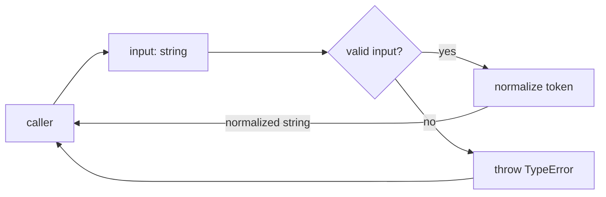
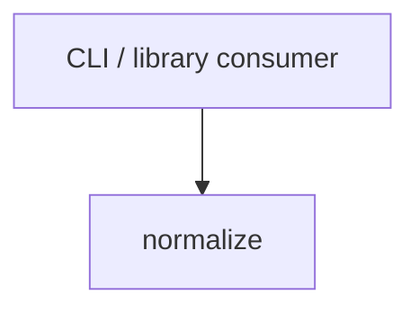

# Module: Normalize

<!--SECTION:SPEC_ID-->
TOKEN-PIPELINE-NORMALIZE
<!--/SECTION:SPEC_ID-->

<!--SECTION:MODULE_VISION-->
## Module Vision

This module owns the normalization of one token inside the `token` scope: trimming ASCII spaces, lowercasing ASCII letters, and collapsing separator runs into one hyphen. It is the only module of the scope and has no child modules. The parent scope is [token](../../token.spec.md).

<!--/SECTION:MODULE_VISION-->

<!--SECTION:OVERVIEW-->
## Overview


_Главный путь нормализации и отказ на недопустимом вводе — NOR-REQ-1, NOR-REQ-2._

<!--/SECTION:OVERVIEW-->

<!--SECTION:MODULE_USAGE_EXAMPLE-->
## Module Usage Example

```ts
import { normalizeToken } from "./normalize.js";

const token = normalizeToken("  Foo__BAR  ");
console.log(token);

try {
  normalizeToken("");
} catch (error) {
  if (error instanceof TypeError) {
    console.error("invalid token");
  }
}
```

<!--/SECTION:MODULE_USAGE_EXAMPLE-->

<!--SECTION:MODULE_REQUIREMENTS-->
## Requirements

### NOR-REQ-1 [должен]
**Когда** передана непустая ASCII-строка, содержащая хотя бы один символ вне набора ASCII-пробел, underscore и hyphen, **нормализатор должен** обрезать ведущие и замыкающие ASCII-пробелы, привести ASCII-буквы к нижнему регистру и свернуть каждый непрерывный набор ASCII-пробелов, underscore и hyphen в один hyphen.

> Уточняет TOK-REQ-1: модуль фиксирует один детерминированный формат токена для локальных CLI- и библиотечных потребителей.

### NOR-REQ-2 [должен · нештатная]
**Если** входная строка пустая, состоит только из разделителей или содержит хотя бы один не-ASCII символ, **то нормализатор должен** выбросить `TypeError` без выполнения ввода-вывода.

> Уточняет TOK-REQ-2: ошибочный вход нельзя маскировать пустым или частично нормализованным токеном.

| Input | Outcome |
|---|---|
| `"  Foo__BAR  "` | `"foo-bar"` |
| `""` | `TypeError` |

<!--/SECTION:MODULE_REQUIREMENTS-->

<!--SECTION:INTER_MODULE_DEPENDENCIES-->
## Inter-Module Dependencies

- **Depends on:** none; this is the only module in the `token` scope.
- **Scope Reference (cross-scope):** none.
- **Provides to:** no sibling modules; the public function serves external CLI and library consumers.


_Единственный входящий край: потребитель вызывает normalize — NOR-REQ-1, NOR-REQ-2._

<!--/SECTION:INTER_MODULE_DEPENDENCIES-->

<!--SECTION:ENTITY_INVENTORY-->
## Entity Inventory

_Это полный список сущностей модуля. Любое введение сущности execution-агентом помимо этого списка считается drift'ом и требует обновления spec._

| Name | Type | Purpose |
|------|------|---------|
| `normalizeToken` | Function | Чистая нормализация токена и отклонение недопустимого ввода |

Ошибки: throw `TypeError` → `normalizeToken`

ER-эскиз не рисуется: в инвентаре одна сущность, связей между сущностями нет.

<!--/SECTION:ENTITY_INVENTORY-->

<!--SECTION:ENTITY_SURFACES-->
## Entity Surfaces

Одна публичная функция с двумя операциями наблюдения: возврат нормализованной строки или throw `TypeError`; состояния и события отсутствуют.

<details>
<summary>Полные поверхности сущностей</summary>

### `normalizeToken`
- **Type:** Function
- **Purpose:** Приводит допустимый ASCII-токен к единому формату и отклоняет недопустимый ввод.
- **Public Properties:** N/A
- **Public Operations:** `normalizeToken(input)` — вернуть нормализованный токен или выбросить `TypeError`.
- **Lifecycle:** Чистая функция без состояния; доступна в течение жизни загрузившего её модуля и не создаёт экземпляров.
- **Events Emitted:** N/A
- **Errors & Degradation:** `TypeError` через throw, владелец — `normalizeToken`; ошибка не логируется и не преобразуется в результат.
- **Consumers:**
  - Internal: none
  - External: CLI and library consumers
- **Usage Waiver (external: CLI and library consumers):** публичная точка входа scope `token`, требуется TOK-REQ-1 и TOK-REQ-2.

</details>

<!--/SECTION:ENTITY_SURFACES-->

<!--SECTION:MODULE_CONTRACTS-->
## Module Contracts

Модуль определяет одну чистую Service-функцию `normalizeToken`; Port и Adapter не вводятся.

Граф не рисуется: в модуле нет Port/Adapter, только Service `normalizeToken`.

Call Chain не рисуется: в инвентаре одна абстракция, последовательности вызовов между абстракциями нет.

<details>
<summary>Контракты DbC</summary>

### Services

#### Service: `normalizeToken`
- **Purpose:** Нормализовать допустимый токен и выбросить `TypeError` для недопустимого входа.
- **Consumers:** external CLI and library consumers
- **Runtime Backing:** `not-implemented`
- **Verification Levels:** `contract` | `unit`
- **Deferred Runtime Scope:** Всё заявленное поведение; реализация и runtime в этой итерации отсутствуют.

**Contract (DbC)**

- `normalizeToken`:
  - Pre: `input` — строка, содержащая только ASCII-символы и хотя бы один символ вне набора ASCII-пробел, underscore и hyphen.
  - Post: возвращает вход без ведущих и замыкающих ASCII-пробелов, с ASCII-буквами в нижнем регистре и с каждым непрерывным набором ASCII-пробелов, underscore и hyphen, заменённым одним hyphen.
  - On pre-violation: выбрасывает `TypeError` и не выполняет ввод-вывод.

**Invariants:** Функция детерминирована и не хранит состояние; один и тот же вход всегда даёт один и тот же результат или ошибку; сеть, файловая система, часы и случайность не используются.

</details>

<!--/SECTION:MODULE_CONTRACTS-->

<!--SECTION:PUBLIC_OPTIONS-->
## Public Options & Policies

Публичных опций нет: политика нормализации фиксирована.

<details>
<summary>Опции и политики</summary>

Публичные флаги, опции и настраиваемые политики в v1 отсутствуют. Никакие опции не отложены: поведение полностью задано TOK-REQ-1 и TOK-REQ-2.

</details>

<!--/SECTION:PUBLIC_OPTIONS-->

<!--SECTION:FILE_STRUCTURE-->
## File Structure

```
pipeline/normalize/
├── normalize.ts
└── normalize.test.ts
```

**File Mapping:**
- `pipeline/normalize/normalize.ts`: pure `normalizeToken` function
- `pipeline/normalize/normalize.test.ts`: contract and edge-case unit tests

<!--/SECTION:FILE_STRUCTURE-->

<!--SECTION:RESEARCH-->
## Research

No research documents are registered for this module. `docs/token-contract.md` is a seeded input contract, not a research document.

<!--/SECTION:RESEARCH-->

<!--SECTION:MODULE_DECISION_LOG-->
## Module Decision Log

Одно модульное решение: чистая функция без Port/Adapter.

<details>
<summary>Полные записи Decision Log</summary>

NOR-DL-1 2026-10-24 — `normalizeToken` реализуется как чистая функция без Port/Adapter (почему: одна детерминированная трансформация без подтверждённой вариативности и без тестового шва; отвергнуто: Port и Adapter — лишняя косвенность без второй реализации; риск: нет)

</details>

<!--/SECTION:MODULE_DECISION_LOG-->

<!--SECTION:HANDOFF-->
## Handoff to Tasks

- **Implementation files to be created:** `pipeline/normalize/normalize.ts`
- **Test files to be created:** `pipeline/normalize/normalize.test.ts`
- **Stack dependencies:**
  - Language: `typescript` (resolves to `ai/directives/coding/typescript-rules.xml`)
  - Test framework: `node-test` (resolves to `ai/directives/testing/node-test.xml`)
- **Module Rules Additions:** None

- **Open risks & validation needs:**
  - Operator review of this module spec is pending; no implementation, ticket, or execution is created.
  - Нормализация ещё не проверена исполняемыми тестами; unit-тесты должны покрыть обе строки Input/Outcome, separator-only и non-ASCII входы.

<!--/SECTION:HANDOFF-->

<!--SECTION:IMPLEMENTATION_INSIGHTS-->
## Implementation Insights

Not applicable: implementation and post-implementation learnings do not exist in this authoring round.

<details>
<summary>Заметки по реализации</summary>

No implementation notes yet; this appendix stays empty until code exists and an audit cycle produces non-trivial learnings.

</details>

<!--/SECTION:IMPLEMENTATION_INSIGHTS-->
