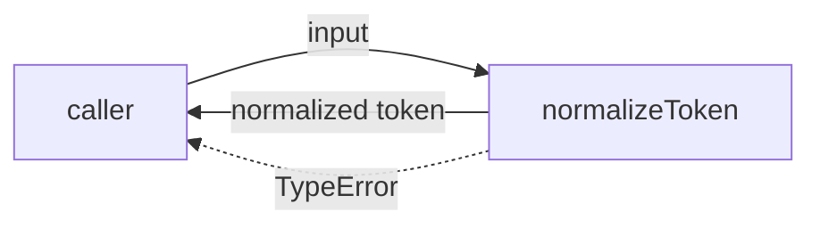
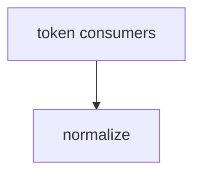

# Module: normalize

<!--SECTION:SPEC_ID-->
TOKEN-PIPELINE-NORMALIZE
<!--/SECTION:SPEC_ID-->

<!--SECTION:MODULE_VISION-->
## Module Vision
Модуль `pipeline/normalize` владеет единственной локальной операцией — детерминированной нормализацией строки в токен для CLI и библиотечных потребителей. Он не выполняет ввод-вывод, не хранит состояние и не зависит от соседних модулей. Ссылка на скоуп: [token](../../token.spec.md). Parent modules: нет; child modules: нет — модуль является листом внутри скоупа `token`.
<!--/SECTION:MODULE_VISION-->

<!--SECTION:OVERVIEW-->
## Overview

_Путь нормализации токена, включая отказ на недопустимом вводе — NOR-REQ-1, NOR-REQ-2._
<!--/SECTION:OVERVIEW-->

<!--SECTION:MODULE_USAGE_EXAMPLE-->
## Module Usage Example
```ts
import { normalizeToken } from "./normalize.js";

const token = normalizeToken("  Foo__BAR  ");
console.log(token);

try {
  normalizeToken("");
} catch (error) {
  console.error(error instanceof TypeError);
}
```
<!--/SECTION:MODULE_USAGE_EXAMPLE-->

<!--SECTION:MODULE_REQUIREMENTS-->
## Requirements
### NOR-REQ-1 [должен]
**Когда** на вход передана строка, содержащая хотя бы один ASCII-символ, отличный от пробела, underscore и hyphen, и не содержащая не-ASCII символов, **модуль нормализации должен** обрезать крайние ASCII-пробелы, привести ASCII-буквы к lower-case и свернуть серии пробелов, underscore и hyphen в один hyphen.

> Уточняет TOK-REQ-1 для границы модуля: фиксирует локальный детерминированный результат и запрещает зависимость от окружения. Без этого потребители получали бы разные формы одного токена.

### NOR-REQ-2 [должен · нештатная]
**Если** входная строка пустая, состоит только из разделителей или содержит не-ASCII символы, **то модуль нормализации должен** выбросить TypeError без выполнения ввода-вывода.

> Уточняет TOK-REQ-2 для границы модуля: ошибка входа принадлежит самой функции `normalizeToken` и не маскируется пустым корректным токеном. Без явного отказа недопустимый ввод выглядел бы как успешная нормализация.

| Input | Outcome |
|---|---|
| `"  Foo__BAR  "` | `"foo-bar"` |
| `""` | `TypeError` |
<!--/SECTION:MODULE_REQUIREMENTS-->

<!--SECTION:INTER_MODULE_DEPENDENCIES-->
## Inter-Module Dependencies
- **Depends on:** None — соседних модулей внутри скоупа нет.
- **Scope Reference (cross-scope):** None — модуль самодостаточен; родительский скоуп: [token](../../token.spec.md).
- **Provides to:** Потребители скоупа `token` (CLI и библиотека); других модулей внутри скоупа нет.


_Модуль нормализации вызывается потребителями токена и не имеет рёбер к соседним модулям._
<!--/SECTION:INTER_MODULE_DEPENDENCIES-->

<!--SECTION:ENTITY_INVENTORY-->
## Entity Inventory

_Это полный список сущностей модуля. Любое введение сущности execution-агентом помимо этого списка считается drift'ом и требует обновления spec._

| Name | Type | Purpose |
|------|------|---------|
| `normalizeToken` | Function | Нормализует строку в детерминированный токен или выбрасывает TypeError |

Ошибки: throw TypeError → `normalizeToken`

ER-скетч не требуется: в инвентаре одна сущность, связей между сущностями нет.
<!--/SECTION:ENTITY_INVENTORY-->

<!--SECTION:ENTITY_SURFACES-->
## Entity Surfaces
Поверхность одна: функция `normalizeToken` с единственной публичной операцией нормализации и отказом на недопустимом вводе.

<details>
<summary>Полные поверхности сущностей</summary>

### `normalizeToken`
- **Type:** Function
- **Purpose:** Преобразует допустимую строку в канонический токен и отклоняет недопустимый ввод.
- **Public Properties:** N/A
- **Public Operations:** нормализовать строку в токен; отклонить пустой, разделительный или не-ASCII ввод
- **Lifecycle:** Создаётся как модульная функция при импорте; вызывается потребителем; не хранит состояния; завершается возвратом строки или выбросом TypeError.
- **Events Emitted:** N/A
- **Errors & Degradation:** `TypeError` механизмом `throw`; владелец — `normalizeToken`; ввод-вывод не выполняется.
- **Consumers:**
  - Internal: `specs/token/pipeline/normalize/normalize.spec.md`
  - External: CLI и библиотечные потребители скоупа `token`
- **Usage Waiver (external: token CLI/library consumers):** Единственная публичная операция модуля, предназначенная внешним потребителям; внутренних вызовов до реализации нет.

</details>
<!--/SECTION:ENTITY_SURFACES-->

<!--SECTION:MODULE_CONTRACTS-->
## Module Contracts
Модуль определяет одну Service-функцию `normalizeToken`; Port и Adapter отсутствуют.

Граф не рисуется: в модуле нет Port/Adapter, только Service `normalizeToken`.

Call Chain не рисуется: в инвентаре одна абстракция (Service `normalizeToken`), порог ≥2 не достигнут.

<details>
<summary>Контракты DbC</summary>

### Services

#### Service: `normalizeToken`
- **Purpose:** Детерминированно нормализовать допустимую строку в токен.
- **Consumers:** внешние CLI и библиотечные потребители скоупа `token`
- **Runtime Backing:** `not-implemented`
- **Verification Levels:** `contract`, `unit`
- **Deferred Runtime Scope:** Вся заявленная реализация отложена; код в этой задаче не создаётся.

**Contract (DbC)** — одна операция:
- `normalizeToken`:
  - Pre: Вход — строка; она содержит хотя бы один ASCII-символ, отличный от пробела, underscore и hyphen, и не содержит не-ASCII символов.
  - Post: Возвращена строка с удалёнными крайними ASCII-пробелами, ASCII-буквами в lower-case и сериями пробелов, underscore и hyphen, свёрнутыми в один hyphen.
  - On pre-violation: Выброшен `TypeError`; ввод-вывод не выполнен.

**Invariants:** Функция детерминирована, не хранит состояния и не выполняет ввод-вывод; одинаковый вход даёт одинаковый токен либо TypeError.

</details>
<!--/SECTION:MODULE_CONTRACTS-->

<!--SECTION:PUBLIC_OPTIONS-->
## Public Options & Policies
Публичных опций и политик в v1 нет — поведение нормализации фиксировано.

<details>
<summary>Опции и политики</summary>

Набор символов-разделителей, правило lower-case и правило отказа заданы требованиями модуля и не настраиваются. Опции не отложены и не будут потребляться в v1.

</details>
<!--/SECTION:PUBLIC_OPTIONS-->

<!--SECTION:FILE_STRUCTURE-->
## File Structure
```
normalize/
└── normalize.ts
```

**File Mapping:**
- `normalize.ts`: функция `normalizeToken` и её контракт
<!--/SECTION:FILE_STRUCTURE-->

<!--SECTION:RESEARCH-->
## Research
Ресёрч не проводился: задача ограничена детерминированным локальным преобразованием, внешние источники не требуются.
<!--/SECTION:RESEARCH-->

<!--SECTION:MODULE_DECISION_LOG-->
## Module Decision Log
Зафиксировано одно решение: чистая функция без Port/Adapter и без состояния.

<details>
<summary>Полные записи Decision Log</summary>

NOR-DL-1 2026-10-24 — выбрана одна чистая Service-функция без Port/Adapter и состояния; где: specs/token/pipeline/normalize/normalize.spec.md#module-contracts (почему: преобразование детерминировано и не имеет подтверждённой вариативности или тестового шва, который оправдал бы абстракцию) [verdict: pending-operator]

</details>
<!--/SECTION:MODULE_DECISION_LOG-->

<!--SECTION:HANDOFF-->
## Handoff to Tasks
- **Implementation files to be created:** `pipeline/normalize/normalize.ts` (запланирован; не создан)
- **Test files to be created:** `pipeline/normalize/normalize.test.ts` (запланирован; не создан)
- **Stack dependencies:**
  - Language: `typescript` (resolves to `ai/directives/coding/typescript-rules.xml`)
  - Test framework: `node-test` (resolves to `ai/directives/testing/node-test.xml`)
- **Module Rules Additions:** None — действует общий baseline скоупа.

- **Open risks & validation needs:** Реализация отсутствует по условию задачи; после одобрения нужны проверки пустого, разделительного и не-ASCII ввода. Операторское одобрение не получено, handoff остаётся pending.
<!--/SECTION:HANDOFF-->

<!--SECTION:IMPLEMENTATION_INSIGHTS-->
## Implementation Insights
Раздел не применим: реализация не выполнялась, пост-имплементационных наблюдений нет.

<details>
<summary>Заметки по реализации</summary>

Раздел не применим, поскольку в этой задаче создаётся только спецификация; библиотечные паттерны, транзакции и особенности fake-runtime отсутствуют.

</details>
<!--/SECTION:IMPLEMENTATION_INSIGHTS-->
