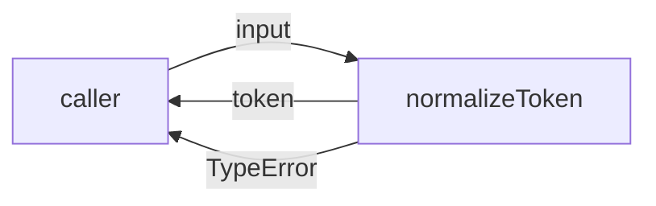
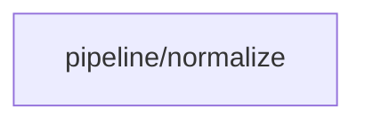

# Module: pipeline/normalize

<!--SECTION:SPEC_ID-->
TOKEN-PIPELINE-NORMALIZE
<!--/SECTION:SPEC_ID-->

<!--SECTION:MODULE_VISION-->
## Module Vision
`pipeline/normalize` owns the deterministic transformation of one ASCII token and the rejection of
invalid input. It exposes no network, persistence, or configuration surface.

Parent scope: [token](../../token.spec.md). No parent module or child modules are declared in this
draft.
<!--/SECTION:MODULE_VISION-->

<!--SECTION:OVERVIEW-->
## Overview


_Нормализация валидного ASCII-токена и отклонение недопустимого входа — NOR-REQ-1, NOR-REQ-2._
<!--/SECTION:OVERVIEW-->

<!--SECTION:MODULE_USAGE_EXAMPLE-->
## Module Usage Example
```ts
import { normalizeToken } from './normalize.js';

const token = normalizeToken('  Foo__BAR  ');
console.log(token);

try {
  normalizeToken('');
} catch (error) {
  console.error(error instanceof TypeError ? 'invalid token' : error);
}
```
<!--/SECTION:MODULE_USAGE_EXAMPLE-->

<!--SECTION:MODULE_REQUIREMENTS-->
## Requirements

### NOR-REQ-1 [должен]
**Когда** на вход передана ASCII-строка, содержащая хотя бы один символ, отличный от пробела,
underscore и hyphen, **нормализатор должен** обрезать крайние ASCII-пробелы, привести ASCII-буквы
к lower-case и свернуть каждую серию ASCII-пробелов, underscore и hyphen в один hyphen.

> Уточняет TOK-REQ-1: модуль фиксирует единственный детерминированный формат токена для CLI и
> библиотечных потребителей.

### NOR-REQ-2 [должен · нештатная]
**Если** вход пуст, состоит только из ASCII-пробелов, underscore и hyphen или содержит не-ASCII
символы, **то нормализатор должен** выбросить TypeError без ввода-вывода.

> Уточняет TOK-REQ-2: ошибочный вход нельзя маскировать пустым или искажённым корректным токеном.

| Input | Outcome |
|---|---|
| `"  Foo__BAR  "` | `"foo-bar"` |
| `""` | `TypeError` |
<!--/SECTION:MODULE_REQUIREMENTS-->

<!--SECTION:INTER_MODULE_DEPENDENCIES-->
## Inter-Module Dependencies
- **Depends on:** None.
- **Scope Reference (cross-scope):** None.
- **Provides to:** None; the module is consumed through the parent scope's public API.


_Модуль не зависит от соседних модулей и не предоставляет им сущностей._
<!--/SECTION:INTER_MODULE_DEPENDENCIES-->

<!--SECTION:ENTITY_INVENTORY-->
## Entity Inventory

_Это полный список сущностей модуля. Любое введение сущности execution-агентом помимо этого списка считается drift'ом и требует обновления spec._

| Name | Type | Purpose |
|------|------|---------|
| `normalizeToken` | Function | Чистая нормализация ASCII-токена и отклонение недопустимого входа |

Ошибки: throw (TypeError) → `normalizeToken`.

ER-эскиз не рисуется: в инвентаре одна сущность без связей.
<!--/SECTION:ENTITY_INVENTORY-->

<!--SECTION:ENTITY_SURFACES-->
## Entity Surfaces
Модуль раскрывает одну функцию `normalizeToken` с публичной операцией нормализации и явной
ошибкой `TypeError` для недопустимого входа.

<details>
<summary>Полные поверхности сущностей</summary>

### `normalizeToken`
- **Type:** Function
- **Purpose:** Преобразует допустимый ASCII-токен в единый lower-case hyphen-формат.
- **Public Properties:** N/A
- **Public Operations:** `normalizeToken(input: string): string` — проверить вход, обрезать
  крайние ASCII-пробелы, привести ASCII-буквы к lower-case и свернуть серии разделителей.
- **Lifecycle:** Stateless; вызывается на каждый вход и завершается возвратом либо исключением.
- **Events Emitted:** N/A
- **Errors & Degradation:** `TypeError` через throw; владелец — `normalizeToken`, ошибка
  возвращается вызывающему без ввода-вывода.
- **Consumers:**
  - Internal: N/A
  - External: local CLI and library consumers
- **Usage Waiver (external: local CLI and library consumers):** единственная публичная функция
  модуля, образующая внешний API скоупа.

</details>
<!--/SECTION:ENTITY_SURFACES-->

<!--SECTION:MODULE_CONTRACTS-->
## Module Contracts
Модуль определяет один Service `normalizeToken`; Port и Adapter отсутствуют.

Граф не рисуется: в модуле нет Port/Adapter, только Service `normalizeToken`.

Call Chain не рисуется: в инвентаре одна абстракция, вызывающая цепочка отсутствует.

<details>
<summary>Контракты DbC</summary>

### Services

#### Service: `normalizeToken`
- **Purpose:** Детерминированно нормализовать допустимый ASCII-токен и отклонить недопустимый вход.
- **Consumers:** local CLI and library consumers.
- **Runtime Backing:** `not-implemented`
- **Verification Levels:** `contract`, `unit`
- **Deferred Runtime Scope:** Всё заявленное поведение; реализация в этой спеке не создаётся.

**Contract (DbC)**
- `normalizeToken(input: string): string`:
  - Pre: `input` — строка, содержащая хотя бы один символ, отличный от ASCII-пробела,
    underscore и hyphen, и не содержащая не-ASCII символов.
  - Post: возвращает строку с удалёнными крайними ASCII-пробелами, ASCII-буквами в lower-case и
    каждой серией ASCII-пробелов, underscore и hyphen, заменённой одним hyphen.
  - On pre-violation: выбрасывает `TypeError` без ввода-вывода.

**Invariants:** функция чистая и детерминированная; не читает и не изменяет внешнее состояние и
не выполняет ввод-вывод.

</details>
<!--/SECTION:MODULE_CONTRACTS-->

<!--SECTION:PUBLIC_OPTIONS-->
## Public Options & Policies
No public options; the transformation is fixed by NOR-REQ-1 and NOR-REQ-2.

<details>
<summary>Опции и политики</summary>

None. No flags, policies, or deferred options are exposed in this module.

</details>
<!--/SECTION:PUBLIC_OPTIONS-->

<!--SECTION:FILE_STRUCTURE-->
## File Structure
```
normalize/
├── normalize.ts
└── normalize.test.ts
```

**File Mapping:**
- `normalize/normalize.ts`: public `normalizeToken` implementation
- `normalize/normalize.test.ts`: contract and unit tests for valid and invalid input
<!--/SECTION:FILE_STRUCTURE-->

<!--SECTION:RESEARCH-->
## Research
No research documents feed this module.
<!--/SECTION:RESEARCH-->

<!--SECTION:MODULE_DECISION_LOG-->
## Module Decision Log
One boundary decision is recorded: a single pure function without a Port or Adapter.

<details>
<summary>Полные записи Decision Log</summary>

NOR-DL-1 2026-10-24 — `normalizeToken` оформлен как единственный Service без Port и Adapter;
где: specs/token/pipeline/normalize/normalize.spec.md#module-contracts (почему: нет подтверждённой
вариативности и test seam; отвергнуто: введение Port/Adapter ради нотации) [verdict:
pending-operator].

</details>
<!--/SECTION:MODULE_DECISION_LOG-->

<!--SECTION:HANDOFF-->
## Handoff to Tasks
- **Implementation files to be created:** `normalize/normalize.ts`
- **Test files to be created:** `normalize/normalize.test.ts`
- **Stack dependencies:**
  - Language: `TypeScript` (resolves to `ai/directives/coding/typescript-rules.xml`)
  - Test framework: `node:test` (resolves to `ai/directives/testing/node-test.xml`)
- **Module Rules Additions:** None.
- **Open risks & validation needs:** Implementation and tests do not exist yet; TypeError
  ownership and the exact separator-collapse boundary must be verified when built. Owner handoff
  remains pending operator approval; no tickets are created.
<!--/SECTION:HANDOFF-->

<!--SECTION:IMPLEMENTATION_INSIGHTS-->
## Implementation Insights
Not applicable: no implementation has occurred, so there are no post-implementation learnings.

<details>
<summary>Заметки по реализации</summary>

None yet.

</details>
<!--/SECTION:IMPLEMENTATION_INSIGHTS-->
