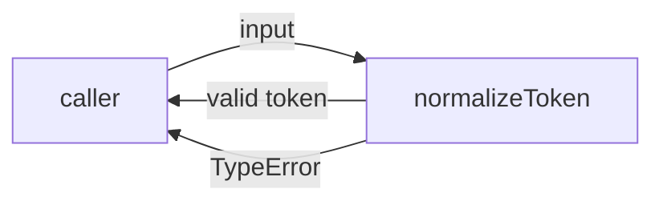
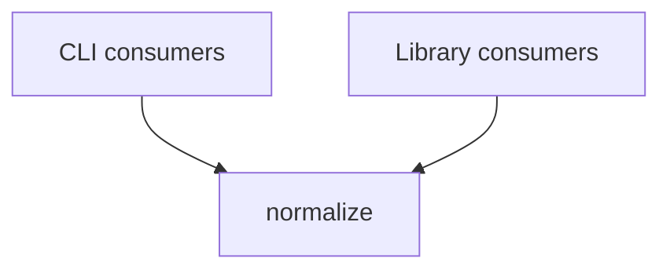

# Module: normalize

<!--SECTION:SPEC_ID-->
TOKEN-PIPELINE-NORMALIZE
<!--/SECTION:SPEC_ID-->

<!--SECTION:MODULE_VISION-->
## Module Vision
This module owns deterministic token normalization inside the [token](../../token.spec.md) scope. It provides the sole public `normalizeToken` operation and has no parent or child module specs of its own.
<!--/SECTION:MODULE_VISION-->

<!--SECTION:OVERVIEW-->
## Overview

_Основной путь нормализации токена._
<!--/SECTION:OVERVIEW-->

<!--SECTION:MODULE_USAGE_EXAMPLE-->
## Module Usage Example
```ts
import { normalizeToken } from "./normalize.js";

const token = normalizeToken("  Foo__BAR  ");
console.log(token);

try {
  normalizeToken("");
} catch (error) {
  if (error instanceof TypeError) {
    console.error("invalid token input");
  }
}
```
<!--/SECTION:MODULE_USAGE_EXAMPLE-->

<!--SECTION:MODULE_REQUIREMENTS-->
## Requirements
No module-specific requirements. Implements parent requirements: TOK-REQ-1, TOK-REQ-2.

| Input | Outcome |
|---|---|
| `"  Foo__BAR  "` | `"foo-bar"` |
| `""` | `TypeError` |
<!--/SECTION:MODULE_REQUIREMENTS-->

<!--SECTION:INTER_MODULE_DEPENDENCIES-->
## Inter-Module Dependencies
- **Depends on:** None; no sibling module exists in the `token` scope.
- **Scope Reference (cross-scope):** None.
- **Provides to:** CLI and library consumers externally; no sibling module inside the `token` scope.


_Внешние потребители единственного модуля normalize; внутренних зависимостей нет._
<!--/SECTION:INTER_MODULE_DEPENDENCIES-->

<!--SECTION:ENTITY_INVENTORY-->
## Entity Inventory
_This is the complete entity list for the module. Any entity introduced by an execution agent outside this list is drift and requires a spec update._

| Name | Type | Purpose |
|------|------|---------|
| `normalizeToken` | Function | Owns deterministic token normalization and rejects invalid input. |

Errors: throw → `normalizeToken`.

ER sketch not applicable: the inventory has one entity and no relational connections.
<!--/SECTION:ENTITY_INVENTORY-->

<!--SECTION:ENTITY_SURFACES-->
## Entity Surfaces
The module exposes one stateless function; all surface detail is folded below.

<details>
<summary>Полные поверхности сущностей</summary>

### `normalizeToken`
- **Type:** Function
- **Purpose:** Normalizes one input token into the canonical lower-case hyphen-separated form.
- **Public Properties:** N/A
- **Public Operations:** Normalize a string input; reject empty, separator-only and non-ASCII input.
- **Lifecycle:** Imported by a consumer, called synchronously, and retains no state between calls.
- **Events Emitted:** N/A
- **Errors & Degradation:** `TypeError` thrown by `normalizeToken` for empty, separator-only and non-ASCII input; the caller owns catching it.
- **Consumers:**
  - Internal: `src/token/pipeline/normalize/normalize.ts`
  - External: CLI and library consumers
- **Usage Waiver (external: CLI and library consumers):** The module's only public entry point; consumers use it directly.

</details>
<!--/SECTION:ENTITY_SURFACES-->

<!--SECTION:MODULE_CONTRACTS-->
## Module Contracts
One stateless Service owns the behavior; the module defines no Port or Adapter.

Граф не рисуется: в модуле нет Port/Adapter, только Service `normalizeToken`.

Call Chain не рисуется: в модуле одна абстракция — Service `normalizeToken`.

<details>
<summary>Контракты DbC</summary>

### Services

#### Service: `normalizeToken`
- **Purpose:** Convert a valid ASCII token into its canonical normalized form.
- **Consumers:** `src/token/pipeline/normalize/normalize.ts`, CLI and library consumers
- **Runtime Backing:** `not-implemented`
- **Verification Levels:** `contract`, `unit`
- **Deferred Runtime Scope:** All behavior is declared but not implemented in this authoring task.

**Contract (DbC)**
- `normalizeToken`:
  - Pre: The input is a string containing at least one ASCII character other than a space, underscore or hyphen.
  - Post: The returned token has leading and trailing ASCII spaces removed, ASCII letters lower-cased, and every run of spaces, underscores and hyphens replaced by one hyphen.
  - On pre-violation: Throws `TypeError` without performing I/O.

**Invariants:** The operation is deterministic, performs no I/O, and returns the same result for the same input.

</details>
<!--/SECTION:MODULE_CONTRACTS-->

<!--SECTION:PUBLIC_OPTIONS-->
## Public Options & Policies
None: the accepted character classes and the rejection behavior are fixed by TOK-REQ-1 and TOK-REQ-2.

<details>
<summary>Опции и политики</summary>

No publicly observable options or policies exist in this module. No option is deferred to a future version.

</details>
<!--/SECTION:PUBLIC_OPTIONS-->

<!--SECTION:FILE_STRUCTURE-->
## File Structure
```
src/token/pipeline/normalize/
├── normalize.ts
└── normalize.test.ts
```

**File Mapping:**
- `src/token/pipeline/normalize/normalize.ts`: `normalizeToken` implementation
- `src/token/pipeline/normalize/normalize.test.ts`: unit tests for valid and rejected inputs
<!--/SECTION:FILE_STRUCTURE-->

<!--SECTION:RESEARCH-->
## Research
No research documents inform this bounded deterministic module.
<!--/SECTION:RESEARCH-->

<!--SECTION:MODULE_DECISION_LOG-->
## Module Decision Log
No module-level decisions are recorded; the module follows the parent scope entry TOK-DL-1.

<details>
<summary>Полные записи Decision Log</summary>

No module-level Decision Log entries exist. The scope-level decision TOK-DL-1 keeps authoring pending and does not claim operator approval.

</details>
<!--/SECTION:MODULE_DECISION_LOG-->

<!--SECTION:HANDOFF-->
## Handoff to Tasks
- **Implementation files to be created:** `src/token/pipeline/normalize/normalize.ts`
- **Test files to be created:** `src/token/pipeline/normalize/normalize.test.ts`
- **Stack dependencies:**
  - Language: `TypeScript` (resolves to `ai/directives/coding/typescript-rules.xml`)
  - Test framework: `node:test` (resolves to `ai/directives/testing/node-test.xml`)
- **Module Rules Additions:** None.
- **Open risks & validation needs:** No implementation exists, so runtime behavior is unverified; accepted input characters and `TypeError` handling still need unit coverage; the module awaits operator approval.
- **Approval status:** pending-operator — no operator approval has been given.
<!--/SECTION:HANDOFF-->

<!--SECTION:IMPLEMENTATION_INSIGHTS-->
## Implementation Insights
Not applicable: no implementation exists yet, so post-implementation learnings cannot be authored.

<details>
<summary>Заметки по реализации</summary>

Not applicable for this authoring-only module specification.

</details>
<!--/SECTION:IMPLEMENTATION_INSIGHTS-->
