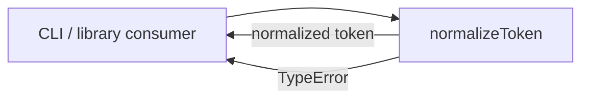
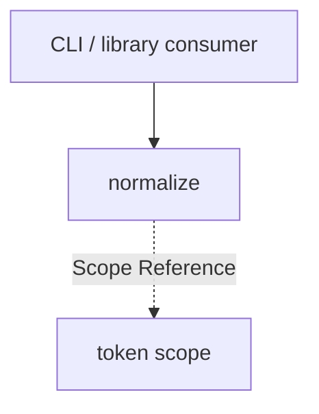

# Module: normalize

<!--SECTION:SPEC_ID-->
TOKEN-PIPELINE-NORMALIZE
<!--/SECTION:SPEC_ID-->

<!--SECTION:MODULE_VISION-->
## Module Vision
Owns the single deterministic token-normalization function of the `token` scope: it turns a valid ASCII input into one canonical token and rejects invalid input without performing I/O. Parent scope: [token](../../token.spec.md). This is a leaf module: it has no parent or child modules inside the scope.
<!--/SECTION:MODULE_VISION-->

<!--SECTION:OVERVIEW-->
## Overview


_Вход либо нормализуется в ASCII-токен, либо завершается TypeError — NOR-REQ-1, NOR-REQ-2._
<!--/SECTION:OVERVIEW-->

<!--SECTION:MODULE_USAGE_EXAMPLE-->
## Module Usage Example

```ts
import { normalizeToken } from "./normalize.js";

const token = normalizeToken("  Foo__BAR  ");
console.log(token);

try {
  normalizeToken("   ");
} catch (error) {
  console.error(error instanceof TypeError ? "invalid token input" : error);
}
```

The snippet needs no initialization, network or adjacent module. The first call is the happy path; the second exercises the minimal error path for separator-only input.
<!--/SECTION:MODULE_USAGE_EXAMPLE-->

<!--SECTION:MODULE_REQUIREMENTS-->
## Requirements

### NOR-REQ-1 [должен]
**Когда** `normalizeToken` получает ASCII-строку, содержащую хотя бы один символ, отличный от ASCII-пробела, underscore и hyphen, **функция должна** удалить крайние ASCII-пробелы, привести ASCII-буквы к нижнему регистру и заменить каждый прогон ASCII-пробелов, underscore или hyphen одним hyphen.

> Уточняет TOK-REQ-1 для единственной операции модуля: один и тот же детерминированный формат токена нужен CLI и библиотечным потребителям.

### NOR-REQ-2 [должен · нештатная]
**Если** вход пуст, состоит только из ASCII-пробелов, underscore или hyphen, либо содержит не-ASCII символ, **то функция должна** выбросить TypeError без ввода-вывода.

> Уточняет TOK-REQ-2 для единственной операции модуля: ошибку входа нельзя маскировать пустым корректным токеном.

| Input | Outcome |
|---|---|
| `"  Foo__BAR  "` | `"foo-bar"` |
| `""` | `TypeError` |
<!--/SECTION:MODULE_REQUIREMENTS-->

<!--SECTION:INTER_MODULE_DEPENDENCIES-->
## Inter-Module Dependencies
- **Depends on:** None.
- **Scope Reference (cross-scope):** None; the module is a member of the [token scope](../../token.spec.md).
- **Provides to:** CLI and library consumers of the `token` scope.


_Внешние потребители вызывают normalize; внутренних зависимостей и дочерних модулей нет._
<!--/SECTION:INTER_MODULE_DEPENDENCIES-->

<!--SECTION:ENTITY_INVENTORY-->
## Entity Inventory

_Это полный список сущностей модуля. Любое введение сущности execution-агентом помимо этого списка считается drift'ом и требует обновления spec._

| Name | Type | Purpose |
|------|------|---------|
| `normalizeToken` | Function | Детерминированно нормализует ASCII-токен или отклоняет некорректный вход |

Ошибки: throw TypeError → `normalizeToken`

ER-скетч не рисуется: в модуле одна сущность, связывать нечего.
<!--/SECTION:ENTITY_INVENTORY-->

<!--SECTION:ENTITY_SURFACES-->
## Entity Surfaces

Одна публичная функция `normalizeToken`; её поверхность совпадает с публичным API модуля.

<details>
<summary>Полные поверхности сущностей</summary>

### `normalizeToken`
- **Type:** Function
- **Purpose:** Преобразует допустимый ASCII-вход в канонический токен и отклоняет некорректный вход.
- **Public Properties:** N/A
- **Public Operations:**
  - нормализовать строку в канонический токен
  - отклонить пустой, разделительный или не-ASCII вход
- **Lifecycle:** Не имеет состояния; создаётся импортом модуля и завершается после возврата значения или выброса ошибки.
- **Events Emitted:** N/A
- **Errors & Degradation:** `TypeError` через throw для некорректного входа; обрабатывает и отображает её вызывающий потребитель.
- **Consumers:**
  - Internal: собственный файл модуля `src/token/pipeline/normalize/normalize.ts`
  - External: local CLI and library consumers
- **Usage Waiver (external: local CLI and library consumers):** Единственная публичная операция модуля и его контракт для внешних потребителей.

</details>
<!--/SECTION:ENTITY_SURFACES-->

<!--SECTION:MODULE_CONTRACTS-->
## Module Contracts

Модуль определяет только Service `normalizeToken`; Ports и Adapters отсутствуют. Граф не рисуется: в модуле нет Port/Adapter, только Service `normalizeToken`. Call Chain не рисуется: в модуле одна абстракция — Service `normalizeToken`.

<details>
<summary>Контракты DbC</summary>

### Services

#### Service: `normalizeToken`
- **Purpose:** Выполняет чистую детерминированную нормализацию ASCII-токена.
- **Consumers:** local CLI and library consumers; `src/token/pipeline/normalize/normalize.ts`
- **Runtime Backing:** `not-implemented`
- **Verification Levels:** `contract`, `unit`
- **Deferred Runtime Scope:** None

**Contract (DbC)**
- `normalizeToken`:
  - Pre: вход — строка, содержащая хотя бы один символ, отличный от ASCII-пробела, underscore и hyphen, и не содержащая не-ASCII символов.
  - Post: крайние ASCII-пробелы удалены, ASCII-буквы приведены к нижнему регистру, каждый прогон ASCII-пробелов, underscore или hyphen заменён одним hyphen.
  - On pre-violation: выбрасывает TypeError без ввода-вывода и без возврата значения.

**Invariants:** операция не выполняет ввод-вывод и не изменяет внешнее состояние.

</details>
<!--/SECTION:MODULE_CONTRACTS-->

<!--SECTION:PUBLIC_OPTIONS-->
## Public Options & Policies

Публичных опций и политик нет: контракт полностью задан функцией `normalizeToken`.

<details>
<summary>Опции и политики</summary>

Не применимо: модуль не читает конфигурацию, флаги, окружение или версии политик.
</details>
<!--/SECTION:PUBLIC_OPTIONS-->

<!--SECTION:FILE_STRUCTURE-->
## File Structure
```
src/token/pipeline/normalize/
├── normalize.ts
└── normalize.test.ts
```

**File Mapping:**
- `src/token/pipeline/normalize/normalize.ts`: чистая функция `normalizeToken`
- `src/token/pipeline/normalize/normalize.test.ts`: контрактные и юнит-тесты нормализации и отказа
<!--/SECTION:FILE_STRUCTURE-->

<!--SECTION:RESEARCH-->
## Research

No research documents for this bounded deterministic draft.
<!--/SECTION:RESEARCH-->

<!--SECTION:MODULE_DECISION_LOG-->
## Module Decision Log

Записано одно решение: отсутствие Port/Adapter у чистой функции.

<details>
<summary>Полные записи Decision Log</summary>

NOR-DL-1 2026-10-24 — не вводить Port/Adapter для чистой функции; где: specs/token/pipeline/normalize/normalize.spec.md#module-contracts (почему: нет вариативности, ввода-вывода и второй реализации) [verdict: pending-operator]

</details>
<!--/SECTION:MODULE_DECISION_LOG-->

<!--SECTION:HANDOFF-->
## Handoff to Tasks
- **Implementation files to be created:** `src/token/pipeline/normalize/normalize.ts`
- **Test files to be created:** `src/token/pipeline/normalize/normalize.test.ts`
- **Stack dependencies:**
  - Language: `typescript` (resolves to `ai/directives/coding/typescript-rules.xml`)
  - Test framework: `vitest` (resolves to `ai/directives/testing/vitest-rules.xml`)
- **Module Rules Additions:** None

  | Rule | Category | Source |
  |------|----------|--------|
  | None | | |

- **Open risks & validation needs:** Operator approval remains pending-operator; no implementation, runtime verification or ticket exists yet.
<!--/SECTION:HANDOFF-->

<!--SECTION:IMPLEMENTATION_INSIGHTS-->
## Implementation Insights

Not applicable: no implementation has occurred, so there are no post-implementation learnings to preserve.

<details>
<summary>Заметки по реализации</summary>

Не применимо: модуль ещё не реализован; раздел остаётся пустым до появления фактических выводов после реализации.
</details>
<!--/SECTION:IMPLEMENTATION_INSIGHTS-->
