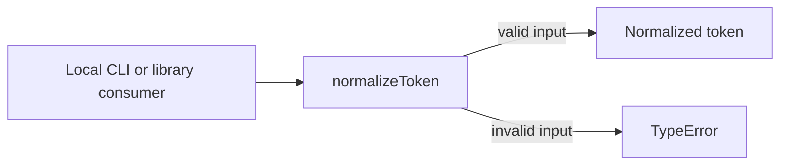
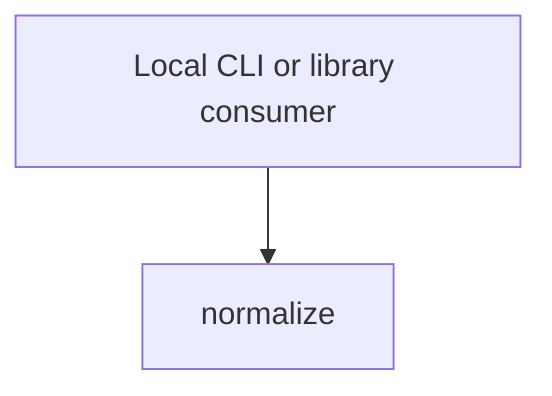

# Module: normalize

<!--SECTION:SPEC_ID-->
TOKEN-PIPELINE-NORMALIZE
<!--/SECTION:SPEC_ID-->

<!--SECTION:MODULE_VISION-->
## Module Vision

This module owns deterministic normalization of a single ASCII token for local CLI and library consumers. It refines the parent scope [token](../../token.spec.md) and introduces no Port or Adapter because the transformation is pure and has no state. No sibling, parent-module or child-module links exist: the parent scope's Module Map currently names only this module.
<!--/SECTION:MODULE_VISION-->

<!--SECTION:OVERVIEW-->
## Overview


_Путь нормализации токена и отказ на недопустимом входе — NOR-REQ-1, NOR-REQ-2._
<!--/SECTION:OVERVIEW-->

<!--SECTION:MODULE_USAGE_EXAMPLE-->
## Module Usage Example

```ts
import { normalizeToken } from "./normalize.js";

const token = normalizeToken("  Foo__BAR  ");
console.log(token); // "foo-bar"

try {
  normalizeToken("");
} catch (error) {
  console.error(error instanceof TypeError); // true
}
```
<!--/SECTION:MODULE_USAGE_EXAMPLE-->

<!--SECTION:MODULE_REQUIREMENTS-->
## Requirements

### NOR-REQ-1 [должен]
**Когда** передана непустая ASCII-строка, содержащая хотя бы один символ, отличный от ASCII-пробела, underscore и hyphen, **нормализатор должен** обрезать крайние ASCII-пробелы, привести ASCII-буквы к нижнему регистру и свернуть серии пробелов, underscore и hyphen в один hyphen.

> Уточняет TOK-REQ-1: один детерминированный формат токена нужен CLI и библиотечным потребителям без скрытых вариантов записи.

### NOR-REQ-2 [должен · нештатная]
**Если** строка пустая, состоит только из ASCII-пробелов, underscore и hyphen или содержит хотя бы один не-ASCII символ, **то нормализатор должен** выбросить TypeError без ввода-вывода.

> Уточняет TOK-REQ-2: ошибочный вход нельзя маскировать пустым или искажённым корректным токеном.

| Input | Outcome |
|---|---|
| `"  Foo__BAR  "` | `"foo-bar"` |
| `""` | `TypeError` |
<!--/SECTION:MODULE_REQUIREMENTS-->

<!--SECTION:INTER_MODULE_DEPENDENCIES-->
## Inter-Module Dependencies

- **Depends on:** None within the `token` scope.
- **Scope Reference (cross-scope):** None — this module exposes a pure local function and has no cross-scope interface; the parent scope's authoring dependency is [infra-base](../../../infra-base/infra-base.spec.md).
- **Provides to:** No sibling modules; local CLI and library consumers outside this scope graph.


_Нормализатор вызывается локальным потребителем; рёбер к модулям скоупа нет._
<!--/SECTION:INTER_MODULE_DEPENDENCIES-->

<!--SECTION:ENTITY_INVENTORY-->
## Entity Inventory

_Это полный список сущностей модуля. Любое введение сущности execution-агентом помимо этого списка считается drift'ом и требует обновления spec._

| Name | Type | Purpose |
|------|------|---------|
| `normalizeToken` | Function | Чистая нормализация одного ASCII-токена |

Ошибки: throw TypeError → `normalizeToken`

Одна сущность — связей для ER-наброска нет.
<!--/SECTION:ENTITY_INVENTORY-->

<!--SECTION:ENTITY_SURFACES-->
## Entity Surfaces

Одна публичная функция; контракт нормализации описан ниже.

<details>
<summary>Полные поверхности сущностей</summary>

### `normalizeToken`
- **Type:** Function
- **Purpose:** Нормализует один ASCII-токен в детерминированную форму.
- **Public Properties:** N/A
- **Public Operations:** normalize the input string into a token.
- **Lifecycle:** Stateless; available on module import, no termination step.
- **Events Emitted:** N/A
- **Errors & Degradation:** `TypeError` via throw for empty, separator-only or non-ASCII input; the caller handles it.
- **Consumers:**
  - Internal: module root `normalize.ts`
  - External: local CLI and library consumers
- **Usage Waiver (external: local CLI and library consumers):** the function is the module's sole public entry point and exists for consumers outside this authoring fixture.

</details>
<!--/SECTION:ENTITY_SURFACES-->

<!--SECTION:MODULE_CONTRACTS-->
## Module Contracts

One pure Function owns the module's behavior; there are no Ports or Adapters.

Dependency graph not drawn: the module defines no Port or Adapter, only the Function `normalizeToken`. Call Chain not drawn: the inventory contains a single abstraction.

<details>
<summary>Контракты DbC</summary>

### Services

#### Service: `normalizeToken`
- **Purpose:** Normalize one ASCII token deterministically.
- **Consumers:** local CLI and library consumers.
- **Runtime Backing:** `not-implemented`
- **Verification Levels:** `contract`, `unit`
- **Deferred Runtime Scope:** None — this authoring task requests no product implementation or runtime claim.

**Contract (DbC)**
- `normalize`:
  - Pre: the input is a string containing only ASCII characters and at least one character other than ASCII space, underscore and hyphen.
  - Post: returns the input with leading and trailing ASCII spaces removed, ASCII letters lowercased, and every run of spaces, underscores and hyphens replaced by one hyphen.
  - On pre-violation: throws `TypeError` without reading or writing external state.

**Invariants:** the operation is pure and deterministic; the same input always produces the same output or the same `TypeError`, with no I/O.

</details>
<!--/SECTION:MODULE_CONTRACTS-->

<!--SECTION:PUBLIC_OPTIONS-->
## Public Options & Policies

No configurable options; the token format is fixed by the requirements.

<details>
<summary>Опции и политики</summary>

None. No flags, options or policies are exposed or deferred.

</details>
<!--/SECTION:PUBLIC_OPTIONS-->

<!--SECTION:FILE_STRUCTURE-->
## File Structure

```text
pipeline/normalize/
├── normalize.ts
└── normalize.test.ts
```

**File Mapping:**
- `pipeline/normalize/normalize.ts`: `normalizeToken` implementation and public export.
- `pipeline/normalize/normalize.test.ts`: contract tests for valid, empty, separator-only and non-ASCII input.
<!--/SECTION:FILE_STRUCTURE-->

<!--SECTION:RESEARCH-->
## Research

No research documents for this bounded deterministic draft; no research row is claimed.
<!--/SECTION:RESEARCH-->

<!--SECTION:MODULE_DECISION_LOG-->
## Module Decision Log

No module-specific decisions; the parent scope [token](../../token.spec.md) already fixes the pure-function architecture.

<details>
<summary>Полные записи Decision Log</summary>

None. This authoring task records no disputed autonomous boundary choice and claims no operator approval.

</details>
<!--/SECTION:MODULE_DECISION_LOG-->

<!--SECTION:HANDOFF-->
## Handoff to Tasks

- **Implementation files to be created:** `pipeline/normalize/normalize.ts`
- **Test files to be created:** `pipeline/normalize/normalize.test.ts`
- **Stack dependencies:**
  - Language: `TypeScript` (resolves to `ai/directives/coding/typescript-rules.xml`)
  - Test framework: `node-test` (resolves to `ai/directives/testing/node-test.xml`)
- **Module Rules Additions:** None

  | Rule | Category | Source |
  |------|----------|--------|
  | None | — | — |

- **Open risks & validation needs:** No implementation or tests exist; contract tests must confirm the `TypeError` path for empty, separator-only and non-ASCII input. Operator approval remains pending.
<!--/SECTION:HANDOFF-->

<!--SECTION:IMPLEMENTATION_INSIGHTS-->
## Implementation Insights

Not applicable: no implementation exists in this authoring task.

<details>
<summary>Заметки по реализации</summary>

None. Post-implementation learnings cannot be recorded before implementation exists.

</details>
<!--/SECTION:IMPLEMENTATION_INSIGHTS-->
