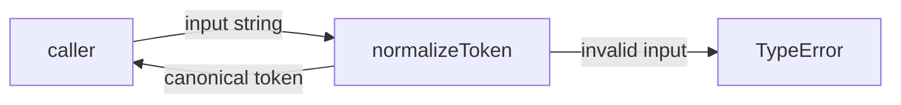
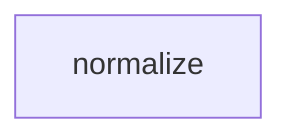

# Module: normalize

<!--SECTION:SPEC_ID-->
TOKEN-PIPELINE-NORMALIZE
<!--/SECTION:SPEC_ID-->

<!--SECTION:MODULE_VISION-->
## Module Vision
The module owns the single deterministic ASCII token transformation in the `token` scope: trim leading and trailing ASCII spaces, lowercase ASCII letters, collapse every run of spaces, underscores, and hyphens into one hyphen, and reject invalid input with `TypeError`. It performs no I/O and owns no persistence or CLI surface. The parent scope is [token](../../token.spec.md#REQUIREMENTS_AND_CONSTRAINTS); the scope's [module map](../../token.spec.md#MODULE_MAP) contains only this leaf module, so there is no parent or child module and no sibling module to coordinate with.
<!--/SECTION:MODULE_VISION-->

<!--SECTION:OVERVIEW-->
## Overview

_Путь нормализации с отдельным отказом для недопустимого входа — NOR-REQ-1, NOR-REQ-2._
<!--/SECTION:OVERVIEW-->

<!--SECTION:MODULE_USAGE_EXAMPLE-->
## Module Usage Example
```ts
import { normalizeToken } from "./normalize.js";

const token = normalizeToken("  Foo__BAR  ");
if (token !== "foo-bar") {
  throw new Error(`unexpected token: ${token}`);
}

try {
  normalizeToken("");
} catch (error) {
  if (!(error instanceof TypeError)) {
    throw error;
  }
}
```
<!--/SECTION:MODULE_USAGE_EXAMPLE-->

<!--SECTION:MODULE_REQUIREMENTS-->
## Requirements
### NOR-REQ-1 [должен]
**Когда** передана непустая ASCII-строка, содержащая хотя бы один символ, отличный от пробела, underscore и hyphen, **нормализатор должен** обрезать крайние ASCII-пробелы, привести ASCII-буквы к нижнему регистру и свернуть каждый прогон пробелов, underscore и hyphen в один hyphen.

> Уточняет TOK-REQ-1 на уровне модуля: CLI и библиотечные потребители получают один канонический токен независимо от регистра и разделителей.

### NOR-REQ-2 [должен · нештатная]
**Если** входная строка пустая, состоит только из разделителей (пробел, underscore, hyphen) или содержит хотя бы один не-ASCII символ, **то нормализатор должен** выбросить `TypeError` без ввода-вывода.

> Уточняет TOK-REQ-2 на уровне модуля: недопустимый вход нельзя маскировать пустым или частично нормализованным токеном.

Сценарии `normalize-example` и `empty-input-rejection`:

| Input | Outcome |
|---|---|
| `"  Foo__BAR  "` | `"foo-bar"` |
| `""` | `TypeError` |
<!--/SECTION:MODULE_REQUIREMENTS-->

<!--SECTION:INTER_MODULE_DEPENDENCIES-->
## Inter-Module Dependencies
- **Depends on:** None; the scope has no sibling module.
- **Scope Reference (cross-scope):** None; the module uses no cross-scope interface.
- **Provides to:** None inside the scope; the parent scope exposes this module to CLI and library consumers.


_Листовой модуль без междомодульных зависимостей и потребителей внутри скоупа._
<!--/SECTION:INTER_MODULE_DEPENDENCIES-->

<!--SECTION:ENTITY_INVENTORY-->
## Entity Inventory
_Это полный список сущностей модуля; введение любой другой сущности считается drift и требует обновления спеки._

| Name | Type | Purpose |
|------|------|---------|
| `normalizeToken` | Function | Pure transformation of one raw token into its canonical form |

Ошибки: throw → `normalizeToken`

Single-entity inventory: no relational sketch applies because there is only one entity.
<!--/SECTION:ENTITY_INVENTORY-->

<!--SECTION:ENTITY_SURFACES-->
## Entity Surfaces
The module exposes one public function, `normalizeToken`; there is no internal or presentation-only entity.

<details>
<summary>Полные поверхности сущностей</summary>

### `normalizeToken`
- **Type:** Function
- **Purpose:** Transform one raw ASCII token into a canonical token or reject invalid input.
- **Public Properties:** N/A
- **Public Operations:** Normalize a raw token and return its canonical form.
- **Lifecycle:** Stateless pure function; created by module import, owns no resources, and terminates after returning or throwing.
- **Events Emitted:** N/A
- **Errors & Degradation:** `TypeError` via throw for empty, separator-only, or non-ASCII input; the caller owns handling; the module performs no I/O.
- **Consumers:**
  - Internal: None; the function is the module's public entry point.
  - External: CLI and library consumers.
- **Usage Waiver (external: CLI and library consumers):** The function is the module's sole public entry point; normalization is intentionally one deterministic transformation.

</details>
<!--/SECTION:ENTITY_SURFACES-->

<!--SECTION:MODULE_CONTRACTS-->
## Module Contracts
The module defines one pure Service, `normalizeToken`; it defines no Port or Adapter because the transformation has no variability or external integration to isolate.

Граф не рисуется: в модуле нет Port/Adapter, только Service `normalizeToken`.
Call Chain не рисуется: в модуле одна абстракция (`normalizeToken`), меньше порога ≥2.

<details>
<summary>Контракты DbC</summary>

### Services

#### Service: `normalizeToken`
- **Purpose:** Return the canonical lowercase token for valid ASCII input and reject invalid input.
- **Consumers:** CLI and library consumers of the `token` scope.
- **Runtime Backing:** `not-implemented`
- **Verification Levels:** `contract`, `unit`
- **Deferred Runtime Scope:** All behavior is declared by this spec; implementation and runtime verification belong to a later scaffold and execute phase.

**Contract (DbC)** — one block per operation:
- `normalizeToken`:
  - Pre: The input is a string containing at least one ASCII character other than a space, underscore, or hyphen, and every character is ASCII.
  - Post: The returned string has no leading or trailing ASCII space, contains lowercase ASCII letters only where the input contained ASCII letters, and every run of spaces, underscores, and hyphens is replaced by exactly one hyphen.
  - On pre-violation: Throws `TypeError` before any I/O or state mutation when the input is empty, contains only separators, or contains at least one non-ASCII character.

**Invariants:** The operation is pure and deterministic: it neither reads nor writes external state, and the same input always yields the same result or the same `TypeError`.

</details>
<!--/SECTION:MODULE_CONTRACTS-->

<!--SECTION:PUBLIC_OPTIONS-->
## Public Options & Policies
None: the module exposes no flags, configuration, environment variables, or policies beyond the fixed `normalizeToken` contract.

<details>
<summary>Опции и политики</summary>

No options are consumed in v1; nothing is deferred.
</details>
<!--/SECTION:PUBLIC_OPTIONS-->

<!--SECTION:FILE_STRUCTURE-->
## File Structure
```
normalize/
├── normalize.ts
└── normalize.test.ts
```

**File Mapping:**
- `normalize/normalize.ts`: Service `normalizeToken`, the only implementation file.
- `normalize/normalize.test.ts`: contract and unit tests for NOR-REQ-1 and NOR-REQ-2.
<!--/SECTION:FILE_STRUCTURE-->

<!--SECTION:RESEARCH-->
## Research
Not applicable: no module-level research document exists or is required for this bounded deterministic transformation, and the parent scope records no research.
<!--/SECTION:RESEARCH-->

<!--SECTION:MODULE_DECISION_LOG-->
## Module Decision Log
One decision records the single pure Service shape and the absence of Port and Adapter.

<details>
<summary>Полные записи Decision Log</summary>

NOR-DL-1 2026-10-24 — normalizeToken is a single pure Service with no Port or Adapter; где: specs/token/pipeline/normalize/normalize.spec.md#MODULE_CONTRACTS (почему: the transformation has no variability or external integration that a Port would isolate; отвергнуто: a Port plus Adapter layer that would add indirection without a second implementation; риск: future variability would require a later contract revision) [verdict: pending-operator].
</details>
<!--/SECTION:MODULE_DECISION_LOG-->

<!--SECTION:HANDOFF-->
## Handoff to Tasks
- **Implementation files to be created:** `normalize/normalize.ts`
- **Test files to be created:** `normalize/normalize.test.ts`
- **Stack dependencies:**
  - Language: `TypeScript` (resolves to `ai/directives/coding/typescript-rules.xml`)
  - Test framework: `node:test` (resolves to `ai/directives/testing/node-test.xml`)
- **Module Rules Additions:** None; the scope-wide baseline rules apply.
- **Open risks & validation needs:** Approval #1 remains pending-operator; no implementation or tests exist, so behavior is unverified. Physical source-root placement is not fixed in this authoring fixture; the File Structure paths are module-local until scaffold decides the repository layout. Non-ASCII rejection must cover the full input string at implementation time.
- **Status:** pending-operator; no tickets, scaffold, or execution were produced.
<!--/SECTION:HANDOFF-->

<!--SECTION:IMPLEMENTATION_INSIGHTS-->
## Implementation Insights
Not applicable: no implementation has occurred, so there are no post-implementation learnings to record.
<!--/SECTION:IMPLEMENTATION_INSIGHTS-->
