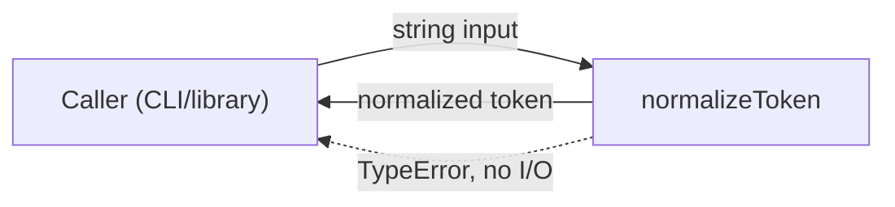
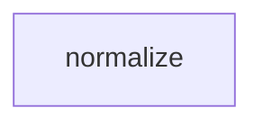

# Module: normalize

<!--SECTION:SPEC_ID-->
TOKEN-PIPELINE-NORMALIZE
<!--/SECTION:SPEC_ID-->

<!--SECTION:MODULE_VISION-->
## Module Vision
This module owns deterministic, local token normalization inside the token scope: one pure function, no I/O, no persistence, and no configuration. Consumers use it to turn a raw ASCII token into a stable lowercase hyphen-separated form.

Parent scope: [token](../../token.spec.md). The current scope is pending decomposition, so this module has no sibling, parent, or child modules.
<!--/SECTION:MODULE_VISION-->

<!--SECTION:OVERVIEW-->
## Overview

_Путь нормализации токена: вход проверяется, нормализуется и возвращается либо выбрасывается TypeError — NOR-REQ-1, NOR-REQ-2._
<!--/SECTION:OVERVIEW-->

<!--SECTION:MODULE_USAGE_EXAMPLE-->
## Module Usage Example
```ts
import { normalizeToken } from "./normalize";

const token = normalizeToken("  Foo__BAR  ");
console.log(token); // "foo-bar"

try {
  normalizeToken("");
} catch (error) {
  if (error instanceof TypeError) {
    console.error("invalid token input");
  }
}
```
<!--/SECTION:MODULE_USAGE_EXAMPLE-->

<!--SECTION:MODULE_REQUIREMENTS-->
## Requirements
### NOR-REQ-1 [должен]
**Когда** передана ASCII-строка, которая содержит хотя бы один символ, отличный от пробела, underscore и hyphen, **нормализатор должен** обрезать крайние пробелы, привести буквы к lower-case и свернуть пробелы, underscore и hyphen в один hyphen.
> Уточняет TOK-REQ-1: один детерминированный формат токена нужен CLI и библиотечным потребителям.

### NOR-REQ-2 [должен · нештатная]
**Если** строка пустая, состоит из разделителей или содержит не-ASCII символы, **то нормализатор должен** выбросить TypeError без ввода-вывода.
> Уточняет TOK-REQ-2: ошибку входа нельзя маскировать пустым корректным токеном.

| Input | Outcome |
|---|---|
| `"  Foo__BAR  "` | `"foo-bar"` |
| `""` | `TypeError` |
<!--/SECTION:MODULE_REQUIREMENTS-->

<!--SECTION:INTER_MODULE_DEPENDENCIES-->
## Inter-Module Dependencies
- **Depends on:** None within this scope.
- **Scope Reference (cross-scope):** [infra-base](../../../infra-base/infra-base.spec.md) — authoring infrastructure only.
- **Provides to:** No sibling module; CLI and library consumers of the token scope call `normalizeToken` directly.


_Соседних модульных зависимостей нет: normalize вызывается напрямую потребителями скоупа._
<!--/SECTION:INTER_MODULE_DEPENDENCIES-->

<!--SECTION:ENTITY_INVENTORY-->
## Entity Inventory
_Это полный список сущностей модуля. Любое введение сущности execution-агентом помимо этого списка считается drift'ом и требует обновления spec._

| Name | Type | Purpose |
|------|------|---------|
| `normalizeToken` | Function | Чистая нормализация токена с проверкой входа |

Ошибки: throw TypeError → normalizeToken.

ER-эскиз не нужен: инвентарь состоит из одной сущности, связывать нечего.
<!--/SECTION:ENTITY_INVENTORY-->

<!--SECTION:ENTITY_SURFACES-->
## Entity Surfaces
One public Function (`normalizeToken`); no Ports, Adapters, stateful Services, or emitted events.

<details>
<summary>Полные поверхности сущностей</summary>

### `normalizeToken`
- **Type:** Function
- **Purpose:** Normalize an ASCII token deterministically and reject invalid input.
- **Public Properties:** N/A
- **Public Operations:** принимает строку и возвращает нормализованный токен; отклоняет недопустимый вход через TypeError.
- **Lifecycle:** Stateless; created per call and terminates on return or throw.
- **Events Emitted:** N/A
- **Errors & Degradation:** `TypeError` via `throw`, owned by `normalizeToken`; no I/O and no fallback value.
- **Consumers:**
  - Internal: none
  - External: CLI and library consumers of the token scope
- **Usage Waiver (external: CLI and library consumers of the token):** Public entry point of the module's single responsibility.

</details>
<!--/SECTION:ENTITY_SURFACES-->

<!--SECTION:MODULE_CONTRACTS-->
## Module Contracts
One pure Function (`normalizeToken`); no Ports or Adapters, so its DbC contract is stated directly on the Service per `DBC_SERVICE_FORMAT`.

Граф не рисуется: в модуле нет Port/Adapter, только Service `normalizeToken`.

Call Chain не рисуется: в инвентаре одна абстракция — `normalizeToken`; сценария с ≥2 участниками нет.

<details>
<summary>Контракты DbC</summary>

### Services

#### Service: `normalizeToken`
- **Purpose:** Transform a valid ASCII token into lowercase hyphen-separated form.
- **Consumers:** CLI and library consumers of the token scope
- **Runtime Backing:** `not-implemented`
- **Verification Levels:** `contract`, `unit`
- **Deferred Runtime Scope:** All declared behavior; no implementation is requested in this authoring task.

**Contract (DbC)**
- `normalizeToken(input)`:
  - Pre: `input` is a string containing at least one ASCII character other than space, underscore, or hyphen, and no non-ASCII characters.
  - Post: returns `input` with leading/trailing ASCII spaces removed, ASCII letters lowercased, and each run of spaces, underscores, or hyphens replaced by one hyphen.
  - On pre-violation: throws `TypeError` without I/O.

**Invariants:** deterministic and pure — the same input yields the same output or the same TypeError; no I/O and no shared state.

</details>
<!--/SECTION:MODULE_CONTRACTS-->

<!--SECTION:PUBLIC_OPTIONS-->
## Public Options & Policies
No public options, flags, or policies; `normalizeToken` takes only its input string.

<details>
<summary>Опции и политики</summary>

Не применимо: публичных опций, флагов или политик нет; `normalizeToken` принимает только входную строку.

</details>
<!--/SECTION:PUBLIC_OPTIONS-->

<!--SECTION:FILE_STRUCTURE-->
## File Structure
```
src/token/pipeline/normalize/
└── normalize.ts
```

**File Mapping:**
- `src/token/pipeline/normalize/normalize.ts`: `normalizeToken` implementation (planned; not created in this authoring task).
<!--/SECTION:FILE_STRUCTURE-->

<!--SECTION:RESEARCH-->
## Research
No research documents; this module is a bounded deterministic transformation with no research inputs.
<!--/SECTION:RESEARCH-->

<!--SECTION:MODULE_DECISION_LOG-->
## Module Decision Log
One decision: implement `normalizeToken` as a single pure function without a Port or Adapter.

<details>
<summary>Полные записи Decision Log</summary>

NOR-DL-1 2026-10-24 — normalizeToken реализован одной чистой функцией без Port/Adapter (почему: одна реализация, нет подтверждённой вариативности или тестового шва).

</details>
<!--/SECTION:MODULE_DECISION_LOG-->

<!--SECTION:HANDOFF-->
## Handoff to Tasks
- **Implementation files to be created:** `src/token/pipeline/normalize/normalize.ts` (planned; none created by this authoring task).
- **Test files to be created:** `src/token/pipeline/normalize/normalize.test.ts` (planned; none created).
- **Stack dependencies:**
  - Language: `TypeScript` (resolves to `ai/directives/coding/typescript-rules.xml`)
  - Test framework: `node:test` (resolves to `ai/directives/testing/node-test.xml`)
- **Module Rules Additions:** None

- **Open risks & validation needs:** Separator-only and non-ASCII rejection need explicit unit coverage; no implementation, tests, or execution were performed in this authoring task. Owner handoff remains `pending-operator`; no approval, ticket creation, or execution claim is made.
<!--/SECTION:HANDOFF-->

<!--SECTION:IMPLEMENTATION_INSIGHTS-->
## Implementation Insights
Not applicable: no implementation exists yet, and post-implementation insights are authored only after code and audit.

<details>
<summary>Заметки по реализации</summary>

Не применимо: модуль ещё не реализован, поэтому наблюдений после реализации нет.

</details>
<!--/SECTION:IMPLEMENTATION_INSIGHTS-->
