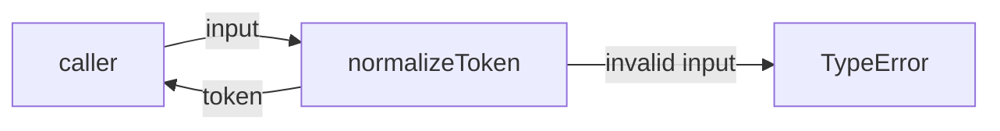
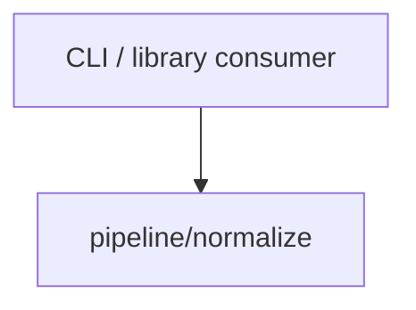

# Module: normalize

<!--SECTION:SPEC_ID-->
TOKEN-PIPELINE-NORMALIZE
<!--/SECTION:SPEC_ID-->

<!--SECTION:MODULE_VISION-->
## Module Vision
Модуль владеет единственной операцией нормализации токена: он превращает допустимую ASCII-строку в канонический lower-case токен и отвергает недопустимый вход. Скоуп: [token](../../../token.spec.md). Соседних, родительских и дочерних модулей у него нет — это единственный модуль карты скоупа.
<!--/SECTION:MODULE_VISION-->

<!--SECTION:OVERVIEW-->
## Overview


_Допустимый вход превращается в токен, недопустимый — отвергается — NOR-REQ-1, NOR-REQ-2._
<!--/SECTION:OVERVIEW-->

<!--SECTION:MODULE_USAGE_EXAMPLE-->
## Module Usage Example
```ts
import { normalizeToken } from "./index.js";

const token = normalizeToken("  Foo__BAR  ");
console.log(token); // "foo-bar"

try {
  normalizeToken("");
} catch (error) {
  console.error(error instanceof TypeError); // true
}
```
<!--/SECTION:MODULE_USAGE_EXAMPLE-->

<!--SECTION:MODULE_REQUIREMENTS-->
## Requirements
### NOR-REQ-1 [должен]
**Когда** передана ASCII-строка, содержащая хотя бы один символ, отличный от ASCII-пробела, underscore и hyphen, **нормализатор должен** обрезать ведущие и замыкающие ASCII-пробелы, привести ASCII-буквы к нижнему регистру и свернуть каждый прогон ASCII-пробелов, underscore и hyphen в один hyphen.

> Уточняет TOK-REQ-1: один детерминированный формат токена нужен CLI и библиотечным потребителям.

### NOR-REQ-2 [должен · нештатная]
**Если** строка пустая, состоит только из ASCII-пробелов, underscore и hyphen или содержит хотя бы один не-ASCII символ, **то нормализатор должен** выбросить TypeError без ввода-вывода.

> Уточняет TOK-REQ-2: ошибку входа нельзя маскировать пустым корректным токеном.

| Input | Outcome |
|---|---|
| `"  Foo__BAR  "` | `"foo-bar"` |
| `""` | `TypeError` |
<!--/SECTION:MODULE_REQUIREMENTS-->

<!--SECTION:INTER_MODULE_DEPENDENCIES-->
## Inter-Module Dependencies
- **Depends on:** нет — у модуля нет соседей внутри скоупа.
- **Scope Reference (cross-scope):** нет — внешние скоупы не вызываются.
- **Provides to:** CLI и библиотечные потребители вне скоупа; других модулей скоупа нет.


_Единственная связь модуля — вызов из CLI и библиотеки._
<!--/SECTION:INTER_MODULE_DEPENDENCIES-->

<!--SECTION:ENTITY_INVENTORY-->
## Entity Inventory
_Это полный список сущностей модуля. Любое введение сущности execution-агентом помимо этого списка считается drift'ом и требует обновления spec._

| Name | Type | Purpose |
|------|------|---------|
| `normalizeToken` | Function | Чистая нормализация одной ASCII-строки в токен |

Ошибки: throw (`TypeError`) → `normalizeToken`

ER-скетч не рисуется: в инвентаре одна сущность, связывать нечего.
<!--/SECTION:ENTITY_INVENTORY-->

<!--SECTION:ENTITY_SURFACES-->
## Entity Surfaces
Поверхность модуля — одна публичная функция `normalizeToken`; полное описание ниже.

<details>
<summary>Полные поверхности сущностей</summary>

### `normalizeToken`
- **Type:** Function
- **Purpose:** Приводит допустимую ASCII-строку к каноническому токену и отвергает недопустимый вход.
- **Public Properties:** N/A
- **Public Operations:** нормализовать строку в токен
- **Lifecycle:** создаётся при загрузке модуля; вызывается без состояния; завершается после возврата значения или TypeError.
- **Events Emitted:** N/A
- **Errors & Degradation:** `TypeError` через throw, обрабатывается вызывающей стороной; модуль не выполняет ввод-вывод.
- **Consumers:**
  - Internal: `normalize/index.ts`
  - External: CLI / библиотечные потребители
- **Usage Waiver (external: CLI / library consumers):** единственная публичная операция модуля; потребитель получает её напрямую.

</details>
<!--/SECTION:ENTITY_SURFACES-->

<!--SECTION:MODULE_CONTRACTS-->
## Module Contracts
Модуль определяет один Service-уровневый Function `normalizeToken`; Port и Adapter не вводятся.

Граф не рисуется: в модуле нет Port/Adapter, только Service `normalizeToken`.

Call Chain не рисуется: абстракций меньше двух — единственный участник `normalizeToken`.

<details>
<summary>Контракты DbC</summary>

### Services

#### Service: `normalizeToken`
- **Purpose:** Детерминированно нормализовать одну ASCII-строку в токен.
- **Consumers:** `normalize/index.ts`; CLI и библиотечные потребители.
- **Runtime Backing:** `not-implemented`
- **Verification Levels:** `contract`, `unit`
- **Deferred Runtime Scope:** None

**Contract (DbC)** — одна операция:
- `normalizeToken`:
  - Pre: вход — строка, содержащая только ASCII-символы, и в ней есть хотя бы один символ, отличный от ASCII-пробела, underscore и hyphen.
  - Post: возвращённая строка не имеет ведущих и замыкающих ASCII-пробелов, ASCII-буквы приведены к нижнему регистру, каждый прогон ASCII-пробелов, underscore и hyphen заменён одним hyphen.
  - On pre-violation: выбрасывается `TypeError` без ввода-вывода.

**Invariants:** функция чистая и детерминированная — один и тот же вход даёт один и тот же результат или TypeError, без обращений к сети, диску и глобальному изменяемому состоянию.

</details>
<!--/SECTION:MODULE_CONTRACTS-->

<!--SECTION:PUBLIC_OPTIONS-->
## Public Options & Policies
Публичных опций нет: поведение `normalizeToken` полностью фиксировано контрактом выше.

<details>
<summary>Опции и политики</summary>

Настраиваемые флаги, режимы и политики отсутствуют; добавлять их в v1 не планируется.

</details>
<!--/SECTION:PUBLIC_OPTIONS-->

<!--SECTION:FILE_STRUCTURE-->
## File Structure
```
normalize/
├── index.ts
└── normalize.ts
```

**File Mapping:**
- `normalize/normalize.ts`: чистая реализация `normalizeToken`
- `normalize/index.ts`: публичный реэкспорт `normalizeToken`
<!--/SECTION:FILE_STRUCTURE-->

<!--SECTION:RESEARCH-->
## Research
Ресёрч-документов нет: правило локальное и детерминированное, внешние источники для него не привлекались.
<!--/SECTION:RESEARCH-->

<!--SECTION:MODULE_DECISION_LOG-->
## Module Decision Log
Зафиксировано одно решение: нормализация реализуется чистой функцией без Port и Adapter.

<details>
<summary>Полные записи Decision Log</summary>

NOR-DL-1 2026-10-24 — `normalizeToken` остаётся чистой функцией без Port и Adapter (почему: одна реализация, нет подтверждённой вариативности и тестового шва; отвергнуто: Port с единственным адаптером; риск: нет) [verdict: pending-operator]

</details>
<!--/SECTION:MODULE_DECISION_LOG-->

<!--SECTION:HANDOFF-->
## Handoff to Tasks
- **Implementation files to be created:** `normalize/normalize.ts`, `normalize/index.ts`
- **Test files to be created:** `normalize/normalize.test.ts`
- **Stack dependencies:**
  - Language: `TypeScript` (resolves to `ai/directives/coding/typescript-rules.xml`)
  - Test framework: `node:test` (resolves to `ai/directives/testing/node-test.xml`)
- **Module Rules Additions:** None.
- **Open risks & validation needs:** Реализация не запрошена и не выполнялась; поведение проверяется будущими задачами. Семантика разделителей и не-ASCII входа остаётся строго в границах NOR-REQ-1 и NOR-REQ-2.
<!--/SECTION:HANDOFF-->

<!--SECTION:IMPLEMENTATION_INSIGHTS-->
## Implementation Insights
Не применимо: реализации ещё нет, appendix заполняется после audit-cycle compaction.

<details>
<summary>Заметки по реализации</summary>

Нет наблюдений: модуль не реализован, post-implementation материал отсутствует.

</details>
<!--/SECTION:IMPLEMENTATION_INSIGHTS-->
