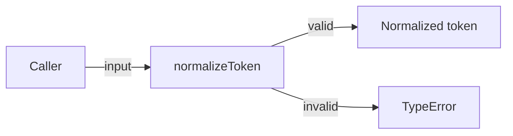
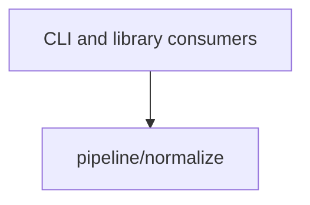

# Module: normalize

<!--SECTION:SPEC_ID-->
TOKEN-PIPELINE-NORMALIZE
<!--/SECTION:SPEC_ID-->

<!--SECTION:MODULE_VISION-->
## Module Vision
Модуль владеет единственной обязанностью — детерминированной нормализацией одного токена для локальных CLI- и библиотечных потребителей. Он реализует требования скоупа [token](../../token.spec.md#REQUIREMENTS_AND_CONSTRAINTS) и не имеет sibling-, parent- или child-модулей в текущей декомпозиции.
<!--/SECTION:MODULE_VISION-->

<!--SECTION:OVERVIEW-->
## Overview


_Путь валидного и невалидного входа — NOR-REQ-1, NOR-REQ-2._
<!--/SECTION:OVERVIEW-->

<!--SECTION:MODULE_USAGE_EXAMPLE-->
## Module Usage Example

```ts
import { normalizeToken } from "./normalize";

const token = normalizeToken("  Foo__BAR  ");
console.log(token);

try {
  normalizeToken("");
} catch (error) {
  if (error instanceof TypeError) {
    console.error(error.message);
  }
}
```
<!--/SECTION:MODULE_USAGE_EXAMPLE-->

<!--SECTION:MODULE_REQUIREMENTS-->
## Requirements
### NOR-REQ-1 [должен]
**Когда** `normalizeToken` получает ASCII-строку, содержащую хотя бы один символ, отличный от пробела, underscore и hyphen, **функция должна** обрезать ведущие и замыкающие ASCII-пробелы, привести ASCII-буквы к нижнему регистру и свернуть каждый непрерывный фрагмент из пробелов, underscore и hyphen в один hyphen. Уточняет TOK-REQ-1.

### NOR-REQ-2 [должен · нештатная]
**Если** вход является пустой строкой, состоит только из разделителей или содержит не-ASCII символ, **то** `normalizeToken` должна выбросить `TypeError` без ввода-вывода. Уточняет TOK-REQ-2.

| Input | Outcome |
|---|---|
| `"  Foo__BAR  "` | `"foo-bar"` |
| `""` | `TypeError` |
<!--/SECTION:MODULE_REQUIREMENTS-->

<!--SECTION:INTER_MODULE_DEPENDENCIES-->
## Inter-Module Dependencies
- **Depends on:** None — внутри скоупа `token` нет sibling-модулей.
- **Scope Reference (cross-scope):** None.
- **Provides to:** CLI- и библиотечные потребители outside this scope; других модулей внутри скоупа нет.


_Зависимостей между модулями скоупа нет; потребители вызывают этот модуль напрямую._
<!--/SECTION:INTER_MODULE_DEPENDENCIES-->

<!--SECTION:ENTITY_INVENTORY-->
## Entity Inventory

_Это полный список сущностей модуля. Любое введение сущности execution-агентом помимо этого списка считается drift'ом и требует обновления spec._

| Name | Type | Purpose |
|------|------|---------|
| `normalizeToken` | Function | Детерминированно нормализует один токен и отклоняет невалидный вход |

Ошибки: throw `TypeError` → `normalizeToken`

ER sketch not applicable: одна сущность, связывать нечего.
<!--/SECTION:ENTITY_INVENTORY-->

<!--SECTION:ENTITY_SURFACES-->
## Entity Surfaces
Поверхность модуля состоит из одной публичной функции `normalizeToken`; ниже — её полное описание.

<details>
<summary>Полные поверхности сущностей</summary>

### `normalizeToken`
- **Type:** Function
- **Purpose:** Возвращает нормализованный токен либо выбрасывает `TypeError` для невалидного входа.
- **Public Properties:** N/A
- **Public Operations:** `normalizeToken(input: string): string`
- **Lifecycle:** Stateless; создаётся как экспорт модуля и вызывается отдельно на каждый вход, без собственного состояния.
- **Events Emitted:** N/A
- **Errors & Degradation:** `TypeError` via throw; вызывающий код отвечает за обработку и отображение ошибки.
- **Consumers:**
  - Internal: `pipeline/normalize/normalize.ts`
  - External: CLI- и библиотечные потребители
- **Usage Waiver (external: CLI and library consumers):** единственная публичная операция модуля, требуется TOK-REQ-1 и TOK-REQ-2.

</details>
<!--/SECTION:ENTITY_SURFACES-->

<!--SECTION:MODULE_CONTRACTS-->
## Module Contracts
Модуль определяет одну чистую функцию `normalizeToken` и не вводит Ports или Adapters.

Граф не рисуется: в модуле нет Port/Adapter, только функция `normalizeToken`.
Call Chain не рисуется: в модуле меньше двух абстракций — одна функция без внутренних участников.

<details>
<summary>Контракты DbC</summary>

### Services

#### Service: `normalizeToken`
- **Purpose:** Детерминированно нормализовать один ASCII-токен или отклонить невалидный вход.
- **Consumers:** CLI- и библиотечные потребители.
- **Runtime Backing:** `not-implemented`
- **Verification Levels:** `contract`, `unit`
- **Deferred Runtime Scope:** Всё заявленное поведение пока не имеет рантайма — реализация не входит в эту authoring-задачу.

**Contract (DbC)**
- `normalizeToken`:
  - Pre: `input` — строка, содержащая хотя бы один ASCII-символ, отличный от пробела, underscore и hyphen; других не-ASCII символов нет.
  - Post: возвращённая строка не имеет ведущих и замыкающих ASCII-пробелов, ASCII-буквы приведены к нижнему регистру, а каждый непрерывный фрагмент из пробелов, underscore и hyphen заменён одним hyphen; ввод-вывод не выполняется.
  - On pre-violation: выбрасывается `TypeError` без ввода-вывода.

**Invariants:** Функция чистая и детерминированная: одинаковый вход даёт одинаковый результат, состояние не сохраняется.
</details>
<!--/SECTION:MODULE_CONTRACTS-->

<!--SECTION:PUBLIC_OPTIONS-->
## Public Options & Policies
Публичных опций и политик в v1 нет.

<details>
<summary>Опции и политики</summary>

None — поведение полностью фиксировано NOR-REQ-1 и NOR-REQ-2; ничего не отложено.
</details>
<!--/SECTION:PUBLIC_OPTIONS-->

<!--SECTION:FILE_STRUCTURE-->
## File Structure
```
normalize/
├── normalize.ts
└── normalize.test.ts
```

**File Mapping:**
- `normalize.ts`: единственная публичная функция `normalizeToken`
- `normalize.test.ts`: unit-тесты для NOR-REQ-1 и NOR-REQ-2
<!--/SECTION:FILE_STRUCTURE-->

<!--SECTION:RESEARCH-->
## Research
Not applicable — для этого ограниченного детерминированного модуля нет research-документов, которые питали бы спеку.
<!--/SECTION:RESEARCH-->

<!--SECTION:MODULE_DECISION_LOG-->
## Module Decision Log
Записано одно решение: отсутствие Port/Adapter и выбор чистой функции.

<details>
<summary>Полные записи Decision Log</summary>

NOR-DL-1 2026-10-24 — не вводить Port/Adapter и реализовать поведение одной чистой функцией `normalizeToken` (почему: одна реализация и подтверждённой вариативности нет; отвергнуто: Port ради тестового шва — избыточен для чистой функции).
NOR-DL-2 2026-10-24 — module draft complete (почему: sdd-check --spec specs/token/pipeline/normalize/normalize.spec.md --authoring прошёл без замечаний)

</details>
<!--/SECTION:MODULE_DECISION_LOG-->

<!--SECTION:HANDOFF-->
## Handoff to Tasks
- **Implementation files to be created:** `normalize.ts`
- **Test files to be created:** `normalize.test.ts`
- **Stack dependencies:**
  - Language: `typescript` (resolves to `ai/directives/coding/typescript-rules.xml`)
  - Test framework: `node-test` (resolves to `ai/directives/testing/node-test.xml`)
- **Module Rules Additions:** None

  | Rule | Category | Source |
  |------|----------|--------|
  | None | — | — |

- **Open risks & validation needs:** реализация и runtime не созданы; поведение не проверено исполнением. Operator approval остаётся pending.
<!--/SECTION:HANDOFF-->

<!--SECTION:IMPLEMENTATION_INSIGHTS-->
## Implementation Insights
Not applicable — реализации ещё нет, post-implementation наблюдений пока не существует.

<details>
<summary>Заметки по реализации</summary>

None. Раздел заполняется только после появления нетривиальных выводов из реализации.
</details>
<!--/SECTION:IMPLEMENTATION_INSIGHTS-->
