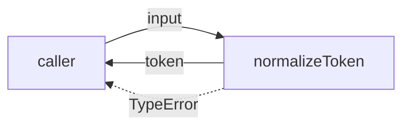
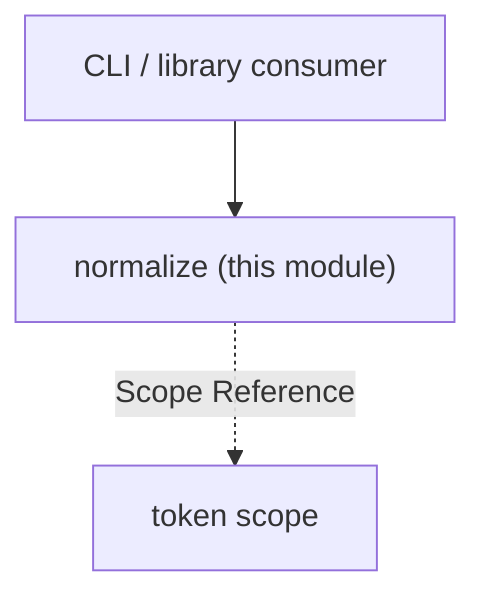

# Module: Normalize

<!--SECTION:SPEC_ID-->
TOKEN-PIPELINE-NORMALIZE
<!--/SECTION:SPEC_ID-->

<!--SECTION:MODULE_VISION-->
## Module Vision
Модуль `normalize` владеет единственной операцией `normalizeToken` — детерминированной нормализацией одного токена для CLI и библиотечных потребителей скоупа [token](../../token.spec.md). Родительских и дочерних модулей нет; соседних модулей в скоупе также нет.

<!--/SECTION:MODULE_VISION-->

<!--SECTION:OVERVIEW-->
## Overview


_Преобразование входа в токен либо отказ TypeError без ввода-вывода — NOR-REQ-1, NOR-REQ-2._

<!--/SECTION:OVERVIEW-->

<!--SECTION:MODULE_USAGE_EXAMPLE-->
## Module Usage Example
```ts
import { normalizeToken } from './normalize.js';

normalizeToken('  Foo__BAR  ');
// 'foo-bar'

try {
  normalizeToken('');
} catch (error) {
  if (!(error instanceof TypeError)) throw error;
  // некорректный вход отклонён без ввода-вывода
}
```

<!--/SECTION:MODULE_USAGE_EXAMPLE-->

<!--SECTION:MODULE_REQUIREMENTS-->
## Requirements
### NOR-REQ-1 [должен]
**Когда** передана ASCII-строка, содержащая хотя бы один символ, отличный от ASCII-пробела, underscore и hyphen, **normalizeToken должен** обрезать крайние ASCII-пробелы, привести ASCII-буквы к нижнему регистру и свернуть серии пробелов, underscore и hyphen в один hyphen.

> Уточняет TOK-REQ-1 для одного модуля: фиксирует единственный детерминированный формат токена и не оставляет выбора разделителя.

### NOR-REQ-2 [должен · нештатная]
**Если** входная строка пустая, состоит только из разделителей или содержит не-ASCII символы, **то normalizeToken должен** выбросить TypeError без ввода-вывода.

> Уточняет TOK-REQ-2: ошибку входа нельзя маскировать пустым или искажённым токеном, а отказ не должен зависеть от файлов, сети или окружения.

| Input | Outcome |
|---|---|
| `"  Foo__BAR  "` | `"foo-bar"` |
| `""` | `TypeError` |

<!--/SECTION:MODULE_REQUIREMENTS-->

<!--SECTION:INTER_MODULE_DEPENDENCIES-->
## Inter-Module Dependencies
- **Depends on:** нет — в скоупе `token` нет соседних модулей.
- **Scope Reference (cross-scope):** [token](../../token.spec.md) — родительский library-скоуп, владеющий TOK-REQ-1 и TOK-REQ-2; это не runtime-зависимость.
- **Provides to:** внешние CLI и библиотечные потребители; ни один модуль скоупа не потребляет этот модуль.


_Модуль не зависит от соседей и опирается только на скоуп token — NOR-REQ-1, NOR-REQ-2._

<!--/SECTION:INTER_MODULE_DEPENDENCIES-->

<!--SECTION:ENTITY_INVENTORY-->
## Entity Inventory

_Это полный список сущностей модуля. Любое введение сущности execution-агентом помимо этого списка считается drift'ом и требует обновления spec._

| Name | Type | Purpose |
|------|------|---------|
| `normalizeToken` | Function | Детерминированная нормализация одного токена |

Ошибки: throw → `normalizeToken`

ER-эскиз не нужен: в инвентаре одна сущность, связывать нечего.

<!--/SECTION:ENTITY_INVENTORY-->

<!--SECTION:ENTITY_SURFACES-->
## Entity Surfaces
Одна публичная функция `normalizeToken`; других сущностей и состояний нет.

<details>
<summary>Полные поверхности сущностей</summary>

### `normalizeToken`
- **Type:** Function
- **Purpose:** Детерминированно преобразует допустимую ASCII-строку в токен либо выбрасывает TypeError.
- **Public Properties:** N/A
- **Public Operations:** нормализовать входную строку в токен
- **Lifecycle:** Not applicable — чистая функция без экземпляра, создаётся импортом модуля и не завершается.
- **Events Emitted:** N/A
- **Errors & Degradation:** `TypeError` через throw при пустом входе, входе только из разделителей или не-ASCII входе; обработка остаётся на вызывающей стороне.
- **Consumers:**
  - Internal: нет
  - External: CLI and library consumers
- **Usage Waiver (external: CLI and library consumers):** это единственная публичная точка входа модуля; внешние потребители вызывают её напрямую, поэтому счётчик использований внутри репозитория неприменим.

</details>

<!--/SECTION:ENTITY_SURFACES-->

<!--SECTION:MODULE_CONTRACTS-->
## Module Contracts
Один чистый Service `normalizeToken`; Port и Adapter не вводятся, потому что вариативности и внешних зависимостей нет.

Граф не рисуется: в модуле нет Port/Adapter, только Service `normalizeToken`.

Цепочка вызовов не рисуется: в инвентаре одна абстракция (`normalizeToken`), порог ≥2 абстракций не достигнут.

<details>
<summary>Контракты DbC</summary>

### Services

#### Service: `normalizeToken`
- **Purpose:** Детерминированно нормализует один допустимый токен и отклоняет некорректный вход.
- **Consumers:** External: CLI and library consumers
- **Runtime Backing:** `not-implemented`
- **Verification Levels:** `contract`, `unit`
- **Deferred Runtime Scope:** Всё объявленное поведение — реализация не создана, артефакт описывает только контракт.

**Contract (DbC)**
- `normalizeToken`:
  - Pre: вход — строка, содержащая хотя бы один ASCII-символ, отличный от ASCII-пробела, underscore и hyphen, и не содержащая не-ASCII символов.
  - Post: возвращает строку без крайних ASCII-пробелов, с ASCII-буквами в нижнем регистре и с сериями ASCII-пробелов, underscore и hyphen, свёрнутыми в один hyphen.
  - On pre-violation: выбрасывает `TypeError` без ввода-вывода.

**Invariants:** Функция чистая и детерминированная: один и тот же вход даёт один и тот же результат или `TypeError`, без сети, файлов и изменения общего состояния.

</details>

<!--/SECTION:MODULE_CONTRACTS-->

<!--SECTION:PUBLIC_OPTIONS-->
## Public Options & Policies
Публичных опций и политик нет.

<details>
<summary>Опции и политики</summary>

Not applicable: у `normalizeToken` нет флагов, конфигурации и политик в v1; поведение полностью задано NOR-REQ-1 и NOR-REQ-2.

</details>

<!--/SECTION:PUBLIC_OPTIONS-->

<!--SECTION:FILE_STRUCTURE-->
## File Structure
```
src/token/pipeline/normalize/
└── normalize.ts
```

**File Mapping:**
- `src/token/pipeline/normalize/normalize.ts`: чистая функция `normalizeToken`

Каталогов `ports/` и `adapters/` нет: модуль не вводит Port/Adapter.

<!--/SECTION:FILE_STRUCTURE-->

<!--SECTION:RESEARCH-->
## Research
Not applicable: для этого ограниченного детерминированного модуля нет research-документов.

<!--/SECTION:RESEARCH-->

<!--SECTION:MODULE_DECISION_LOG-->
## Module Decision Log
Зафиксировано одно решение: модуль остаётся чистой функцией без Port/Adapter.

<details>
<summary>Полные записи Decision Log</summary>

NOR-DL-1 2026-10-24 — `normalizeToken` остаётся чистой функцией без Port/Adapter (почему: детерминированное преобразование без состояния и внешних зависимостей; отвергнуто: Port ради тестового шва — подтверждённой вариативности нет)

</details>

<!--/SECTION:MODULE_DECISION_LOG-->

<!--SECTION:HANDOFF-->
## Handoff to Tasks
- **Implementation files to be created:** `src/token/pipeline/normalize/normalize.ts`
- **Test files to be created:** `test/token/pipeline/normalize/normalize.test.ts`
- **Stack dependencies:**
  - Language: `TypeScript` (resolves to `ai/directives/coding/typescript-rules.xml`)
  - Test framework: `node:test` (resolves to `ai/directives/testing/node-test.xml`)
- **Module Rules Additions:** None.
- **Approval:** pending-operator — артефакт создан только для authoring; операторского одобрения и разрешения на реализацию нет.
- **Open risks & validation needs:** Реализация не создана и не авторизована. Проверка ASCII отклоняет любой code point выше U+007F; поведение для цифр и пунктуации наследуется из TOK-REQ-1 и здесь дополнительно не сужается.

<!--/SECTION:HANDOFF-->

<!--SECTION:IMPLEMENTATION_INSIGHTS-->
## Implementation Insights
Not applicable: артефакт создаётся до реализации, поэтому пост-имплементационных наблюдений ещё нет.

<!--/SECTION:IMPLEMENTATION_INSIGHTS-->
