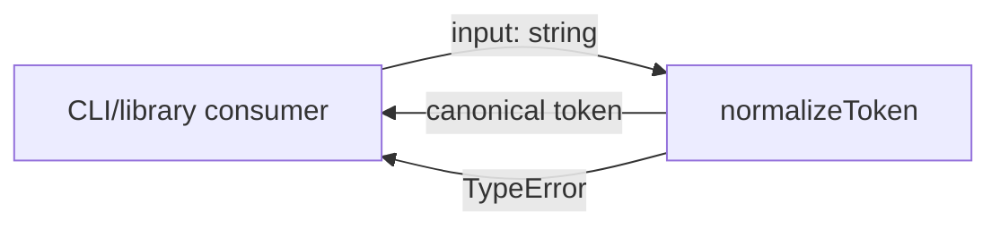
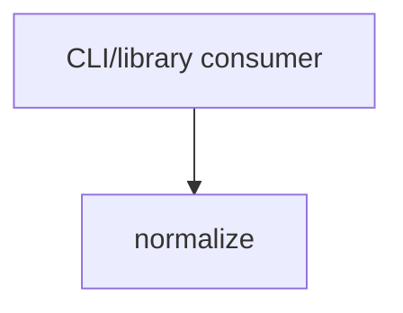

# Module: normalize

<!--SECTION:SPEC_ID-->
TOKEN-NORMALIZE
<!--/SECTION:SPEC_ID-->

<!--SECTION:MODULE_VISION-->
## Module Vision
Модуль `normalize` владеет единственной ответственностью скоупа [token](../token.spec.md): детерминированно приводит входную строку к каноническому токену и отклоняет недопустимый вход. Модульный акроним требований — `NOR`. Parent-модулей, sibling-модулей и child-модулей в текущем скоупе нет.
<!--/SECTION:MODULE_VISION-->

<!--SECTION:OVERVIEW-->
## Overview

_Нормализация строки в один токен или локальный TypeError — NOR-REQ-1, NOR-REQ-2._
<!--/SECTION:OVERVIEW-->

<!--SECTION:MODULE_USAGE_EXAMPLE-->
## Module Usage Example
```ts
import { normalizeToken } from "./src/token/normalize.js";

const token = normalizeToken("  Foo__BAR  ");
console.log(token);

try {
  normalizeToken("");
} catch (error) {
  if (!(error instanceof TypeError)) throw error;
  console.log("invalid input rejected");
}
```
<!--/SECTION:MODULE_USAGE_EXAMPLE-->

<!--SECTION:MODULE_REQUIREMENTS-->
## Requirements
### NOR-REQ-1 [должен]
**Когда** на вход передана ASCII-строка, содержащая хотя бы один символ, отличный от пробела, underscore и hyphen, и не содержащая не-ASCII символов, **нормализатор должен** обрезать крайние ASCII-пробелы, привести ASCII-буквы к нижнему регистру и свернуть серии пробелов, underscore и hyphen в один hyphen.

> Уточняет TOK-REQ-1 на уровне модуля: фиксирует один детерминированный локальный формат токена для CLI и библиотечных потребителей.

### NOR-REQ-2 [должен · нештатная]
**Если** входная строка пустая, состоит только из ASCII-пробелов, underscore и hyphen или содержит не-ASCII символ, **то нормализатор должен** выбросить TypeError без ввода-вывода.

> Уточняет TOK-REQ-2: недопустимый вход не маскируется пустым или частичным токеном, а ошибка остаётся локальной.

Проверочные сценарии:
- `normalize-example` — нормализация ASCII-токена.
- `empty-input-rejection` — отклонение пустого входа.

| Input | Outcome |
|---|---|
| `"  Foo__BAR  "` | `"foo-bar"` |
| `""` | `TypeError` |
<!--/SECTION:MODULE_REQUIREMENTS-->

<!--SECTION:INTER_MODULE_DEPENDENCIES-->
## Inter-Module Dependencies
- **Depends on:** нет sibling-модулей в скоупе `token`.
- **Scope Reference (cross-scope):** нет; модуль не использует интерфейсы других скоупов.
- **Provides to:** нет sibling-модулей; публичная функция доступна CLI и библиотечным потребителям.


_Направление зависимости: внешний потребитель вызывает normalize; sibling-зависимостей нет._
<!--/SECTION:INTER_MODULE_DEPENDENCIES-->

<!--SECTION:ENTITY_INVENTORY-->
## Entity Inventory
_Это полный список сущностей модуля. Любое введение сущности execution-агентом помимо этого списка считается drift'ом и требует обновления spec._

| Name | Type | Purpose |
|------|------|---------|
| `normalizeToken` | Function | Нормализует ASCII-токен и владеет ошибкой недопустимого входа. |

Ошибки: throw → `normalizeToken`

ER-эскиз не строится: в инвентаре одна сущность, связывать нечего.
<!--/SECTION:ENTITY_INVENTORY-->

<!--SECTION:ENTITY_SURFACES-->
## Entity Surfaces
Модуль предоставляет одну публичную функцию без состояния, свойств и событий.

<details>
<summary>Полные поверхности сущностей</summary>

### `normalizeToken`
- **Type:** Function
- **Purpose:** Детерминированно преобразует допустимую ASCII-строку в канонический токен.
- **Public Properties:** N/A
- **Public Operations:** нормализация входной строки в токен; отклонение недопустимого входа.
- **Lifecycle:** Вызывается потребителем при каждом преобразовании; собственного состояния нет, жизнь ограничена вызовом.
- **Events Emitted:** N/A
- **Errors & Degradation:** `TypeError` через throw; владелец — `normalizeToken`, потребитель получает ошибку без ввода-вывода.
- **Consumers:**
  - Internal: нет внутренних потребителей в текущем скоупе.
  - External: CLI и библиотечные потребители.
- **Usage Waiver (external: CLI/library consumers):** Единственная публичная точка входа модуля; существует ради внешнего потребителя.

</details>
<!--/SECTION:ENTITY_SURFACES-->

<!--SECTION:MODULE_CONTRACTS-->
## Module Contracts
Модуль определяет один Service `normalizeToken`; Ports и Adapters отсутствуют.

Граф зависимостей не рисуется: в модуле нет Port/Adapter, только Service `normalizeToken`.

Call Chain не рисуется: в инвентаре одна абстракция — Service `normalizeToken`, сценарий линейный.

<details>
<summary>Контракты DbC</summary>

### Services

#### Service: `normalizeToken`
- **Purpose:** Приводит допустимую ASCII-строку к каноническому токену и отклоняет недопустимый вход.
- **Consumers:** external: CLI и библиотечные потребители; internal: нет.
- **Runtime Backing:** `not-implemented`
- **Verification Levels:** `contract`, `unit`
- **Deferred Runtime Scope:** вся заявленная логика нормализации — реализация не запрошена.

**Contract (DbC)**
- `normalizeToken`:
  - Pre: вход — строка, содержащая хотя бы один ASCII-символ, отличный от пробела, underscore и hyphen, и не содержащая не-ASCII символов.
  - Post: возвращает строку с обрезанными крайними ASCII-пробелами, ASCII-буквами в нижнем регистре и одиночными hyphen вместо серий разделителей.
  - On pre-violation: выбрасывает `TypeError` без ввода-вывода.

**Invariants:** Результат вычисляется локально; функция не читает и не изменяет внешнее состояние.
</details>
<!--/SECTION:MODULE_CONTRACTS-->

<!--SECTION:PUBLIC_OPTIONS-->
## Public Options & Policies
Публичных опций нет: API состоит из одной функции без флагов и политик.

<details>
<summary>Опции и политики</summary>

Публично наблюдаемые флаги, опции и политики отсутствуют; поведение полностью задано контрактом `normalizeToken`.
</details>
<!--/SECTION:PUBLIC_OPTIONS-->

<!--SECTION:FILE_STRUCTURE-->
## File Structure
```
src/token/
├── normalize.ts
└── normalize.test.ts
```

**File Mapping:**
- `src/token/normalize.ts`: единственная реализация `normalizeToken`.
- `src/token/normalize.test.ts`: unit-тесты NOR-REQ-1 и NOR-REQ-2.
<!--/SECTION:FILE_STRUCTURE-->

<!--SECTION:RESEARCH-->
## Research
Ресёрч не проводился: поведение полностью задано TOK-REQ-1 и TOK-REQ-2, внешних источников или исследований не требуется.
<!--/SECTION:RESEARCH-->

<!--SECTION:MODULE_DECISION_LOG-->
## Module Decision Log
Записано одно решение: для чистой функции не вводится Port/Adapter.

<details>
<summary>Полные записи Decision Log</summary>

NOR-DL-1 2026-10-23 — не вводится Port/Adapter для `normalizeToken`; где: specs/token/normalize/normalize.spec.md#module-contracts (почему: одна чистая функция без подтверждённой вариативности; отвергнуто: Port ради тестового шва — избыточен для pure function) [verdict: pending-operator]
</details>
<!--/SECTION:MODULE_DECISION_LOG-->

<!--SECTION:HANDOFF-->
## Handoff to Tasks
- **Implementation files to be created:** `src/token/normalize.ts`
- **Test files to be created:** `src/token/normalize.test.ts`
- **Stack dependencies:**
  - Language: `typescript` (resolves to `ai/directives/coding/typescript-rules.xml`)
  - Test framework: `node-test` (resolves to `ai/directives/testing/node-test.xml`)
- **Module Rules Additions:** None — scope-wide baseline suffices.
- **Open risks & validation needs:** Операторское одобрение не выдано; реализация не начата; граничные случаи separator-only и не-ASCII требуют тестового подтверждения.
<!--/SECTION:HANDOFF-->

<!--SECTION:IMPLEMENTATION_INSIGHTS-->
## Implementation Insights
Не применимо: реализация не запрашивалась, поэтому пост-имплементационных наблюдений нет.

<details>
<summary>Заметки по реализации</summary>

Раздел остаётся пустым до появления реализации; заполняется только после аудита и сжатия цикла.
</details>
<!--/SECTION:IMPLEMENTATION_INSIGHTS-->
